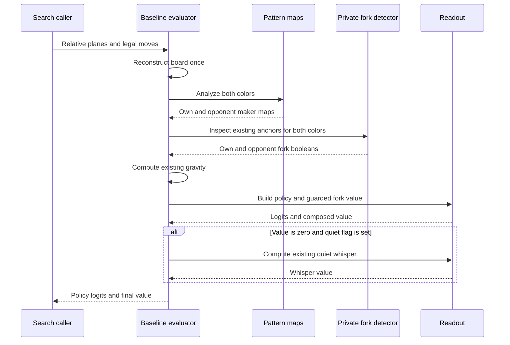
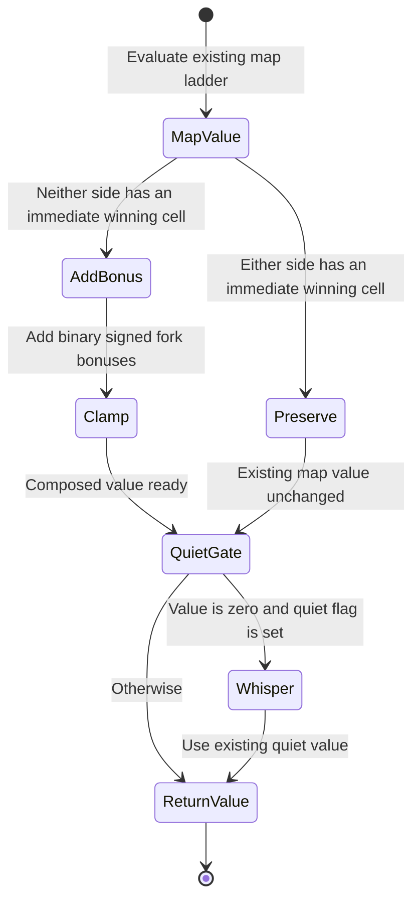

# Baseline fork bonuses — policy and value

## Abstract

The baseline evaluator gives distinct policy weight to preventing an
opponent fork and adds value for an already formed fork. These are separate
signals: one concerns a candidate move, the other existing stones. This paper
describes the baseline-only implementation, its geometric detector, compatibility
rules and verification scope. It is for readers following the evaluator code
and reviewers checking its behavior.

**Status (2026-11-07): IMPLEMENTED, owner-authorized and uncommitted on `main`.**
Independent implementation review approved the functional Rust changes.
Full-workspace quality assurance (QA): **608 passed / 0 failed / 7 ignored**,
plus **3 passing doc tests**; clippy and formatting checks green. The release
CLI was rebuilt successfully. The weights remain provisional experiments;
these correctness checks establish neither playing strength nor timing
improvements. There are no architecture changes.

## Glossary

- **Own / opponent:** the side to move / the other color.
- **Policy logit:** an unnormalized preference for one legal candidate move.
- **Maker map:** a grid describing what placing a stone at an empty cell creates.
- **Three-maker:** a candidate creating an open three in a direction, represented
  by `threes_per_dir`.
- **Gravity:** the existing proximity preference from nearby stones of either
  color, normalized to [0, 1].
- **Double-threat maker:** a candidate leaving at least two distinct immediate
  winning cells; this is the existing `double_threats` map membership.
- **Potential fork:** a candidate creating threes in multiple directions,
  represented by the existing `double_threes` maker map.
- **Anchor:** an occupied stone shared by the qualifying directions of a fork.
- **Established fork:** qualifying open-four-capable threes in at least two
  distinct directions through the same anchor, as defined below.
- **Open-four-capable three:** three own stones and one empty interior cell
  between two empty endpoints in a six-cell in-board window. Filling the
  interior gap creates four consecutive own stones with empty endpoints.
- **Map value:** the existing scalar heuristic computed from both maker maps.
- **Quiet whisper:** the existing small gravity-based value used when the
  preceding value is exactly zero and its existing enable flag is set.
- **Binary membership:** presence contributes once, regardless of multiplicity.

## How one evaluation connects the signals

`BaselineEvaluator::evaluate` reconstructs the board once from the search
request and obtains threat maps for both colors. These maps describe candidate
moves, so `readout::policy_logits` can use them directly: it combines gravity
with binary threat memberships, giving an opponent potential fork its own
defensive weight instead of ordinary three-maker defense.

Already formed forks require a different input. Maker maps mask occupied cells,
so `forks::has_open_three_fork` inspects existing stones on that same board for
two qualifying three directions sharing an occupied anchor. The evaluator
orders these two color-specific booleans, like the maps, by the side to move.
`readout::value_with_forks` then starts with the unchanged public map-only value
and adds the signed formed-fork bonus only when neither side has an immediate
winning cell. The result is clamped; only an exactly zero result can reach the
existing optional quiet whisper. Thus candidate preference and formed geometry
remain separate heuristics, without a new search or proof mechanism. The
[implementation artifacts below](#artifacts-and-revision-context) connect each
function to its source.

## Artifacts and revision context

The revision is implemented in the working tree on `main`, based at `a64420f`.
The learner's current source on `main`, not tutorial solutions, is the
implementation reference. The relevant artifacts are:

| Artifact | Current responsibility |
| --- | --- |
| [baseline/src/readout.rs](../../gomoku/crates/baseline/src/readout.rs) | Revised policy weights, exclusive defensive memberships, unchanged public map value and crate-visible `value_with_forks`. |
| [baseline/src/lib.rs](../../gomoku/crates/baseline/src/lib.rs) | Declares the private fork module; `BaselineEvaluator::evaluate` passes side-to-move-ordered flags to `value_with_forks`. |
| [baseline/src/forks.rs](../../gomoku/crates/baseline/src/forks.rs) | Private geometric detector and focused unit tests; `has_open_three_fork` is `pub(super)`, with no public module or engine API. |
| [baseline/src/adapter.rs](../../gomoku/crates/baseline/src/adapter.rs) | Reconstructs an absolute-color board from relative planes; unchanged. |
| [baseline/src/gravity.rs](../../gomoku/crates/baseline/src/gravity.rs) | Existing normalized gravity in [0, 1]; unchanged. |
| [patterns/src/net.rs](../../gomoku/crates/patterns/src/net.rs) | Existing `ThreatMaps` and `analyze_both`; unchanged. |
| [baseline/tests/acceptance.rs](../../gomoku/crates/baseline/tests/acceptance.rs) | Existing tactical, legal-game and ignored measurement checks; unchanged. |
| [player/src/lib.rs](../../gomoku/crates/player/src/lib.rs) | Current unified chapter-08 player orchestration; unchanged. |

[WARM-UP](../WARM-UP.md) records the unified chapter-08 player on `main`.
The player owns bounded own-side proof search and the opponent-refutation guard;
the evaluator does not own either mechanism. The retired chapter-08b design is
history, not authority. The learner's current source is the implementation
reference; tutorial solutions do not determine this change.

**Before this revision, at `a64420f`,** `evaluate` reconstructed a board,
analyzed both colors, selected own and opponent maps by `board.to_move()`,
computed gravity, then read policy and map value. The historical policy weights
were **64/32/16/8/4/2** plus gravity. That historical defensive tier combined
opponent potential forks and ordinary three-makers at weight 2. These are not
the current weights; the approved, implemented table below supersedes them.

The map value, unchanged by this revision, first returns +0.95 for any own
immediate win, then −0.99 for at least two opponent winning cells. Otherwise it
accumulates −0.75 for one opponent winning cell, ±0.85 for double-threat-maker
presence and ±0.20 for potential-fork presence, then clamps to [−0.99, +0.99].
The quiet whisper remains subject to the zero-value gate after composition.
These details are source behavior, not a new ladder.

## Intention, use case and boundary

A candidate preventing an opponent potential fork should receive more preference
than an ordinary defensive three-maker. After a move forms intersecting threes,
value should retain an explicit signal for the structure already on the board,
not rely exclusively on future maker cells.

These cases require different inputs. Policy can use existing maker maps.
Established-fork value needs occupied anchors, which those maps deliberately
zero. Raw `fours_created_per_dir` is also unsuitable: it describes candidate
moves and can count the same completing cell more than once.

The scope is policy readout, a private baseline detector, value composition and
focused tests. It deliberately supersedes the original locked weights in the
[baseline design, §4.3](2026-10-13-baseline-player-design.md#43-the-tier-table)
with owner approval. This is not a Monte Carlo tree search (MCTS) algorithm change.

Non-goals are engine public APIs, pattern kernels or map semantics, player or
MCTS changes, proof search, a shallow verifier, counterattack checks, new
configuration switches or feature flags, unrelated tactical corrections, and
changes to the existing quiet-whisper condition. No fork opt-out is needed.

## Policy: strengthen and separate the defensive fork signal

The readout still sums binary memberships at each supplied legal move and
returns negative infinity everywhere else. The approved, implemented current
weights are:

| Membership | Contribution |
| --- | ---: |
| Own immediate-winning candidate | 128 |
| Opponent immediate-winning candidate, hence a block | 64 |
| Own double-threat maker | 32 |
| Own potential fork | 16 |
| Opponent potential fork, hence defensive fork | 8 |
| Any own three-maker direction | 4 |
| Any opponent three-maker direction, only without opponent potential fork | 2 |
| Existing normalized gravity | 0 to 1 |

An own potential fork still also receives the own-three contribution: 16 + 4
before other memberships and gravity. The defensive branch is different:
opponent potential-fork membership contributes 8 **instead of**, never alongside,
the ordinary defensive 2. Own and defensive memberships may still coexist.
Opposite-side double-threat makers remain absent from policy, as today.

Existing public policy constant names retain their roles;
`T4_DEFENSIVE_FORK` names the new weight 8. The ordinary defensive constant
`T4C_DEFENSIVE` continues to mean 2. Neither pattern multiplicity nor direction
count multiplies a tier. Conservative lower-tier bounds are 16 + 8 + 4 + 1 = 29 below 32,
32 + 29 = 61 below 64, and 64 + 61 = 125 below 128. Defensive exclusivity makes
these bounds valid even when all allowed lower memberships coexist.

## Established-fork geometry

The private `forks` module exposes
`pub(super) fn has_open_three_fork(&Board, Color) -> bool` to its parent baseline
module. Its window helper, `open_three_window`, is private. Detection uses
existing `Board::stone_at` and `Move::new`; no new engine accessors or bitboard
exposure are necessary.

For each occupied stone of the requested color, use that stone as the anchor.
Scan horizontal, vertical and the two diagonal directions. In each direction,
consider every six-cell window with the anchor in one of its four interior
positions. A window qualifies exactly when all six cells are in bounds, both
endpoints are empty, and the four interior cells contain exactly three stones
of the requested color and one empty cell. The anchor must be among those
three stones; no opponent stone is permitted anywhere in the window.

A direction qualifies once even if several overlapping windows qualify. Return
true when at least two distinct directions qualify **at the same anchor**;
otherwise try the next anchor and ultimately return false. An occupied anchor
is never simulated at an empty candidate. There is no move application, board
mutation or recursive search.

Using `X` for an own stone and `.` for an empty cell, qualifying windows include
`.XXX..`, `..XXX.`, `.XX.X.` and `.X.XX.`. Thus straight and gapped threes are
included. These are geometric open-four-capable threes, not every shape covered
by the existing maker-map definitions. There are no extra outside-window margin
conditions. An off-board endpoint is not empty; reject the window.

Two separated threes, qualifying directions at different anchors, or repeated
windows along one line do not establish a fork. A detected fork is not a forced
win certificate. The detector does not verify defensive replies, faster opposing
threats, legal threat sequences or counterattacks.

## Value: add a guarded bonus to the existing map value

Public `readout::value(own, opp)` retains its map-only behavior.
The `pub(crate)` wrapper `readout::value_with_forks` takes both maps plus
own-established-fork and opponent-established-fork booleans. It first obtains
the existing, already-clamped map value through `value`.

If **either** map contains any positive immediate-winning cell, return that map
value unchanged. Otherwise add +0.30 for own-established-fork presence and
−0.30 for opponent-established-fork presence, then clamp again to
[−0.99, +0.99]. The added amount is binary per side, not per anchor or direction.
The existing ±0.20 potential-fork terms remain in the map value.

This is addition to the existing result, not replacement by a constant fork
score, not removal of the ±0.85 maker terms, and not a revised ordering of the
ladder. In particular, one opponent winning cell plus an own double-threat
maker retains its old arithmetic (−0.75 + 0.85, with other old terms if present).
The new bonus is ineligible there; this work does not correct that heuristic.

One already formed three can already yield an open-four maker and hence +0.85
map value. An own established fork with the same map value becomes +0.99 after
the +0.30 bonus and saturation; the opponent case mirrors this without immediate
wins. Thus the bonus can distinguish structures despite the existing high rung,
but cannot distinguish values already saturated in the same direction.

If both sides have established forks, the new contributions cancel, leaving the
old map value; the result is not necessarily zero. Cancellation is a heuristic,
not proof of equality, safety or a draw.

In `evaluate`, both colors are detected on the board already reconstructed
there, and the booleans reach the wrapper in side-to-move order. The subsequent
condition remains **exactly** `value == 0.0 && self.quiet`. If the composed value
is zero, including after symmetric cancellation, the existing whisper may still
run. The existing quiet-value opt-out remains; there is no fork-specific switch.

## Evaluation sequence

## Value states and transitions

These states describe one readout call, not stored player state. Policy is
computed independently from the same maps and gravity.

| Transition | Condition | Effect |
| --- | --- | --- |
| Map value → preserve | Own or opponent immediate-winning cell exists | Keep every old ladder result; add no established-fork bonus. |
| Map value → add bonus | Neither map has an immediate-winning cell | Add signed 0.30 once per qualifying side. |
| Add bonus → clamp | Always | Clamp the sum of old map value and new bonus to ±0.99. |
| Composed value → whisper | Exactly zero and existing quiet flag enabled | Use existing gravity-based quiet value. |
| Composed value → return | Otherwise | Return the composed value unchanged. |

## Noun catalog

| Noun | Owner and meaning |
| --- | --- |
| Board | Existing reconstructed absolute-color position; read-only detector input. |
| Maker maps | Existing pattern outputs over empty candidate cells; unchanged. |
| Anchor and window | Private detector's occupied reference stone and local six-cell geometry. |
| Fork booleans | Transient own/opponent presence facts, not proofs or cached state. |
| Policy and value | Existing evaluator outputs; only their baseline heuristics change. |

## Verb catalog

| Verb | Contract |
| --- | --- |
| Reconstruct | Recover the board once using the existing adapter. |
| Analyze | Obtain existing candidate maps for both colors. |
| Detect | Inspect formed geometry without mutation, simulation or verification. |
| Weight | Sum legal-cell binary policy memberships with defensive exclusivity. |
| Compose | Preserve map value, gate and add formed bonuses, then clamp. |
| Whisper | Apply the existing zero-value condition without modification. |

## Central rule and invariants

**Reward a candidate and recognize a formed structure separately; neither is a proof.**

1. Policy reads existing candidate maps; established-fork value reads occupied anchors.
2. A fork requires two distinct qualifying directions at one occupied own anchor.
3. Each direction and each side contributes at most once to its respective signal.
4. Policy own-fork 16 stacks with own-three 4; defensive-fork 8 excludes defensive 2.
5. Immediate-winning cells on either side disable only the new value bonus;
   all existing map-value precedence and arithmetic remain unchanged.
6. New value is old clamped map value plus eligible signed bonuses, finally
   clamped to ±0.99; ±1 remains reserved for exact terminal outcomes in search.
7. Potential-fork ±0.20 survives; neither the ±0.85 ladder nor public map-only
   `value` is replaced. Zero-value whisper behavior remains exactly unchanged.
8. Detector and integration do not mutate boards, expose engine internals,
   alter kernels, add proof mechanisms or modify player/MCTS behavior.

## Verification coverage and results

**Policy tests** use independent numeric expectations for the revised weights,
own-fork 16 + 4, defensive-fork exactly 8 rather than 10, ordinary defense 2,
binary direction membership, allowed own/defensive stacks, gravity endpoints,
illegal-cell masking and domination bounds. Existing tactical argmax checks
remain. Synthetic map fixtures distinguish defensive forks from ordinary defense.

**Geometry tests** cover straight and gapped forks, all direction pairs, both
colors, board transforms, valid near-edge windows, blocked endpoints and blocked
interiors. They reject off-board windows, overlapping windows in only one
direction, separated threes and an unplayed potential anchor. Fixtures use
count-valid boards with explicit opposite-side stone lists and check that
detection leaves the board unchanged.

**Value and integration tests** compare `value_with_forks` with public map-only
`value`: absent or equal flags preserve the old result; eligible signed flags
add ±0.30; ±0.20 survives; ±0.85 plus the matching fork saturates; outputs stay
within ±0.99. Every fork-flag combination preserves the existing arithmetic
when either win map fires, including a single opponent win plus an own double
threat. Evaluator fixtures check both colors and side-to-move perspectives,
formed versus potential geometry, binary presence despite multiple anchors,
determinism, and zero-value cancellation reaching the unchanged whisper gate.
The existing quiet opt-out isolates exact non-whisper values where needed.

Independent full-workspace QA ran from `gomoku/` on 2026-11-07:

| Command | Result |
| --- | --- |
| `cargo test --release --locked --all-targets` | 608 passed, 0 failed, 7 ignored; includes 69 baseline unit and 6 baseline acceptance tests. |
| `cargo test --release --locked --doc` | 3 passed, 0 failed. |
| `cargo clippy --locked --all-targets -- -D warnings` | Passed. |
| `cargo fmt --all -- --check` | Passed. |
| `cargo build --release --locked -p cli --bin gomoku` | Passed; release CLI rebuilt. |
| `git diff --check` | Passed. |

The seven existing ignored tests are three baseline measurements, one CLI
measurement, and three full pattern differential checks. No ignored test,
GPU test, or strength/latency experiment was run. Independent functional and
documentation reviews approved the change. Mermaid 12.3.0 parsed both diagrams;
local file and fragment links resolve. These results verify implementation
behavior and integration, not playing-strength or timing improvements.

## Costs, risks and experiment interpretation

Policy adds a small branch; geometry adds bounded local scans over occupied
anchors and short windows, with early exit after a fork is found. The existing
board and maps are reused; no extra convolution, board reconstruction, proof
search, cache or dependency is needed. This qualitative account establishes no
latency bound: detection runs at evaluator calls, and timing remains unmeasured.

Main risks are confusing makers with anchors, double-counting windows, edge
handling, fixture contamination, unintended immediate-win changes, and excessive
saturation or sharper priors reducing useful exploration. Geometric forks may
be tactically ineffective against counterattacks. Cancellation may hide unequal
threats. Contract tests address implementation errors, not playing strength.

The 128/64/32/16/8/4/2 policy weights and ±0.30 formed bonuses are provisional
experiment values. Existing ignored strength and latency measurements are
optional later evidence, not design acceptance or promises; use the current
unified player when measuring the complete seat. The implementation tests above
verify contracts; playing-strength experiments have not been rerun for this revision.

## References

- [Current project status and chapter-08 provenance](../WARM-UP.md).
- [Original baseline design, policy and value](2026-10-13-baseline-player-design.md).
- [Current readout implementation and unit tests](../../gomoku/crates/baseline/src/readout.rs).
- [Private established-fork detector and geometry tests](../../gomoku/crates/baseline/src/forks.rs).
- [Current evaluator integration](../../gomoku/crates/baseline/src/lib.rs),
  [adapter](../../gomoku/crates/baseline/src/adapter.rs), and
  [gravity](../../gomoku/crates/baseline/src/gravity.rs).
- [Pattern map contracts and unique-cell handling](../../gomoku/crates/patterns/src/net.rs).
- [Existing board accessors](../../gomoku/crates/engine/src/board.rs).
- [Current baseline acceptance and measurement harness](../../gomoku/crates/baseline/tests/acceptance.rs).
- [Unified player implementation](../../gomoku/crates/player/src/lib.rs).
