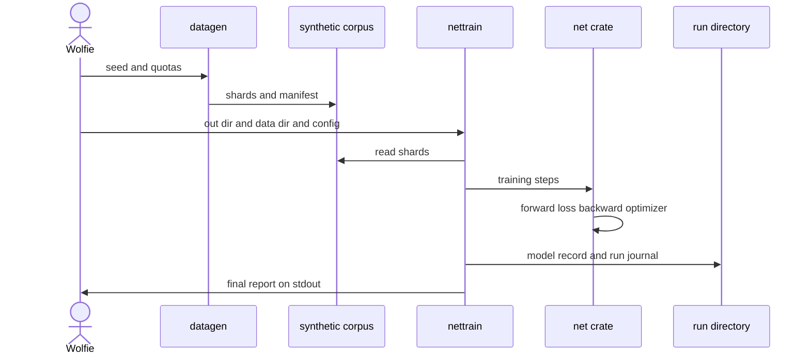
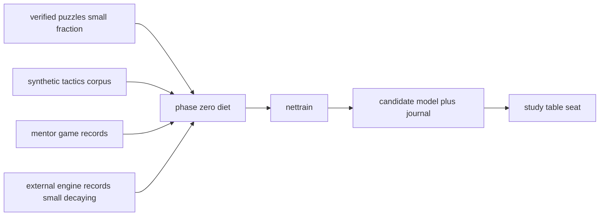

# The phase-0 training journey — a sketch of what happens next

**Status:** orientation sketch, written 2026-11-08 at the owner's
request ("give me a vivid idea of what I will go through once done
with the net tutorial"). This is **not** a locked spec. Authority
order where documents disagree: chapters 12/13/14 locked decisions →
[2026-11-08-mentor-datagen-design.md](2026-11-08-mentor-datagen-design.md)
→ the tutorial chapters → this sketch. Numbers are labelled
[measured] / [derived] / [experiment] / [invention] per chapter 12's
honesty convention.

**Audience:** Wolfie, standing at the end of net-tutorial chapter 6.

---

## The turn you are about to make

Until now, every chapter ended the same way: gates green, commit,
next chapter. The artifact under construction was *code*, and the
definition of done was *tests*.

After chapter 8, the definition of done changes shape. The artifact
becomes a **trained model file plus its journal**, and done means
*measured*: a holdout metric crossed a bar, a determinism ritual
reproduced a loss trajectory byte-for-byte, a corpus manifest says
what its shards contain. You stop asking "does it compile" and start
asking "what did the run show, where is the evidence, and can I
regenerate it". This sketch walks that loop end to end: corpora in,
runs out, a candidate model onto the study table.

Nothing below requires new invention before the mentor-datagen
tutorial. The pipeline pieces exist and are tested on `main`: the
`datagen` binary (`train` crate), the `net` crate (`planes`,
`batcher`, `network`, `loss`, `train`, `checkpoint`), the `nettrain`
binary (chapter 7), and the acceptance protocol (chapter 8).

## The laboratory layout

Two kinds of ground, kept apart [invention — directory proposal, not
locked]:

- **`data/` — corpora.** Durable, regenerable datasets. Each corpus
  is a directory of bincode shards plus a JSON `manifest.json` (the
  datagen tutorial's storage discipline). Synthetic corpora are
  byte-identical under regeneration [measured, datagen acceptance];
  mentor corpora are reproducible per game via recorded seeds
  (mentor-datagen spec §4). Puzzle packs already live committed at
  `data/puzzles/`.
- **`artifacts/gomoku/runs/<run-name>/` — runs.** Disposable output
  of training. One directory per run, written by `nettrain --out`:
  `model.mpk` (full-precision model record) and `run.json` (the
  `RunJournal`: seed, `ModelConfig`, `TrainConfig`, final step and
  eval metrics). Git-ignored like `artifacts/mnist/`; a run is
  reproducible from its journal plus its corpus, not worth
  versioning.

The mental rule: **data is precious because it is slow; runs are
cheap because data + journal regenerate them.** Never hand-edit
either.

## Scene 1 — the first corpus (an hour)

```bash
cd gomoku
cargo run --release -p train --bin datagen -- \
    --out ../data/synthetic/v1 --seed 1 \
    --win 20000 --block 20000 --quiet 10000
```

You watch the quota collector fill win/block/quiet from seeded random
playouts with tactics labels (90/10 shaped policies, ±1/0 values).
Afterwards you open `manifest.json` — per-class counts, shard list,
the holdout fraction (~9.8% [measured] by Zobrist key-hash). This is
the moment the abstract "synthetic set" becomes files you can point
at. The acceptance numbers say 50k samples cost 45 s in *debug*
[measured]; release is faster.

What to look at: the class histogram in the manifest, and the
holdout split — those holdout positions are the fixed measuring
stick every future run is compared against.

## Scene 2 — the first training runs (a day)

**Smoke first.** Bare `nettrain` generates 200 samples in-memory and
trains the `tiny` preset (8 channels, 1 block) for 20 steps — the
binary's way of saying "the pipeline is alive" in seconds:

```bash
cargo run -p net --bin nettrain -- --out /tmp/smoke
```

**Then the real run** against the corpus, with progress on `stderr`
and the final report on `stdout`:

```bash
cargo run --release -p net --bin nettrain -- \
    --out ../artifacts/gomoku/runs/phase0-synthetic-v1 \
    --data ../data/synthetic/v1 \
    --config mid --seed 1 --steps 20000 --batch-size 64 \
    --eval-interval 500
```

(Step count and preset for the first full run: [experiment] — chapter
8's reduced-scale evidence is the calibration point; `default` is the
locked 128-channel/10-block architecture and is the *eventual* bar,
not necessarily the first run.)

While it runs you watch the step metrics scroll by: combined loss,
learning rate (linear warmup × cosine decay), and every 500 steps a
holdout evaluation — loss, policy-argmax agreement, value-sign
accuracy. When it finishes, the run directory holds the model and
the journal, and stdout holds the summary.

**Then the two rituals of chapter 8:**

1. **The determinism ritual** — same seed, same config, twice;
   identical loss trajectories. This is what makes every later
   comparison meaningful: when two runs differ, they differ because
   *you* changed something.
2. **The acceptance bar** [invention I5, chapter 8] — after training
   on the full synthetic set: ≥80% policy-argmax agreement on
   held-out win/block samples, ≥85% value-sign accuracy. A starting
   bar, not a research result.

What "good" looks like at this stage: the win/block policy metric
climbs well above chance (chapter 8 explains why reduced-scale
numbers sit near chance — small model, few steps), the value-sign
accuracy tracks the ±1/0 structure of the synthetic labels, and the
holdout curve flattens instead of diving (the synthetic set is small
and the model will eventually memorize it — holdout divergence is
your overfitting alarm).

## Scene 3 — the mentor corpus (the next tutorial, then an overnight run)

Now the journey you proposed: students watching the mentor fight
itself. The mentor-datagen tutorial (specced, locked 2026-11-08) is
the very next track after the net tutorial. You will build:

- the `selfplay` crate's first inhabitant: a synchronous
  baseline-vs-baseline game runner (two `player::AiPlayer` seats,
  Swap2 through the engine typestate, tournament opening lists,
  temperature + Dirichlet exploration for ~10 plies);
- the **game-record format** — the durable milestone-5 replay format
  from day one: header (seed, per-seat configs, evaluator identity,
  opening provenance), per-ply sparse visit distributions (π),
  sparse top-16 priors, root values, outcome (z), and certified
  endgame suffixes where the TSS probe proved a forced win;
- diversity mechanics (one seed per game, Zobrist dedup, [experiment]
  seat asymmetry for Elo-graded corpora);
- the read path: replay-to-sample at read time, same holdout
  discipline, D4 at batch time — your `NetBatcher` design already
  anticipates this.

Then the acceptance corpus: 1,000 games with a quality report
(game-length histogram, opening distribution, outcome balance), and
the determinism and legality gates. Throughput [derived from measured
baseline timings]: ~6 s/game at 200 sims single-threaded → the 1k
corpus is a couple of hours on one core; a 10k-game corpus (~500k
positions) is an overnight run on 12–14 parallel processes. This is
the first time wall-clock becomes a design input: you will start a
run before dinner and read the manifest at breakfast.

This is also where the data teaches forks: mentor π targets carry
the *search's* judgment — blocks, double threats, the guard's
refutation checks — not just one-hot tactics labels.

## Scene 4 — the full phase-0 diet

Phase 0 (locked D2) is a **mixture**, and you said it plainly: you
do not want to miss any good input signal. Here is every signal the
project admits, with its standing:

| Signal | Ladder tier (ch. 14 §5.2) | Provenance & license (D3) | Phase | Fraction discipline | Status |
|---|---|---|---|---|---|
| Synthetic tactics corpus | 2 — rules-true by construction | self-generated | 0 | the bulk of phase 0 | **exists** (`datagen`) |
| Mentor game records | 3 — search-improved π, real z | self-generated, engine-adjudicated by construction (D5 satisfied) | 0, decays in phase 2 | large in phase 0, counterweighted | **specced** (mentor-datagen tutorial) |
| Verified puzzles → anchor set | 1 — solver-verified (TSS, `verify_line`) | curated packs committed (`data/puzzles/`, 3,808 engine-proven + 763 pending re-verification) + certified mentor suffixes | 1 formally (milestone 4); small taste possible earlier | **small, always** — the anchor fraction stays small (ch. 12 decision 8): puzzle positions are a weird slice where someone always has a forced win; too many teach the value head that every position is winning | packs exist; anchor machinery is milestone 4 |
| External engine records (Gomocup PSQ freestyle-15; Karesis/Gomoku MIT; Rapfi-generated) | 3 — strong but stylized | mixed: MIT/CC0 redistributable, unlicensed archives local-only, GPL engines black-box only | 0 supplement, **not persistent** (weak-label echo, §5.4 risk 4) | small; the counterweight to mentor bias (D6) | catalogued, not yet wired |
| Self-play bootstrap (π, z) | 4 — noisiest early, asymptotically exact | self-generated | 1+ | becomes the diet | milestone 5 |

Two rules carry your "no good signal missed" intent without breaking
the quality guardrails you accepted:

1. **Every tier is represented, no tier is trusted absolutely.** The
   cleanest (puzzles) is narrow; the broadest (mentor) is capped at
   mentor strength; the strongest (external engines) is stylized.
   The mixture is the point — each signal covers another's blind
   spot.
2. **Everything enters through the same gate discipline**: our engine
   re-adjudicates external positions (D5), tactical claims pass
   `verify_line`, licenses filter redistribution (D3), and the
   holdout split makes every diet measurable against a fixed stick.

## Scene 4b — the early seat (a small, deliberate detour)

You asked for the earliest possible model loading in the CLI — a
typed `load <path>` at the study table — and the answer is that it
is a genuinely small slice, unblocked **right now**: it needs only
the `net` *library* (`planes`, `network`, `checkpoint` — all on
`main`), not the chapter-7 binary.

The seam is friendlier than expected: `mcts::EvalResult.policy` is
`[f32; 225]` and `value` is the side-to-move tanh scalar — exactly
the shapes the network heads produce (chapter 12 sized the heads for
this seam). So the slice is three pieces [invention — minimal
predecessor of the client-model-integration tutorial]:

1. **`NetEvaluator`** (~100 lines + tests): holds a `Model` and a
   `Device`; `evaluate(&EvalRequest)` turns `request.planes` into a
   `[1, 4, 17, 17]` tensor, calls `forward()`, copies the 225 logits
   into the array, reads the value scalar. Illegal-move masking is
   not its job — `mcts` does `masked_softmax` against
   `request.legal`.
2. **Loading**: `checkpoint::load_model` needs the `ModelConfig` —
   read it from the `run.json` next to `model.mpk`. The
   journal-aware picker in embryonic form, using only what chapter 6
   already writes.
3. **The `load` command** (~50–100 lines + tests): one new entry in
   the study table's command language, installing the net as an AI
   seat; the analysis-invalidation machinery for seat/configuration
   changes already exists (resignation/decision features) and is
   reused.

Two cautions keep it small: stay minimal — the client-integration
tutorial will subsume this with the proper journal-aware picker, so
do not build that now — and play the first games at 50–100
simulations, since every simulation is a CPU forward pass.

## Scene 5 — the candidate goes to the table

The dream scene. A `NetEvaluator` behind the `mcts::Evaluator` seam
loads `model.mpk` from a run directory, turns the `EvalRequest`
planes into your chapter-1 input format, runs one `forward()`, and
returns policy logits + side-to-move value. The study table gains a
seat — `--ai net:artifacts/gomoku/runs/phase0-synthetic-v1` in
spirit — and the overlays you built (value strip, visits heatmap,
prior view) light up from a *trained* network for the first time.
That integration is the queued client-model-integration tutorial;
scene 4b's minimal seat gets you the first game earlier.

Expectation for the first candidate: tactical reflexes without
strategy — it takes wins-in-one, blocks your fours, and plays
plausible shape, and it will lose to patience. After the mentor
diet: fork awareness and realistic middlegame judgment near mentor
strength. The mentor-datagen spec's playing-strength probe
[experiment, bar pre-registered in its acceptance chapter] makes this
measurable: a network trained with a mentor fraction beats the
tactics mock at equal simulations — the project's first strength
gate on a trained artifact.

Practical note: on the Flex CPU backend, 400-sim MCTS through a
3.17 M-param conv net is seconds per move [derived]. First games:
50–100 sims, or the `mid` preset.

## Scene 6 — beyond the horizon (context only)

Phase 1 ignites the loop: self-play with the chapter-14 opening
procedure, the milestone-4 anchor fraction in each batch, the
certified suffixes feeding the anchor set. The arena (milestone 6)
gates promotions by Elo, and each confirmed promotion halves the
supervised fractions (phase-2 decay, D2). Students become masters;
the masters' game records arrive in the *same* format the mentor
tutorial built — that is why the format was chosen to be the
milestone-5 replay format from day one.

## The primary interaction, as a diagram

One full happy path, corpus to candidate:



And the signal mixture of scene 4:



## What you keep, and why

After every scene you hold three kinds of evidence:

- **Manifests** say what a corpus contains (counts, seeds, shards,
  holdout split).
- **Journals** (`run.json`) say what a run did (seed, configs, final
  metrics) — the unit of comparison between runs.
- **Model records** (`model.mpk`) are the candidates — full
  precision, bit-identical roundtrip verified by the checkpoint
  tests.

The discipline that makes the laboratory a laboratory: **every
number you ever quote traces to a manifest or a journal, and every
artifact regenerates from its seed.** When a future run surprises
you, the difference is never a mystery — it is a diff between two
journals.

## Honest ledger

- [measured]: datagen acceptance numbers (50k/45 s debug, 9.84%
  holdout, byte-identical regeneration); baseline seat timings
  underlying the mentor throughput estimate; the bit-identical
  checkpoint roundtrip.
- [derived]: mentor corpus wall-clock estimates; CPU inference cost
  at 400 sims.
- [experiment]: first full-run step count and preset choice;
  seat-asymmetry diversity; the playing-strength probe.
- [invention]: the directory layout (`data/` vs `artifacts/gomoku/
  runs/`); the chapter-8 acceptance bar (I5); the early-seat slice
  of scene 4b.
- Locked and unchanged by this sketch: the signal ladder, phases D2,
  licensing D3, re-adjudication D5, mentor records + retained
  external counterweight D6, the anchor-fraction discipline, the
  store-games record format.

## References

- [../12-gomoku-architecture.md](../12-gomoku-architecture.md) — §9
  store-games discipline, §13 milestones, honesty convention.
- [../14-openings-and-supervised-curriculum.md](../14-openings-and-supervised-curriculum.md)
  — the signal ladder, phases, D2/D3/D5/D6.
- [2026-11-08-mentor-datagen-design.md](2026-11-08-mentor-datagen-design.md)
  — the next tutorial track, game-record format, acceptance gates.
- [../tutorials/net-tutorial/07-the-nettrain-binary.md](../tutorials/net-tutorial/07-the-nettrain-binary.md)
  and [../tutorials/net-tutorial/08-acceptance.md](../tutorials/net-tutorial/08-acceptance.md)
  — the binary contract and the phase-0 bar.
- [../tutorials/datagen-tutorial/README.md](../tutorials/datagen-tutorial/README.md)
  — the synthetic corpus pipeline.
