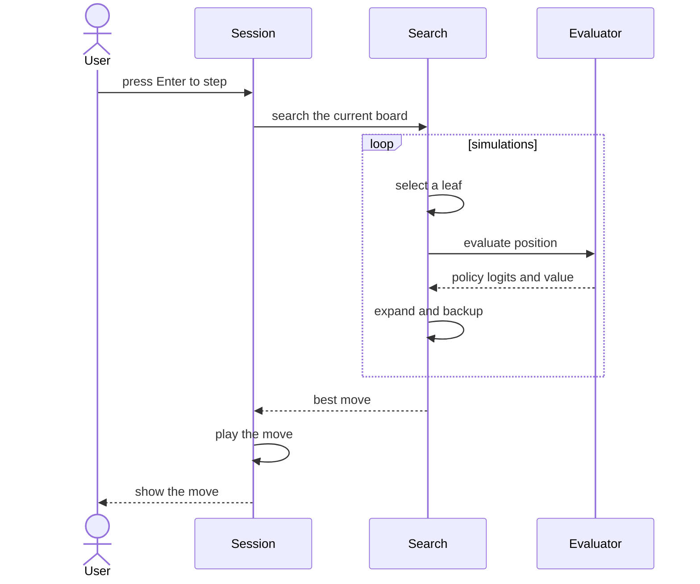

# Sub-chapter 01 — The seat: design paper

## Abstract

This paper records the decisions behind the first baseline sub-chapter.
The evaluator is intentionally empty: the point is not strength, but the
pipeline. Once the crate, the feature flag, the CLI enum, the internal
`EvaluatorKind`, and the session wiring are real, every later chapter
replaces only the body of `evaluate`.

## Glossary

| Term | Definition |
|------|------------|
| **Seat** | A place at the study table occupied by a human or an AI. |
| **Brain** | The evaluator backend that drives an AI seat. |
| **Socket** | The `mcts::Evaluator` trait. It is the only coupling between search and brain. |
| **Seam** | Same as socket: the single place where the search asks for a policy and a value. |
| **V0 evaluator** | The baseline evaluator after this chapter: uniform policy, zero value, no learning. |
| **Feature gate** | The `baseline` cargo feature that makes the `baseline` crate optional in the CLI. |

## Context

The project has a rules engine, a search, and a terminal client. None
of them meet in one learner-owned artifact. The mock evaluator lives
inside `mcts`; the CLI can seat it, but the learner did not write it.
This sub-chapter creates the learner's own artifact and plugs it into
the existing machinery.

## Decision 1 — The socket comes before the smarts

The PUCT search is finished. The `Evaluator` trait is finished. The CLI
seat is finished. The only missing piece is a learner-owned evaluator.
Building a do-nothing evaluator first is a win because it makes the
whole surrounding pipeline real. The crate topology, the feature flag,
the CLI enum, and the session factory all get exercised. A later
chapter can then focus on a single file: the body of `evaluate`.

## Decision 2 — The seam is the only coupling

`BaselineEvaluator` knows nothing about the terminal, the session, or
the CLI flags. It knows only `EvalRequest` and `EvalResult`. The session
knows only `EvaluatorKind` and the factory function. The CLI knows only
`AiKind`. Each layer translates once:

```text
--ai baseline          AiKind::Baseline
        |
        v
From<AiKind>           EvaluatorKind::Baseline
        |
        v
make_evaluator         baseline::BaselineEvaluator
        |
        v
search                 mcts::Evaluator::evaluate
```

This keeps the search reusable. A future `net` crate will follow the
same shape.

## Decision 3 — A do-nothing evaluator is still a real player

A uniform policy and a zero value are enough to play legal Gomoku. The
search finds terminal wins on its own. The value is wrong, but it is
wrong honestly: the doc comment says the planes are ignored. The
behavior is reproducible and testable. That is the right foundation for
a tutorial that adds one layer of intelligence at a time.

## Decision 4 — The `--ai` flag is the brain selector

The seat flag already chose between a human and an AI. Once an AI is
seated, the same flag selects the brain. The design does not add a second flag.
The flag value `baseline` maps to `AiKind::Baseline`, then to
`EvaluatorKind::Baseline`, then to `BaselineEvaluator`. One name flows
all the way down.

## Decision 5 — The baseline crate is optional in the CLI

The `baseline` dependency is marked `optional = true`. A `baseline`
feature gates the factory arm. The default feature set includes it, so
normal builds work. A no-default-features build can still compile the
CLI without the baseline crate. This mirrors the shape the `net` crate
will later follow.

## One AI move



The loop runs `simulations` times. Each iteration calls the evaluator
once. The evaluator does not know it is inside a loop; it only answers
one request.

## Noun catalog

* User
* `SessionCore`
* PUCT search
* `BaselineEvaluator`
* `Evaluator` trait
* `EvalRequest`
* `EvalResult`
* legal moves
* policy logits
* value
* `masked_softmax`
* `AiConfig`
* `EvaluatorKind`
* `AiKind`
* `baseline` feature

## Verb catalog

* press
* search
* select
* evaluate
* return
* expand
* backup
* repeat
* play
* show

## Central design rule and invariants

**Central rule:** The evaluator answers one question with two values.
The rest of the system does not change.

Invariants:

1. The evaluator contains no RNG. Match variety comes from the search
side only.
2. Terminal positions never reach the evaluator. `mcts::expand` handles
won and drawn boards before evaluation.
3. The policy vector carries `f32::NEG_INFINITY` at every occupied cell
and the same logit at every legal cell.
4. The scalar value is exactly `0.0` in v0.
5. The `--ai` flag selects the evaluator backend at startup. The seat
flag doubles as the brain selector.

## References

* [Sub-chapter 01 — The seat](./the-seat.md) — the tutorial chapter.
* [`00-baseline-primer.md`](../00-baseline-primer.md) — the design authority for the full baseline tutorial.
* [`../README.md`](../README.md) — the chapter map.
* [`the-seat-implementation.md`](./the-seat-implementation.md) — the hiding layer.
