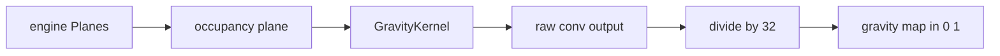

# Sub-chapter 02 — The vicinity kernel: design paper

## Abstract

This paper records the decisions behind the gravity kernel. The kernel
is a picture of a neighborhood condition, not a detector of the
candidate cell itself. It is color-blind, border-free, and normalized
by a power of two so that every value is exact. The central rule is:
**gravity must never be the reason a move looks good when no stone is
nearby**, and it must never be tricked into thinking the board edge is
a stone.

## Glossary

| Term | Definition |
|------|------------|
| **Neighborhood condition** | A property of the cells around a candidate cell, as opposed to the candidate cell itself. |
| **Chebyshev ring** | The set of cells at a fixed Chebyshev distance from a center cell. |
| **Occupancy plane** | A one-channel 15×15 board image where any stone of either color marks a cell as occupied. |
| **Border-pull bug** | The false signal that appears when the 17×17 opponent plane, including its one-cell border ring, is reused for gravity. |
| **Dyadic normalization** | Division by a power of two, which keeps every representable value exact in `f32`. |

## Context

The baseline evaluator starts as a uniform policy. The first upgrade
is not knowledge of winning lines; it is knowledge of locality.
Gomoku tactics rarely appear in empty space. When no threat fires, the
search must still know where to spend its simulations.

The threat network in `patterns` already consumes 17×17 relative
planes. Those planes carry a border ring in `you` so that edge
patterns are treated as blocked. Gravity has different needs: it looks
at stones, not at walls, and it must not confuse the two.

## Decision 1 — A kernel is a picture of a neighborhood

The center cell of the 5×5 kernel is `0.0`. The reason is semantic: a
kernel answers the question "what is around the candidate cell?" The
candidate cell itself is either empty and legal, or occupied and
illegal. Knowing that a stone sits on the candidate cell is not a
neighborhood fact. A non-zero center would mix two different questions.

## Decision 2 — Gravity is color-blind

Proximity to a fight does not depend on who owns the stone. The
occupancy plane counts both `me` and `you` stones. If gravity looked
only at own stones, the evaluator would spray toward its own stones
and ignore the opponent's threats. If it looked only at opponent
stones, it would ignore its own shape. Color blindness is the only
sane default.

## Decision 3 — The border ring must not leak into gravity

The `you` plane is attractive because it already holds opponent
stones. But it also holds a ring of ones one cell outside the board.
A convolution is translation-equivariant; it cannot tell the
difference between a real stone and a border cell that happens to be
set to `1`. Reusing `you` would make edge and corner cells score
phantom neighbor mass. The fix is a dedicated occupancy plane that
reads only the inner 15×15 cells and treats everything outside as
zero.

## Decision 4 — Weights decay by distance and normalize by 32

The Chebyshev rings are simple and monotone: distance 1 weighs more
than distance 2. The exact numbers (2 and 1) are an `[experiment]`
starting point. The load-bearing property is the maximum raw sum:

```text
8 cells · 2 + 16 cells · 1 = 32
```

Dividing by 32 maps the raw output into [0, 1]. Because 32 is a power
of two, every normalized gravity value is exact in `f32`. This lets
the tests assert equality instead of using epsilon comparisons.

## Decision 5 — The kernel is a small independent branch

Gravity is not a surgery on `ThreatNet`. It is a separate one-channel
`Conv2d` built in the `baseline` crate. Future hand-written heuristics
will follow the same pattern: a small named branch that reuses the
existing tools, not a change to the proven threat network.

## Data flow



## Noun catalog

| Noun | Role |
|------|------|
| `Planes` | The 17×17 side-to-move-relative input from `engine::encode`. |
| Occupancy plane | The 15×15 color-blind, border-free input to the kernel. |
| `GravityKernel` | The owner of the 5×5 `Conv2d` layer and the device. |
| Weight table | The 5×5 matrix of ring weights. |
| Template `Conv2d` | The initialized layer that supplies padding, stride, and dilation. |
| Bias | A single zero bias, kept explicit for clarity. |
| Gravity map | The normalized 15×15 output. |

## Verb catalog

| Verb | Action |
|------|--------|
| Strip | Remove the 17×17 border ring and keep only the inner board. |
| Fold | Combine `me` and `you` into one occupancy bit. |
| Convolve | Slide the 5×5 kernel over the occupancy plane. |
| Normalize | Divide the raw output by 32. |
| Observe | Print or inspect the map; no policy decision yet. |

## Central design rule and invariants

**Central rule:** gravity rewards nearness to existing stones, but it
must never invent nearness from the board edge or from the candidate
cell itself.

Invariants:

1. **Border-free input.** The occupancy plane has no border ring. The
   kernel sees `0` outside the board.
2. **Zero center.** The kernel center weight is `0.0`.
3. **Color blindness.** Swapping every stone's color does not change
   the gravity map.
4. **Exact dyadic output.** Every normalized value is `k / 32` for some
   integer `k`, so `==` comparisons are exact on every backend.
5. **Truncation, not boosting.** A stone in the corner produces a
   smaller total signal than a stone in the center, because part of the
   kernel falls outside the board.

## References

* [`./the-vicinity-kernel.md`](./the-vicinity-kernel.md) — the
  tutorial chapter.
* [`../00-baseline-primer.md`](../00-baseline-primer.md) — design
  authority for gravity, the trust ladder, and the adapter shape.
* [`../../convolutions-tutorial/03-the-kernel-language.md`](../../convolutions-tutorial/03-the-kernel-language.md)
  — the kernel-as-picture idea.
* `gomoku/crates/engine/src/encode.rs` — the `Planes` border-ring
  design.
* `gomoku/crates/patterns/src/tools.rs` — the
  init-then-overwrite helper.
