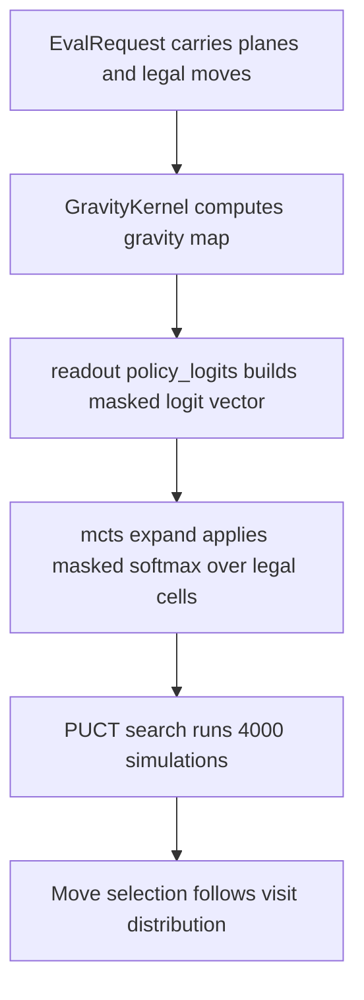

# Sub-chapter 03 — Gravity takes the wheel: design paper

## Abstract

This paper records the design decisions behind wiring the gravity map
into the `BaselineEvaluator`. The move is small: one new readout
function and a changed evaluator body. The conceptual shift is larger:
policy logits become instructions for where the search should spend its
simulations, not scores that choose the move directly.

## Glossary

| Term | Definition |
|------|------------|
| **Gravity map** | The 15×15 output of `GravityKernel::compute`, normalized to `[0, 1]`. |
| **Policy readout** | The function that turns a map into a 225-vector of logits. |
| **Logit** | An unnormalized log-probability. The search normalizes it with `masked_softmax`. |
| **Tier T5** | The bottom row of the full policy tier table. Gravity will become this tier in later sub-chapters. |
| **Device re-export** | `baseline::Device` is `burn::tensor::Device` re-exported so `cli` stays Burn-free. |

## Context

Sub-chapter 01 proved the evaluator can sit in the `mcts::Evaluator`
seam and return a legal, masked policy. Sub-chapter 02 proved a small
convolution can measure "nearness to stones" as exact dyadic numbers.
This sub-chapter makes nearness the default policy signal.

## Narrative

A logit is not a move score. It is a request: "look here." When every
empty cell has the same logit, the search sprays its simulations across
the board. Gomoku rewards local play, so a uniform prior wastes most of
its budget on cells that cannot matter soon.

The gravity kernel gives a natural quiet-board default. It counts stone
mass in the 5×5 neighborhood of each cell, then divides by 32. The
result `g(r, c)` is in `[0, 1]`, a dyadic exact f32 value. Because it is
already in the right range, it can be used as a logit unchanged. That
is not a coincidence. Later sub-chapters build a tier table where the
bottom tier, T5, is exactly this gravity value. Using `g` as the logit
now plants the seed for the full table.

The readout must still mask illegal moves. Occupied cells are illegal,
so they receive `f32::NEG_INFINITY`. The search's `masked_softmax` then
ignores them. Legal cells keep their gravity logit. After
normalization, cells near stones carry most of the prior mass, and the
PUCT tree follows that mass.

The evaluator itself becomes a thin adapter. It holds the kernel, calls
it, calls the readout, and returns a flat value of `0.0`. The flat
value is deliberate. The search still finds terminal wins and losses,
and those exact outcomes drive Q-values. A heuristic value would add
noise before the tree has learned anything from playouts.

One coupling detail matters for crate hygiene. The evaluator needs a
Burn device to build the kernel, but the `cli` crate must not depend on
Burn directly. The baseline crate re-exports `burn::tensor::Device` as
`baseline::Device`. The `cli` crate passes `baseline::Device::flex()`
when it constructs the evaluator. This preserves the rule that only the
baseline crate touches Burn.

## Decisions

### Decision 1 — Gravity values are logits directly

The normalized gravity map is already in `[0, 1]`. It is used as the
logit without scaling or offset. This keeps the quiet-board policy
simple and makes the later T5 tier a natural extension rather than a
rewrite.

### Decision 2 — Illegal cells keep the negative-infinity mask

The readout initializes all 225 cells to `f32::NEG_INFINITY` and only
unmasks legal moves. This matches the masked style of sub-chapter 01
and the mock evaluator. The search never has to reason about illegal
cells.

### Decision 3 — The value stays flat at 0.0

No heuristic value is added yet. The tree's Q-values come from real
terminal outcomes and backed-up values. A flat value means the search
still dominates decisions; gravity only guides where it looks.

### Decision 4 — The evaluator owns the kernel

`BaselineEvaluator` stores a `GravityKernel`. Each evaluator builds its
own kernel. There is no global state, no shared mutable cache, and no
RNG.

### Decision 5 — Device is re-exported from baseline

`pub use burn::tensor::Device` in `baseline/src/lib.rs` lets `cli`
construct the evaluator on the flex device without taking a Burn
dependency. The `cli` crate already depends on `baseline`; it does not
need to know about Burn.

## Data flow

## Noun catalog

| Noun | Role |
|------|------|
| `BaselineEvaluator` | The `mcts::Evaluator` implementation. It holds the kernel and returns logits plus a flat value. |
| `GravityKernel` | The 5×5 convolution from sub-chapter 02. It produces the gravity map. |
| `occupancy_plane` | A color-blind, border-free 15×15 plane used by the kernel. |
| `gravity_map` | The normalized 15×15 output of the kernel. |
| `policy_logits` | The readout function that turns the map into a 225-vector. |
| `EvalRequest` | The search's question: planes plus legal moves. |
| `EvalResult` | The evaluator's answer: policy logits plus value. |
| `Device` | The Burn flex device, re-exported from baseline. |
| `masked_softmax` | The search-side normalization over legal cells only. |

## Verb catalog

| Verb | Actor | Object | Meaning |
|------|-------|--------|---------|
| compute | `GravityKernel` | `Planes` | Builds the occupancy plane and runs the convolution. |
| normalize | `GravityKernel` | raw conv output | Divides by 32 to get values in `[0, 1]`. |
| build | `policy_logits` | logit vector | Starts masked and writes gravity values at legal cells. |
| mask | `policy_logits` | illegal cells | Leaves `f32::NEG_INFINITY` everywhere else. |
| evaluate | `BaselineEvaluator` | `EvalRequest` | Computes map, builds logits, returns value `0.0`. |
| normalize | `mcts::expand` | logits | Applies `masked_softmax` over legal moves. |
| select | PUCT search | child nodes | Uses priors and Q-values to choose paths. |
| concentrate | visit distribution | simulations | Puts most simulations near stones. |

## Central design rule and invariants

**Central rule:** Gravity tells the search where to look, not which move
to play.

Invariants:

1. Every legal empty cell receives logit `g(r, c) ∈ [0, 1]` with no
   scaling.
2. Every occupied or otherwise illegal cell receives
   `f32::NEG_INFINITY`.
3. The evaluator returns value `0.0` for every position.
4. The evaluator contains no RNG.
5. The `cli` crate does not depend on Burn directly; it uses
   `baseline::Device`.

## References

* [`./gravity-takes-the-wheel.md`](./gravity-takes-the-wheel.md) — the
  tutorial for this sub-chapter.
* [`../00-baseline-primer.md`](../00-baseline-primer.md) — §4 gravity
  and §5 tier derivation.
* [`../02-the-vicinity-kernel/the-vicinity-kernel.md`](../02-the-vicinity-kernel/the-vicinity-kernel.md)
  — the `GravityKernel` design.
* `gomoku/crates/baseline/src/readout.rs` — the policy readout.
* `gomoku/crates/baseline/src/lib.rs` — the evaluator crate root.
