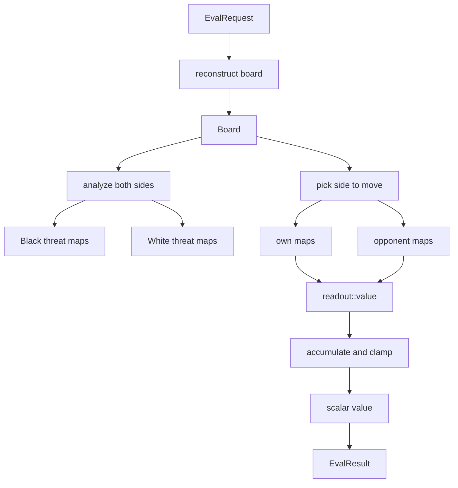

# Sub-chapter 05 — The honest value: design paper

## Abstract

This paper records the decisions behind the baseline value readout.
The value is a saturating, side-to-move heuristic built from the same
threat maps that drive the policy. Its most important feature is not
what it sees; it is what it refuses to claim. It never returns `±1.0`,
because those values belong to terminal outcomes handled by the search.
It also refuses to see threat sequences, naming that limitation as the
honesty clause that sub-chapter 08's TSS probe will fill.

## Glossary

| Term | Definition |
|------|------------|
| **Value readout** | The scalar value returned by `readout::value`. |
| **Saturating heuristic** | A heuristic clamped inside a strict sub-range of `[-1, 1]`. |
| **Terminal reservation** | The rule that `±1.0` are owned by the search's terminal handler. |
| **Side-to-move relativity** | The value is always from the viewpoint of the player about to move. |
| **Quiet board** | A position with no positive cell in any relevant threat map. |
| **Honesty clause** | The explicit statement that the heuristic is one-move deep and cannot see sequences. |
| **Threat map** | A 15×15 map from `ThreatMaps` scoring a tactical condition per empty cell. |

## Context

The PUCT search asks the evaluator two questions at every leaf: where
should the simulations go, and how good is this position? Sub-chapter
04 answered the first question with a tiered policy. This sub-chapter
answers the second. The two answers share the same inputs — the threat
maps and the gravity map — but they use them differently. The policy
ranks moves. The value estimates the position. Because they share
inputs, the value readout inherits the same trust ladder and the same
v1 simplifications that the maps carry.

## Decision 1 — Value is side-to-move relative

`EvalResult::value` is a contract: positive is good for the player
whose turn it is, negative is good for the opponent. MCTS backup takes
the child's value and adds it to the parent with the opposite sign.
If the evaluator returned an absolute "good for Black" number, the
search would invert every other ply.

The readout enforces this by taking `own` and `opp` maps as arguments
rather than Black and White maps. The caller — `BaselineEvaluator` —
swaps the maps based on `board.to_move()`. The function itself has no
notion of color.

## Decision 2 — ±1 belongs to the search

`mcts::expand` checks `board.status()` before calling the evaluator. A
won board yields `+1.0`; a lost board yields `−1.0`. Backup treats these
as exact truth. If a heuristic returned the same magnitude, a backed-up
value could no longer distinguish "the tree proved this" from "the
heuristic feels strongly about this." The value readout therefore
saturates at `0.99`, leaving a measurable gap.

This is not a tuning choice. It is a type-system-like convention: the
search owns terminal truth, and the evaluator owns estimates.

## Decision 3 — Quiet board is exactly 0.0

A board with stones but no wins, forced blocks, or double threats is
honestly neutral. The value readout returns `0.0` because no ladder rung
fires. Gravity is deliberately excluded: proximity to stones is useful
for choosing where to look, but it is not evidence of advantage.

Exact `0.0` is also a sanity check. If the value of a quiet board were
slightly positive or negative, that bias would propagate up the tree
through backup and distort every unexplored branch.

## Decision 4 — Constants are experiments, properties are pinned

The numbers `0.95`, `-0.99`, `-0.75`, `0.85`, `-0.85`, and `0.99` are
starting values. They will be tuned during acceptance measurement. The
tests do not assert the constants; they assert the properties:
saturation, monotonicity, side-to-move relativity, and the quiet-board
zero. This lets the acceptance chapter change the numbers without
rewriting the contract.

## Decision 5 — Double-three rungs are deferred to chapter 06

The value ladder in the primer includes `±0.20` for double-threes. This
sub-chapter ships the win and double-threat rungs only. Double-threes
belong to the next sub-chapter because they complete the policy's
three ladder first; adding them to the value before the policy sees
them would create a value that knows about forks the policy cannot yet
build or answer.

## Decision 6 — The honesty clause is explicit

The value readout cannot see a forced sequence. It sees only whether a
single move creates a win, a double threat, or a block. A VCF win that
takes ten forcing moves looks quiet to this heuristic until the final
ply. The tutorial names this limitation everywhere rather than hiding
it. Sub-chapter 08 adds an evaluator-owned root-level TSS hook for
sequences, and the net tutorial will eventually replace the whole
heuristic with a learned value head.

## Decision 7 — Accumulate, then clamp

After the fast paths for own win and opponent double win, the function
adds contributions for opponent single win, own double threat, and
opponent double threat, then clamps. Clamping after accumulation keeps
the code simple and the monotonicity property visible: each added threat
pushes the value in one direction. The clamp is the final guard against
ever reaching `±1.0`.

## Central design rule and invariants

**Central rule:** the value readout is a side-to-move saturating
heuristic that estimates one-move-deep threats and never claims a
proven terminal value.

Invariants:

1. `|value(own, opp)| < 1.0` for every input.
2. `|value(own, opp)| <= V_CLAMP` for every input.
3. Empty `own` and `opp` maps ⇒ `value == 0.0` exactly.
4. Any positive cell in `own.wins` ⇒ value is `V_OWN_WIN`.
5. Two or more positive cells in `opp.wins` ⇒ value is `V_TWO_OPP_WINS`.
6. Adding own threats never decreases value; adding opponent threats
   never increases it.
7. Gravity never enters the value computation.

## Noun and verb catalogs

Nouns:

* `EvalRequest` — the evaluator's input from MCTS.
* `Board` — the reconstructed absolute board.
* `ThreatMaps` — the analyzed threat maps for one color.
* `own` — the threat maps for the side to move.
* `opp` — the threat maps for the opponent.
* `value` — the scalar output.
* `V_CLAMP` — the absolute ceiling.
* `quiet board` — a board with no firing threat maps.

Verbs:

* `reconstruct` — turn planes into a `Board`.
* `analyze` — run `analyze_both` to produce threat maps.
* `pick` — choose `own` and `opp` by `board.to_move()`.
* `count` — tally positive cells in a map.
* `accumulate` — sum the active threat contributions.
* `clamp` — bound the result to `[-V_CLAMP, V_CLAMP]`.
* `return` — produce the scalar `EvalResult::value`.

## Data flow

## References

* [`./the-honest-value.md`](./the-honest-value.md) — the tutorial.
* [`../00-baseline-primer.md`](../00-baseline-primer.md) — §6 pins the
  value heuristic semantics.
* [`../04-wins-and-blocks/wins-and-blocks-design.md`](../04-wins-and-blocks/wins-and-blocks-design.md)
  — the policy readout design this value readout extends.
* [`../06-the-three-ladder/the-three-ladder-design.md`](../06-the-three-ladder/the-three-ladder-design.md)
  — the double-three rungs added next.
* [`../08-the-ai-player/the-ai-player-design.md`](../08-the-ai-player/the-ai-player-design.md)
  — the player-level root probe that owns sequences.
