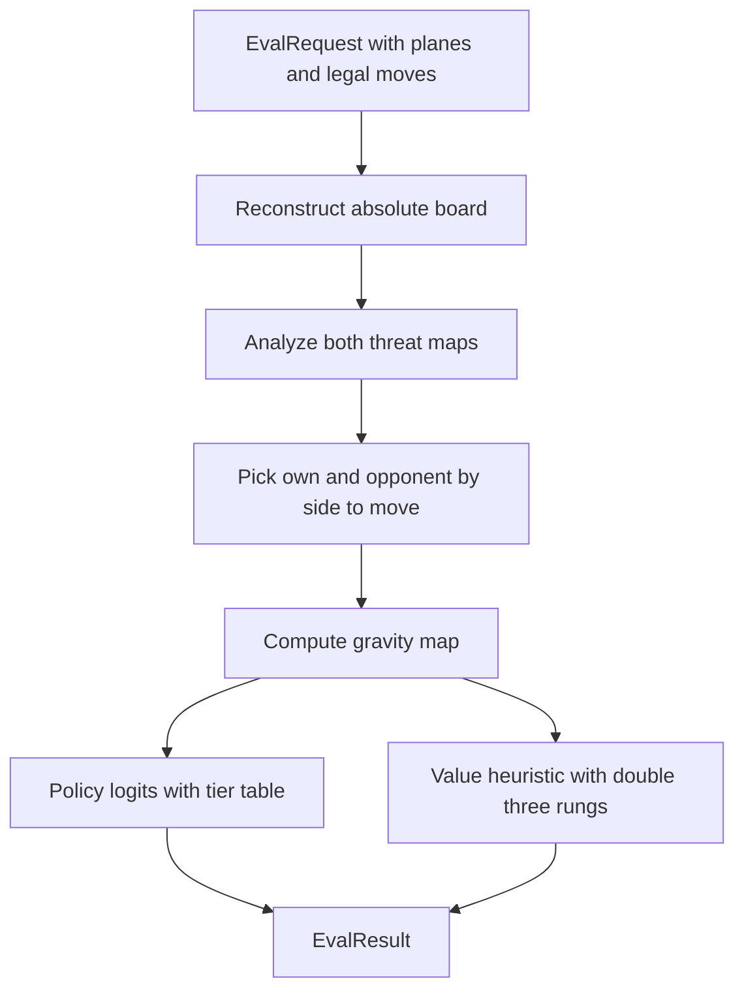

# Sub-chapter 06 — The three ladder: design paper

## Abstract

This paper records the decisions behind adding the middle rungs of the
policy ladder and the double-three rungs of the value ladder. The core
idea is binary membership: a cell is in a tier or it is not, and a
double-three cell is in both the double-three tier and the three-maker
tier, but only once. The domination invariant that protects the argmax
depends on this choice.

## Glossary

| Term | Definition |
|------|------------|
| **Tier** | One row of the policy table: a set of cells and a logit weight. |
| **Binary membership** | A cell contributes a tier's weight at most once, regardless of how many directions or reasons qualify it. |
| **Domination invariant** | Every tier weight is larger than the sum of all lower tier weights multiplied by their maximum cell counts. With binary membership the counts collapse to one per cell. |
| **Defensive tier** | The only tier that looks at the opponent's three-level threats. It gives a small policy mass to blocking cells. |
| **Value despair** | A large negative value for an unblockable opponent threat, because the policy cannot usefully respond. |

## Context

The baseline evaluator is an adapter: `EvalRequest` in, `EvalResult`
out. Inside, it reconstructs a board, analyzes both sides' threat maps,
computes a gravity map, and produces a policy vector and a value scalar.
The previous chapters fixed the top of the policy table (wins and forced
blocks) and the top of the value ladder. This chapter asks: what belongs
between wins/blocks and gravity?

The answer comes from Gomoku tactics. Immediate wins and forced blocks
are one move deep. Double threats are one move deep but unblockable.
Double-three forks and open threes are two moves deep. Gravity is a
quiet-board prior. The natural order is wins, forced blocks, double
threats, double-threes, threes, defensive threes, gravity.

## Narrative

A player who only sees wins and blocks is dangerous but blind. It wins
when it can and blocks when it must, but it never builds a trap. The
three ladder gives it foresight.

The first new tier is the own double threat. It sits just below forced
blocks because a double threat wins next move no matter what the
opponent does. The policy should put heavy mass there.

Below it sit the fork builders. A double-three fork is a move that
creates open threes in two directions at once. It is not a guaranteed
win, but one more move can often turn it into a double threat. It is
more valuable than a plain three-maker, so it gets its own tier above
plain threes.

But a double-three fork cell is also a three-maker. The design decision
is to let it collect **both** the double-three tier and the three-maker
tier. That rewards forks more than plain threes. The second decision is
to add the three-maker tier only once per cell, even if the cell makes
threes in two directions. That is binary membership. It keeps the
maximum lower-tier sum small, which keeps the domination invariant true.

The defensive tier is smaller still. It gives a little policy mass to
cells that block the opponent's three-makers or double-threes. The mass
is small because the opponent can often answer; the search will verify
whether a particular block is urgent. The defensive tier deliberately
**excludes** opponent double threats. A double threat is already past
the point where a single block helps. The value readout instead records
the position as nearly lost.

The value ladder gets the same treatment. An own double-three fork is
worth `+0.20`; an opponent double-three fork is worth `−0.20`. These
numbers are small because a fork is only a promise, not a certainty, and
the value must stay far from `±1` so that proven terminal values remain
distinct.

## Data flow

## Noun catalog

- `BaselineEvaluator` — the `mcts::Evaluator` implementation.
- `ThreatMaps` — the two-sided output of `analyze_both`.
- `ThreatNet` — the hand-written convolution network that produces the
  threat maps.
- `GravityKernel` — the 5×5 vicinity conv branch.
- `policy_logits` — function that turns maps and gravity into a
  225-vector of logits.
- `value` — function that turns maps into a saturating scalar.
- `EvalRequest` / `EvalResult` — the MCTS seam types.
- `Move` / `Board` — engine types for the reconstructed position.

## Verb catalog

- **reconstruct** — turn relative planes into an absolute board.
- **analyze** — run the threat network on the board.
- **compute** — run the gravity conv branch.
- **apply** — add a tier weight when membership is true.
- **clamp** — keep the value inside `±0.99`.
- **outrank** — a higher tier's logit beats lower-tier stacking.
- **dominate** — a tier weight exceeds the maximum lower sum.

## Central design rule and invariants

**Central rule:** policy mass is allocated by binary tier membership,
and every tier's weight dominates the largest possible sum of every tier
below it.

Invariants:

1. **Argmax safety.** A cell in the highest non-empty policy tier holds
   the strict maximum logit, because that tier's weight exceeds the
   largest sum every lower cell can contribute.
2. **Binary membership.** A cell receives each tier's weight at most
   once. In particular, a double-three cell receives `T4A_DOUBLE_THREE`
   plus `T4B_THREE` once, not `T4B_THREE` per direction.
3. **No policy mass for opponent double threats.** Opponent double
   threats appear only in the value readout. The policy does not waste
   mass on unblockable threats.
4. **Value saturation.** `|value| ≤ 0.99` always. Proven terminal values
   at `±1` stay reserved for the search.
5. **Quiet board is neutral.** When no threat map fires, `value` returns
   exactly `0.0`. Gravity does not enter the value.
6. **Side-to-move relativity.** Both policy and value are computed from
   the side to move's perspective, matching the `Evaluator` contract.

## References

* [`the-three-ladder.md`](./the-three-ladder.md) — the tutorial.
* [`00-baseline-primer.md`](../00-baseline-primer.md) — design authority
  for the tier table and value ladder.
* [`README.md`](../README.md) — chapter map.
* [`gomoku/crates/baseline/src/readout.rs`](../../../../gomoku/crates/baseline/src/readout.rs)
— the readout module.
