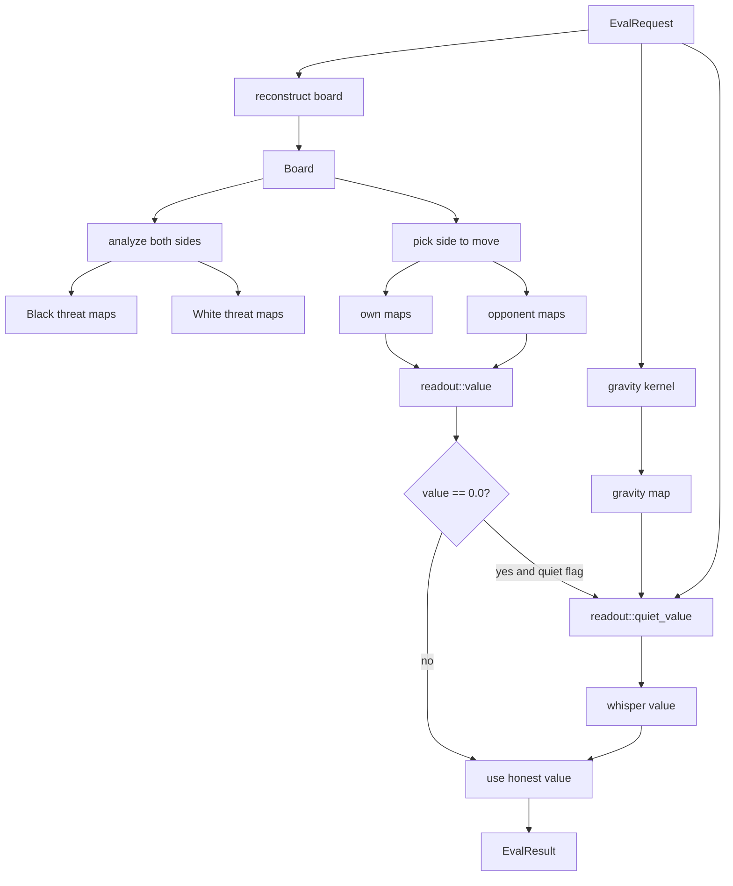

# Sub-chapter 07 — The quiet whisper: design paper

## Abstract

This paper records the decisions behind the `[experiment]` quiet-position
value term. The term is deliberately naive: it rewards the side to move
for having stones in high-gravity cells. It is gated behind the threat
ladder, capped an order below the weakest ladder rung, switchable, and
measured with a pre-registered A/B. The verdict is **KEEP**, with the
important caveat that the discriminating result is efficiency, not win
rate.

## Glossary

| Term | Definition |
|------|------------|
| **Quiet whisper** | The gravity-weighted stone differential in `readout::quiet_value`. |
| **Threat-ladder silence** | `readout::value(own, opp) == 0.0`. |
| **`QUIET_CAP`** | The absolute ceiling `0.05` for the whisper. |
| **A/B arms** | Whisper ON versus whisper OFF. |
| **Efficiency metric** | Average plies and average seconds per game. |
| **Systematic bias risk** | The danger that a consistent value error is amplified by PUCT selection. |

## Context

The honest value readout returns exactly `0.0` whenever no threat map
fires. That is the correct answer for a one-move-deep heuristic: it
admits it sees no advantage. But the search then has no gradient in
quiet branches. A small, clearly labelled value term could guide
selection; an unlabelled one could mislead it. The design problem is how
to add the nudge without pretending it is knowledge.

## Decision 1 — The whisper is gated by threat-ladder silence

`evaluate` computes the honest value first. Only if that value is
exactly `0.0` does the whisper run. This means:

* An own win returns `0.95`.
* An opponent win returns `-0.75` or `-0.99`.
* A double threat returns `±0.85`.
* A double-three fork returns `±0.20`.

The whisper cannot override any of these. It fills only the gap the
ladder deliberately leaves open.

## Decision 2 — The cap is one order below the weakest rung

The weakest non-zero rung in the value ladder is the double-three fork
at `±0.20`. Setting `QUIET_CAP = 0.05` keeps the whisper an order of
magnitude smaller. Even a maximally confident whisper cannot masquerade
as a fork. The cap is a structural guard, not a tuning knob.

## Decision 3 — The formula reuses existing maps

The whisper uses the gravity map already computed for the policy and the
side-to-move-relative planes already in the `EvalRequest`. No new
network, no new analysis, no RNG. The cost is one 15×15 loop per
evaluation call where the ladder is silent.

The denominator `max(gravity_sum, 1.0)` is a safety guard for the empty
board. It also keeps the scale bounded: a dense board normalizes by more
than 1.0, so the differential becomes a small fraction.

## Decision 4 — The evaluator carries a switch

`BaselineEvaluator::quiet` defaults to `true`, and
`without_quiet_value()` disables it. This makes the A/B possible without
touching the readout code, and it keeps the escape hatch one line long.

## Decision 5 — Pre-register the A/B and accept the result

The protocol is written into `baseline/tests/acceptance.rs` before the
first run:

* 20 games versus `TacticsEvaluator`.
* 200 simulations per move for both sides.
* Alternating colors by game index.
* Base seed `20_260_901`.
* Metrics: wins, losses, draws, average plies, average seconds per game.

The yardstick is deliberately weak — the mock cannot reliably
discriminate strength at this budget — so the protocol does not pretend
otherwise. The bar is: keep the whisper if it does no harm and improves
an honest secondary metric.

## Decision 6 — Verdict: KEEP, with the efficiency caveat

The measured result:

| Arm | Wins | Losses | Draws | Avg plies | Avg s/game |
|-----|------|--------|-------|-----------|------------|
| Whisper ON | 20 | 0 | 0 | 23.5 | 3.842 |
| Whisper OFF | 20 | 0 | 0 | 34.5 | 5.847 |

Both arms win every game. The discriminating metric is efficiency: the
whisper arm finishes in 32% fewer plies and 34% less time. The lesson is
that a value improvement can help a player without raising its win rate
against a weak opponent: it shortens the path to the kill.

## Decision 7 — The `[experiment]` flag stays honest about residual risk

The A/B was against a weak opponent. Against a stronger opponent, a
systematically biased value term is amplified by PUCT selection. The
whisper rewards clustering, and clustering can be wrong. The flag, the
cap, and the one-line switch are the admission that this term is a
gamble, not a theorem. The net tutorial will replace the whole
hand-written value head.

## Decision 8 — Alternatives are deferred, not rejected on merit

Three alternatives were considered and set aside:

* **A live-twos rung in the value ladder.** This would require real
  machinery: extending the threat network or engine analysis to identify
  forcing two-stone threats. It is too large for an experiment.
* **Per-leaf TSS probing.** Rejected on cost in the primer §7. The
  evaluator answers thousands of questions per move; a prover call
  inside that loop is unaffordable.
* **A learned value head.** This is the net tutorial's job. The whisper
  is a placeholder to test whether any quiet-position signal helps.

## Central design rule and invariants

**Central rule:** the quiet whisper is a capped, side-to-move,
quiet-position nudge that is used only when the threat ladder is silent,
and its usefulness is decided by measurement.

Invariants:

1. `|quiet_value(gravity, planes)| <= QUIET_CAP` for every input.
2. `QUIET_CAP < |V_OWN_DOUBLE_THREE|` and `QUIET_CAP < |V_OPP_DOUBLE_THREE|`.
3. `quiet_value` is called in `evaluate` only when `value == 0.0` and
   `self.quiet == true`.
4. `quiet_value` returns `0.0` on an empty board.
5. The whisper can be disabled in one constructor call.

## Noun and verb catalogs

Nouns:

* `EvalRequest` — the evaluator's input.
* `gravity` — the 15×15 normalized gravity map.
* `planes` — the side-to-move-relative 17×17 planes.
* `QUIET_CAP` — the absolute whisper ceiling.
* `quiet_value` — the scalar whisper output.
* `quiet` — the evaluator flag.

Verbs:

* `compute` — calculate the gravity-weighted differential.
* `normalize` — divide by `max(gravity_sum, 1.0)`.
* `clamp` — bound the result to `[-QUIET_CAP, QUIET_CAP]`.
* `gate` — call the whisper only when the honest value is zero.
* `measure` — run the A/B and record the numbers.

## Data flow

## References

* [`./the-quiet-whisper.md`](./the-quiet-whisper.md) — the tutorial.
* [`../00-baseline-primer.md`](../00-baseline-primer.md) — §6 the honest
  value heuristic and §7 the root-only TSS probe.
* [`../06-the-three-ladder/the-three-ladder-design.md`](../06-the-three-ladder/the-three-ladder-design.md)
— the value ladder rungs that bound the whisper.
* [`../08-the-ai-player/the-ai-player-design.md`](../08-the-ai-player/the-ai-player-design.md)
— the player-level root probe that owns sequences.
* [`../09-acceptance/acceptance.md`](../09-acceptance/acceptance.md) —
where the A/B numbers are quoted.
