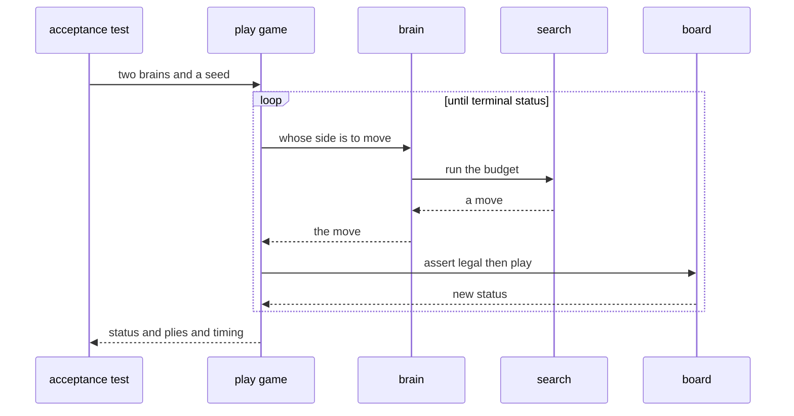

# Design paper — Acceptance: the measured ladder

## The story

A player that has never played a recorded game is a hypothesis, not a
player. Seven sub-chapters stacked layer on layer — gravity, tiers,
value, the TSS eye — and every layer arrived with unit tests that
prove the *mechanism* works. This sub-chapter asks the only question
left: does the whole thing win games, and how would you know?

The design hangs on a separation the CLI tutorial's chapter 09 already
taught: **certainties are asserted, strength is measured.** The two
never mix. An assert runs on every `cargo test` and must hold
forever — a win-in-1 found at 50 simulations is a fact about the tier
table. A measurement runs on demand, in release, takes half an hour,
and produces a number that is *recorded*, not enforced — except for
its pre-registered bar, the one sentence you wrote down before you
knew the answer.

The file `gomoku/crates/baseline/tests/acceptance.rs` therefore has
two halves. The always-on half holds the tactical asserts and the
health flood. The `#[ignore]`d half holds the strength ladder: one
test, one protocol, four tables.

## The cast

The games are driven headless, straight through the `mcts` public API
— the study table is a human surface, and twenty-game matches do not
belong in a terminal. Three helpers carry the whole show.

`Brain` is the cast list: an enum with one variant per possible
occupant — `Random`, `Baseline(sims)`, `Tactics(sims)`. Every pairing
the protocol needs is two enum values.

`play_game` is the referee. It takes two `Brain`s and a seed, plays to
a terminal status, and returns the status, the ply count, and the
baseline's evaluation count and time. It owns the legality assert —
every move, every game, `board.is_legal(mv)` — so the flood and the
match share one notion of a legal game.

`solve_puzzle` is the examiner. It seats the baseline as the attacker
on a puzzle-root board, with the root probe active exactly as the CLI
seat wires it, and the defender following the pack's claimed line. It
answers one boolean: was the claimed forced win actually converted
within `line length + 4` plies?

And `pack`, a private module, is the deliberate duplication: a minimal
`PuzzlePack` parser, copied in spirit from `cli::puzzle`, because
depending on `cli` from a `baseline` test would close a dependency
cycle. The comment at its top names the precedent.

## One game, end to end

## The invariants

1. **Asserts and measurements never mix.** The default suite stays
   fast and deterministic; the ladder is opt-in and release-only.
2. **The bar is written before the number.** Both pre-registered bars
   (≥50% against the mock, ≥50% of the VCF sample) live in the test as
   assertions; the measured numbers are recorded whatever they are.
3. **Every game is reproducible.** Seeds derive from one base seed by
   level and game index; the same protocol reproduces the same table.
4. **Colors alternate in the match.** First-move advantage never
   enters the score.
5. **The random driver is a sanity check, not a yardstick.** Its
   table carries no bar, and the chapter says why.
6. **The flood is honest about its trade-off.** It runs the fast
   evaluator and says so in a comment — the plumbing it exercises is
   evaluator-agnostic; baseline behavior is covered elsewhere.

## The flip as ceremony

The last act is one line: `ai_config_from`'s fallback becomes
`EvaluatorKind::Baseline`. The CLI's default brain — what an `--ai`-less
`release` mid-session builds — is now the player this tutorial grew.
The mock stays one flag away (`--ai tactics`), because a yardstick
never leaves the toolbox: the net tutorial's first trained network
will meet both.

## Noun catalog

| Name | Kind | Role |
|------|------|------|
| `Brain` | enum | the three seatable opponents |
| `play_game` | function | the referee: one game to a terminal status |
| `solve_puzzle` | function | the examiner: one puzzle to a boolean |
| `baseline_best_move` / `tactics_best_move` | functions | one searched move at temperature 0 |
| `random_move` | function | one seeded uniform legal move |
| `pack::PuzzlePack` | struct | the deliberately duplicated pack parser |
| `strength_ladder_measured` | test | the ignored measurement: four tables, two bars |
| `win_in_one_is_solved_at_50_sims`, `forced_block_is_taken_at_50_sims` | tests | the tactical asserts |
| `fifty_seeded_self_play_games_are_legal` | test | the health flood |

## References

* [`acceptance.md`](acceptance.md) — the sub-chapter.
* [`../00-baseline-primer.md`](../00-baseline-primer.md) — §9 the
  strength-ladder contract.
* [Playable CLI chapter 09](../../playable-cli-tutorial/09-acceptance.md)
  — the ritual this design extends.
