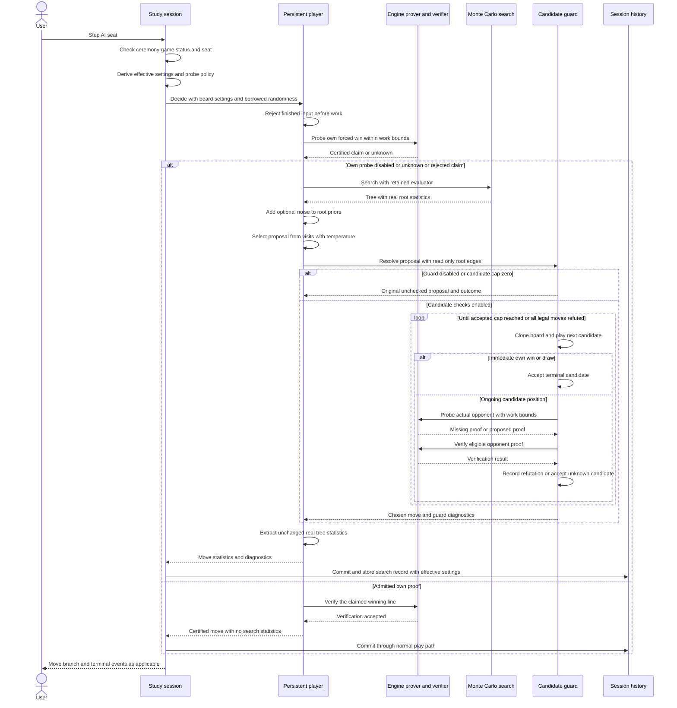
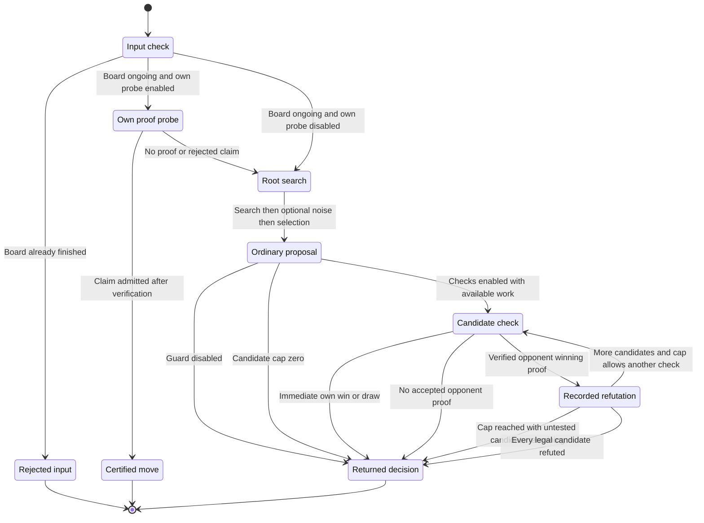

# Sub-chapter 08 — The AI player: design paper

## Abstract

This paper records the decisions behind the `player` crate, the reusable
move-deciding layer between the command-line interface (CLI) session and
the search crate. A persistent `AiPlayer` owns one evaluator per AI seat
and orchestrates the whole decision: a certified own forced-win probe
before search, ordinary Monte Carlo tree search (MCTS) otherwise, and a
bounded opponent-refutation check after ordinary selection. The central
move, relative to the retired design, is that certification authority
sits in the player: the player calls the engine's prover directly and
re-verifies every claimed proof with the engine's line verifier. Nothing
below the player changes — the evaluator seam, the search outcome type,
and the engine are byte-untouched — and nothing the player returns
fabricates measurements. The design is synchronous, allocates a fresh
search tree per decision, and treats every unproven position as unknown,
never as safe.

## Glossary

| Term | Meaning here |
|------|--------------|
| CLI | Command-line interface, including the study session and its command/event model. |
| AI seat | A Black or White seat occupied by an automatic move producer. |
| MCTS | Monte Carlo tree search; simulations accumulate statistics on search-tree edges. |
| Evaluator | A concrete implementation of `mcts::Evaluator`, a single-method estimate interface, owned by a player. |
| Own probe | One bounded `engine::prove_forced_win` call for the side to move at the start of a decision. |
| Admission | The player's re-check of a claimed proof before accepting its first move. |
| TSS | Threat-space search: bounded engine search through forcing threats and replies. |
| Proposal | The ordinary temperature-selected move, before candidate checking. |
| Candidate guard | Optional checking of hypothetical moves for verified opponent winning proofs. |
| Refutation | An accepted proof of the opponent's win after one particular candidate. |
| Unrefuted | No accepted opponent proof found within the bounds; unknown, not certified safe. |
| RNG | Random-number generator, owned by the session and mutably borrowed for a decision. |
| Work bounds | Candidate count and per-probe node/depth limits, not a wall-clock deadline and not a bound on verification work. |
| `[experiment]` | A local tuning choice without a theorem or measured strength/latency guarantee. |

## Context and connected design narrative

`SessionCore`, in the [CLI session module][session], is the session state
machine. It owns `History`, the Black and White `Occupant` values, the
session RNG, and the search records keyed by history cursor. `AiConfig`
describes an AI occupant's settings, and `SearchInfo`, in the
[actor module][actor], attaches those settings to a search record. None
of these artifacts should become part of a reusable move-deciding
library, and none of them can answer the chapter's tactical question,
because the tactical machinery lives two layers down: the engine's
threat-space search (TSS) [2], `prove_forced_win` and `verify_line`, in
[the engine's threat-space module][tss].

The new artifact is `AiPlayer`, in the [player library][player]. It owns
a `Box<dyn mcts::Evaluator>` and accepts a borrowed `Board`, borrowed
`PlayerOptions`, and a mutably borrowed RNG for one `decide` call. The
ownership boundary is the design's backbone: a decision supplies
information to the session, and it cannot advance history or emit session
events. The borrows are per-call choices, not constraints imposed by the
language: the player is borrowed mutably because its evaluator may carry
mutable state across decisions, the board is borrowed immutably because
committing moves is the session's job, and the RNG is borrowed because
one seeded stream must stay reproducible across the whole session.
`Box<dyn Evaluator>` erases the concrete evaluator at the CLI boundary,
which is why the [player manifest][player-manifest] can depend only on
`engine`, `mcts`, and `rand` even when the CLI seats a Burn-backed
baseline evaluator.

The retired chapter-08 design put the tactical probe inside the evaluator
seam: an `evaluate_root` hook returned either an estimate or a certified
move, and `mcts::search` returned a `SearchResult` enum to carry that
distinction. That shape made certification a property of whatever
evaluator happened to be seated, and it made the generic search crate
carry a proof variant. The design here inverts the authority. The
evaluator seam keeps its single `evaluate` method; `mcts::search` keeps
returning `SearchOutcome { tree, root }`; and the player — the one
structure responsible for the decision — calls the engine prover itself
and re-verifies what it is told. Where the retired design trusted the
evaluator's certificate, this design certifies at decision time and
treats a claim that fails verification exactly like no claim at all.

Persistence is the second half of the boundary. `SessionCore::new`
creates one `AiPlayer` per initial AI occupant through `make_player`, and
`set_occupant` is the single replacement point: releasing a seat
constructs its player, taking a seat drops it, and `reset` replaces both
from the initial occupants while keeping the same RNG stream. The slots
`black_player` and `white_player` sit beside the occupants, never inside
`Occupant` or `AiConfig`, because those types are cloneable and
serializable configuration while a boxed evaluator is runtime state.
`execute_set_sims` and history or puzzle navigation change configuration,
never player identity, so a simulation-count change does not rebuild the
baseline evaluator's pattern network and gravity kernel. Persistence
covers the evaluator only; every `decide` builds a fresh search tree.

When a user steps a seat, `SessionCore::execute_step` first rejects an
opening ceremony, then a finished board, then a human side-to-move seat.
It derives an effective configuration from the current occupant; the
existing opening schedule may replace temperature and noise fraction for
the first ten plies of an eligible empty-root AI-versus-AI line. The
effective settings become `PlayerOptions`, and this construction is where
the CLI attaches probe policy: evaluator kind `Baseline` maps to
`OwnTssConfig::baseline()` and `GuardConfig::baseline()`, while kind
`Tactics` maps to both disabled. The mapping lives at the session
boundary because policy is a property of the deployment, not of the
reusable player; a library caller opts out by passing disabled options,
and the player never inspects the evaluator's concrete type.

Inside `AiPlayer::decide`, the terminal check repeats the session's
game-over check for non-CLI callers. A won or drawn board returns
`DecisionError::GameOver` with zero evaluator calls and zero RNG draws.
This is an error about the input, not a proof about the position.

For an ongoing board with the own probe enabled, `decide` makes one call
to `engine::prove_forced_win` for the side to move. The probe runs on the
`Board` the session already holds, in absolute colors; it never touches
the evaluator's side-to-move-relative planes, so there is nothing to
reconstruct — the board is the prover's native input. The prover's
`None` means "not proven within budget", which says nothing about
whether a threat exists; an exhausted budget is unknown, and the decision
falls through to ordinary search. A returned `Proof` is a claim, and the
private admission helper `certified_own_move` re-checks it: the winner
must be the side to move, the line must start with a move legal on this
board, and `engine::verify_line` must accept the line. A claim that fails
any check is rejected and falls through the same way — the player
re-checks rather than trusts, so a false proof cannot produce a move.

An admitted proof returns its first move immediately, with
`search: None` and `GuardDiagnostics` reporting `ProvenWin` with zero
checks. Three properties of this branch matter. First, the certified move
is the start of a forcing line, not necessarily a game-ending move: the
chapter's fixture certifies a win three plies away, and the game
continues after the move is played. Second, the branch consumes no
evaluator calls and no RNG draws, and it fabricates no statistics —
there is no searched tree, so there is nothing honest to report beyond
the move. Third, the probe runs once per `decide` and no proof is stored
across decisions. That last property is structural, not measured: there
is a single unconditional call site, and `AiPlayer` holds no state
besides the evaluator, so there is nothing that could cache a proof. The
test suite pins the dynamic consequence — a later quiet board is really
searched by the same player — which excludes a stale short-circuit
without needing an injectable prover. The own probe has no injection
seam by design: one direct engine call keeps the pipeline readable, and
the admission predicate's rejection rules are unit-tested with fabricated
`Proof` values instead. This evidence policy — structural inspection plus
fixtures — is a stated limitation, revisited in the verification section.

The ordinary path runs `mcts::search` once with the retained evaluator,
then applies `add_dirichlet_noise` to the root when the noise fraction is
positive, then selects a proposal with `visit_distribution` and
`select_move`. Root noise and temperature are familiar from AlphaGo Zero
[1], but their placement here is a preserved local behavior, not that
paper's pre-search noise policy. Noise changes root priors after
simulations; it does not change existing visits or accumulated values,
and therefore does not change the visit-derived weights that temperature
selection is about to use. It does consume RNG before sampling, so its
presence shifts a seeded stream; and its post-noise priors are what the
statistics record and what the guard's retry ranking tie-breaks on.

The selected move is a proposal, not yet the decision. With the guard
enabled, the private `choose` helper in the [guard module][guard]
resolves it. The module is private on purpose: `AiPlayer` is the single
structure responsible for the decision, and the guard is an
implementation detail of that responsibility — only its data types
(`GuardConfig`, `GuardDiagnostics`, `GuardOutcome`) are re-exported. The
helper's probe parameter, an `impl FnMut` callback, is test equipment for
observing calls and feeding malformed proofs; the production caller
passes `engine::prove_forced_win`. It is not an evaluator hook and does
not widen the evaluator seam.

`choose` checks the proposal first, regardless of ranking, and moves on
only after a verified refutation. Retries follow a deterministic order —
descending visits, descending prior with incomparable values treated as
equal, then ascending move index — and include every remaining root edge,
even unvisited ones, because an expanded root covers every legal move.
Retries never resample and never consume RNG. Each check plays the
candidate on a cloned board; the input board is never mutated. An
immediate own win or a draw is accepted as `Terminal` without probing.
Otherwise the probe runs for the actual opponent on the hypothetical
board, `after.to_move()`, and a proof refutes the candidate only when its
winner is that opponent, its first move is legal there, and
`verify_line` accepts the line. `None` or any rejected proof leaves the
candidate `Unrefuted`: unknown, never certified safe. The refutation is
proof-certified; accepting a defense is not.

The work bounds are `[experiment]` values: five candidates, 1,000 nodes
and ten plies per probe in the baseline preset. They bound prover nodes
and plies per candidate; they are not a wall-clock deadline, and
`verify_line`'s work is not governed by them. The numbers were chosen as
fixed experiment bounds, not measured as optimal. When the candidate cap
is reached after refutations, the guard returns the highest-ranked
remaining **untested** candidate with `BudgetExhausted` — never the
already-refuted proposal. Only when every legal candidate has been
individually refuted does it report `AllRefuted` and retain the original
legal proposal, asserting the refutation count equals the legal-move
count. That outcome is a list of individual refutations, not a composed
proof that the root position is lost, and the session must not infer a
resignation from it.

Whatever the guard decides, `SearchStats::from_searched` — a private
helper in the player library — extracts statistics from the real tree:
every root edge, visits sorted by descending count then ascending index,
priors after optional noise sorted by descending probability then
ascending index, the root value as accumulated value over total visits
with an explicit zero-visit branch, and the searched board's
side-to-move perspective. When the guard substitutes a different move,
the statistics still describe the original proposal's search; the record
is a measurement, not an endorsement of the returned move.

Back in the session, a certified own win is committed through the
existing `execute_play` path and stores **no** search record at the fresh
cursor; records stored earlier at other cursors are historical
information and stay untouched. A searched decision is wrapped by the new
`SearchInfo::from_stats`, which attaches the effective configuration to
the player's statistics, and the existing branch — `history.play`,
storage at the new cursor, move, branch, and terminal events — is
preserved. `SearchInfo::from_search` remains unchanged; the seeded
eleven-ply comparison test uses it to reproduce the pre-extraction
manual path move for move. The CLI returns but neither stores nor renders
`GuardDiagnostics`; they exist for callers and tests.

## Primary sequence: one AI step

The plain-word labels abbreviate the named artifacts above. The engine
participant appears twice with different meanings: the own probe before
search, and opponent probes inside candidate checking.

The session's initial checks can return errors before the decision call,
and the player's finished-input check can likewise return early; the
sequence expands the successful paths, and the state diagram includes the
rejection explicitly. Admission — winner check, legal first move, line
verification — is drawn as the verification exchange on the certified
branch; a rejected claim follows the unknown branch instead.

## Decision state diagram and transition table

The diagram describes one decision, not a persistent search tree. After a
successful return the player still owns its evaluator, but its local tree
and candidate boards are discarded.

| From → to | Condition and operation | Observable result |
|-----------|-------------------------|-------------------|
| Input → rejected | Board won or drawn before any work | `DecisionError::GameOver`; no evaluator or RNG use. |
| Input → own proof probe | Ongoing board, probe enabled | One bounded prover call for the side to move on the session's board. |
| Input → root search | Ongoing board, probe disabled | Straight to ordinary search. |
| Own proof probe → certified | Winner is the side to move, legal first move, verified line | First move of the line; `search: None`; `ProvenWin`, zero checks; no evaluator call, no RNG, no guard work. |
| Own proof probe → root search | `None` or any failed admission check | Unknown, not "no threat"; ordinary search runs. |
| Root search → proposal | One search, optional post-search prior noise, temperature selection | Proposal plus a real tree; RNG consumed only by noise and sampling. |
| Proposal → returned | Guard disabled | Original proposal; `Disabled`, zero checks. |
| Proposal → returned | Enabled, zero cap | Original unchecked proposal; `BudgetExhausted`, zero checks. |
| Proposal → candidate check | Enabled positive cap | Proposal checked first on a cloned board; increment `checked`. |
| Candidate check → returned | Immediate own win or draw | Candidate; `Terminal`; no opponent probe. |
| Candidate check → returned | No acceptable opponent proof | Candidate; `Unrefuted`; unknown, not certified safe. |
| Candidate check → recorded refutation | Correct opponent winner, legal first move, verified line | Append candidate to ordered `refuted`; root statistics untouched. |
| Recorded refutation → candidate check | Another candidate exists and check count below cap | Next ranked candidate, counted only when hypothetically played. |
| Recorded refutation → returned | Another candidate exists, cap reached | Highest-ranked remaining untested move; `BudgetExhausted`. |
| Recorded refutation → returned | All legal candidates checked and refuted | Original legal proposal; `AllRefuted`; no root loss certificate. |

A separate resource lifetime runs alongside the decision states,
expressed by session operations rather than by the player:

| Session operation | Occupant/player transition | Retained state |
|-------------------|----------------------------|----------------|
| `SessionCore::new` | Initial AI seat gets a player; initial human gets none | One session RNG, initialized from the session seed. |
| `execute_release` through `set_occupant` | Selected seat becomes AI with a newly constructed player | Other seat's evaluator and session RNG. |
| `execute_take` through `set_occupant` | Selected seat becomes human; its player is dropped | Other seat's evaluator and session RNG. |
| `execute_set_sims` | Configuration and override change; player identity unchanged | Both evaluators and RNG. |
| Move or history/puzzle navigation | No player replacement | Both evaluators and RNG. |
| `execute_new` through `reset` | Both players replaced according to initial occupants | Existing RNG stream; initial settings restored. |

## Noun catalog

| Artifact | Owner and role |
|----------|----------------|
| `SessionCore` | CLI owner of live session state, command checks, player slots, effective options, and events. |
| `History` and cursor | Session's authoritative variation history and location for search records. |
| `Occupant` and `AiConfig` | Cloneable/serializable seat description, not evaluator storage. |
| `black_player`, `white_player` | Optional runtime `AiPlayer` slots, aligned with AI occupancy. |
| `AiPlayer` | Reusable owner of one boxed evaluator; the single structure responsible for a decision; no session state or retained tree. |
| `mcts::Evaluator` | The unchanged single-method estimate interface; concrete construction stays in the CLI. |
| `Board` | Borrowed decision input and the own probe's native input; clones permit hypothetical checks without mutation. |
| `PlayerOptions` | Decision-local settings, including the own probe and candidate guard configurations. |
| `OwnTssConfig` | Enable flag and `SearchBudget` for the own probe; `baseline()` and `disabled()` presets; disabled by default. |
| `certified_own_move` | Private admission helper: the player's re-check of a claimed own proof. |
| `Proof` | Engine winning-line evidence; a claim until the player verifies it. |
| `SearchBudget` | Prover work caps in nodes and plies; not a wall-clock deadline. |
| `SearchConfig` | Simulation count and exploration constant passed to MCTS. |
| `SearchOutcome` | The unchanged search result: a fresh tree and its root. |
| `Tree` and root edges | Decision-local measurements and all legal retry candidates, including unvisited moves. |
| `Decision` | Move, optional real `SearchStats`, and separate `GuardDiagnostics`. |
| `SearchStats` | Sorted full-root visits, post-noise priors, searched-side perspective, and root value; never fabricated for a proof. |
| `SearchInfo` | CLI search record: player statistics plus effective `AiConfig`. |
| `DecisionError` | Terminal input rejection; not a proof or an unknown outcome. |
| `GuardConfig` | Enable flag, candidate cap, and per-probe engine `SearchBudget`. |
| `GuardDiagnostics` | Original proposal, ordered refutations, check count, and `GuardOutcome`; decision-local, never altering MCTS data. |
| `GuardOutcome` | Decision-local status: `Disabled`, `ProvenWin` (own TSS certified at decision time), `Unrefuted`, `Terminal`, `BudgetExhausted`, or `AllRefuted`. |
| Session RNG | One mutable stream borrowed by the player; not owned by evaluator or guard. |

## Verb catalog

| Action | Implementing method/helper | Contract |
|--------|----------------------------|----------|
| Construct evaluator | `SessionCore::make_evaluator` | Select concrete tactics/baseline implementation at the CLI boundary. |
| Construct player | `SessionCore::make_player`, `AiPlayer::new` | Transfer evaluator ownership only for an AI occupant. |
| Replace occupant | `SessionCore::set_occupant` | Update seat description and runtime player together. |
| Restore initial seats | `SessionCore::reset` | Replace both players and restore initial settings without reseeding. |
| Change simulations | `SessionCore::execute_set_sims` | Update configuration and override without replacing the evaluator. |
| Derive effective options | `SessionCore::execute_step` | Apply opening schedule and evaluator-kind probe policy for this move. |
| Decide | `AiPlayer::decide` | Reject finished input or return a move without modifying its board. |
| Probe own win | `engine::prove_forced_win` | Return possible evidence or unknown under node/depth bounds; once per decision, never cached. |
| Admit or reject a claim | Private `certified_own_move` | Winner, legal first move, and `verify_line`; rejection means unknown. |
| Verify a line | `engine::verify_line` | Replay the proof line airtight; the player's soundness net. |
| Search | `mcts::search` | Return a fresh tree with real root statistics. |
| Perturb priors | `mcts::add_dirichlet_noise` | Consume RNG after search; alter root priors, not visits. |
| Propose | `mcts::visit_distribution`, `mcts::select_move` | Include zero visits; apply temperature exactly once to obtain the original proposal. |
| Resolve candidates | Private `guard::choose` | Check proposal first; rank retries; retain unknown or return an explicit fallback. |
| Extract measurements | Private `SearchStats::from_searched` | Preserve all root statistics and searched-side perspective, regardless of guard substitution. |
| Attach session config | `SearchInfo::from_stats` | Add the effective configuration without reconstructing the evaluator or changing measurements. |
| Reproduce legacy records | `SearchInfo::from_search` | Unchanged; used by the manual comparison path in tests. |
| Commit and notify | Session play/history/event path | Advance history and preserve the CLI event contract. |

## Central rule and invariants

**Central rule:** certification authority sits in the player — a move is
certified only when the engine's verifier accepts its line at decision
time — and everything short of a certificate stays unknown, while every
reported statistic stays a real measurement.

1. **Dependency direction:** the CLI depends on the player; the player
   depends only on `engine`, `mcts`, and `rand`. It imports neither Burn
   nor concrete baseline/pattern implementations and performs no session
   I/O.
2. **Runtime ownership:** each AI seat has one player holding one
   evaluator; humans have none. Moves and `SetSims` reuse it;
   release/take/reset perform the resource transitions described above.
3. **Decision isolation:** the board and RNG are borrowed. Hypothetical
   checks use cloned boards. Every search tree is fresh; no asynchronous
   execution, background worker, or tree reuse is introduced.
4. **Terminal input rejection:** a won or drawn input produces
   `GameOver` with zero evaluator calls and zero RNG draws. It is not
   confused with a certified ongoing-root win.
5. **Player certification:** an own proof is admitted only when its
   winner is the side to move, its first move is legal on this board, and
   `verify_line` accepts the line. The player re-checks the prover's
   claim; it does not trust it. This inverts the retired design's rule
   that trusted the evaluator's certificate.
6. **Proof honesty:** a certified own win yields `search: None`, no
   synthetic visits/prior/value, zero guard checks, and zero RNG draws.
   The certified move starts a forcing line; it need not end the game.
   The session stores no new search record at the fresh cursor, and
   historical records elsewhere are unaffected.
7. **Unknown stays unknown:** prover `None` or an exhausted budget means
   unknown, never "no threat exists", and ordinary search runs.
8. **Ordinary-path preservation:** with checking disabled, the path is
   search → optional post-search prior noise → visit selection, with the
   same RNG stream consumption and real statistics as the pre-extraction
   CLI path.
9. **Noise honesty:** noise changes priors after search, not existing
   visits or accumulated values, and not the visit-derived sampling
   weights. Its RNG consumption can shift a seeded sample; its priors are
   what the statistics record and what retry ranking tie-breaks on. No
   "noisy visits" are claimed.
10. **Proposal precedence:** the original temperature proposal is checked
    first and retained unless refuted. Alternatives are deterministic by
    visits, prior, and move index, include unvisited legal moves, and are
    not repeated or resampled.
11. **Refutation soundness:** only an actual-opponent proof with a legal
    first move and a verified line refutes a candidate. Immediate own
    wins and draws are accepted without invoking the opponent prover.
12. **Unrefuted is unknown:** a missing, malformed, wrong-winner, or
    unverified proof yields `Unrefuted`, never certified safety. Work
    bounds are node/depth/candidate caps, not an elapsed-time guarantee,
    and they do not bound verification work.
13. **Fallback precision:** a reached cap chooses the highest-ranked
    remaining untested candidate; a zero cap leaves the proposal
    unchecked. Only actual refutation of every legal candidate permits
    `AllRefuted` with the original proposal retained. That diagnostic is
    not a root-position loss proof and not grounds for resignation.
14. **Measurement integrity:** the guard leaves root edges and returned
    `SearchStats` unchanged. Visits sum to the ordinary simulation count;
    zero simulations have zero root value. A substituted move keeps the
    original proposal's search statistics and need not lead the visit or
    prior list.
15. **Probe discipline:** the own probe runs once per `decide` and stores
    nothing — a structural property of the single call site and the
    evaluator-only player state, with fixture evidence that a later quiet
    board is really searched.
16. **Session authority:** the CLI retains ceremony/game/seat checks,
    effective options, history commits, record storage, and events. The
    player returns diagnostics; the present CLI does not expose them in
    its UI.
17. **Opt-in boundary:** reusable defaults disable both probes. Baseline
    probing is the CLI's explicit per-kind policy, not behavior inferred
    inside the player.

## Verification scope and limitations

The [tutorial][tutorial] orders executable tests before implementation
and names their exact artifacts. The own probe has **no injectable prover
seam**, by design: one direct engine call per decision keeps the pipeline
readable, and `AiPlayer` holds no state besides the evaluator. The
consequence is that "once per decide, never cached" cannot be proven by a
dynamic call count through the public API. The accepted evidence is
structural (the single call site and evaluator-only state, verifiable by
code review) plus fixtures: the bypass tests prove the probe fired and
search was skipped, and the quiet-root test proves a second decision on a
quiet board really searches, excluding a stale short-circuit. The
admission predicate's four rejection rules are unit-tested with
fabricated `Proof` values. The guard keeps its private injected-callback
seam for ordering, malformed-evidence, and no-probe branches; public
guard tests use the real engine prover, including a legal White-to-move
mirror fixture that pins absolute-color correctness on both the own probe
and the guard.

Fresh QA in the sibling reference worktree `rust-ml-unified08-ref`
(detached at main HEAD `2b6ec75`, source uncommitted, recorded
2026-11-06, run from its `gomoku/` directory):

| Command | Result |
|---------|--------|
| `cargo test --release --locked --all-targets` | Exit 0; **563 passed, 0 failed, 5 ignored** across the workspace. The ignored five are pre-existing measurement and full-proof tests (three patterns differentials, the quiet-whisper A/B, sims-versus-strength). |
| `cargo clippy --locked --all-targets -- -D warnings` | Exit 0. |
| `cargo fmt --all -- --check` | Exit 0. |
| `git diff --check` | Exit 0. |
| `rg 'RootEval\|evaluate_root\|SearchResult'` over all five crates | No matches. |
| `git status --porcelain crates/mcts crates/baseline crates/engine` | Empty: the search, baseline, and engine crates are byte-untouched. |

The new tests number 36: six library unit tests (one admission, five
private guard), nine public decision tests, thirteen public guard tests,
five CLI session tests, and three CLI actor tests. Both Mermaid fences in
this paper parsed cleanly under mermaid 12.3.0 with jsdom
(`mermaid.parse`: sequenceDiagram → `sequence`, stateDiagram-v2 →
`stateDiagram`, no errors); this is syntactic parsing only, not browser
rendering.

**Historical provenance, kept distinct.** The legacy 08b paper quotes a
574-test run from the retired hook-era reference; that number does not
transfer, and 563/0/5 is this design's fresh evidence. The
strength-ladder measurements in [sub-chapter 09][acceptance] were
recorded against earlier proof paths and keep their old provenance
labels; this chapter claims no re-measurement and no strength or latency
result. Reference verification does not land learner source on main, and
interactive play is not claimed.

The design's known limits are part of its meaning. The candidate cap can
return an untested move. The guard can miss wins because threat-space
search is bounded, and it accepts unknown candidates that may still lose.
`AllRefuted` may play a known-refuted move because every legal move was
refuted; it is not a loss certificate. The own probe's preset (10,000
nodes, 30 plies) and the guard's preset (five candidates, 1,000 nodes,
ten plies) are `[experiment]` work bounds, not measured optima. None of
these are reasons to silently strengthen the claims; they are the
contract.

## References

- [The AI player: tutorial][tutorial] — test-first execution order,
  contracts, commands, and completion criteria.
- [The AI player: implementation plan][implementation] — per-artifact
  construction contracts.
- [The AI player: solution][solution] — the opt-in annotated reference.
- [Baseline primer][primer] — the tutorial's design authority.
- [Sub-chapter 09 — Acceptance][acceptance] — measured strength numbers
  with their own provenance; unchanged by this chapter.
- Legacy history, superseded: [08 — The TSS eye][legacy-08] and
  [08b — The AI player][legacy-08b] — the retired evaluator-hook design
  and the provisional split chapter, kept for the record only.
- Verified reference (uncommitted, detached at `2b6ec75`):
  [player library][player], [private guard module and tests][guard],
  [player manifest][player-manifest], [decision tests][decisions],
  [public guard tests][guard-tests], [CLI session and unit
  tests][session], [actor types][actor], [actor integration
  tests][actor-tests]. These links intentionally point to the implemented
  worktree, not to unlanded main source.
- Main source (authoritative, pre-change): [engine prover and
  verifier][tss], [MCTS move policy][policy], [evaluator seam][eval].
- [1] Silver et al. (2017), [Mastering the game of Go without human
  knowledge](https://doi.org/10.1038/nature24270) — temperature and root
  noise; not authority for this implementation's post-search noise
  timing.
- [2] Allis (1994), [Searching for Solutions in Games and Artificial
  Intelligence](https://doi.org/10.26481/dis.19940923la) — threat-space
  search; not authority for the local probes' experimental work bounds.

[tutorial]: ./the-ai-player.md
[implementation]: ./the-ai-player-implementation.md
[solution]: ./the-ai-player-solution.md
[primer]: ../00-baseline-primer.md
[acceptance]: ../09-acceptance/acceptance.md
[legacy-08]: ../08-the-tss-eye/the-tss-eye.md
[legacy-08b]: ../08b-the-ai-player/ai-player.md
[player]: ../../../../../rust-ml-unified08-ref/gomoku/crates/player/src/lib.rs
[guard]: ../../../../../rust-ml-unified08-ref/gomoku/crates/player/src/guard.rs
[player-manifest]: ../../../../../rust-ml-unified08-ref/gomoku/crates/player/Cargo.toml
[decisions]: ../../../../../rust-ml-unified08-ref/gomoku/crates/player/tests/decisions.rs
[guard-tests]: ../../../../../rust-ml-unified08-ref/gomoku/crates/player/tests/guard.rs
[session]: ../../../../../rust-ml-unified08-ref/gomoku/crates/cli/src/session.rs
[actor]: ../../../../../rust-ml-unified08-ref/gomoku/crates/cli/src/actor.rs
[actor-tests]: ../../../../../rust-ml-unified08-ref/gomoku/crates/cli/tests/actor.rs
[tss]: ../../../../gomoku/crates/engine/src/tss.rs
[policy]: ../../../../gomoku/crates/mcts/src/policy.rs
[eval]: ../../../../gomoku/crates/mcts/src/eval.rs
