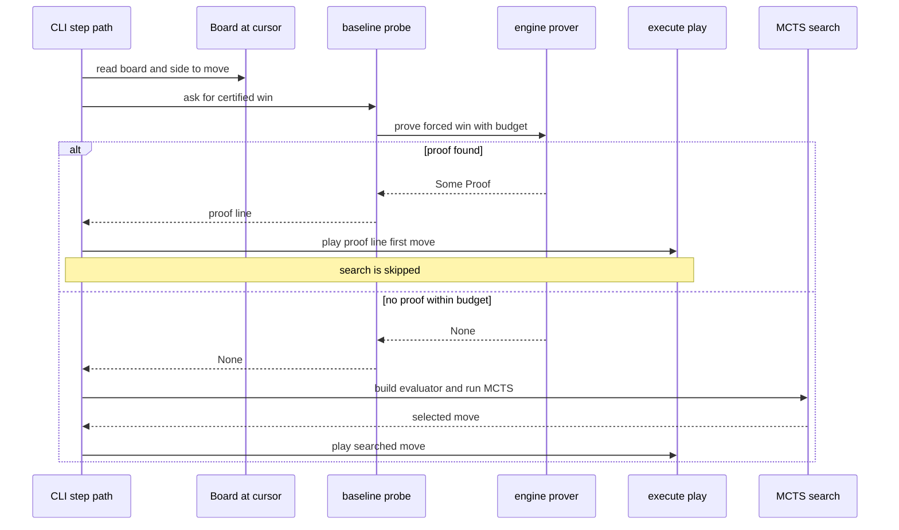

# Sub-chapter 08 — The TSS eye: design paper

## Abstract

This paper records the design decisions behind the root-level
threat-space search probe. The probe is not a scoring function and it
is not an evaluator upgrade. It is a once-per-move short-circuit in the
CLI seat path that asks the engine for a certified forced win before
the MCTS search starts. The design keeps the prover outside the
`Evaluator` seam because the seam's cost model cannot afford it.

## Glossary

| Term | Definition |
|------|------------|
| **Static readout** | The policy and value outputs built from one-move-deep maps. They cannot see forcing sequences. |
| **Threat-space search** | The engine's search through forcing lines to certify a win or report "not proven". |
| **Root probe** | A single prover call at the root of one AI move, before MCTS. |
| **Per-node probe** | A prover call inside the evaluator. This design forbids it. |
| **Defensive probe** | A probe to prove the opponent has a forced win. This design forbids it. |
| **Short-circuit** | A branch that skips the normal search when a proof is found. |
| **Proof line** | The certified sequence of moves returned by `prove_forced_win`. |

## Context

The baseline evaluator built in sub-chapters 01 through 06 answers
"what does this position look like now?" It sees immediate wins,
forced blocks, double threats, double-threes, threes, and gravity. It
does not see sequences. A VCF win is a sequence of threats; each
individual move may create only a three or a closed four, so no single
cell in the sequence tops the policy ladder. The search can discover
some sequences through tree exploration, but it can also miss short
forcing wins when simulations are scarce or priors are unfocused.

The engine already has a soundness-first threat-space search. It
explores only forcing moves and replies, so it can see ten-ply VCF
lines at a fraction of the cost of a full-width search. The question is
not whether to use it, but where to place it in the move loop.

## Narrative

A player sits down at the study table and steps the baseline AI. The
CLI's step handler already knows which seat is AI and which config it
uses. Before it builds an evaluator and runs MCTS, it can ask a
different question: "Is there a certified forced win from this root?"

That question is answered by the engine's prover. The prover is a
search, not a function of the position. It explores threat moves and
defender replies until it either finds a line that wins against every
legal defense or exhausts its budget. If it finds a line, the first
move of that line is the only move that matters right now. The rest of
the line is a promise about the future, verified by `verify_line`.

The evaluator cannot ask this question. The evaluator is called at
every leaf of the MCTS tree. A single move at 4,000 simulations may call
it 4,000 times. If each call ran a threat-space search, the move would
cost tens of millions of nodes. The probe must live where it runs once
per move.

The CLI's step path is that place. The step path already runs once per
AI move. Adding the probe there makes "once per move" a structural fact
of the loop, not a convention the evaluator must remember. The probe
sees the same `Board` that the search would see, makes its decision,
and either returns a move or hands control back to the normal search.

When the probe returns a proof, the seat plays the first move of the
proof line through the normal move path. This matters for the teaching
of the chapter: the events, the history update, the rendering, and the
game-over detection are all unchanged. The only observable difference
is that the move arrives instantly, with no search info overlay,
because no search ran.

When the probe returns `None`, the seat must not change behavior. `None`
is not a signal that the position is quiet or lost. It is only "the
prover ran out of budget before finding a proof." The normal MCTS step
takes over and estimates the move. This interpretation is load-bearing:
treating `None` as "no win exists" is the same category of bug as
trusting an unverified heuristic as truth.

Two probes are deliberately absent. There is no defensive probe: if the
opponent already has a forced win, proving it does not change the move
choice, and the value readout already marks such positions as nearly
lost. There is no per-node probe: the `Evaluator` seam carries no
budget or depth context, and a per-node probe would smuggle search
state into a function contract that forbids it.

## Sequence diagram: one AI move with the root probe

## Noun catalog

| Artifact | Role |
|----------|------|
| `Board` | The current position at the cursor; input to the probe. |
| `SearchBudget` | Hard caps on nodes and depth for the prover. |
| `ROOT_BUDGET` | The pinned budget constant for the root probe. |
| `Proof` | A certified forced win: winner and move line. |
| `root_probe` | The thin wrapper that calls the engine prover for the side to move. |
| `EvaluatorKind::Baseline` | The selector that arms the probe for the baseline seat. |
| `execute_step` | The CLI path that runs once per AI move. |
| `execute_play` | The normal move path shared by probe and search moves. |

## Verb catalog

| Action | Actor | Object | Outcome |
|--------|-------|--------|---------|
| prove | engine prover | `Board`, side, budget | `Option<Proof>` |
| root probe | baseline probe | `Board`, `ROOT_BUDGET` | `Option<Proof>` |
| short-circuit | CLI step path | proof line | skip search, play first move |
| fall through | CLI step path | `None` | run normal MCTS step |
| verify | engine verifier | `Board`, `Proof` | `true` if the line is airtight |

## Central design rule and invariants

**Central rule:** the prover is a once-per-move root short-circuit,
never a per-node evaluator call. A proof pre-empts the search; the lack
of a proof does not pre-empt anything.

Invariants:

1. The probe is called exactly once per AI move in the CLI step path.
2. `Some(proof)` always plays `proof.line[0]` through the normal move
   path, so events and rendering are unchanged.
3. `None` always falls through to the normal MCTS step and is never
   interpreted as "no win exists."
4. The probe has no defensive counterpart: a forced loss is not
   confirmed because it would change no decision.
5. The `Evaluator` seam remains free of prover calls.
6. The probe module depends only on `engine`; it introduces no Burn,
   no patterns, and no MCTS types.

## References

* [Sub-chapter 08 — The TSS eye](./the-tss-eye.md) — the tutorial.
* [Baseline primer](../00-baseline-primer.md) — §7 pins the root-only
  probe and the meaning of `None`.
* [Sub-chapter 06 — The three ladder](../06-the-three-ladder/the-three-ladder.md)
  — the readout layer below the probe.
* `gomoku/crates/engine/src/tss.rs` — the prover and verifier.
* `gomoku/crates/baseline/src/probe.rs` — the probe module.
* `gomoku/crates/cli/src/session.rs` — the step path.
