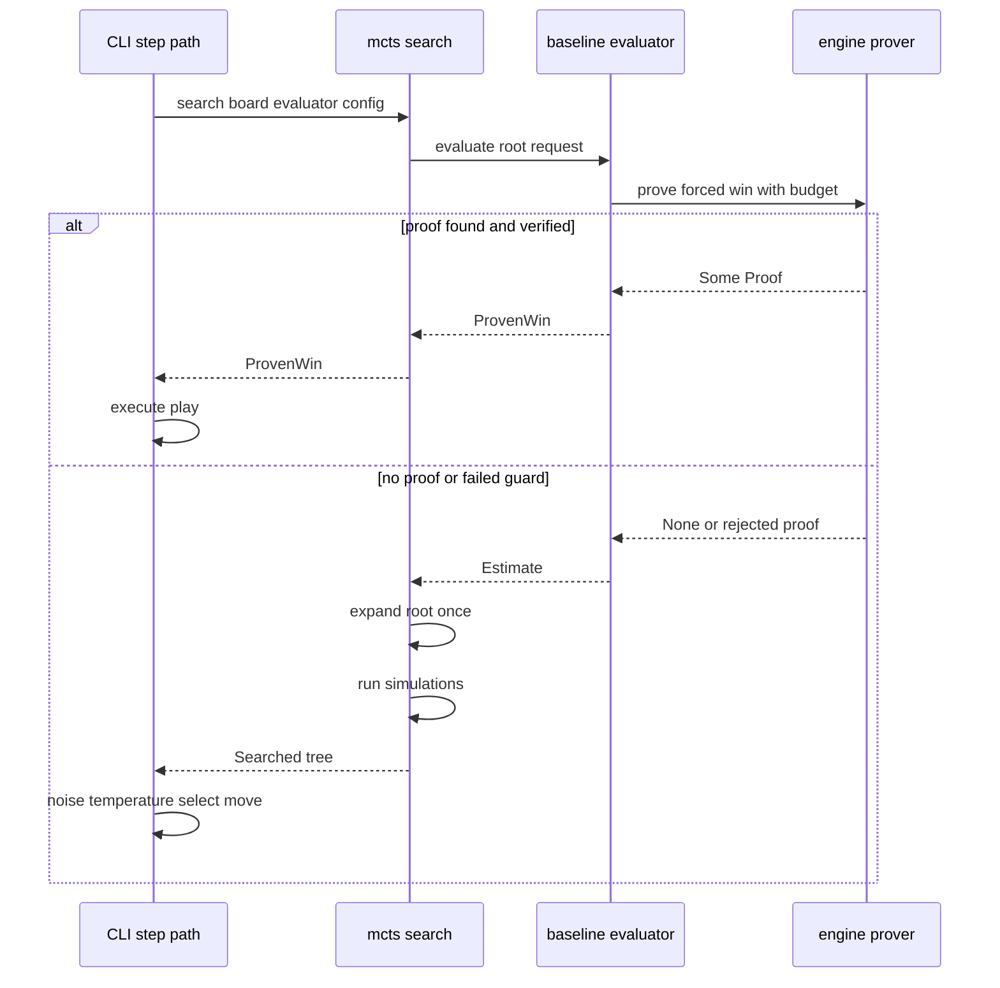
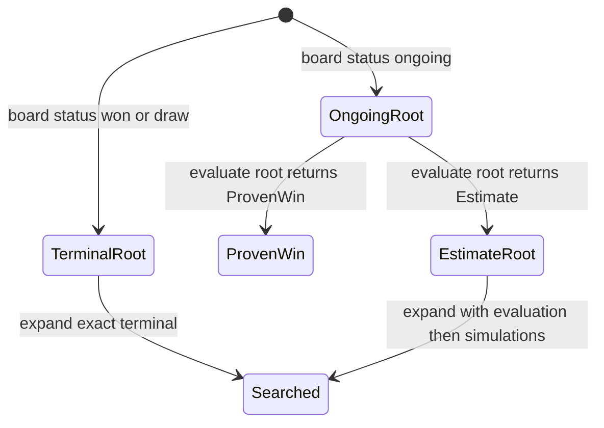

# Sub-chapter 08 — The TSS eye: design paper

## Abstract

This paper records the design decisions behind moving the root-level
threat-space search probe into the `mcts::Evaluator` seam. The probe is
not a scoring function and it is not a per-node evaluator upgrade. It
is a once-per-search short-circuit that asks the evaluator for a
certified forced win before the PUCT simulations begin. The design
keeps the prover inside the evaluator's root hook as a fixed per-move
overhead, rather than multiplying it across every leaf evaluation, and
it keeps the result shape generic so the CLI needs no baseline-specific
wiring.

## Glossary

| Term | Definition |
|------|------------|
| **Static readout** | The policy and value outputs built from one-move-deep maps. They cannot see forcing sequences. |
| **Threat-space search** | The engine's search through forcing lines to certify a win or report "not proven". |
| **Root hook** | The `Evaluator::evaluate_root` method, called once per search at the root. |
| **Per-node probe** | A prover call inside `Evaluator::evaluate`. Out of scope: the leaf path must stay the fast static estimate. |
| **Defensive probe** | A prover call to certify the opponent's forced win. Out of scope: the hook certifies wins for the side to move only; proving a forced loss changes no decision. |
| **Short-circuit** | A branch that skips the normal search when a proof is found. |
| **Proof line** | The certified sequence of moves returned by `prove_forced_win`. |
| **Generic seam** | The `Evaluator` trait, which knows nothing about `baseline` or `engine::Proof`. |

## Context

The baseline evaluator built in sub-chapters 01 through 07 answers
"what does this position look like now?" It sees immediate wins,
forced blocks, double threats, double-threes, threes, and gravity. It
does not see sequences. A VCF win is a sequence of threats; each
individual move may create only a three or a closed four, so no single
cell in the sequence tops the policy ladder. The search can discover
some sequences through tree exploration, but it can also miss short
forcing wins when simulations are scarce or priors are unfocused.

The engine already has a soundness-first threat-space search. It
explores only forcing moves and replies, so it can see ten-ply VCF
lines at a fraction of the cost of a full-width search. The question is
not whether to use it, but where to place it in the move loop.

The original design placed a client-side probe in the CLI step path.
That worked, but it forced the CLI to know about `baseline` internals
and it could not be reused by other evaluators. This design moves the
probe into the `Evaluator` trait. The CLI becomes generic: it matches
`SearchResult` and either plays a proven move or runs the normal
selection path.

## Narrative

A player sits down at the study table and steps the baseline AI. The
CLI's step handler already knows which seat is AI and which config it
uses. It builds an evaluator and calls `mcts::search`. Before this
chapter, `search` always built a tree and ran simulations. After this
chapter, `search` first asks the evaluator a different question at the
root: "Is there a certified forced win from here?"

That question is answered by the evaluator's root hook. The baseline
implementation reconstructs the absolute-color board from the request
planes, reads the side to move, and runs the engine's prover with a
bounded budget. The result is computed from the position plus the budget: a bounded search may find a proof or may stop without one.
It explores threat moves and defender replies until it either finds a
line that wins against every legal defense or hits the node/depth
budget.

If the prover returns a proof, the baseline evaluator does not trust it
blindly. It checks that the proof's winner is the side to move, that
the line is non-empty, that the first move is currently legal, and that
`engine::verify_line` accepts the whole line. Only then does the hook
return `RootEval::ProvenWin { mv: proof.line[0] }`. The full proof line
stays inside the evaluator; the generic seam sees only the first move.

The search receives `RootEval::ProvenWin` and returns
`SearchResult::ProvenWin` immediately. No searched tree is returned (the
tree created before the hook is not expanded and is discarded), no
simulations run, no leaf evaluator runs. The CLI receives the proven
move and plays it through the normal move path. Events, history update,
and rendering are unchanged.

If the prover returns `None`, or if any verification guard fails, the
hook falls back to `RootEval::Estimate(self.evaluate_board(&board))`.
This is the same static readout that `evaluate` would have produced.
The search expands the root with that estimate through
`expand_with_evaluation` and runs the normal simulation loop. Leaf
expansions call `evaluate`, not `evaluate_root`.

`None` is not a signal that the position is quiet or lost. It is only
"the prover ran out of budget before finding a proof." The normal MCTS
step takes over and estimates the move. This interpretation is
load-bearing: treating `None` as "no win exists" is the same category of
bug as trusting an unverified heuristic as truth.

Two probes are deliberately absent. There is no defensive probe: the
hook certifies wins for the side to move, and proving that the opponent
has a forced win is out of scope. The static readout does not guarantee
to see sequence losses, and confirming a forced loss changes no
decision; the value readout already marks such positions as nearly
lost. The prover is always called with `board.to_move()`, never with
the opponent's side. There is no per-node probe: the ordinary
`evaluate` method is called at every leaf of the MCTS tree, and a
prover call there would multiply the cost of a move by orders of
magnitude.

## Sequence diagram: one AI move with the root hook

## State machine: one search

## Noun catalog

| Artifact | Role |
|----------|------|
| `EvalRequest` | The request passed to both `evaluate` and `evaluate_root`: encoded planes plus legal moves. |
| `EvalResult` | The ordinary policy/value readout. |
| `RootEval` | Output of `evaluate_root`: either `Estimate(EvalResult)` or `ProvenWin { mv }`. |
| `SearchResult` | Output of `mcts::search`: either `Searched { tree, root }` or `ProvenWin { mv }`. |
| `Tree` | The MCTS arena tree; built only for the searched path. |
| `NodeId` | The root node inside the tree. |
| `SearchConfig` | Simulations and `c_puct`; unchanged by this chapter. |
| `BaselineEvaluator` | The hand-written evaluator that implements the root hook. |
| `ROOT_TSS_BUDGET` | The pinned default budget for the baseline root probe. |
| `tss_budget` | The per-instance budget field on `BaselineEvaluator`. |
| `evaluate_board` | Private helper that runs the static readout for either seam method. |
| `expand_with_evaluation` | Shared expansion body that builds edges from an already-produced `EvalResult`. |
| `SearchInfo` | Record of a searched tree; not produced for a proven win. |
| `SessionCore::execute_step` | The CLI path that matches `SearchResult` and routes the move. |

## Verb catalog

| Action | Actor | Object | Outcome |
|--------|-------|--------|---------|
| prove | engine prover | `Board`, side, budget | `Option<Proof>` |
| evaluate root | any evaluator | `EvalRequest` | `RootEval` |
| evaluate leaf | any evaluator | `EvalRequest` | `EvalResult` |
| search | `mcts::search` | board, evaluator, config | `SearchResult` |
| expand with evaluation | `expand` module | tree, leaf, board, result | expanded node |
| short-circuit | `mcts::search` | `ProvenWin` | return immediately |
| fall through | `mcts::search` | `Estimate` | run PUCT loop |
| verify | engine verifier | `Board`, `Proof` | `true` if the line is airtight |
| execute play | CLI step path | proven or selected move | events and history update |

## Central design rule and invariants

**Central rule:** the prover is a once-per-search root hook, never a
per-node evaluator call. A proof pre-empts the search; the lack of a
proof does not pre-empt anything.

Invariants:

1. `Evaluator::evaluate_root` is called exactly once per call to
   `mcts::search` for an ongoing root, and never for a terminal root.
2. `RootEval::ProvenWin { mv }` is returned only after the four guards
   (winner, non-empty line, legal first move, `verify_line`) all pass.
3. `SearchResult::ProvenWin { mv }` always plays `mv` through the
   normal move path, so events and rendering are unchanged.
4. For an ongoing root, `SearchResult::Searched { tree, root }` falls
   through to the normal noise, temperature, and visit-selection path.
   Clients must check `board.status()` before choosing a move from the
   tree; a terminal root returns `Searched` with no legal edges.
5. `None` from the prover always falls back to a static estimate and
   is never interpreted as "no win exists."
6. The probe has no defensive counterpart: it certifies wins for the
   side to move only. Proving the opponent's forced win is out of
   scope because the static readout does not guarantee to see sequence
   losses, and confirming a forced loss changes no decision.
7. The ordinary `Evaluator::evaluate` method remains free of prover
   calls.
8. The generic seam exposes only `RootEval::ProvenWin { mv }`; the
   `engine::Proof` type stays private to the evaluator implementation.
9. Repeated searches on the same evaluator instance invoke the root
   hook each time; there is no first-call caching convention.

## References

* [Sub-chapter 08 — The TSS eye](./the-tss-eye.md) — the tutorial.
* [Baseline primer](../00-baseline-primer.md) — §7 pins the root-only
  probe and the meaning of `None`. (This chapter moves the probe into
  the `Evaluator` seam; the root-only policy and the interpretation of
  `None` remain unchanged.)
* [Sub-chapter 07 — The quiet whisper](../07-the-quiet-whisper/the-quiet-whisper.md)
  — the readout layer below the probe.
* [`gomoku/crates/mcts/src/eval.rs`](../../../../gomoku/crates/mcts/src/eval.rs)
  — the `Evaluator` seam and `RootEval`.
* [`gomoku/crates/mcts/src/search.rs`](../../../../gomoku/crates/mcts/src/search.rs)
  — `SearchResult` and the root hook invocation.
* [`gomoku/crates/mcts/src/expand.rs`](../../../../gomoku/crates/mcts/src/expand.rs)
  — `expand_with_evaluation`.
* [`gomoku/crates/baseline/src/lib.rs`](../../../../gomoku/crates/baseline/src/lib.rs)
  — `BaselineEvaluator::evaluate_root` and the verification guards.
* [`gomoku/crates/cli/src/session.rs`](../../../../gomoku/crates/cli/src/session.rs)
  — the generic match on `SearchResult`.
