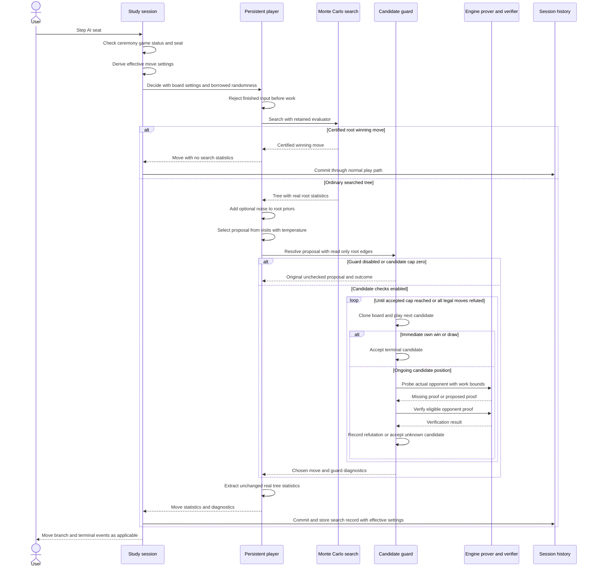
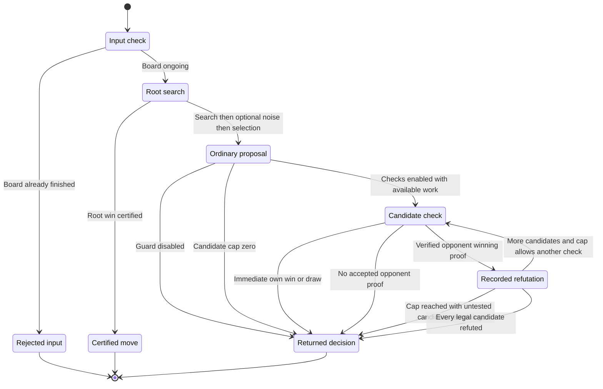

# Sub-chapter 08b — The AI player: design paper

## Abstract

This paper separates reusable move decisions from study-session state. A
persistent player owns one evaluator, while the session supplies the board,
per-move settings, and random-number generator. A first milestone preserves
the existing decision path. A second adds bounded opponent-proof checks after
ordinary move selection. Those checks certify individual refutations, never
the safety of an accepted defense. Root winning proofs remain distinct from
ordinary searched decisions and never acquire fabricated search statistics.
The design is synchronous, allocates a fresh search tree per decision, and
keeps the reusable player independent of Burn and the command-line interface.

## Glossary

| Term | Meaning here |
|------|--------------|
| CLI | Command-line interface, including the study session and its command/event model. |
| AI seat | A Black or White seat occupied by an automatic move producer. |
| MCTS | Monte Carlo tree search; simulations accumulate statistics on search-tree edges. |
| Evaluator | A concrete implementation of `mcts::Evaluator`, owned by a player. |
| Root hook | `Evaluator::evaluate_root`, which can supply a certified winning move before simulations. |
| Root proof | The certified move delivered as `SearchResult::ProvenWin`, not an estimated value. |
| Proposal | The ordinary temperature-selected move, before candidate checking. |
| Temperature | The setting for deterministic maximum-visit selection or visit-weighted sampling. |
| Prior | A policy probability on a root edge, separate from that edge's visits. |
| Dirichlet noise | A random perturbation of root priors; applied after search in the preserved path. |
| TSS | Threat-space search: bounded engine search through forcing threats and replies. |
| Candidate guard | Optional checking of hypothetical moves for verified opponent winning proofs. |
| Refutation | An accepted proof of the opponent's win after one particular candidate. |
| Unrefuted | No accepted opponent proof found within the bounds; unknown, not certified safe. |
| RNG | Random-number generator, owned by the session and mutably borrowed for a decision. |
| Work bounds | Candidate count and per-probe node/depth limits, not a wall-clock deadline. |
| `[experiment]` | A local tuning choice without a theorem or measured strength/latency guarantee. |

## Context and connected design narrative

`SessionCore` is the session state machine in the [CLI session module][session].
It owns `History`, Black and White `Occupant` values, the session RNG, and
search records keyed by history cursor. `AiConfig` describes an AI occupant's
settings; `SearchInfo` attaches those settings to a search record in the
[actor module][actor]. None of these artifacts should become part of a
reusable move-deciding library.

`AiPlayer`, in the [player library][player], is the new reusable artifact.
It owns a `Box<dyn mcts::Evaluator>` and accepts a borrowed `Board`,
`PlayerOptions`, and mutable RNG for one `decide` call. `PlayerOptions` carries
the simulation count, exploration constant, temperature, noise settings, and
`GuardConfig` for that call. The output `Decision` contains the chosen `Move`,
optional `SearchStats`, and `GuardDiagnostics`. Naming these artifacts makes
the ownership boundary explicit: a decision supplies information to the
session; it cannot advance history or emit session events.

[Chapter 08][chapter08] already gave `mcts::search` two outcomes. Its evaluator
root hook may certify a winning first move, producing
`SearchResult::ProvenWin`. Otherwise it returns
`SearchResult::Searched` with a simulated tree. This chapter consumes that
existing distinction rather than changing the evaluator seam. The root
certificate crosses the seam as a move; the complete `engine::Proof` remains
inside the certifying evaluator. Ordinary leaf evaluation does not gain a
prover call.

The first milestone creates one `AiPlayer` for each AI seat and extracts the
existing search/noise/selection path without defensive checking. Keeping the
evaluator alive matters for baseline because its construction initializes the
pattern network and gravity kernel. Keeping a player alive does **not** keep
a search tree alive. Each `decide` starts another search on the board supplied
by the session. The [player manifest][player-manifest] depends only on
`engine`, `mcts`, and `rand`; the CLI still constructs a concrete evaluator
through `make_evaluator` and passes it across that interface. Burn remains
outside the player crate even when the CLI chooses a Burn-backed evaluator.

At construction, `SessionCore::new` uses `make_player` to create players for
initial AI occupants and no players for humans. `set_occupant` becomes the
single replacement operation: releasing a seat constructs its player, taking
a seat drops its player, and `reset` replaces both according to the initial
occupants. `execute_new` invokes reset. An ordinary move or history/puzzle
navigation does not replace the evaluator. `execute_set_sims` changes
configuration and overrides, not evaluator ownership. Reset keeps the session
RNG rather than starting its stream again. Runtime player slots stay outside
`Occupant` and `AiConfig`, preserving those configuration types' clone,
equality, and serialization contracts.

When a user steps a seat, `SessionCore::execute_step` first rejects an opening
ceremony, then a finished board, then a human side-to-move seat. It derives an
`effective_config` from the current AI occupant. The existing opening schedule
may replace temperature and noise fraction for the first ten plies of an
eligible empty-root AI-versus-AI line. The effective settings become
`PlayerOptions`, so a schedule change or simulation-count update does not
reconstruct the evaluator. The selected player and the session RNG are
borrowed just for this decision.

Inside `AiPlayer::decide`, the terminal-board check repeats defensively for
non-CLI callers. A won or drawn input returns `DecisionError::GameOver`
without evaluation or RNG consumption. This is an error, not a proof. For an
ongoing board the player calls `mcts::search` using its retained evaluator.
A root certificate returns a decision with `search: None`, no sampling or
noise, and `GuardOutcome::ProvenWin` with zero checked candidates. No searched
tree is returned by that branch of the search seam. The player does not invent
visits, priors, or a measured value for the certificate.

An ordinary searched result follows the existing order: simulations, optional
root noise, visit extraction, and temperature selection. Root noise and
temperature are familiar from AlphaGo Zero [1], but their placement here is an
implementation compatibility constraint, not a reproduction of that paper's
pre-search noise policy. Here noise changes root priors **after** simulations;
it does not change current visits or accumulated values. Temperature selection
still uses those visits. Noise consumes RNG before sampling, so changing its
presence can change a seeded proposal without reweighting the visit
distribution. Post-noise priors can also break equal-visit ties among guard
alternatives in the second milestone.

`SearchStats::from_searched` records all root edges, including unvisited legal
moves. It sorts visits by descending count then ascending move index, and
priors by descending probability then ascending index. The root value is the
sum of root edge accumulated values divided by total root visits, or zero
when no visits occurred. Its perspective is the searched board's side to
move. This record must remain unchanged even if a subsequent guard chooses a
different move.

The second milestone adds `choose`, a private helper in the
[guard module][guard]. It receives the ordinary proposal and read-only root
edges. `GuardConfig::disabled()` returns the proposal unchecked. Both
`GuardConfig::default()` and `PlayerOptions::default()` disable checking;
`GuardConfig::baseline()` is an explicit opt-in preset. The CLI enables that
preset only when the effective evaluator kind is baseline, and disables it
for tactics. The library does not inspect the evaluator's concrete type.
There is no new CLI opt-out flag in this reference; a reusable-library caller
opts out by supplying disabled options.

With checking enabled, `choose` considers the proposal first, regardless of
its place in a deterministic ranking. Only a verified refutation permits
moving on to alternatives. Those alternatives contain every remaining root
move, including zero-visit moves, sorted by descending visits, descending
prior, and ascending move index. A single-candidate iterator followed by a
filtered ranked iterator expresses this separation; retries do not resample
and do not consume RNG.

For each checked candidate the guard clones the board and plays the move.
An immediate own win or a draw is accepted without probing. Otherwise
`after.to_move()` identifies the actual opponent on that hypothetical board,
and the callback runs `engine::prove_forced_win` for that opponent. The engine
uses threat-space search [2]. A proof refutes this candidate only if its winner
is the opponent, it has a legal first move on that board, and
`engine::verify_line` accepts it. Missing, malformed, wrong-winner, or
unverified proofs leave the candidate `Unrefuted`. `None` is UNKNOWN: no proof
was established within the work bounds. It cannot certify a safe defense.

The private callback parameter is a test seam, not a new evaluator hook. The
production caller supplies the engine prover; private tests can observe calls
or supply malformed proofs. The guard checks boards after hypothetical
candidates, not evaluator leaves. A certified root win bypasses it entirely.
It therefore complements, rather than relocates, the chapter-08 root hook.

The preset's five candidates, 1,000 nodes per probe, and ten plies per probe
are `[experiment]` work bounds. Proof verification and other decision work
are not controlled by a response-time deadline. When the candidate cap is
reached after refutations, the guard selects the highest-ranked remaining
**untested** move with `BudgetExhausted`. It must not go back to a refuted
proposal merely because the cap was small. A zero cap leaves the proposal
untested with that same outcome.

Only if every legal candidate has actually been refuted does `choose` report
`AllRefuted` and return the original legal proposal. That fallback can be a
known-refuted move; it is a legal continuation when the bounded decision API
has no unrefuted choice. The ordered individual refutations are diagnostics,
not a composed proof object establishing that the root position is lost.
The session must not infer a resignation from this outcome.

Finally, the session commits the chosen move. Proof decisions use
`execute_play` without adding a new search record. Searched decisions preserve
the existing `history.play` branch, attach `effective_config` through
`SearchInfo::from_stats`, store at the new cursor, and produce move, branch,
and terminal events as appropriate. `SearchInfo::from_searched` remains for
other callers and comparison tests. The current CLI does not retain or render
`GuardDiagnostics`; the player returns them for callers and tests. A changed
move never implies changed MCTS statistics.

## Primary sequence: one AI step

The plain-word diagram labels abbreviate the named artifacts above. The
search participant's root result is supplied through the existing evaluator
hook; candidate probes are a separate later operation.

The initial session checks can return errors before the decision call; the
player's defensive finished-input check can likewise return early. The
sequence expands the successful step paths, while the state diagram includes
that rejection explicitly. Proof verification in the sequence is conditional
on having a proof with the correct winner and a legal first move. A missing
proof proceeds directly to unknown acceptance.

## Decision state diagram and transition table

The diagram describes one decision, not a persistent search tree. After a
successful return the player still owns its evaluator, but its local tree and
candidate boards are discarded.

| From → to | Condition and operation | Observable result |
|-----------|-------------------------|-------------------|
| Input → rejected | Board won or drawn before search | `DecisionError::GameOver`; no evaluator or RNG use. |
| Input → root search | Ongoing board | One search with the retained evaluator and current simulation settings. |
| Root search → certified | `SearchResult::ProvenWin` | Certified move; `search: None`; `ProvenWin`, zero checks; no noise, sampling, or guard work. |
| Root search → proposal | `SearchResult::Searched` | Optional post-search prior noise, then ordinary visit-based selection; real statistics available. |
| Proposal → returned | Guard disabled | Original proposal; `Disabled`, zero checks. |
| Proposal → returned | Enabled, zero cap | Original unchecked proposal; `BudgetExhausted`, zero checks. |
| Proposal → candidate check | Enabled positive cap | Proposal checked first on a cloned board; increment `checked`. |
| Candidate check → returned | Immediate own win or draw | Candidate; `Terminal`; no opponent probe. |
| Candidate check → returned | No acceptable opponent proof | Candidate; `Unrefuted`; unknown, not certified safe. |
| Candidate check → recorded refutation | Correct opponent winner, legal first move, verified line | Append candidate to ordered `refuted`; do not alter root statistics. |
| Recorded refutation → candidate check | Another candidate exists and check count below cap | Next ranked candidate, counted only when hypothetically played. |
| Recorded refutation → returned | Another candidate exists, cap reached | Highest-ranked remaining untested move; `BudgetExhausted`. |
| Recorded refutation → returned | All legal candidates checked and refuted | Original legal proposal; `AllRefuted`; no root loss certificate. |

There is a separate resource lifetime, expressed by the session operations
rather than by the decision states:

| Session operation | Occupant/player transition | Retained state |
|-------------------|----------------------------|----------------|
| `SessionCore::new` | Initial AI gets a player; initial human gets none | One session RNG, initialized from the session seed. |
| `execute_release` through `set_occupant` | Selected seat becomes AI with a newly constructed player | Other seat's evaluator and session RNG. |
| `execute_take` through `set_occupant` | Selected seat becomes human; its player is dropped | Other seat's evaluator and session RNG. |
| `execute_set_sims` | Config and override change; player identity unchanged | Both evaluators and RNG. |
| Move or history/puzzle navigation | No player replacement | Both evaluators and RNG. |
| `execute_new` through `reset` | Both old players replaced according to initial occupants | Existing RNG stream; initial settings restored. |

## Noun catalog

| Artifact | Owner and role |
|----------|----------------|
| `SessionCore` | CLI owner of live session state, command checks, player slots, effective options, and events. |
| `History` and cursor | Session's authoritative variation history and location for search records. |
| `Occupant` and `AiConfig` | Cloneable/serializable seat description, not evaluator storage. |
| `black_player`, `white_player` | Optional runtime `AiPlayer` slots, aligned with AI occupancy. |
| `AiPlayer` | Reusable owner of one boxed evaluator; no session state or retained tree. |
| `mcts::Evaluator` | Existing estimate/root-certification interface; concrete construction stays in the CLI. |
| `Board` | Borrowed decision input; clones permit hypothetical checks without mutation. |
| `PlayerOptions` | Decision-local settings, including optional guard work bounds. |
| `SearchConfig` | Simulation count and exploration constant passed to MCTS. |
| `SearchResult` | Distinction between a certified root move and an ordinary searched tree. |
| `Tree` and root edges | Decision-local measurements and all legal retry candidates, including unvisited moves. |
| `Decision` | Move, optional real `SearchStats`, and separate `GuardDiagnostics`. |
| `SearchStats` | Sorted full-root visits, post-noise priors, searched-side perspective, and root value. |
| `SearchInfo` | CLI search record: player statistics plus effective `AiConfig`. |
| `DecisionError` | Terminal input rejection; not a proof or an unknown outcome. |
| `GuardConfig` | Enable flag, candidate cap, and per-probe engine `SearchBudget`. |
| `GuardDiagnostics` | Original proposal, ordered refutations, check count, and `GuardOutcome`. |
| `GuardOutcome` | Decision-local status: disabled, root proof, unrefuted, terminal, cap exhausted, or all legal candidates refuted. |
| `Proof` | Engine winning-line evidence checked on a hypothetical resulting board; not a defense certificate. |
| Session RNG | One mutable stream borrowed by the player; not owned by evaluator or guard. |

## Verb catalog

| Action | Implementing method/helper | Contract |
|--------|----------------------------|----------|
| Construct evaluator | `SessionCore::make_evaluator` | Select concrete tactics/baseline implementation at the CLI boundary. |
| Construct player | `SessionCore::make_player`, `AiPlayer::new` | Transfer evaluator ownership only for an AI occupant. |
| Replace occupant | `SessionCore::set_occupant` | Update seat description and runtime player together. |
| Restore initial seats | `SessionCore::reset` | Replace both players and restore initial session settings without reseeding. |
| Change simulations | `SessionCore::execute_set_sims` | Update config and override without replacing evaluator. |
| Derive effective options | `SessionCore::execute_step` | Apply opening schedule and evaluator-kind guard policy for this move. |
| Decide | `AiPlayer::decide` | Reject finished input or return a move without modifying its board. |
| Search | `mcts::search` | Invoke existing root hook and return certificate or searched tree. |
| Perturb priors | `mcts::add_dirichlet_noise` | Consume RNG after search; alter root priors, not visits. |
| Propose | `mcts::visit_distribution`, `mcts::select_move` | Include zero visits; apply temperature exactly once to obtain the original proposal. |
| Resolve candidates | Private `guard::choose` | Check proposal first; rank retries; retain unknown or return an explicit fallback. |
| Prove opponent win | `engine::prove_forced_win` | Return possible evidence or unknown under node/depth bounds. |
| Verify refutation | `engine::verify_line` plus eligibility checks | Accept only a valid opponent proof on the post-candidate board. |
| Extract measurements | Private `SearchStats::from_searched` | Preserve all root statistics and searched-side perspective. |
| Attach session config | `SearchInfo::from_stats` | Add the effective config without reconstructing evaluator or changing measurements. |
| Commit and notify | Session play/history/event path | Advance history and preserve the CLI event contract. |

## Central rule and invariants

**Central rule:** retain the evaluator, keep measurements separate from
certification, and change an ordinary proposal only after a verified
candidate refutation. An accepted defense remains unknown unless it has
already ended the game with an own win or draw.

1. **Dependency direction:** the CLI depends on the player; the player depends
   only on `engine`, `mcts`, and `rand`. It imports neither Burn nor concrete
   baseline/pattern implementations and performs no session I/O.
2. **Runtime ownership:** each AI seat has one player holding one evaluator;
   humans have none. Moves and `SetSims` reuse it; release/take/reset establish
   the resource transitions described above.
3. **Decision isolation:** the board and RNG are borrowed. Hypothetical checks
   use cloned boards. Every search tree is fresh; no asynchronous execution,
   background worker, or tree reuse is introduced.
4. **Terminal input rejection:** won/drawn input produces `GameOver` before
   evaluation or RNG use. It is not confused with a certified ongoing-root win.
5. **Proof honesty:** root certification yields `search: None`, no synthetic
   visits/prior/value, and zero defensive checks. The evaluator's certificate
   is trusted through the existing seam, not re-proved by the player.
6. **Ordinary-path preservation:** disabled checking preserves search →
   optional post-search prior noise → visit selection, including RNG stream
   consumption, real statistics, and existing temperature tie behavior.
7. **Noise honesty:** noise changes priors after search, not the current visit
   distribution. Its RNG consumption can affect seeded sampling; its priors
   can affect retry ranking. No “noisy visits” are claimed.
8. **Proposal precedence:** the original temperature proposal is checked first
   and retained unless refuted. Alternatives are deterministic by visits,
   prior, and move index, include unvisited legal moves, and are not repeated.
9. **Refutation soundness:** only an actual-opponent proof with legal first
   move and verified line refutes a candidate. Immediate own wins/draws do not
   invoke the opponent prover.
10. **Unknown remains unknown:** `None` or rejected proof means `Unrefuted`,
    never certified safe. Neither node/depth bounds nor the candidate cap
    establish a strict elapsed-time guarantee.
11. **Fallback precision:** a reached cap chooses the highest-ranked remaining
    untested candidate; zero cap leaves the proposal unchecked. Only actual
    refutation of all legal candidates permits `AllRefuted` and original-move
    fallback. That diagnostic is not a root-position loss proof.
12. **Measurement integrity:** the guard leaves root edges and returned
    `SearchStats` unchanged. Visits sum to the ordinary simulation count;
    zero simulations have zero root value. A guarded move need not lead the
    visit or prior list.
13. **Session authority:** the CLI retains ceremony/game/seat checks, effective
    options, history commits, record storage, and events. The player returns
    diagnostics; the present CLI does not expose them in its UI.
14. **Opt-in boundary:** reusable defaults disable checking. Baseline checking
    is the CLI's explicit policy, not behavior inferred inside the player.

## Verification scope and limitations

The [tutorial][tutorial] orders executable tests before implementation and
names their exact artifacts. Its public decision comparisons check manual
search equivalence and seeded RNG state; session tests check evaluator drops,
reuse, effective options, and proof event behavior. Guard tests use both real
engine proofs and a private injected callback; the latter isolates ordering,
malformed evidence, and branches where the prover must never run. The
[CLI policy test][session] uses a cheap injected evaluator under different
configured evaluator kinds; it does not execute the real Burn baseline.

Fresh reference QA in `rust-ml-ai-player-ref/gomoku` reports
`cargo test --release --locked --all-targets` exit 0: **574 passed, 0 failed,
6 ignored** across the workspace (42 s including compilation; 4 s cached).
All ten actor tests passed in release, including both real-baseline cases
previously skipped. The **21 player tests** comprise five private guard,
four public decision, and twelve public guard tests, including the independent
horizontal/vertical-line regression as well as the older two-ended-line test.
The six ignored tests are preexisting: two baseline acceptance, one CLI
acceptance, and three patterns differential tests.

`cargo clippy --locked --all-targets -- -D warnings` exited 0 (9 s);
`cargo fmt --all -- --check` and `git diff --check` also exited 0. These full
gates supersede the earlier filtered evidence; reference verification does
not land learner source on main. Interactive play is not claimed. Both design Mermaid fences passed
syntactic parsing under mermaid 12.3.0 with jsdom: `mermaid.parse` returned
diagramType `sequence` for the sequence diagram and `stateDiagram` for the
state diagram, with no errors. Browser/render validation was not performed.

The five-candidate/1,000-node/ten-ply preset is unmeasured as a strength or
latency policy. The guard can miss wins because TSS is bounded and selective,
accept unknown losing candidates, or return a refuted candidate only after
all legal moves have been refuted. It does not search for certified defenses,
compose a root loss certificate, or replace general MCTS. These limitations
are part of the interface's meaning, not reasons to silently strengthen its
claims.

## References

- [The AI player: tutorial][tutorial] — test-first execution order, contracts,
  commands, and completion criteria.
- [Chapter 08 — The TSS eye][chapter08] — evaluator-owned root certification;
  this chapter adds a separate post-selection defensive check.
- [Chapter 08b work plan][work-plan] — implementation milestones and evidence ledger.
- Implemented sibling reference: [player library][player],
  [private guard module and tests][guard], [player manifest][player-manifest],
  [decision tests][decisions], [public guard tests][guard-tests],
  [CLI session and unit tests][session], [actor types][actor],
  [actor integration tests][actor-tests], [MCTS move policy][policy],
  [engine prover/verifier][tss]. These links intentionally point to the
  implemented worktree, not to unlanded main source.
- [1] Silver et al. (2017), [Mastering the game of Go without human
  knowledge](https://doi.org/10.1038/nature24270) — temperature and root noise;
  not authority for this reference's post-search noise timing.
- [2] Allis (1994), [Searching for Solutions in Games and Artificial
  Intelligence](https://doi.org/10.26481/dis.19940923la) — threat-space search;
  not authority for the local guard's experimental work bounds.

[tutorial]: ./ai-player.md
[chapter08]: ../08-the-tss-eye/the-tss-eye.md
[work-plan]: ./WORK-PLAN.md
[player]: ../../../../../rust-ml-ai-player-ref/gomoku/crates/player/src/lib.rs
[guard]: ../../../../../rust-ml-ai-player-ref/gomoku/crates/player/src/guard.rs
[player-manifest]: ../../../../../rust-ml-ai-player-ref/gomoku/crates/player/Cargo.toml
[decisions]: ../../../../../rust-ml-ai-player-ref/gomoku/crates/player/tests/decisions.rs
[guard-tests]: ../../../../../rust-ml-ai-player-ref/gomoku/crates/player/tests/guard.rs
[session]: ../../../../../rust-ml-ai-player-ref/gomoku/crates/cli/src/session.rs
[actor]: ../../../../../rust-ml-ai-player-ref/gomoku/crates/cli/src/actor.rs
[actor-tests]: ../../../../../rust-ml-ai-player-ref/gomoku/crates/cli/tests/actor.rs
[policy]: ../../../../../rust-ml-ai-player-ref/gomoku/crates/mcts/src/policy.rs
[tss]: ../../../../../rust-ml-ai-player-ref/gomoku/crates/engine/src/tss.rs
