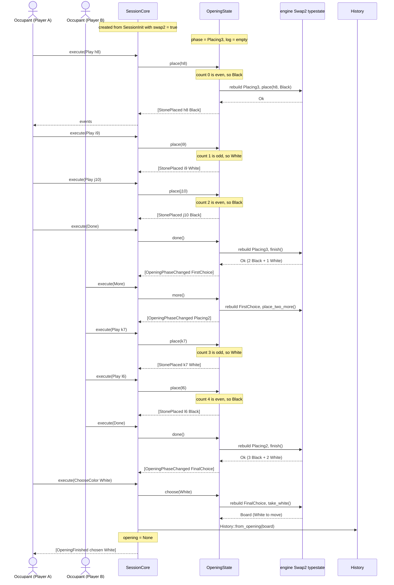
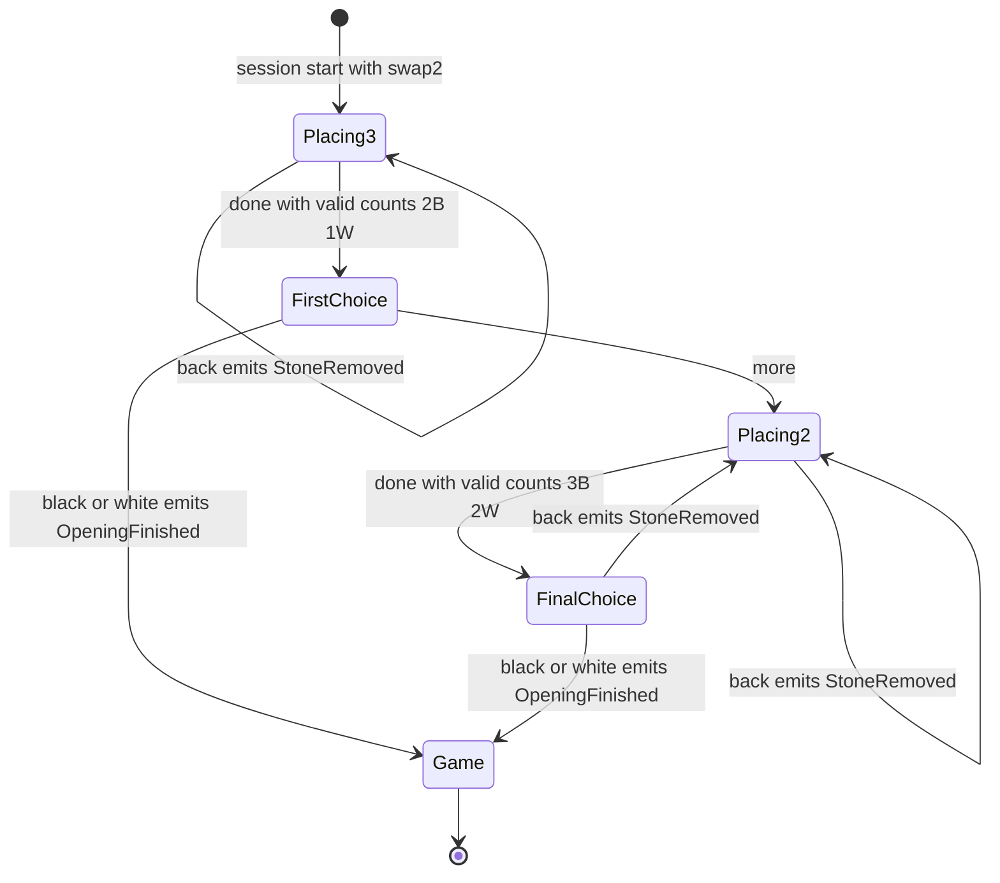
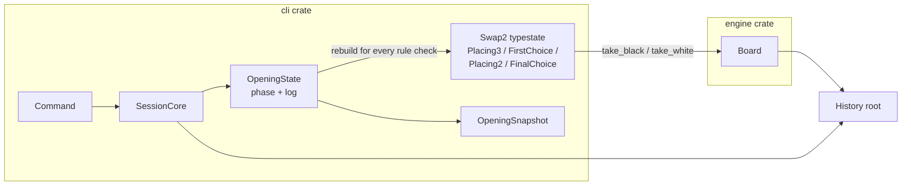

# Swap2 — Conceptual Design Paper

This paper describes how the concepts of the Swap2 implementation relate
to each other. Structs and enums are nouns. Methods are verbs. Section 1
explains the connections in plain language. Section 2 follows the
interaction between the Occupant and the SessionCore during the first
moves of a Swap2 game. The later sections decompose that interaction
into its parts.

Scope: the engine crate (`gomoku/crates/engine/src/opening.rs`) and the
cli crate (`gomoku/crates/cli/src/command.rs`, `opening.rs`,
`session.rs`). The contract is sub-chapter 05c (`swap2.md`).

## 1. The design in plain language

A Swap2 game does not start with a Black player and a White player. It
starts with two players and one procedure. The first player puts three
stones on the board: two Black, one White. The second player then
decides. Either take a color and start the game, or add two more stones
and give the choice to the first player. Only when someone takes a
color do the seats — the two `Occupant` values in `SessionCore` — gain
their meaning. Before that moment there is no Black seat and no White
seat. There is only the player who places and
the player who answers.

The engine knows the rules of this procedure. It holds a machine, the
struct `Swap2<State>`, with four states: `Placing3` (place three
stones), `FirstChoice`, `Placing2` (place two stones), and
`FinalChoice`. This machine is a Rust typestate. Each state is its own
marker type, and each move to a next state consumes the old value. Code that tries
an illegal move does not compile. This guarantee has a price. A machine
that consumes itself cannot be stored in a field. It cannot undo a
placement. It cannot report which stones are on the board. A session
needs all three abilities.

The session therefore keeps data instead of the machine, in the struct
`OpeningState`. The data is a list, the field `log: Vec<(Move,
Color)>`, plus the current phase, the field `phase: OpeningPhase`.
The log holds every placement the engine accepted, in order. It is the
authoritative record of the ceremony. When a rule must be checked — are
the counts right, is the square free, what does the finished board look
like — the session rebuilds a `Swap2<State>` value from the log, asks
the question, and discards the value again. The rules live in exactly
one place, and the session keeps the abilities the machine cannot
have.

Undo shows why this works. Every entry in the log passed the engine
once, so every prefix of the log is a valid state. Removing the last
placements is enough. No engine call is needed, and no state can be
broken. The phase after an undo follows from the log length alone.

`OpeningState` stores the phase next to the log instead of computing
it, because the log length is ambiguous at three stones: the round can
be finished (`FirstChoice`), or the `done` can still be missing (still
`Placing3`).

The Occupant sees none of this directly. The Occupant sends a
`Command` to `SessionCore::execute` and receives `Event` values as
the answer. The command words are `play`, `back`, `done`, `more`,
`black`, and `white`. The SessionCore reads the `OpeningPhase` and
gives each command its meaning. During the ceremony, `play` places a
stone, and the stone's color follows from the number of placements:
Black on even counts, White on odd counts. `back` removes the last
placement. After the ceremony, the same words operate on the variation
tree, the `History` struct: `play` adds a move, `back` navigates. One
vocabulary, two meanings. The phase decides which.

The ceremony ends with a choice, `Command::ChooseColor`. The chosen
color assigns the seats. The engine produces a legal `Board`, always
with White to move, because White holds fewer stones after both
possible ceremonies. That board becomes the root of a fresh `History`,
the field `opening` in `SessionCore` becomes `None`, and the ceremony
is over. From that point on, the game is an ordinary game.

The sections below make this precise. Section 2 follows one full
ceremony command by command. Section 3 gives the state machine.
Sections 4 and 5 catalog the nouns and the verbs. Section 6 states
the central rule. Sections 7 to 9 cover routing, events, errors, and
invariants.

## 2. The primary interaction: Occupant and SessionCore

A Swap2 game starts before any seat has a color. Two players share one
procedure. Player A places stones. Player B answers. The roles "Player A"
and "Player B" exist only during the ceremony. The seats `black` and
`white` receive their meaning only when the ceremony ends: the choice of
color assigns the seats.

The Occupant does not talk to the engine. The Occupant sends a `Command`
to `SessionCore::execute` and receives a list of `Event` values. The
SessionCore decides what the command means. During the ceremony it
forwards placement commands to the `OpeningState`. The `OpeningState`
rebuilds the engine's `Swap2<State>` typestate for every rule decision.

The full happy path, with the `more` branch:

After `OpeningFinished`, the same commands keep working, with a
different meaning: `play` adds a node to the variation tree, and `back`
navigates it. One language, two phases, two meanings. Section 7 covers
this routing.

## 3. The state machine

The ceremony has four phases. The engine encodes them as type
parameters. The session encodes them as the `OpeningPhase` enum. The
two encodings mirror each other one to one.

Transition table:

| Current phase | Command | Condition | Next phase | Events |
|---|---|---|---|---|
| Placing3 | `play <sq>` | square free | Placing3 | `StonePlaced` |
| Placing3 | `back [n]` | log not empty | Placing3 | `StoneRemoved` |
| Placing3 | `done` | 2 Black + 1 White | FirstChoice | `OpeningPhaseChanged` |
| Placing3 | `done` | wrong counts | Placing3 (unchanged) | error `IllegalMove(BadOpeningCounts)` |
| FirstChoice | `more` | — | Placing2 | `OpeningPhaseChanged` |
| FirstChoice | `black` / `white` | — | game | `OpeningFinished` |
| Placing2 | `play <sq>` | square free | Placing2 | `StonePlaced` |
| Placing2 | `back [n]` | log not empty | Placing2 or Placing3 | `StoneRemoved` |
| Placing2 | `done` | 3 Black + 2 White | FinalChoice | `OpeningPhaseChanged` |
| FinalChoice | `back` | — | Placing2 | `StoneRemoved` |
| FinalChoice | `black` / `white` | — | game | `OpeningFinished` |

Three rules explain every transition:

1. **The counts are the rule.** The engine accepts a placement round
   only at the exact counts: 2 Black and 1 White in round one, 3 Black
   and 2 White in round two. A failed `done` changes nothing. The phase
   and the log stay as they are.
2. **The colors are a convention.** The session fixes the placement
   order: strict alternation, Black first, over the whole ceremony. An
   even placement count places Black next, an odd count White. The
   sequence is B, W, B in round one and W, B in round two. The rule
   cares about counts; the convention cares about order. No reachable
   position is lost, so the convention is free.
3. **Undo is log truncation.** `back` removes the last placements from
   the log. The phase after an undo follows from the log length: three
   or fewer stones means Placing3, four or five means Placing2. An undo
   never lands in a choice phase. Removing the stone that completed a
   round takes the `done` back with it.

## 4. The nouns

The implementation has two layers. The engine layer owns the rules. The
session layer owns the interaction.

### 4.1 The word "opening" names three different things

| Name | Type | Layer | Meaning |
|---|---|---|---|
| `Swap2<State>` | struct, generic over the phase marker | engine | The rule machine. Exists only inside one rule check. |
| `SessionInit.opening` | field of type `Board` | cli | The root position of the variation tree. For Swap2 it must be empty. |
| `OpeningState` | struct | cli | The ceremony in progress: the phase plus the replay log. |

This paper uses "the typestate" for `Swap2<State>`, "the root board" for
`SessionInit.opening`, and "the ceremony state" for `OpeningState`.

### 4.2 Engine layer (nouns)

| Noun | Kind | Role |
|---|---|---|
| `Swap2<State>` | struct | The rule machine. Holds two `Bitboard` values (black stones, white stones) and a `PhantomData<State>`. |
| `Placing3` | marker struct | Phase marker: Player A places three stones. |
| `FirstChoice` | marker struct | Phase marker: Player B chooses a color or asks for two more stones. |
| `Placing2` | marker struct | Phase marker: Player B places two more stones. |
| `FinalChoice` | marker struct | Phase marker: Player A chooses a color. |
| `Board` | struct | A legal game position. The output of a finished ceremony. |
| `PlayError` | enum | The engine's rejection: `Occupied`, `BadOpeningCounts`. |

The marker structs carry no data. They exist so that an invalid
transition is a compile error. `Swap2<Placing3>` has no `take_black`
method; calling one does not compile.

### 4.3 Session layer (nouns)

| Noun | Kind | Role |
|---|---|---|
| `SessionInit` | struct | The construction record for a session. Seats, AI defaults, seed, root board, and the `swap2` flag. |
| `SessionCore` | struct | The headless session. Owns the `History`, the two seat `Occupant` values, the RNG, and `opening: Option<OpeningState>`. |
| `Occupant` | enum | Who produces a seat's moves: `Human` or `Ai(AiConfig)`. |
| `OccupantKind` | enum | `Human` or `Ai`, without configuration. Used in events and snapshots. |
| `OpeningState` | struct | The ceremony state: `phase: OpeningPhase` and `log: Vec<(Move, Color)>`. |
| `OpeningPhase` | enum | The runtime mirror of the engine's markers: `Placing3`, `FirstChoice`, `Placing2`, `FinalChoice`. |
| `OpeningSnapshot` | struct | The read model of the ceremony: phase, placements, next color. |
| `Snapshot` | struct | The read model of the whole session. Gains `opening: Option<OpeningSnapshot>`. |
| `Command` | enum | The input vocabulary. `Play`, `Done`, `ChooseColor`, `More`, `Back`, and the rest. |
| `Event` | enum | The output vocabulary. Facts about what changed. |
| `CommandError` | enum | The typed rejections. |
| `History` | struct | The variation tree. Inactive during the ceremony. |

Why does `OpeningPhase` exist when the engine already has four marker
types? Because the typestate cannot be stored. A typestate transition
consumes `self`. A value that must survive across commands of different
phases cannot be a typestate value. So the session stores data (an enum
plus a log) and rebuilds the typestate on demand. The enum is the
storable mirror of the markers.

Why is the phase a separate field and not derived from the log length?
Because three placements are ambiguous: "round complete, `done`
accepted" (FirstChoice) or "third stone placed, `done` not yet given"
(still Placing3). The log length cannot distinguish these two states.

## 5. The verbs

### 5.1 Engine layer (verbs)

| Receiver | Method | Consumes | Produces |
|---|---|---|---|
| `Swap2<Placing3>` | `new()` | — | `Swap2<Placing3>` |
| `Swap2<Placing3>` | `place(mv, color)` | `&mut self` | `Result<(), PlayError>` |
| `Swap2<Placing3>` | `finish()` | `self` | `Result<Swap2<FirstChoice>, PlayError>` |
| `Swap2<FirstChoice>` | `take_black()` / `take_white()` | `self` | `Board` |
| `Swap2<FirstChoice>` | `place_two_more()` | `self` | `Swap2<Placing2>` |
| `Swap2<Placing2>` | `place(mv, color)` | `&mut self` | `Result<(), PlayError>` |
| `Swap2<Placing2>` | `finish()` | `self` | `Result<Swap2<FinalChoice>, PlayError>` |
| `Swap2<FinalChoice>` | `take_black()` / `take_white()` | `self` | `Board` |

Every transition verb takes ownership. This is the compile-time proof
that no path uses a stale state. It is also the reason the session
cannot keep a typestate value.

### 5.2 Session layer (verbs)

| Receiver | Method | Meaning |
|---|---|---|
| `SessionInit` | `hotseat()`, `versus_ai(..)`, `ai_vs_ai(..)` | Constructors. All set `swap2: false`. |
| `SessionInit` | `with_swap2(bool)` | Chainable flag setter. |
| `SessionCore` | `new(init)` | Builds the session. With `swap2 = true`, creates `OpeningState` and requires an empty root board (a panic, because the combination is a programming error). |
| `SessionCore` | `execute(cmd)` | The single entry point. Routes by phase. |
| `SessionCore` | `snapshot()` | The read model, including `OpeningSnapshot` during the ceremony. |
| `OpeningState` | `place(mv)` | Appends a validated placement. No color argument: the parity of the log length decides. |
| `OpeningState` | `undo(n)` | Pops placements. Recomputes the phase from the log length. |
| `OpeningState` | `done()` | Validates the round counts through the rebuilt typestate. Advances the phase. |
| `OpeningState` | `more()` | Converts FirstChoice into Placing2 through the rebuilt typestate. |
| `OpeningState` | `choose(color)` | Read-only. Rebuilds the typestate and returns the finished `Board`. The caller decides what the board becomes. |
| `OpeningState` | `next_color()` | `Some(color)` during placement phases, `None` at choice phases. |
| `OpeningState` | `snapshot()` | Produces the `OpeningSnapshot`. |
| module-level | `rebuild_placing3(log)` etc. | Four helpers that replay the log into a typestate value. |

## 6. The central design rule

**The log is the authoritative record. The typestate is a validated
projection of that record.**

Every placement enters the log only after the engine accepted it. Every
rule decision (`done` counts, occupied squares, the final board)
rebuilds the typestate from the log and asks the engine. The session
contains no second copy of a Swap2 rule. A rebuild costs at most five
`place` calls.

Two consequences:

1. **Undo needs no engine call.** The log grows only through validated
   placements. Every prefix of the log was once the live state. A prefix
   of a valid sequence is a valid state. So `back` pops the log and is
   done.
2. **The ceremony has no `Board`.** `Board::from_position` requires
   counts that differ by at most one and a defined side to move. A
   mid-ceremony position has neither. During the ceremony,
   `SessionCore::board()` returns the empty root board, and the stones
   live in `Snapshot.opening` as `(Move, Color)` pairs. Only the
   finished opening becomes a `Board` and the root of a fresh `History`.

## 7. Phase routing: one language, two meanings

The parser produces the same `Command` values in and out of the
ceremony. `SessionCore::execute` routes them by phase.

| Command | During the ceremony | After the ceremony |
|---|---|---|
| `play <sq>` | place a ceremony stone | add a tree move |
| `back [n]` | remove placements | navigate the tree |
| `done` | end the current placement round | error `NotInOpening` |
| `black` / `white` | choose a color | error `NotInOpening` |
| `more` | decline the first choice | error `NotInOpening` |
| `step` | error `OpeningInProgress` | search and play one AI move |
| `new` | reset into the ceremony | reset to the root board |

The split between parse errors and phase errors is deliberate. The
parser rejects text it cannot read (`play h8 white` is a usage error).
The session rejects commands that do not apply now (typed
`CommandError` variants). Parsing is about text. Phase is about state.

`step` is refused during the ceremony because the AI searches game
positions, and a ceremony is not one. A searched move would be discarded
when the ceremony resets the tree.

## 8. Events and errors

Commands go in. Events come out. Four events are specific to the
ceremony:

| Event | Meaning |
|---|---|
| `StonePlaced { mv, color }` | A placement entered the log. |
| `StoneRemoved { mv }` | `back` removed a placement. |
| `OpeningPhaseChanged { phase }` | The ceremony advanced. |
| `OpeningFinished { chosen }` | The ceremony ended; the game starts. |

`OpeningFinished` carries only the chosen color. The side to move is not
carried, because it is always White: White has fewer stones after both
possible ceremonies (1 of 3 or 2 of 5), and the engine derives the side
to move from the counts.

Every wrong-phase command returns its own typed error, and each error
message says one true sentence:

| Error | Sentence |
|---|---|
| `NotInOpening` | No Swap2 opening is in progress. |
| `NotAtPlacementPhase` | The opening is not at a placement phase. |
| `NotAtChoicePhase` | The opening is not at a choice phase. |
| `NotAtFirstChoice` | `more` applies only at the first choice. |
| `OpeningLogEmpty` | There is no placement to remove. |
| `OpeningInProgress` | Choose a color first. |
| `IllegalMove(BadOpeningCounts)` | The engine's own count rejection, passed through unchanged. |

The count rule belongs to the engine, so its error is the engine's
`PlayError`, not a new session variant.

## 9. Invariants

The design keeps these properties true at all times:

1. The log contains only placements the engine accepted.
2. The phase field and the log agree: a choice phase follows a
   count-validated round.
3. The next color is a pure function of the log length: even count,
   Black; odd count, White.
4. After an undo, the phase is a pure function of the log length, and
   never a choice phase.
5. A finished ceremony produces a legal `Board` with White to move.
6. Sessions without Swap2 are byte-identical in behavior and in
   snapshot serialization (`opening` is serialized only when `Some`).
7. `new` returns a Swap2 session to Placing3 with an empty log.
