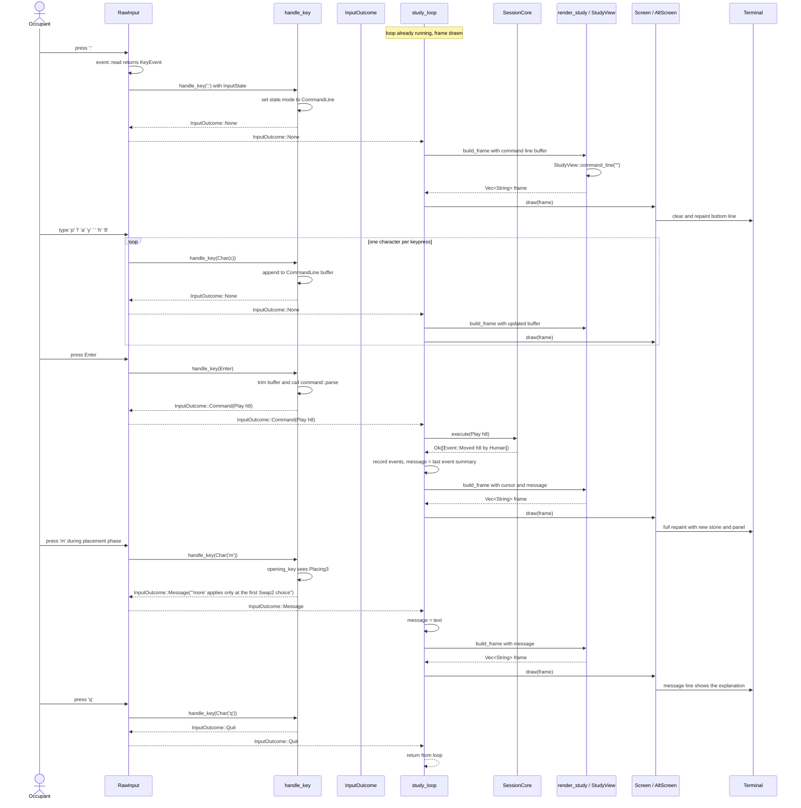
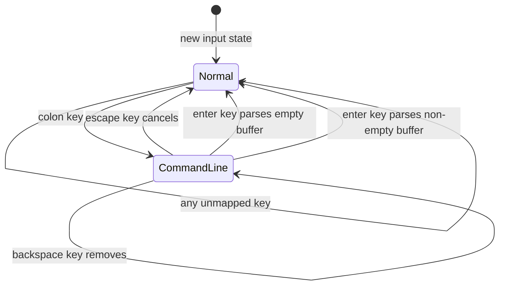
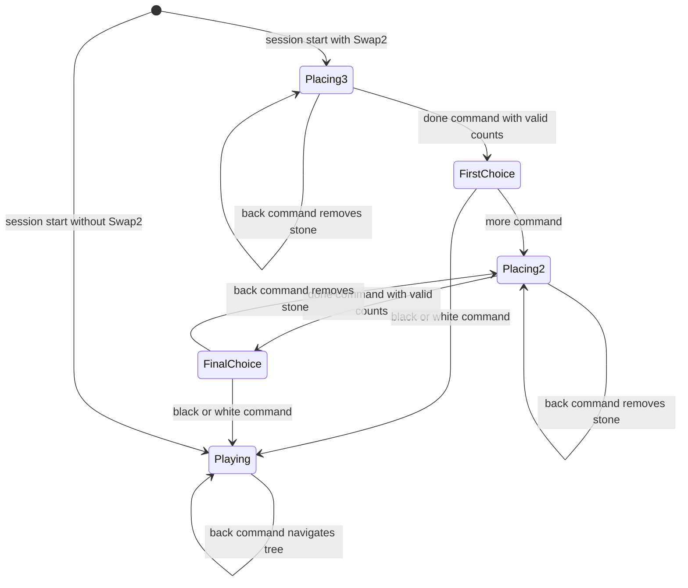

# The alternate-screen shell — Conceptual Design Paper

Scope: the shell layer of sub-chapter 05d. It covers the `Screen` trait and the `AltScreen` RAII guard in `screen.rs`, the pure key translator in `input.rs`, and the generic `study_loop` with its terminal `RawInput` source in `study.rs`. It also covers the small extensions to `render.rs`: the `StudyView` chainable setters and the message/command-line bottom line. Sub-chapter e adds `LineScreen` and `LineInput`; this paper mentions them only as the line-mode fallback.

## 1. The design in plain language

The alternate-screen shell is a thin loop around the session core. The session core owns the game. The shell owns only three things: the terminal state, the occupant's hands, and the picture on the screen.

The terminal state lives in the `AltScreen` struct. `AltScreen::enter()` enables raw mode, enters the alternate screen buffer, and hides the cursor. The value that `enter()` returns carries no data. Its only job is to stay alive. When the value drops out of scope, its `Drop` implementation restores the terminal: it shows the cursor, leaves the alternate screen, and disables raw mode. `Drop` runs on every exit path: a normal return, an error propagated with `?`, and a panic. This is the RAII guard pattern. The terminal is safe because the guard exists, not because every caller remembers to clean up.

The occupant's hands live in `InputState`. It holds an `InputMode` and a board cursor. `InputMode` has two variants. `Normal` means single keys act immediately. `CommandLine(String)` means a `:` command line is open and the `String` is the buffer typed so far. The cursor is a `Move`; it marks the square where the next `Enter` key will act. `InputState::new()` starts in normal mode with the cursor on the center point h8.

A keypress becomes a meaning through `handle_key`. This function is pure: it mutates only the `InputState` and touches no I/O. It takes a crossterm `KeyEvent`, the mutable `InputState`, and a read-only `SessionCore`. It returns an `InputOutcome`. `InputOutcome` has five variants: `Command(Command)`, `Help`, `Quit`, `Message(String)`, and `None`. The variant is the only thing the loop sees. The key itself never leaves the input module.

`handle_key` is two small machines. In normal mode it checks global keys first. Arrows and `hjkl` move the cursor. `:` opens the command line. `?` means `Help`. `q` means `Quit`. After the global keys, it dispatches on the session phase. The phase comes from `core.snapshot().opening`. If an opening snapshot is present, the shell is in a Swap2 ceremony and `opening_key` runs. If the snapshot is `None`, the shell is in normal play and `playing_key` runs. This is why one key can safely carry one meaning per phase: the session knows the phase, and the input layer asks.

The command line is a small editor. While the mode is `CommandLine`, `handle_command_line_key` appends characters, pops characters on `Backspace`, cancels on `Esc`, and parses on `Enter`. The parse uses `command::parse`. This is the same grammar that the line-mode REPL uses. No second grammar exists. A successful parse produces `InputOutcome::Command(cmd)`. A parse error produces `InputOutcome::Message(err.to_string())` and closes the line.

The picture on the screen lives in `StudyView` and `render_study`. `StudyView` is the input to the renderer. It holds the session core, the recent events, and optional display state: cursor, command-line buffer, message text, and a styling flag. The setters are chainable, so a caller states only what it has. `render_study` returns `Vec<String>`. The frame is the board on the left, the side panel on the right, and one bottom line. The bottom line belongs to the command-line buffer while it is open; otherwise it belongs to the message.

The loop in `study_loop` ties these pieces together. It is generic over `Screen` and `InputSource`. One iteration builds a frame, draws it, reads one input outcome, and applies it. `Screen::draw` sends the frame to the terminal. `InputSource::next_outcome` returns the next `InputOutcome`. `RawInput` is the terminal implementation; it reads crossterm events and calls `handle_key`. The loop does not know it is talking to a terminal. Tests use a recording screen and a scripted input source instead.

When the occupant presses a key, the execution path is short. The terminal sends the key through crossterm. `RawInput` reads it, calls `handle_key`, and receives an `InputOutcome`. The loop applies the outcome. If the outcome is a command, the loop calls `SessionCore::execute`. The session returns events or an error. The loop records the events and updates the message line. Then it builds a new `StudyView`, renders it, and draws it. The occupant sees the new frame.

The terminal-safety story runs underneath every happy path. The `AltScreen` value is created before the loop starts. It outlives the loop. Whatever happens inside the loop — a quit command, an I/O error, a panic — the guard restores the terminal when the stack unwinds. The shell never leaves the user in raw mode or on the alternate screen.

## 2. The primary interaction: one keypress from occupant to terminal

The diagram follows one full happy path. The occupant opens the command line, types `play h8`, presses Enter, and sees the result. It also shows the error-to-message-line path: the occupant presses `m` during a placement phase, and the shell shows a message instead of sending a command.

## 3. The state machines

The shell has two separate state machines. One is inside the shell: the input mode. The other is inside the session: the game phase. The meaning of a key is a function of both.

### 3.1 InputMode inside the shell

Transition table for `InputMode`:

| Current mode | Key | Next mode | Output |
|---|---|---|---|
| Normal | `:` | CommandLine | `InputOutcome::None` |
| CommandLine | character | CommandLine | `InputOutcome::None`, buffer appended |
| CommandLine | Backspace | CommandLine | `InputOutcome::None`, buffer popped if non-empty |
| CommandLine | Esc | Normal | `InputOutcome::None`, buffer dropped |
| CommandLine | Enter on empty buffer | Normal | `InputOutcome::None` |
| CommandLine | Enter on non-empty buffer | Normal | `InputOutcome::Command(cmd)` or `InputOutcome::Message(err)` |
| Normal | any unmapped key | Normal | `InputOutcome::None` |

### 3.2 Session phase changes the meaning of the same keys

The same physical key produces different `Command` values depending on the phase. The table below shows the mapping from key to outcome for keys that change meaning.

| Key | Placing3 / Placing2 | FirstChoice | FinalChoice | Playing |
|---|---|---|---|---|
| Enter | `Command::Play` at cursor | unmapped | unmapped | `Command::Play` at cursor if human seat, `Command::Step` if AI seat |
| u | `Command::Back` | unmapped | unmapped | `Command::Back` |
| d | `Command::Done` | unmapped | unmapped | unmapped |
| b | unmapped | `Command::ChooseColor Black` | `Command::ChooseColor Black` | unmapped |
| w | unmapped | `Command::ChooseColor White` | `Command::ChooseColor White` | unmapped |
| m | message | `Command::More` | message | unmapped |

The phase is not stored in the shell. The shell reads it from `core.snapshot().opening` on every keypress. This keeps the input layer stateless except for the cursor and the command-line buffer.

## 4. The nouns

### 4.1 Shell layer nouns

| Noun | Kind | Role |
|---|---|---|
| `Screen` | trait | A destination for one rendered frame. Has `draw` and a default `styled`. |
| `AltScreen` | struct | The full-screen terminal screen and the RAII guard that restores the terminal. |
| `InputSource` | trait | A source of `InputOutcome` values. The loop is generic over it. |
| `RawInput` | struct | The terminal implementation of `InputSource`. Reads crossterm key events. |
| `InputState` | struct | The shell's mutable input state: `mode: InputMode` and `cursor: Move`. |
| `InputMode` | enum | `Normal` or `CommandLine(String)`. |
| `InputOutcome` | enum | What one keypress means: `Command`, `Help`, `Quit`, `Message`, or `None`. |
| `StudyView` | struct | The render input: session, events, cursor, command line, message, styling flag. |
| `EVENT_CAP` | constant | The maximum number of recent events kept by the loop. |
| `ScriptedInput` | struct in tests | A test input source that plays back scripted key events. |
| `TestScreen` | struct in tests | A test screen that records frames in a `Vec`. |

### 4.2 Session layer nouns

| Noun | Kind | Role |
|---|---|---|
| `SessionCore` | struct | The headless session. Owns the board, history, seats, and optional opening state. |
| `SessionInit` | struct | The construction record for a session. |
| `Snapshot` | struct | The read model of the whole session, including `opening: Option<OpeningSnapshot>`. |
| `OpeningSnapshot` | struct | The read model of a Swap2 ceremony: phase, placements, next color. |
| `OpeningPhase` | enum | `Placing3`, `FirstChoice`, `Placing2`, `FinalChoice`. |
| `Command` | enum | The input vocabulary: `Play`, `Back`, `Done`, `More`, `ChooseColor`, `Step`, `Help`, `Quit`, etc. |
| `Event` | enum | The output vocabulary: facts about what changed. |
| `Move` | struct | A board square, used for the cursor and for commands. |
| `Color` | enum | `Black` or `White`, used in `ChooseColor` commands. |
| `Board` | struct | A legal game position. Empty during the Swap2 ceremony. |
| `command::parse` | function | The shared grammar parser. Lives in `command.rs`. |

## 5. The verbs

### 5.1 Shell layer verbs

| Receiver | Method | Consumes | Produces |
|---|---|---|---|
| `AltScreen` | `enter()` | — | `io::Result<AltScreen>` |
| `AltScreen` | `draw(frame)` | `&[String]` | `io::Result<()>` |
| `AltScreen` | `styled()` | — | `bool` |
| `AltScreen` | `drop` implicitly | self | terminal restored |
| `Screen` default | `styled()` | — | `false` |
| `RawInput` | `next_outcome(state, core)` | mutable state, read-only core | `io::Result<InputOutcome>` |
| `RawInput` | `wait_any_key()` | — | `io::Result<()>` |
| `InputState` | `new()` | — | `InputState` |
| module `input` | `handle_key(key, state, core)` | `KeyEvent`, mutable state, read-only core | `InputOutcome` |
| module `input` | `handle_normal_key(key, state, core)` | `KeyEvent`, mutable state, read-only core | `InputOutcome` |
| module `input` | `handle_command_line_key(key, state)` | `KeyEvent`, mutable state | `InputOutcome` |
| module `input` | `move_cursor(cursor, dr, dc)` | mutable `Move`, deltas | clamped `Move` |
| module `input` | `opening_key(key, state, opening)` | `KeyEvent`, mutable state, `OpeningSnapshot` | `InputOutcome` |
| module `input` | `playing_key(key, state, core)` | `KeyEvent`, state, `SessionCore` | `InputOutcome` |
| `StudyView` | `new(core, events)` | session core, events | `StudyView` |
| `StudyView` | `cursor(mv)` | `Move` | `StudyView` |
| `StudyView` | `command_line(buffer)` | `&str` | `StudyView` |
| `StudyView` | `message(text)` | `&str` | `StudyView` |
| `StudyView` | `styled(flag)` | `bool` | `StudyView` |
| module `render` | `render_study(view)` | `&StudyView` | `Vec<String>` |
| module `study` | `run(init, hint)` | `SessionInit`, optional hint | `io::Result<()>` |
| module `study` | `study_loop(core, screen, input, hint)` | mutable core, screen, input; hint | `io::Result<()>` |
| module `study` | `build_frame(...)` | core, state, cursor, events, message, styled | `Vec<String>` |
| module `study` | `show_help(screen, input)` | mutable screen and input | `io::Result<()>` |
| module `study` | `read_key_press()` | — | `io::Result<KeyEvent>` |

### 5.2 Session layer verbs

| Receiver | Method | Meaning |
|---|---|---|
| `SessionCore` | `new(init)` | Builds the session from `SessionInit`. |
| `SessionCore` | `execute(cmd)` | Routes the command and returns events or an error. |
| `SessionCore` | `snapshot()` | Produces the read-only `Snapshot`. |
| `SessionCore` | `board()` | Returns the current game board. |
| `SessionCore` | `occupant(side)` | Returns the `Occupant` for the given side. |

## 6. The central design rule and invariants

The central design rule is: keys are only translations to `Command` values. The session core sees no difference between a key and a typed line. Both go through the one shared grammar in `command::parse`. The terminal is restored on every exit path, panic included.

This rule gives four consequences:

1. The command line and the line-mode fallback use the same parser. A second parser in the shell would drift from the first.
2. The session core is input-agnostic. It accepts `Command` values and returns `Event` values or errors. It does not know whether the command came from a single key or a typed line.
3. Phase-dependent keys are safe because the session always knows the phase. The input layer asks the session for the phase on every keypress.
4. The terminal guard is unconditional. `AltScreen::Drop` restores the terminal no matter how the loop ends.

Invariants:

1. `AltScreen::enter()` is called only after stdout is confirmed to be a terminal. If stdout is not a terminal, `run` returns a clear `Unsupported` I/O error and never touches raw mode.
2. `AltScreen::Drop` runs on every exit path: normal return, error return, and panic unwind. Errors inside `Drop` are ignored with `let _`, because panicking inside `Drop` during an unwind would abort the process.
3. `handle_key` is pure: it mutates only `InputState` and performs no I/O. It is fully testable without a terminal.
4. Every key maps to exactly one `InputOutcome`. The mapping is total; unmapped keys produce `InputOutcome::None`.
5. Global keys (`:` `?` `q` and cursor motion) have the same meaning in every phase.
6. The bottom line of the frame belongs to the command-line buffer while `InputMode` is `CommandLine`; otherwise it belongs to the message.
7. The recent-events list is capped at `EVENT_CAP` entries. The oldest events drop first.
8. `Screen::styled()` decides whether the frame carries ANSI styling. The default is `false`, so test recordings and pipes are plain text unless the screen overrides it.
9. The loop repaints the whole frame on every input. There is no diffing. A 15×15 board frame is small enough that full repaints cost nothing measurable.

## 7. Disambiguation

### 7.1 The word "mode"

The word "mode" names three different things in this sub-chapter. Do not confuse them.

- **Terminal raw mode** is a Unix terminal input mode. In raw mode the terminal driver does not buffer lines and does not echo characters. `AltScreen::enter()` enables raw mode. `AltScreen::Drop` disables it.
- **Terminal canonical mode** is the opposite of raw mode. The terminal driver buffers lines and echoes characters. The line-mode fallback in sub-chapter e uses canonical mode.
- **`InputMode`** is the shell's own modal input state. It has two variants: `Normal` and `CommandLine`. It exists inside the program, not inside the terminal driver. Raw mode can carry either `InputMode` variant.

### 7.2 The word "screen"

The word "screen" also names two different things.

- **`Screen`** is a trait in the shell. It has one required method, `draw`, and one default method, `styled`. It abstracts over where a finished frame goes. `AltScreen` implements it for terminals; `TestScreen` implements it for tests; sub-chapter e adds `LineScreen` for pipes.
- **The alternate screen** is a second terminal buffer. Entering it hides the user's scrollback; leaving it restores the previous content. `AltScreen::enter()` sends the escape sequence to enter it; `AltScreen::Drop` sends the escape sequence to leave it.

The `Screen` trait is software. The alternate screen is a terminal feature. The `AltScreen` type is both: it implements the `Screen` trait and manages the alternate-screen buffer.
