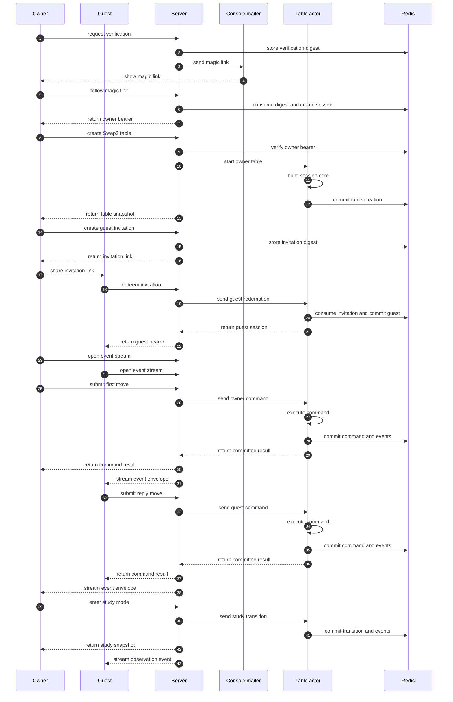
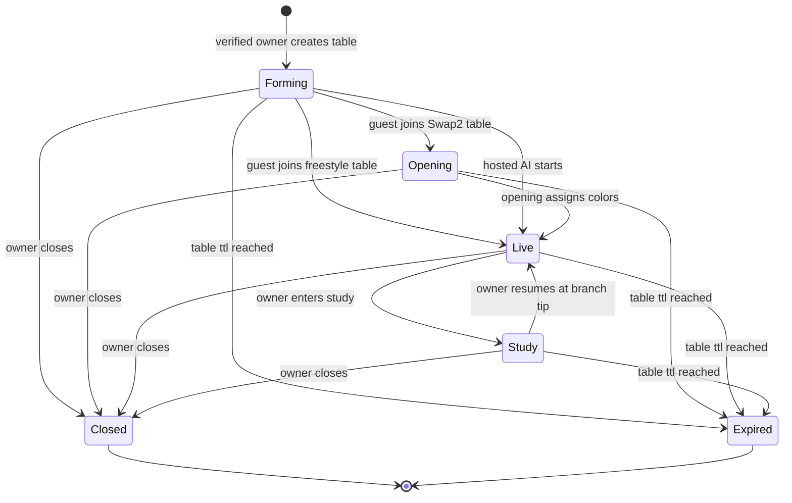
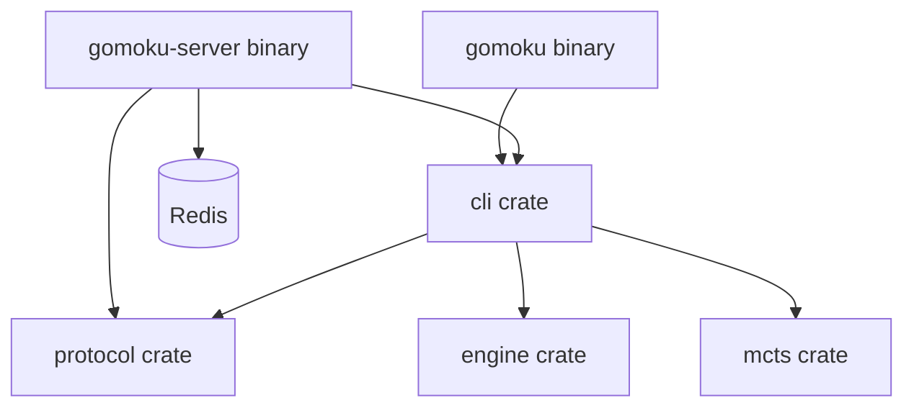

# The shared table server — design paper

**Status:** approved design milestone 1, 2026-11-03.  
**Scope:** a standalone `gomoku-server` executable, a new `protocol`
crate, and the Redis-backed persistence that lets multiple humans and
hosted AIs share the study table over a network. The local `cli` crate's
`SessionCore`, `Command`, `Event`, `Snapshot`, `Occupant`, `AiConfig`,
`SearchInfo`, `OpeningState`, `SeatSel`, and `SessionInit` remain the
engine of a table. The hosted-AI slice adds one narrow deterministic
replay seam to `SessionCore`; it does not duplicate the session model.  
**Audience:** the owner and future implementation agents.  
**Authority:** this paper. When implementation details later disagree
with it, the implementation is wrong unless a new design decision is
explicitly recorded.

---

## 1. Plain-language narrative

The local `gomoku` binary already has a headless brain: `SessionCore` in
the `cli` crate. You feed it a `Command` and it returns `Event`s and a
`Snapshot`. The terminal is just one shell around that brain. The shared
table server is another shell: it runs many `SessionCore` instances at
once, one per table, and lets owners and guests talk to them through a
REST API and an SSE event stream.

A new standalone executable called **`gomoku-server`** is the host. It
uses Axum on Tokio for HTTP and Redis for persistence. It does not
replace the existing `gomoku` binary; `gomoku play` and `gomoku
selfplay` stay local and independent. Later, a `gomoku remote` mode may
speak the same wire protocol, but that is not part of this milestone.

Because network clients cannot share a mutable object directly, each
table gets its own **`TableActor`**: a Tokio task that owns exactly one
`SessionCore`. Every command for that table is sent to the actor's
bounded mailbox. The actor is the only code that calls
`SessionCore::execute`; there is no mutex around the core. If the actor
panics or is evicted, the server simply rebuilds a fresh actor from the
Redis journal and continues.

Redis is not just a cache; it is the **source of truth**. For every
table it stores an append-only journal of accepted canonical commands
and hosted state transitions, plus a separate bounded stream of
`EventEnvelope`s. It also stores table metadata, owner verification
state, owner sessions, and outstanding invitation digests. Lua scripts
commit the journal entry, resulting envelope, integer table
revision, idempotency result, and refreshed TTL atomically. When Redis
cannot accept a write, the actor discards the uncommitted in-memory
state and publishes nothing; clients see an error and can retry against
a rebuilt actor.

Only a **verified owner** can create a table. Account verification comes
first: a person submits an email address, the server generates a magic
link, prints it through the `ConsoleMailer` implementation of the
`Mailer` trait, and stores only a one-way digest of the link token in
Redis with a 15-minute expiry. Following the link consumes that token
and creates a 30-day sliding owner bearer. The verified owner can then
create and occupy a table. `ConsoleMailer` is the only v1 mailer. Its
secret-bearing delivery output stays separate from structured
application logs and acts as the recipient's mailbox for the tutorial.
The trait exists so an SMTP mailer can be added later without touching
actor logic.

The owner can invite a human guest with a 256-bit URL-safe invitation
token. The server stores only the token's cryptographic digest, bound
to the table and a new guest record, with a 24-hour expiry. The owner
shares the raw token outside the system. When the guest redeems it, one
atomic operation consumes the digest, issues a table-scoped anonymous
guest bearer, and attaches the guest to the table. The token is
one-time: after successful redemption, its digest no longer authorizes
anything.

Tables have modes. A **human table** contains its verified owner and one
anonymous invited guest; it can use either a Swap2 opening or freestyle.
In Swap2, the owner and guest are color-neutral during the ceremony; the
final choice assigns colors. In freestyle, the owner picks their color
when creating the table. An **AI table** contains its verified owner in
one seat and the hosted AI in the other. It has no guest slot and is
freestyle-only in v1.

The owner can enter **Study Mode** at any time. In Study Mode the owner
may navigate the variation tree and play both sides; the guest observes
but cannot act. When the owner resumes live play, the table continues
from the branch tip the owner selected. Study commands are owner-only.
Client-side conveniences such as Help and Quit remain local to the
terminal and are never sent to the server.

AI moves are computed inside `spawn_blocking` tasks so the event loop
stays responsive. A global semaphore limits total concurrent searches
and a per-table maximum simulation count prevents runaway CPU. If a
client disconnects during an AI search, the search still finishes and
its selected move is appended to the journal; there is no mid-search
cancellation in v1.

Clients stay synchronized through **SSE**. Each committed mutation
produces one `EventEnvelope` containing its `WireEvent`s and integer
table revision. That revision is also stored as a field in Redis entries
and is not the Redis Stream ID.
On reconnect, a client sends its last event id; if it is too old, the
server sends a **reset snapshot** instead of replaying the whole event
window. Commands carry a `CommandId` idempotency key so retrying the
same command returns the same events without duplicating the move.

Every table has a 7-day sliding TTL in Redis. A successful authorized
snapshot read, event-stream connection, or committed mutation refreshes
it; SSE heartbeats and failed requests do not. After seven days without
one of those activities, the table expires and subsequent requests
receive `410 Gone`. An idle actor is evicted after 15 minutes of mailbox
inactivity. A table
can also be explicitly closed by its owner.

The system is designed for friendly games, not production identity.
High-entropy tokens are reduced to one-way cryptographic digests or
keyed HMACs before storage, email addresses are redacted from logs and
errors, and simple rate limits protect the obvious endpoints. There is
no OAuth, password, or cryptographic identity proofing.

---

## 2. Complete owner and guest happy path

---

## 3. Table lifecycle state machine

Account verification is a prerequisite, not a table state. The table
lifecycle begins only when an authenticated owner creates it.

| From | To | Trigger | Notes |
|---|---|---|---|
| start | Forming | verified owner creates table | The owner occupies one participant slot. A human table awaits its guest; an AI table can start immediately. |
| Forming | Opening | guest redeems a Swap2 invitation | Owner and guest remain color-neutral during the ceremony. |
| Forming | Live | guest redeems a freestyle invitation | The owner's selected color fixes both assignments. |
| Forming | Live | hosted AI starts | The owner and AI occupy opposite colors; AI tables are freestyle-only. |
| Opening | Live | Swap2 ceremony resolves | The opening choice assigns colors to the two human participants. |
| Live | Study | owner enters study | Owner may navigate and play both sides; a human guest only observes. |
| Study | Live | owner resumes live | Play continues from the selected branch tip with participant assignments restored. |
| any active state | Closed | owner closes | Bearers are revoked, the actor stops, and future requests get 410. |
| any active state | Expired | table TTL elapses | Automatic after seven days without activity; future requests get 410. |

---

## 4. Noun catalog grouped by crate or layer

### Existing `cli` crate (reused, with one narrow replay seam)

| Noun | Role | Notes |
|---|---|---|
| `SessionCore` | Headless state machine for one table. | The actor calls `execute`; the hosted-AI slice adds a narrow method that applies a recorded AI move and `SearchInfo` without searching. |
| `SessionInit` | Initial seat assignment, Swap2 flag, opening board, AI config. | Used by the actor when starting or rebuilding a table. |
| `Command` | Single intent such as play, step, back, take, release, set sims. | The protocol carries a serializable equivalent. |
| `Event` | Fact emitted by `SessionCore::execute`. | Broadcast over SSE. |
| `Snapshot` | Read-only serializable view of the cursor, seats, status, and branches. | Sent on connect and after reset. |
| `CommandError` | Why a command failed. | Mapped to HTTP status codes by the server. |
| `Occupant` / `OccupantKind` | Human or AI seat occupant. | AI tables use `Occupant::Ai(AiConfig)`. |
| `AiConfig` | Search knobs: evaluator, simulations, c_puct, temperature, noise. | Stored per seat in `SessionInit`. |
| `SearchInfo` | Record of one AI search: visits, prior, value, config. | Stored in canonical AI journal entries. |
| `SeatSel` | Black, White, or Both. | Used by take, release, and set sims commands. |
| `History` / `NodeId` | Variation tree and cursor. | Study Mode navigation operates on this tree. |
| `OpeningState` | Swap2 ceremony state machine. | Reused for hosted Swap2 tables. |

### New `protocol` crate

| Noun | Role | Notes |
|---|---|---|
| `TableId` | Public identifier for a table. | Opaque, URL-safe, non-sequential. |
| `CommandId` | Client idempotency key. | Same key retried yields same result. |
| `TableRevision` | Monotonic integer version of a table. | Incremented atomically by Lua and stored as a field; distinct from a Redis Stream ID. |
| `OwnerToken` | Raw magic-link token sent by mailer. | Never stored or logged raw. |
| `OwnerBearer` | Long-lived owner session token. | Sliding 30-day TTL. |
| `InvitationToken` | Raw 256-bit token shared by the owner. | Never stored or logged raw. |
| `GuestBearer` | Anonymous table-scoped token for a redeemed guest. | Issued once on redemption. |
| `SessionToken` | Generic term for either bearer. | Disambiguate by context. |
| `WireCommand` | Protocol-owned serializable command DTO plus `CommandId` and expected `TableRevision`. | The server validates and maps it to the corresponding `cli::Command`; `protocol` does not depend on `cli`. |
| `WireEvent` | Protocol-owned serializable event DTO. | The server maps emitted `cli::Event`s plus hosted context into this type. |
| `EventEnvelope` | One committed revision and all `WireEvent`s emitted by that mutation. | It is the atomic command-response and SSE unit. |
| `TableSnapshot` | Protocol-owned remote read model. | The server maps `cli::Snapshot` fields plus hosted mode, participant assignments, and revision into it. |
| `SearchInfoDto` | Protocol-owned serializable AI search record. | The server maps to and from `cli::SearchInfo`; canonical AI journal entries carry this DTO. |
| `TableMode` | Swap2 or freestyle; for AI tables, freestyle only. | Determines initial `SessionInit`. |
| `TableSummary` | Redacted view: table id, mode, status, and whether a human guest has joined. | Embedded where a full snapshot is unnecessary. |

### New `gomoku-server` crate

| Noun | Role | Notes |
|---|---|---|
| `gomoku-server` | Standalone Axum/Tokio executable. | Independent of the `gomoku` binary. |
| `TableActor` | One Tokio task owning one `SessionCore`. | Accessed through a bounded mpsc mailbox. |
| `TableActorHandle` | Cloneable handle used by HTTP handlers. | Hides the mailbox and the actor lifecycle. |
| `TableRegistry` | In-memory map from `TableId` to `TableActorHandle`. | Starts actors on demand; evicts idle ones. |
| `Mailer` trait | Abstraction for sending magic links. | `ConsoleMailer` is the v1 implementation. |
| `ConsoleMailer` | Prints the magic link to stdout. | Designed behind `Mailer` for later SMTP. |
| `RedisStore` | Connection pool and Lua script helpers. | Source of truth for streams, digests, revisions, idempotency records, and TTL. |
| `SseBroadcaster` | Tracks connected SSE clients per table. | Sends events and reset snapshots after a successful commit. |
| `RateLimiter` | Simple per-endpoint rate limiting. | Returns 429 when exceeded. |
| `OwnerContext` | Authenticated owner extracted from request. | Contains owner id and a redacted account reference. |
| `GuestContext` | Authenticated guest extracted from request. | Contains table id and guest id. |

### External Redis

| Noun | Role | Notes |
|---|---|---|
| command journal | Durable `XADD` stream per table. | Accepted canonical commands and hosted transitions, each carrying the committed `TableRevision`. |
| client-event stream | Bounded `XADD` stream per table. | `EventEnvelope`s retained only for SSE reconnection. It is not actor-replay input. |
| table hash | Redis hash per table. | Mode, owner id, guest id, closed flag, and integer `TableRevision`. |
| owner verification record | Redis record keyed by a magic-token digest. | Single-use, with a 15-minute TTL. |
| owner session record | Redis record keyed by an owner-bearer digest. | Sliding 30-day TTL. |
| invitation record | Redis record keyed by an invitation-token digest. | Single-use, 24-hour TTL, bound to table and guest slot. |
| gone tombstone | Compact record keyed by table id. | Retained after payload expiry or closure so the API can distinguish 410 from 404. |
| rate limit keys | Redis keys with short TTL. | Back simple rate limits. |

### Disambiguation

- **Token** by itself is ambiguous. It may mean the raw owner magic-link
token, the raw invitation token, an owner bearer, or a guest bearer.
This paper uses the qualified names above.
- **Snapshot** may mean the `cli::Snapshot` from `SessionCore` or the
server's reset snapshot sent over SSE. The reset snapshot contains a
`cli::Snapshot` plus the current revision and table metadata.
- **Mode** may mean the table mode (Swap2 or freestyle) or Study Mode.
This paper says table mode or Study Mode explicitly.

---

## 5. Verb catalog

### Owner verbs

| Verb | Meaning |
|---|---|
| create table | Submit an email and table mode; receive a pending table id. |
| verify | Submit the magic link token; become verified and receive an owner bearer. |
| resend link | Ask for a fresh magic link if the old one expired. |
| configure table | Choose Swap2 or freestyle, and for freestyle choose owner color. |
| invite guest | Request a human invitation token for the table. |
| close table | End the table; revoke tokens; stop the actor. |
| enter study | Switch the table to Study Mode. |
| resume live | Switch the table back to Live Mode at the selected branch tip. |
| configure AI | Select an allowed simulation preset for the hosted AI; the hard server maximum still applies. |
| play | Place a stone or make a tree move. |
| step | Ask the AI to search and play one move. |
| back / forward / var | Navigate the variation tree. |

### Guest verbs

| Verb | Meaning |
|---|---|
| redeem invitation | Submit an invitation token and receive a guest bearer. |
| open stream | Connect to the table's SSE endpoint. |
| play | In Live Mode, make a move on their turn. |
| observe | In Study Mode, receive events but cannot send commands. |

### Server verbs

| Verb | Meaning |
|---|---|
| authenticate owner | Look up the bearer digest in Redis; reject with 401 if missing or expired. |
| authenticate guest | Look up the guest-bearer digest; reject an invalid bearer with 401 and a valid bearer scoped to another table with 403. |
| start actor | Load table metadata and replay the command stream into a fresh `SessionCore`. |
| evict actor | Drop an idle `TableActor` from memory; it can be rebuilt later. |
| commit mutation | Atomically append the canonical journal entry and one `EventEnvelope`, increment `TableRevision`, store the idempotent result, and refresh the table TTL. |
| publish events | Send new events to every SSE client for the table. |
| send reset snapshot | Send a full snapshot when an SSE client reconnects too far behind. |
| digest token | Compute a one-way cryptographic digest or keyed HMAC of a high-entropy token for lookup and storage. |
| redact | Remove emails and raw tokens from logs and error bodies. |
| rate limit | Reject or delay requests that exceed per-source limits. |
| map error | Convert `CommandError` and Redis failures to HTTP status codes. |

### AI verbs

| Verb | Meaning |
|---|---|
| search | Run `mcts::search` in a `spawn_blocking` task using the seat's `AiConfig`. |
| select move | Pick a move from the visit distribution with temperature and optional noise. |
| store canonical entry | Append a journal entry containing the selected move and serializable `SearchInfoDto`. |
| replay move | When rebuilding, call the deterministic `SessionCore` replay seam with the stored move and mapped `SearchInfo`; never rerun search. |

---

## 6. Central design rule and numbered invariants

**Central design rule:** Redis owns the table. The `TableActor` is a
rebuildable cache. Any state that cannot be recovered from Redis is
state that does not matter.

### Invariants

1. **One actor, one core.** A `TableActor` owns exactly one
   `SessionCore`. All commands go through the actor's mailbox; no code
   outside the actor holds a reference to the core.
2. **Commands are the only mutator.** The only way to change a table's
   state is to send a command to the actor. Events are the only
   observable change.
3. **Journal authority.** The Redis command journal is the authoritative
   history. The actor rebuilds from accepted canonical commands and
   hosted transitions. Committed `EventEnvelope`s live in a separate,
   bounded stream and are never replayed into `SessionCore`.
4. **Canonical AI entries.** When an AI seat searches, the journal
   stores the selected move and its serializable `SearchInfoDto`.
   Rebuilding maps the DTO back to `SearchInfo` and uses the narrow
   deterministic `SessionCore` replay seam; it never reruns the search.
5. **Verified owner gate.** Every table has exactly one verified owner.
   No table can be created, configured, closed, or put into Study Mode
   without owner authentication.
6. **Token digest storage.** Raw owner magic-link tokens, invitation
   tokens, owner bearers, and guest bearers are never persisted in
   cleartext. Redis stores only one-way cryptographic digests or keyed
   HMACs suitable for high-entropy random tokens.
7. **Invitation binding.** An invitation digest is bound to one table
   and one guest slot. It is one-time and expires in 24 hours.
8. **Owner study exclusivity.** In Study Mode, only the owner may issue
   navigation and play-both-sides commands. The guest receives events
   but cannot act.
9. **Client-local conveniences.** Although the local CLI represents
   Help and Quit as `cli::Command` variants, the wire protocol omits
   them. They are never sent to or journaled by the server.
10. **TTL enforcement.** A successful authorized snapshot read,
    event-stream connection, or committed mutation refreshes the table's
    seven-day TTL; heartbeats and failed requests do not. Idle actors are
    evicted after 15 minutes of mailbox inactivity. Closed and expired
    tables answer table requests with 410 Gone.
11. **Persistence failure isolation.** If Redis rejects a journal write,
    the actor discards its in-memory state and publishes nothing. The
    next request rebuilds the actor from the last successful journal
    position.
12. **Idempotent table mutations.** A `CommandId` identifies one logical
    table mutation, including creation and hosted transitions. Replaying
    the same id and request returns the committed result without
    mutating the table again; reusing it for different input is 409.
13. **Freestyle-only AI tables.** In v1, a table with any AI seat uses
    freestyle mode. Swap2 is reserved for human tables.
14. **No mid-search cancellation.** An AI search runs to completion once
    started. Disconnecting a client does not cancel the search.

---

## 7. Architecture and dependency graph

The server adds two new crates to the gomoku workspace and leaves the
rest of the dependency graph unchanged.

Dependency rules:

- `engine` remains a dependency island: no Burn, no I/O, no `rand`.
- `mcts` remains Burn-free and unaware of `cli`.
- The server uses the existing public `cli` library interface. The
  later remote-CLI slice adds a one-way `cli` dependency on `protocol`;
  local `gomoku play` remains operationally independent.
- `protocol` owns its serializable DTOs and depends on neither `cli` nor
  `server`. The server is the translation boundary between protocol
  DTOs and `cli::{Command, Event, Snapshot}`.
- `gomoku-server` is the only crate that depends on Axum and Redis. It
  uses Tokio for its runtime; the later remote client may independently
  choose an async HTTP runtime without changing the protocol boundary.
- The existing `gomoku` binary never depends on the server crate. Its
  eventual protocol dependency is exercised only by explicit `gomoku
  remote` operation.

---

## 8. Persistence and failure semantics

### Command journal

Every table has a durable Redis Stream containing canonical journal
entries. An entry records an accepted protocol command or hosted state
transition in replayable form. On actor start, the server reads this
journal from the beginning, maps deterministic command entries to
`cli::Command`, and applies hosted transitions to the actor's surrounding
table state. A canonical AI entry maps its stored `SearchInfoDto` back
to `SearchInfo`, then applies the selected move through the narrow
deterministic replay seam; rebuilding never reruns MCTS.

A separate bounded Redis Stream contains one resulting `EventEnvelope`
per committed revision for command responses and SSE reconnection. It
may be trimmed without affecting recovery because it is not actor-replay
input.

`TableRevision` is a monotonic integer in table metadata. A mutation's
Lua commit compares the request's expected revision, increments the
integer once, and records the new value as a field in both streams and
the idempotency result. It does not infer revision from stream length or
a Redis Stream ID. A mismatch returns `409 Conflict`.

### Atomic operations

The following operations use Lua scripts or Redis transactions:

- Verify owner and create owner session.
- Redeem invitation and issue guest bearer.
- Commit one canonical journal entry, its `EventEnvelope`, idempotency
  result, new table revision, and refreshed table TTL.
- Close table and revoke all associated tokens.

### AI canonical entries

When a hosted AI turn begins, the actor temporarily moves its
`SessionCore` into a `spawn_blocking` task and executes the existing AI
step there under the global search semaphore. The task returns the modified core, selected move, emitted
events, and `SearchInfo`. The result becomes a canonical AI journal
entry containing the selected move and mapped `SearchInfoDto`. The same
atomic commit records the resulting `EventEnvelope` in the bounded
client-event stream. On replay, the actor uses the deterministic
replay seam; it does not reconstruct the evaluator or rerun MCTS.

### Failure modes

| Failure | Behavior |
|---|---|
| Redis unavailable on read | Return 503 Service Unavailable. The client can retry. |
| Redis rejects an atomic mutation commit | The actor drops its uncommitted `SessionCore` projection and publishes nothing. The next request rebuilds from the last committed canonical journal entry. |
| Actor panics | The handle is removed from `TableRegistry`. The next request rebuilds the actor. |
| Actor idle for 15 minutes | `TableRegistry` stops the actor. It is rebuilt on the next request. |
| Table TTL expires | Redis removes the table payload and keeps a compact gone tombstone. Later requests receive 410 Gone. |
| Owner bearer expired | Authenticated requests return 401 Unauthorized. The owner requests another magic link and starts a new verified session for the same account and tables. |
| Guest bearer invalid or expired | Requests return 401 Unauthorized. A valid guest bearer presented to another table returns 403 Forbidden. |
| Rate limit exceeded | Return 429 Too Many Requests. |

### Snapshot and reset

An SSE client may reconnect with a `Last-Event-ID` that is no longer in
the recent event window. Instead of replaying an arbitrary amount of
history, the server sends one reset message containing the current
`Snapshot`, the current revision, and the table metadata. The client
replaces its local state with the reset and continues from there.

---

## 9. REST endpoint families and status mapping

The API is divided into families by resource. The status code contract
is fixed across all endpoints.

### Endpoint families

| Family | Purpose |
|---|---|
| Owner auth | Create table, verify magic link, resend link, close session. |
| Table management | Configure mode, close table, fetch summary. |
| Invitation | Create invitation, redeem invitation. |
| Commands | Submit a command, fetch command result. |
| Events | SSE stream for a table. |
| Health | Server and Redis liveness. |

### Status code contract

| Code | Meaning |
|---|---|
| 200 OK | Successful read or idempotent replay. |
| 201 Created | Table, session, or invitation created. |
| 400 Bad Request | Malformed body, unknown command, or missing required field. |
| 401 Unauthorized | Missing or invalid owner bearer. |
| 403 Forbidden | Authenticated principal lacks permission for this table or action. |
| 404 Not Found | Table, command, or invitation does not exist (and is not 410). |
| 409 Conflict | Expected revision mismatch or concurrent modification. |
| 410 Gone | Table closed or expired. |
| 422 Unprocessable Entity | Command rejected by `SessionCore` (mapped from `CommandError`). |
| 429 Too Many Requests | Rate limit hit. |
| 503 Service Unavailable | Redis or actor system temporarily unavailable. |

`CommandError` values are mapped to 422 with a structured error body.
Parse errors and bad command shapes return 400. Owner-only commands from
a guest return 403. Study commands from a guest also return 403.

---

## 10. Testing and scale targets

### Scale assumptions

- Single server process.
- Up to 100 active tables in memory at once.
- Up to 200 concurrent SSE clients total.
- Redis is the only external dependency.

These numbers are design targets, not hard limits. The single-process
assumption means sharding and clustering are out of scope for v1.

### Testing strategy

| Area | Approach |
|---|---|
| `protocol` | Unit tests for serialization round-trips, token generation, and idempotency key validation. |
| `TableActor` | Drive the mailbox with commands and assert on returned events; verify no direct core access. |
| Redis journal | Use a test Redis instance or testcontainers. Append canonical commands and transitions, rebuild the actor, and assert the projection matches. |
| Owner verification | Test magic-link digest storage, single use, expiry, and bearer sliding TTL. |
| Invitation | Test token digest storage, atomic one-time redemption, expiry, and table binding. |
| AI canonical entries | Search once, append the move plus `SearchInfoDto`, rebuild, and assert the deterministic replay seam restores the same move and search record without invoking MCTS. |
| SSE | Test Last-Event-ID resume and reset snapshot when the window is exceeded. |
| Rate limits | Unit tests with a fake clock or small Redis-backed limiter. |
| Two-table acceptance | Run two tables concurrently: one owner-plus-guest Swap2 table and one owner-plus-hosted-AI freestyle table. |

### Acceptance criteria

The two-table acceptance story is the chapter-10 capstone:

1. Owner A creates a Swap2 table and invites a guest. They complete the
   opening and play several moves.
2. Owner B creates a freestyle AI table and plays several alternating
   turns against the hosted AI.
3. Both tables survive an actor eviction and rebuild from Redis without
   losing state.
4. A closed table returns 410; an expired table returns 410.
5. A retried command with the same `CommandId` returns the original
   events and does not duplicate the move.

---

## 11. Explicit non-goals

The following are deliberately out of scope for this design milestone
and for the v1 implementation that follows:

- **Production identity.** No OAuth, no passwords, no email validation
  beyond the magic link, no account recovery.
- **Multiple server processes.** No clustering, no pub/sub between
  server instances, no load balancer coordination.
- **Mid-search cancellation.** An AI search, once started, finishes.
- **Time-based search budgets.** Simulation counts remain deterministic.
- **Real SMTP in v1.** `ConsoleMailer` is the only mailer; the trait
  exists only for a future SMTP implementation.
- **Swap2 AI tables.** AI tables are freestyle-only in v1.
- **Game-record save/load on the server.** The existing chapter-08
  game-record loader is local-only.
- **Trained network seats.** The v1 AI seat uses the existing tactics
  evaluator; baseline and net evaluators can enroll later without
  redesign.
- **Graphical or web client.** Only the server and protocol are
  designed; a future `gomoku remote` CLI mode is optional.
- **Federation or matchmaking.** Owners create their own tables; there
  is no global lobby or rating system.

---

## 12. Subchapter guide

The following subchapters break the design into implementation-sized
slices. Each slice names the one capability it delivers.

### Subchapter a — Protocol and server shell

Deliverable: the `protocol` crate compiles and the `gomoku-server`
binary starts without routes, connecting to Redis and printing a health
status. Establishes crate boundaries and dependency rules.

### Subchapter b — Verified owner

Deliverable: a person can request a magic link through `ConsoleMailer`,
verify within 15 minutes, and receive a 30-day sliding owner bearer.
That verified owner can then create a table. Tests cover single use,
expiry, digest storage, session renewal, and redaction.

### Subchapter c — Table actor

Deliverable: `TableActor` owns a `SessionCore`, accepts commands through
a bounded mailbox, and returns events. `TableRegistry` starts actors on
demand and evicts idle ones after 15 minutes. Tests verify exclusive
ownership and rebuild behavior.

### Subchapter d — Redis journal

Deliverable: every accepted mutation is appended to the canonical Redis
command journal, while each resulting `EventEnvelope` enters a separate
bounded event stream. The actor rebuilds from journaled commands and hosted
transitions; Lua guarantees atomic commit, integer revision bump,
idempotency storage, and TTL refresh. Persistence failure discards the
uncommitted actor state. Tests cover replay, revision conflicts, event
window trimming, and failure isolation.

### Subchapter e — Invitation

Deliverable: an owner can create a 256-bit invitation, a guest can redeem
it within 24 hours for a table-scoped anonymous bearer, and the token
digest is consumed atomically with guest attachment. Tests cover
one-time use, expiry, rollback safety, and wrong-table rejection.

### Subchapter f — Swap2 and Study Mode

Deliverable: human tables support Swap2 with color-neutral participants
or freestyle with owner-chosen color; the owner can enter Study Mode,
navigate and play both sides, then resume live play at the branch tip.
Tests verify owner-only study commands and guest observation.

### Subchapter g — Hosted freestyle AI

Deliverable: AI tables are freestyle-only; AI searches run in
`spawn_blocking` under a global semaphore; the selected move and mapped
`SearchInfoDto` are stored as a canonical journal entry and restored
through the narrow deterministic replay seam. Tests prove recovery does
not invoke MCTS and that a disconnected client does not cancel search.

### Subchapter h — REST and SSE completion

Deliverable: command endpoints return events; SSE streams emit events
with revisions; Last-Event-ID resume works; outdated clients receive a
reset snapshot; `CommandId` idempotency prevents duplicate moves. Tests
cover reconnect and retry.

### Subchapter i — Optional remote CLI

Deliverable: a documented wire contract showing how a future `gomoku
remote` mode would use the protocol. No implementation is required; the
local `gomoku play` binary remains untouched.

### Subchapter j — Two-table acceptance

Deliverable: an automated test creates two tables, runs the verified
owner plus anonymous guest through a human Swap2 game, and runs a second
verified owner against the hosted AI in freestyle. It evicts and
rebuilds both actors, closes one table, and asserts 410 behavior and
idempotency.
