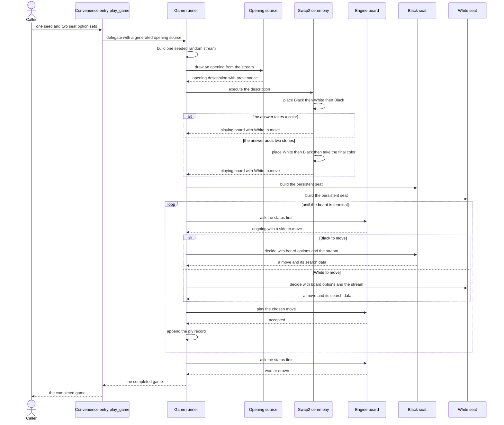
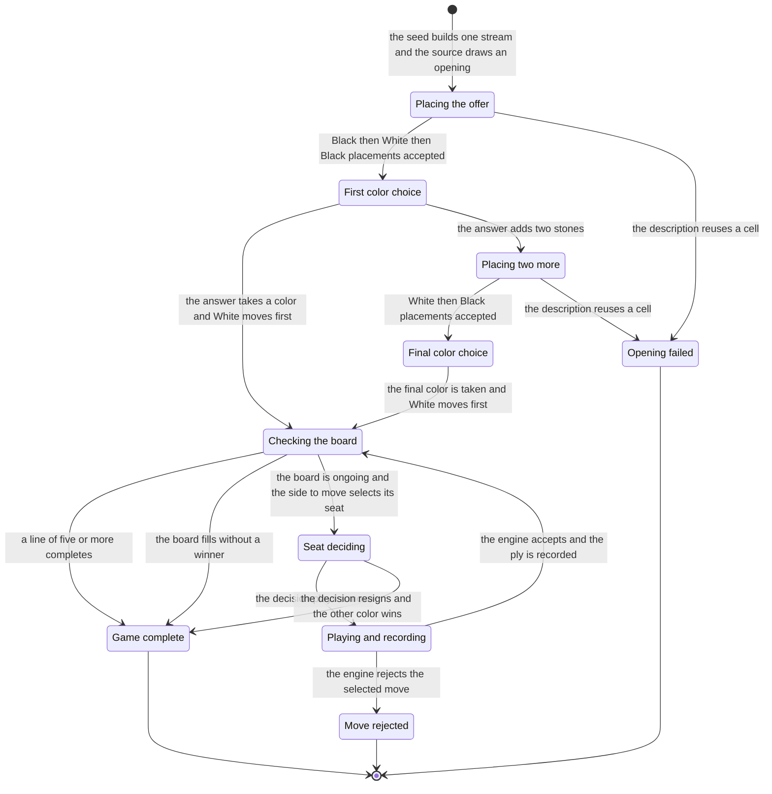

# Chapter 01 — The game runner: design paper

## Abstract

This paper is the conceptual companion to
[chapter 01 of the selfplay-corpora tutorial](the-game-runner.md). The
chapter builds the `selfplay` crate's first inhabitant: a synchronous,
single-threaded runner in which two seats of the hand-written baseline
player — one per color, each a persistent `player::AiPlayer` — play one
complete Swap2 game and return an in-memory `Game`. This paper explains
why the design has that shape. Its conclusions: one seeded random
stream, together with the opening-source draw behavior it feeds, is
the complete identity of a game — and `play_game` fixes that source
to `GeneratedOpening`, so for it the seed alone suffices; the
engine's absolute colors and its Swap2 typestate make the opening
ceremony exact and its illegal sequences unrepresentable; the engine
is the legality gate at
every step, so a recorded game replays to its recorded outcome by
construction; and the runner keeps no artifacts beyond the chapter's
scope — nothing is written to disk, and the recorded search slot
`PlySearch` is present without its chapter-03 semantics. The intended
reader is the learner who has read the chapter paper and wants the
reasoning behind its artifacts before building them.

## Glossary

| Term | Definition |
|------|------------|
| **Seat** | One of the two players of a generated game: a persistent `player::AiPlayer` running the baseline evaluator at a declared simulation budget. Every game pairs two seats. |
| **Simulation budget** | The number of Monte Carlo Tree Search (MCTS) simulations a seat runs per move decision; written baseline-X for a budget of X. |
| **Swap2** | The project's opening protocol: one side places three stones, the other side chooses a color or places two more stones, and the first side then chooses a color. |
| **Opening offer** | The three stones placed in the first phase of the Swap2 ceremony. |
| **Typestate** | A Rust pattern in which the phase of a protocol is a type parameter. The engine's `Swap2<State>` machine makes illegal opening sequences unrepresentable. |
| **Absolute colors** | The engine's storage convention: `Board` holds Black and White bitboards as-is, never a relative me/you view. The engine design locks this because Swap2 places colors non-alternatingly. |
| **Ply** | One move played after the opening. Ply indices in this chapter are zero-based and count post-opening moves only. |
| **Provenance** | The recorded origin of an opening: generated from the game's random stream, or drawn from an external list. |
| **Certified forced win** | A forced-win line produced by the engine's threat-space search (TSS) prover and checked by `engine::verify_line`. The prover may be incomplete, never unsound: budget exhaustion yields *unknown*, never a loss. |
| **Corpus** | A set of game records produced at one declared pairing, stored as shards plus a manifest. Later chapters build corpora; this chapter builds the single in-memory game. |
| **Dependency island** | The project's crate rule for `engine`: no deep-learning framework, no randomness, and no input/output inside it; other crates depend on `engine`, never the reverse. |
| **π (visit-distribution target)** | The normalized root visit-count distribution of the search at a ply; the policy training target (Silver et al. 2017). Chapter 03 owns it; this chapter only retains the raw counts. |

## Context and connected design narrative

The [design spec](../../../specs/2026-11-11-selfplay-corpora-design.md)
fixes the runner's shape in its decision S6: synchronous,
single-threaded, one seed per game, no input/output, no channels, no
graphics processing unit (GPU). Everything in this paper is a
consequence of that sentence plus two older locked decisions: the
engine's absolute colors and the engine's Swap2 typestate.

A caller asks for a game through one of two free functions.
`play_game` is the convenience entry: it takes a seed and one option
set per seat and delegates to `play_game_with_opening`, which
additionally takes an opening source. There is one implementation;
`play_game` only supplies the default source. Both return
`Result<Game, GameError>`, and everything this paper describes happens
inside `play_game_with_opening`.

The runner's first act is to build one standard random number
generator (RNG) stream, the `rand` crate's `StdRng`, from the seed.
That single stream feeds the opening draw and both seats' move
selection for the whole game. This is the sentence the design hangs
on: the seed is the complete identity of the game because nothing
downstream of the stream has hidden state — the baseline evaluator is
deterministic, and the search consumes randomness only through this
stream. Two calls to `play_game` with the same seed and the same
option sets return structurally equal games, which is what makes the
chapter's determinism test a whole-record comparison. The stream is
also why the runner must stay synchronous and single-threaded: one
stream, consumed in one order, is what a seed can reproduce.

The stream's first consumer is the opening source. `OpeningSource` is
a one-method trait: given the game's `StdRng`, produce an `Opening`.
The draw cannot fail — the method returns `Opening`, not a
`Result` — so error behavior is exact: a malformed description
surfaces only when the ceremony executes it. `GeneratedOpening` is
this chapter's source, a unit struct that draws three unique cells
from the central 7×7 region and then answers uniformly: take Black,
take White, or add two more unique central stones and take a random
color. The central region is deliberate: nearby stones produce
representative tactical games instead of scattered full-board play.

An `Opening` is a complete Swap2 description: `initial`, the three
offer stones in placement order; `answer`, an `OpeningAnswer`; and
`provenance`, an `OpeningProvenance`. `OpeningAnswer` is either
`Take(color)` — finish after three stones by taking this color — or
`AddTwo { stones, final_choice }` — add one White and one Black stone
in placement order, then take a color. `OpeningProvenance` is
`Generated` or `Listed { list, index }`. This chapter's games are
generated, but the record keeps the distinction from the start so that
the list-drawn openings of a later chapter never masquerade as
generated ones.

`Opening::board()` executes the description through the engine's
`Swap2<State>` machine. The machine begins in the `Placing3` phase;
three `place` calls with explicit colors — Black, White, Black — build
the offer; `finish()` moves the machine to `FirstChoice`. There the
answer branches: `take_black()` or `take_white()` end the ceremony and
return the playing `Board` directly; `place_two_more()` continues the
machine into `Placing2`, where White and then Black are placed and
`finish()` yields `FinalChoice`, whose `take_black()` or
`take_white()` return the `Board`. Illegal ceremonies are
unrepresentable — the typestate has no method for the wrong order —
and the only reachable execution error is `PlayError::Occupied`, raised
when a description reuses a cell. The runner wraps it as
`GameError::Opening`.
Both branches of the ceremony leave White to move: after three stones
the next placement belongs to White whichever color the answerer
takes, and after five stones the same holds. The explicit colors are
not decoration. Swap2 places colors non-alternatingly — Black, White,
Black, then possibly White, Black — so a description that named
relative sides instead of real colors could not be written down at
all. This is why the engine stores absolute colors (decision 5 of the
[engine design](../../../13-engine-design.md)) and why the opening
vocabulary speaks Black and White throughout.

With the ceremony complete, the runner builds the two seats. Each seat
is a `player::AiPlayer` constructed once, before the loop, around a
boxed `baseline::BaselineEvaluator` whose backend is selected with
`Device::flex()`; the seat owns that evaluator for the whole game
while every decision runs a fresh search. `Device::flex()` is the only
value from the Burn deep-learning framework the runner touches, and
`engine` stays a dependency island far below. Seat identity *is* the
absolute color: the seat configured by the Black option set plays
Black in every game, and `board.to_move()` — not turn order, not the
previous game — selects which seat decides each ply. The Swap2 answers
come from the seeded stream rather than from the seats, so color
choice is opening diversity, not seat negotiation.

The move loop checks `board.status()` first. `Status::Won` ends the
game as `Outcome::Won` with reason `WinReason::FiveOrMore`;
`Status::Draw` ends it as `Outcome::Draw`. Only on `Status::Ongoing`
does the runner ask a seat to decide: `seat.decide(&board, &options,
&mut rng)` returns a `Decision` whose `DecisionAction` is either
`Play(mv)` or `Resign(reason)`, with optional `SearchStats` recording
what the decision rested on. The base option sets pass through
unchanged at every ply in this chapter, and the returned `Game`
preserves them verbatim so the record always shows what was asked for.
Because the status check comes first, a seat is never asked to decide
on a terminal board; the player's `DecisionError::GameOver`, wrapped
as `GameError::Decision`, is a defensive seam a correct loop never
hits, which is why the state machine below has no transition for it.

A `Play(mv)` action is proposed to the engine: `board.play(mv)`. The
engine remains the legality gate even though the seat proposed the
move; a rejection ends the run as `GameError::Play` carrying the
zero-based ply index, the move, and the engine's `PlayError`. The
accepted move is appended as a `PlyRecord`: `mv`, the played move, and
`search`, an `Option<PlySearch>`. `PlySearch` is a recorded slot whose
contents — the sparse visits, the top-k prior, the sign conventions —
are chapter 03's subject; this chapter requires only that the slot is
present when search happened and absent when a seat's own-side
threat-space search (TSS; Allis 1994) probe produced a certified
forced win and no search ran, because
fabricating statistics for a move no search produced would be
dishonest telemetry. A `Resign(reason)` action ends the game instead:
`Outcome::Won` with the winner `side.other()` — the *other* color wins
when a seat concedes — and reason `WinReason::Resignation` carrying
the `player` crate's `ResignReason`. Resignation is reachable only
when a seat's options enable it, the default options disable it, and
the chapter reserves default options for ordinary corpus runs — so
this chapter's games end on the board.

The loop exits with an `Outcome`, and the runner assembles the
`Game`: the seed, both supplied option sets, the opening with its
provenance, the ordered plies, and the outcome. `Game` derives `Debug`,
`Clone`, and `PartialEq`: `Debug` for inspection and `PartialEq` for
the whole-record determinism
comparison, and `Game::moves()` iterates the played moves in order —
excluding the opening stones, which live in `game.opening` — with an
exact size. Termination is bounded by the board: at most 222 plies
after a three-stone opening, 220 after a five-stone one, and a full
board without a completed line is the draw. Nothing is written to
disk: recording is chapter 02, and nothing the `Game` carries is
thrown away before then.

## Primary interaction: one complete game

The sequence walks the happy path of `play_game`: a generated opening,
the take-color branch of the ceremony shown alongside the add-two
branch, and a move loop in which every decision plays a legal move.
The resignation exit and the two error exits are states of the state
machine in the next section, not branches of this diagram.

The participant named convenience entry is `play_game`; the game
runner is `play_game_with_opening`. Both seats appear because the
board's side to move — not the loop counter — selects which seat
decides, and White always decides first.

## The ceremony and runner lifecycle as a state machine

The machine has three regions. The ceremony region is the engine's
`Swap2<State>` typestate driven by the opening description; its two
branches both end on a board with White to move. The playing region is
the runner's loop: status check, seat decision, engine-gated play,
record. The exits are the three ways a run ends: a completed game, an
opening the engine refused, a move the engine refused. The resignation
exit is reachable only when a seat's options enable it.

| Current state | Input | Condition | Next state | Emitted outputs |
|---------------|-------|-----------|------------|-----------------|
| (entry) | seed and both `PlayerOptions` | always | Placing the offer | one seeded `StdRng` stream; an `Opening` with its `OpeningProvenance` |
| Placing the offer | the three `initial` stones with explicit colors Black, White, Black | all cells distinct | First color choice | the held offer inside the `Swap2<Placing3>` machine |
| Placing the offer | the three `initial` stones | a cell is reused | Opening failed | `GameError::Opening` wrapping `PlayError::Occupied` |
| First color choice | the recorded `OpeningAnswer` | `Take(color)` | Checking the board | the playing `Board` with White to move |
| First color choice | the recorded `OpeningAnswer` | `AddTwo` | Placing two more | the machine advanced to `Swap2<Placing2>` |
| Placing two more | the two added stones with explicit colors White, Black | each added cell differs from every offer cell, and the two added cells differ from each other | Final color choice | the five-stone offer inside the machine |
| Placing two more | the two added stones | a cell is reused | Opening failed | `GameError::Opening` wrapping `PlayError::Occupied` |
| Final color choice | the recorded `final_choice` | always | Checking the board | the playing `Board` with White to move |
| Checking the board | `board.status()` | `Status::Won(winner)` | Game complete | `Outcome::Won` with `WinReason::FiveOrMore` |
| Checking the board | `board.status()` | `Status::Draw` | Game complete | `Outcome::Draw` |
| Checking the board | `board.status()` | `Status::Ongoing` | Seat deciding | the side to move selects its seat and its base options |
| Seat deciding | board, options, and the shared stream | `DecisionAction::Play(mv)` | Playing and recording | the proposed move and optional `SearchStats` |
| Seat deciding | board, options, and the shared stream | `DecisionAction::Resign(reason)` | Game complete | `Outcome::Won` for the other color with `WinReason::Resignation` |
| Playing and recording | the proposed move | `board.play` accepts | Checking the board | a `PlyRecord` appended to the game |
| Playing and recording | the proposed move | `board.play` rejects | Move rejected | `GameError::Play` with the ply index, the move, and the `PlayError` |

Two conceivable transitions are absent by design.
`GameError::Decision` — a seat asked to decide on a terminal board —
is unreachable in this loop: the status check precedes every decision,
so the variant is a defensive seam, not a state. And the draw needs no
rule of its own: the only draw the engine reports is a full board
without a winner, and the runner takes the engine's verdict without
interpretation.

## Noun catalog

### The `selfplay` layer (this chapter's artifacts)

| Name | Kind | Role |
|------|------|------|
| `Game` | struct | The returned in-memory record: seed, both base option sets, the opening with provenance, the ordered plies, the outcome. Derives `Debug` and `PartialEq`. |
| `PlyRecord` | struct | One played move: `mv` plus `search`, an optional `PlySearch`. |
| `PlySearch` | struct | The recorded search slot. Present when search happened, absent for a certified-proof move. Its contents are chapter 03's subject. |
| `Outcome` | enum | The terminal result: `Won { winner, reason }` or `Draw`. No *unknown* outcome and no adjudicated loss. |
| `WinReason` | enum | How a win happened: `FiveOrMore` (a line of at least five on the board) or `Resignation(ResignReason)` (a concession). |
| `GameError` | enum | The three failure modes: `Opening` (the engine rejected the ceremony), `Decision` (defensive; a seat asked to decide on a terminal board), `Play` (the engine rejected a selected move, with ply index and move). |
| `Opening` | struct | A complete Swap2 description: `initial` stones in placement order, `answer`, `provenance`. |
| `OpeningAnswer` | enum | The answering side's choice: `Take(color)` or `AddTwo { stones, final_choice }`. |
| `OpeningProvenance` | enum | Where the opening came from: `Generated` or `Listed { list, index }`. |
| `OpeningSource` | trait | The injection seam for openings: one method producing an `Opening` from the game's stream; cannot fail. |
| `GeneratedOpening` | unit struct | This chapter's source: three unique central cells, then a uniform answer. |

### The `engine` layer

| Name | Kind | Role |
|------|------|------|
| `Board` | struct | The bitboard position in absolute colors; the legality gate and the source of the terminal verdict. |
| `Color` | enum | `Black` or `White`, absolute; `Color::other` names the opponent. |
| `Move` | struct | One board cell. |
| `Status` | enum | The engine's verdict: `Ongoing`, `Won(Color)`, or `Draw`. |
| `PlayError` | enum | The legality rejection; `Occupied` is the ceremony's only reachable variant. |
| `Swap2<State>` | struct | The opening ceremony as a typestate machine. |
| `Placing3`, `FirstChoice`, `Placing2`, `FinalChoice` | structs | The four ceremony phases, in order. |

### The `player` layer

| Name | Kind | Role |
|------|------|------|
| `AiPlayer` | struct | One persistent seat: owns one boxed evaluator for the whole game; every decision runs a fresh search. |
| `PlayerOptions` | struct | Per-decision settings: simulation budget, temperature and noise, the own-side TSS probe, the guard, the opt-in resignation heuristic. Defaults disable resignation. |
| `Decision` | struct | What a seat concluded: an action plus what the decision rested on. |
| `DecisionAction` | enum | `Play(mv)` or `Resign(reason)`. |
| `SearchStats` | struct | The player's measurement of one searched decision; the raw material the runner stores in the `PlySearch` slot. |
| `ResignReason` | enum | The concession vocabulary: a resignation backed by verified opponent refutations, not an engine ruling. |
| `DecisionError` | enum | `GameOver`: a decision requested on a terminal board. |

### The `baseline` layer

| Name | Kind | Role |
|------|------|------|
| `BaselineEvaluator` | struct | The hand-written evaluator each seat owns; deterministic, no hidden state. |
| `Device` | re-export | The backend selector; `Device::flex()` is the only Burn value the runner touches. |

### Disambiguation

- **Opening** names four things: the Swap2 *ceremony* (the engine
  protocol), the `Opening` *struct* (a description of one ceremony),
  the `OpeningSource` *seam* and its implementors such as
  `GeneratedOpening` (the producers of descriptions), and the *opening
  offer* (the three initial stones). This paper says "ceremony",
  "description", "source", and "offer" when the distinction matters.
- **Game** names the played game (the activity) and the `Game` struct
  (the in-memory record the runner returns). The durable *game record*
  of chapter 02 is a third thing and does not appear in this chapter.
- **Outcome** names the `Outcome` enum (the runner's terminal
  accounting: won or drawn, with a `WinReason`), distinct from the
  engine's `Status` (the board's verdict) and from `WinReason` (how a
  win happened). The runner maps `Status` to `Outcome`; it never
  invents one.
- **Seat** names the role (the Black seat, the White seat) and the
  `AiPlayer` instance occupying it. Seat identity is the absolute
  color; the runner holds exactly two seats, built once.
- **Move** names the engine's `Move` (a cell) and, loosely, a ply. A
  `PlyRecord` is one played move plus its metadata; `Game::moves()`
  yields the cells only.
- **Search** names the Monte Carlo Tree Search (MCTS) a seat runs
  internally, the player's `SearchStats` measurement of it, and the
  `PlySearch` slot the runner records. The runner never touches the
  tree itself.

## Verb catalog

### The `selfplay` layer

| Receiver | Method | Consumes | Produces |
|----------|--------|----------|----------|
| — (free function) | `play_game` | a seed and both seat option sets | `Result<Game, GameError>`; delegates with a fresh `GeneratedOpening` |
| — (free function) | `play_game_with_opening` | a seed, both seat option sets, and an opening source | `Result<Game, GameError>`; the one implementation |
| `Game` | `moves` | nothing | the played moves in order, excluding the opening stones, with an exact size |
| `Opening` | `board` | nothing (reads the stored description) | `Result<Board, PlayError>` — the ceremony executed |
| `OpeningSource` (trait) | `opening` | a mutable borrow of the game's `StdRng` | an `Opening`; cannot fail |
| `GeneratedOpening` | `opening` (impl) | the game's `StdRng` | an `Opening` with `Generated` provenance: unique central stones, uniform answer |

### The `engine` layer

| Receiver | Method | Consumes | Produces |
|----------|--------|----------|----------|
| — (associated) | `Swap2::<Placing3>::new` | nothing | the ceremony machine in its first phase |
| `Swap2<Placing3>` / `Swap2<Placing2>` | `place` | a move and an explicit color | `Result<(), PlayError>` — the stone held, or `Occupied` |
| `Swap2<Placing3>` / `Swap2<Placing2>` | `finish` | the machine | the next phase, or `PlayError` |
| `Swap2<FirstChoice>` | `take_black` / `take_white` | the machine | the playing `Board` with White to move |
| `Swap2<FirstChoice>` | `place_two_more` | the machine | the machine in `Placing2` |
| `Swap2<FinalChoice>` | `take_black` / `take_white` | the machine | the playing `Board` with White to move |
| `Board` | `status` | nothing | the `Status` verdict |
| `Board` | `to_move` | nothing | the absolute `Color` of the side to move |
| `Board` | `play` | a move | `Result<(), PlayError>` — the move committed, or rejected |
| `Board` | `is_legal` | a move | whether the move may be played |

### The `player` and `baseline` layers

| Receiver | Method | Consumes | Produces |
|----------|--------|----------|----------|
| — (associated) | `AiPlayer::new` | one boxed evaluator | a persistent seat |
| `AiPlayer` | `decide` | a borrowed board, borrowed options, a mutable borrow of the stream | `Result<Decision, DecisionError>` — an action with optional `SearchStats`; never mutates the board |
| — (associated) | `BaselineEvaluator::new` | a `Device` selected with `Device::flex()` | the deterministic hand-written evaluator |

## Central design rule and invariants

**Central rule:** one seed, plus the opening-source draw behavior it
feeds, is the complete identity of a game — a single seeded random
stream drives the opening draw and both seats, and everything
downstream of that stream is deterministic engine and player code
over absolute colors. `play_game` fixes the source to
`GeneratedOpening`, so for it the seed alone is the identity.

1. **Seed determinism.** The runner builds exactly one `StdRng` from
   the seed and shares it between the opening source and both seats.
   The same seed, the same seat option sets, and the same
   opening-source draw behavior reproduce the entire `Game` —
   opening, plies, search metadata, outcome — which the whole-record
   `PartialEq` comparison pins. `play_game` always draws through a
   fresh `GeneratedOpening`, so for it the seed and the option sets
   alone suffice.
2. **Absolute colors everywhere.** The opening description names real
   colors because Swap2 places colors non-alternatingly; the `Board`
   stores Black and White as-is; seat identity is the absolute color;
   `board.to_move()` selects the deciding seat. No relative me/you
   view appears anywhere in the runner.
3. **The engine is the only legality gate.** The ceremony executes
   through the `Swap2<State>` typestate, where illegal sequences are
   unrepresentable; every selected move passes `board.play`. A
   recorded game therefore replays through the engine without error,
   and the recorded outcome is the engine's own verdict.
4. **Opening provenance is recorded, not implied.** Every `Opening`
   carries `Generated` or `Listed { list, index }` from the moment it
   is drawn; sources cannot fail at draw time, so a malformed
   description surfaces only at execution as `GameError::Opening`.
5. **Outcome correctness.** `Outcome` is the engine's terminal
   `Status` mapped one-to-one, or a seat's concession credited to the
   other color. There is no *unknown* outcome and no adjudicated
   loss. Resignation is reachable only when a seat's options enable
   it; the defaults disable it, and this chapter's games end on the
   board.
6. **Honest telemetry.** A `PlyRecord` carries search metadata only
   when a search produced it; a certified-proof move records none. The
   slot's contents — sparsity, the top-k prior, sign conventions —
   belong to chapter 03 and are not decided here.
7. **No persistence, no encoding yet.** The `Game` is in-memory.
   Nothing is written to disk (chapter 02), no corpus exists (chapters
   02 and 04), and no encoded planes or training samples appear (the
   read path is chapter 06).
8. **The engine stays a dependency island.** `selfplay` depends on
   `engine`, never the reverse. The runner is synchronous and
   single-threaded with no channels and no GPU; `Device::flex()` is
   the only Burn value it touches, and `engine` sees none of it.

## References

**This chapter:**

- [the-game-runner.md](the-game-runner.md) — the chapter paper:
  intention, specification as tests, execution-order walkthrough.
- [the-game-runner-implementation.md](the-game-runner-implementation.md)
  — the hiding layer: low-level construction instructions.
- [the-game-runner-solution.md](the-game-runner-solution.md)
  — the annotated reference snippets.

**This track:**

- [Tutorial README](../README.md) — conventions, gates, and the
  chapter map.
- [Self-play primer](../00-selfplay-primer.md) — why strength-graded
  self-play data; the record format this chapter's `Game` grows into.
- [Design spec](../../../specs/2026-11-11-selfplay-corpora-design.md) —
  decision S6 (the runner's shape) and decisions S1–S8.
- [Tutorial hand-off](../../../specs/2026-11-11-selfplay-corpora-tutorial-handoff.md) —
  the per-chapter public surface and the measured evidence.

**Prerequisite tracks:**

- [Engine tutorial](../../13-engine-tutorial/README.md) and
  [engine design](../../../13-engine-design.md) — the Swap2 typestate
  and the absolute-colors decision (decision 5).
- [MCTS tutorial](../../mcts-tutorial/README.md) — the PUCT
  (predictor UCT; Rosin 2011) search behind the evaluator seam.
- [Baseline tutorial](../../baseline-tutorial/README.md) — the seats:
  `AiPlayer`, `PlayerOptions`, the own-side TSS probe, and the honesty
  rule for certified moves.

**Source (live on `main`):**

- [`gomoku/crates/engine/src/opening.rs`](../../../../gomoku/crates/engine/src/opening.rs) —
  the `Swap2<State>` typestate.
- [`gomoku/crates/engine/src/board.rs`](../../../../gomoku/crates/engine/src/board.rs) —
  `Board`, `Color`, `Status`, `PlayError`.
- [`gomoku/crates/player/src/lib.rs`](../../../../gomoku/crates/player/src/lib.rs) —
  `AiPlayer`, `Decision`, `DecisionAction`, `PlayerOptions`,
  `SearchStats`, `ResignReason`, `DecisionError`.
- [`gomoku/crates/baseline/src/lib.rs`](../../../../gomoku/crates/baseline/src/lib.rs) —
  `BaselineEvaluator` and the `Device` re-export.

**Source (created by this chapter; not yet present on `main`):**

- `gomoku/crates/selfplay/src/game.rs` — the runner, `Game`,
  `PlyRecord`, `PlySearch`, `Outcome`, `WinReason`, `GameError`.
- `gomoku/crates/selfplay/src/opening.rs` — `Opening`,
  `OpeningAnswer`, `OpeningProvenance`, `OpeningSource`,
  `GeneratedOpening`.
- `gomoku/crates/selfplay/src/lib.rs` — the crate's public surface.
- `gomoku/crates/selfplay/tests/game.rs` — the chapter's
  specification.

**External sources:**

- Silver, D. et al. (2017). *Mastering the Game of Go without Human
  Knowledge* (AlphaGo Zero). <https://doi.org/10.1038/nature24270> —
  the visit-distribution policy target π whose raw material the
  runner retains.
- Rosin, C. D. (2011). *Multi-armed bandits with episode context*
  (PUCT). <https://doi.org/10.1007/s10472-011-9258-6> — the selection
  rule of the search both seats run.
- Allis, L. V. (1994). *Searching for Solutions in Games and
  Artificial Intelligence*. PhD thesis, Maastricht University.
  <https://doi.org/10.26481/dis.19940923la> — threat-space search, the
  seat's certified-forced-win probe.
