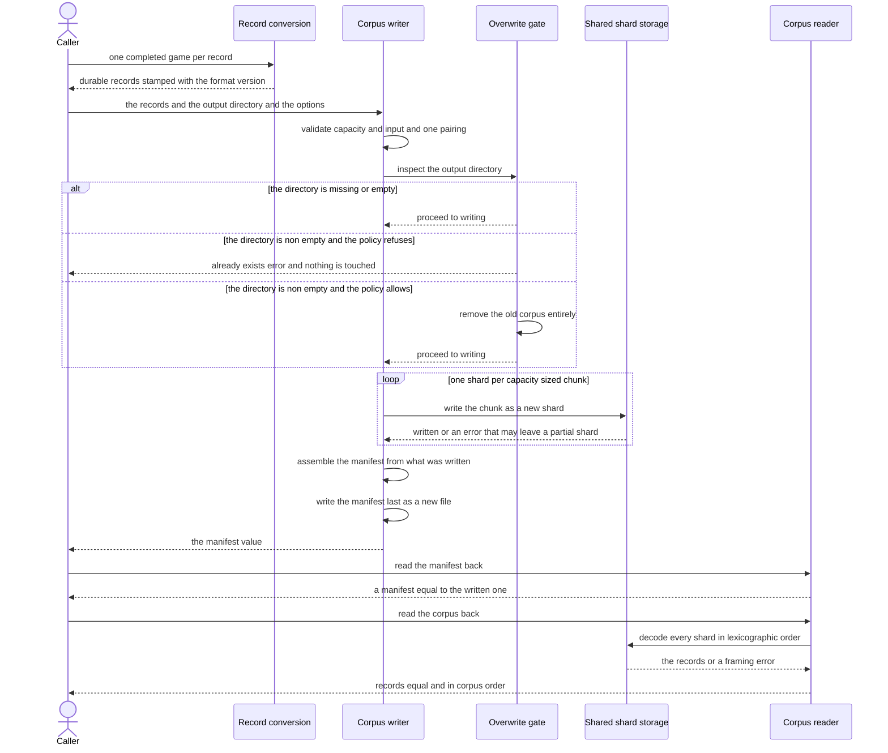
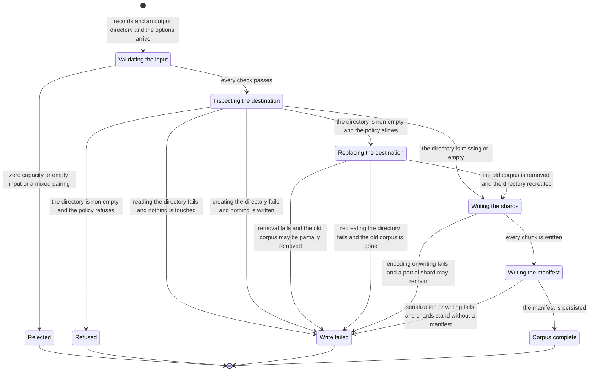

# Chapter 02 — Recording games: design paper

## Abstract

This paper is the conceptual companion to
[chapter 02 of the selfplay-corpora tutorial](recording-games.md). The
chapter teaches the `selfplay` crate to persist complete games: chapter
01's in-memory `Game` gains a durable form, the `GameRecord`, and many
records become a corpus — fixed-capacity shards of length-delimited
bincode records plus a JSON manifest, written through a new shared
`train::storage` module extracted from the `train` crate's existing
dataset writer and reader. This paper explains why the design has that
shape. Its conclusions: the record types are serializable *mirrors* of
the gameplay types, not the gameplay types themselves, because the
durable format must not be hostage to another crate's internals; the
conversion from `Game` to `GameRecord` is a pure transformation of
values, never a replay; the writer's phase order — validate, gate,
shards, manifest last — is the whole of its safety story; the format
version is a stamp, not yet a rejection rule; and the bytes of a
corpus are a pure function of its records, which is what makes a seed
set plus a pairing a complete description of a corpus. The intended
reader is the learner who has read the chapter paper and wants the
reasoning behind its artifacts before building them.

## Glossary

| Term | Definition |
|------|------------|
| **Game record** | The durable serialization of one complete game: a header (configuration and provenance), the per-ply records, the outcome, and an optional certified suffix. The artifact is `GameRecord`. |
| **Corpus** | A set of game records produced at one declared pairing, stored as shard files plus a manifest in one directory. |
| **Shard** | A fixed-capacity file of length-delimited bincode records; the `train` crate's storage unit, named `shard-NNN.bin`. |
| **Length-delimited framing** | Writing a `u32` little-endian length prefix before each bincode payload, so the reader knows where one record ends and the next begins. |
| **Manifest** | The JSON file next to the shards — the artifact `Manifest`, serialized as `manifest.json`: format version, seed set, pairing, game count, shard list, and workspace version. The shards are the data; the manifest is the provenance. |
| **Format version** | The durable-layout version number, `GAME_RECORD_FORMAT_VERSION = 1`, stamped into every record header and every manifest so a future layout change is detectable. |
| **Pairing** | The declared Black-vs-White seat configuration of a corpus — the per-seat simulation budgets and settings. The pairing is the corpus's declared identity and lives in every record header. |
| **Seat** | One of the two players of a generated game: a `player::AiPlayer` running the baseline evaluator at a declared simulation budget. |
| **Simulation budget** | The number of Monte Carlo Tree Search (MCTS) simulations a seat runs per move decision; written baseline-X for a budget of X. |
| **Ply** | One move played after the opening. Ply indices are zero-based and count post-opening moves only. |
| **Provenance** | The recorded origin of the data: the game's seed, the opening's source (generated or drawn from a named list at a named index), and the identity of the evaluator that produced the decisions. |
| **Certified suffix** | A terminal segment of a game in which every attacker move belongs to a machine-verified forced-win line produced by the engine's threat-space search (TSS) prover (Allis 1994). This chapter adds the record slot; chapter 05 fills it. |
| **Overwrite policy** | The explicit choice, `OverwritePolicy`, between refusing a non-empty output directory (`Refuse`, the default) and replacing it (`Allow`). |
| **Record mirror** | A serializable type in the record's own vocabulary that copies the fields of a gameplay type field for field. Mirrors exist so the durable format does not depend on another crate's internals. |
| **Round trip** | Writing a value and reading it back; a byte-exact round trip additionally requires that re-writing the read-back value reproduces the original file bytes. |
| **Dependency island** | The project's crate rule for `engine`: no deep-learning framework, no randomness, and no input/output inside it; other crates depend on `engine`, never the reverse. |
| **Swap2** | The project's opening protocol: one side places three stones, the other side chooses a color or places two more stones, and the first side then chooses a color. |
| **π (visit-distribution target)** | The normalized root visit-count distribution of the search at a ply; the policy training target (Silver et al. 2017). The record stores the raw counts; normalization belongs to chapters 03 and 06. |
| **z (outcome target)** | The game result in {+1, 0, −1} from the perspective of the side to move at a ply; derived from the stored outcome at read time (chapter 06), not stored per ply. |
| **bincode** | The binary encoding library (version 2) that encodes shard payloads under its standard configuration. |
| **serde** | The serialization framework whose `Serialize` and `Deserialize` derives every record type carries; `serde_json` encodes the manifest. |

## Context and connected design narrative

Chapter 01, the [game runner](../01-the-game-runner/the-game-runner.md),
ended with a complete game in memory: the `Game` struct holds the seed,
both seats' `PlayerOptions`, the `Opening` with its provenance, the
ordered `PlyRecord` list with its optional `PlySearch` search data, and
the `Outcome`. Nothing was written to disk. This chapter makes that
value durable, and the [design
spec](../../../specs/2026-11-11-selfplay-corpora-design.md) fixes the
shape of the doing in its decision S2: *store games, not positions*. The
record stays raw enough to re-encode under any future plane encoding and
rich enough to train on without re-searching, and it is the format the
milestone-5 replay buffer will consume — so the format outlives the
tutorial, and its design is worth understanding before writing it.

### Why the record mirrors exist

The shortest path to persistence would be deriving serde's `Serialize`
and `Deserialize` on `Game` itself. The chapter does not take it, for a
reason chapter 01 already prepared: serde derives there were scoped, not
blanket. The opening vocabulary (`Opening`, `OpeningAnswer`,
`OpeningProvenance`) and the outcome vocabulary (`Outcome`, `WinReason`)
carry derives, because those values cross into the record unchanged.
`Game`, `PlyRecord`, and `PlySearch` carry no serde derives, and
`PlayerOptions` — which belongs to the `player` crate — carries none
either. Serializing the gameplay types directly would couple the durable
format to the internals of two other crates: every future refactor of
`player::PlayerOptions` would silently change the on-disk layout, and
the format could no longer version on its own terms.

So the record defines its own vocabulary, in a new `record.rs`: the
`GameRecord` with its `GameHeader`, the per-ply `RecordedPly`, the
`CertifiedSuffix` slot, and the serializable seat mirrors `SeatConfig`,
`TssProbeSettings`, and `GuardSettings`, grouped into the `SeatPairing`.
Each mirror copies the fields of its gameplay original field for field —
`SeatConfig` from `PlayerOptions`, `TssProbeSettings` from
`OwnTssConfig`, `GuardSettings` from `GuardConfig` — through plain
`From` conversions. The opening and the outcome need no mirror: chapter
01 derived serde on them for exactly this purpose, and they move across
unchanged. The mirror rule is what makes the next artifact meaningful:
`GAME_RECORD_FORMAT_VERSION`, the constant `1`, stamped into every
header and every manifest. A format whose layout is owned by the record
vocabulary alone is a format whose version number means something.

### Conversion without replay

The chapter's entry point is a pure conversion.
`GameRecord::from_game` — a must-use method delegating to the
`From<&Game>` implementation — builds the durable record without
replaying the board, without searching, and without I/O. Everything it
needs is already in the `Game`. This is the store-games decision made
mechanical: because chapter 01 kept the opening, every ply, and the
outcome in memory, persistence is a transformation of values, not a
re-computation. The conversion is also total: every `Game` converts, and
nothing it carries is dropped. Keeping that totality is why this chapter
adds one field to chapter 01's `Game` — `certified_suffix`, an optional
`CertifiedSuffix` holding `from_ply`, the zero-based ply from which a
terminal segment is certified, and `line`, the verified forced-win line.
The runner sets the slot to `None`; chapter 05 teaches the runner to
detect certified endgames and fill it. Adding the slot with the record
format rather than with the detection means the conversion never has a
chapter in which it silently discards something the `Game` knew.

The `GameHeader` answers the five questions a future reader of the
corpus will ask. `format_version`: *which layout is this?* `seed`:
*which game is this?* — chapter 01 established that one seed fixes the
entire game, so the seed is the record's complete regeneration key.
`config`: *who played, at what strength?* — the `SeatPairing` holds
`black` and `white` `SeatConfig` values plus an `ExplorationSchedule`,
and the pairing lives in every header, not just in the manifest, because
the pairing is the corpus's declared identity (design spec S5).
`evaluator`: *whose decisions are these?* — the string
`baseline@<version>`, built from the compile-time crate version, so that
baseline records and the records of a future trained network stay
distinguishable in one replay buffer. `opening`: *where did the opening
come from?* — cloned from the game with its provenance, so a listed
opening never masquerades as a generated one.

The `ExplorationSchedule` field deserves a precise scope statement,
because the chapter declares the type without its behavior. As record
vocabulary it carries four fields — `plies`, `temperature`,
`noise_epsilon`, `noise_alpha` — and a `Default` that mirrors the
exploration practice of the CLI's AI-vs-AI sessions: an exploration
window of `EXPLORATION_PLIES` = 10 plies at temperature 1.0 with
Dirichlet noise ε = 0.25, α = 0.3 (Silver et al. 2017). The header
records the schedule because the schedule is part of the corpus's
identity: two corpora generated at different schedules are different
data even at equal budgets. What this chapter does not build is the
schedule's behavior — `options_for_ply`, the per-ply application of the
schedule to a seat's options, is chapter 04's subject — and `from_game`
records `ExplorationSchedule::default()`, the only schedule that exists
until then.

Each `PlyRecord` converts into one `RecordedPly`: `mv`, the played
move; `visits`, the sparse raw root visit counts; `prior`, the sparse
prior entries; and `root_value`, an optional estimate. When the ply's
search ran, all three fields copy across unchanged — this chapter
introduces no conversion from `player::SearchStats`, no top-k
truncation, and no normalization, because chapter 01's runner already
produced the raw slots and chapter 03 owns everything derived from them.
When the ply's search did not run — a move played from a certified
own-side proof — the record keeps empty visits, an empty prior, and no
root value. Fabricating statistics for a move no search produced would
be dishonest telemetry; the baseline tutorial's honesty rule is
load-bearing here. A resignation ends the game without a played move, so
it produces no ply at all. Two read-time rules are already visible in
this shape, though their owners are later chapters: the stored visit
counts are raw, so π is a normalization of `visits` at sample time
(chapters 03 and 06), and the outcome is stored once per game, so z is
derived per ply from the side to move at read time (chapter 06).

### The shared shard mechanics

All record types derive serde's `Serialize` and `Deserialize`, and the
on-disk framing belongs to the `train` crate. The datagen tutorial built
that framing privately inside `write_dataset` and `read_dataset`:
bincode 2 payloads under the standard configuration, each prefixed with
its length as a little-endian `u32`, packed into fixed-capacity shard
files, with a JSON manifest written last. This chapter extracts the
framing into a new shared module, `train::storage`, with two generic
functions and two public constants: `write_shard`, which encodes each
record, prefixes it, and appends both to one shard file opened with
create-new semantics so an existing shard is never truncated;
`read_shard`, which loops over the framing and rejects what it cannot
trust; and the constants `LENGTH_PREFIX_BYTES` = 4 and
`MAX_RECORD_LEN` = 1 MiB. The existing `write_dataset` and
`read_dataset` then delegate, and the extraction is behavior-preserving
by construction and by test: the `train` suite is unchanged and must
stay green. One storage mechanic, two record types — the synthetic
tactical `Sample` and the `GameRecord` share framing, guards, and error
behavior, and neither knows the other exists.

`read_shard`'s guards are the corpus reader's entire defense against
corrupt data, and they are worth stating as design, not just as tests.
A clean end-of-file after zero prefix bytes ends the shard. One to three
leftover prefix bytes are a torn record — a shard that was truncated
mid-write — and surface as `UnexpectedEof`, never as a clean end. A
prefix above `MAX_RECORD_LEN` is `InvalidData`: the cap exists so a
corrupt prefix cannot force a huge allocation, and it is deliberately
far larger than any legitimate record. A payload that fails bincode
decoding is `InvalidData`. On the write side there is one honest caveat,
documented on `write_shard` itself: the file is created before encoding
begins, so a mid-write encoding or I/O failure can leave a partial shard
behind. The design absorbs that caveat at the corpus level rather than
hiding it — the manifest discipline below is what makes a partial write
detectable.

### The writer's four phases

The corpus writer, `write_corpus_with_options`, runs four phases in a
fixed order, and the order is the protection. The caller supplies the
records, the output directory, and a `CorpusWriteOptions` — a shard
capacity and an `OverwritePolicy`.

**Validation, before anything on disk is touched.** A zero shard
capacity is `InvalidInput`. An empty record slice is `InvalidInput`: the
pairing is read from the first record's header, so a corpus without
games cannot state its identity. A record whose header configuration
differs from the first record's is `InvalidInput`: one corpus, one
pairing, enforced at the boundary rather than discovered by a reader
months later.

**The overwrite gate.** The output directory is inspected. A missing
directory is fine; an existing empty directory is fine. A non-empty
directory branches on the policy: `OverwritePolicy::Refuse` returns
`AlreadyExists` without touching anything, and `OverwritePolicy::Allow`
removes the entire directory before writing. Because validation runs
first, a rejected call never destroys data even under `Allow` — a zero
capacity with `Allow` leaves the existing corpus fully intact. The
removal itself has no such guarantee: `remove_dir_all` deletes entry
by entry, so a failed `Allow` removal can leave the old directory
partially removed; only validation failures before removal guarantee
the old corpus remains fully intact. The
convenience wrapper `write_corpus` always passes `Refuse`: the safe
default is the short path, and replacement is always an explicit, typed
decision at the call site. One accuracy note the design does not paper
over: `Allow` is remove-then-write, not an atomic swap. A crash between
the removal and the manifest loses the old corpus. The gate protects
against accidents and ambiguity, not against power failure; nothing in
this chapter claims atomicity or durability beyond what the file system
calls themselves provide.

**The shards.** The records are chunked by capacity and each chunk
becomes one `shard-NNN.bin` — the three-digit zero padding makes shard
indices 0 through 999 sort lexicographically in write order, which the
reader relies on; no shard-count cap is enforced, so the property is a
consequence of the padding width, not a guarantee for arbitrarily many
shards — through `train::storage::write_shard`. Create-new semantics
inside `write_shard` mean a name collision is an error, never a silent
truncation. The last
shard is short when the count does not divide evenly: capacity is a
maximum, not a padding requirement.

**The manifest, last.** The `Manifest` is assembled from what was just
written — `format_version`, the `seeds` in corpus order, the `pairing`
taken from the first record's header, the `game_count`, the `shards` in
record order, and the `workspace_version` from the compile-time crate
version — and serialized as pretty JSON to `manifest.json`, again under
create-new. Writing the manifest last keeps the datagen tutorial's
crash-safety discipline, and its scope is stated exactly: a directory
with shards but no manifest is an interrupted write, and the manifest
never claims shards that do not exist, because it is built from the list
of shards actually written. That is all the manifest is — a completion
marker and a provenance summary. It is not a checksum, not a lock, and
not a durability guarantee. The function returns the `Manifest` value,
so the caller holds in memory exactly what is on disk.

### The readers, and what is not checked

`read_manifest` opens `manifest.json` and deserializes it; a missing
file is the operating system's error, and malformed JSON is
`InvalidData`. `read_corpus` lists the directory, keeps regular files
whose names start with `shard-` and end with `.bin` — so the manifest
and stray files are ignored — sorts the paths lexicographically, and
extends one record vector by `train::storage::read_shard` per shard. A
directory without matching shards yields an empty vector; a missing
directory is the operating system's error. The framing errors of
`read_shard` propagate unchanged.

The honesty boundary of the chapter is here, and the design states it
plainly. **Checked at read time:** framing integrity and decodability,
and — by `read_manifest` only, which `read_corpus` never calls — the
manifest's JSON shape. **Not checked anywhere in this
tutorial:** the format version. It is stamped into every header and
every manifest, and no reader rejects a mismatched one — the stamp is
the seam that makes a future rejection rule possible, and inventing the
rejection now would be claiming a migration policy the project has not
designed. **Deferred to chapter 07:** move legality and outcome
agreement — `read_corpus` does not replay the games, and the
acceptance chapter's verifier implements exactly those two replay
checks. **Open even in the completed reference:** the
manifest-versus-shard cross-check, which no artifact in the tutorial
implements — chapter 07's verifier reads the records and never opens
the manifest, and its acceptance chapter records that limitation. A
corpus that reads back cleanly from this chapter's API is
*well-formed*, not *true*.

### Why the bytes agree

The chapter's two determinism tests pin the same property at two scales
— a write–read–write cycle reproduces the file bytes, and two processes
writing the same records produce byte-identical corpora — and the
reasons are structural. Records are written in slice order, so iteration
order is fixed. No record field carries wall-clock time or process
state. The two version strings — `evaluator` in the header and
`workspace_version` in the manifest — come from the compile-time crate
version, not from the environment at write time. bincode's standard
configuration encodes identical values identically, including the bit
patterns of the `f32` prior and root-value entries, and the JSON writer
emits struct fields in declaration order. The manifest names the shard
list, so a byte comparison compares exactly the files the corpus claims
to contain. The bytes of a corpus are a pure function of its records —
which is what makes a seed set plus a pairing a complete description of
a corpus, the property chapter 04 scales up and chapter 07 measures on
real games.

## Primary interaction: one corpus write and read-back

The sequence walks the happy path: the caller converts completed games
into records, the writer validates, gates, writes shards through the
shared storage, and seals the directory with the manifest last; the
reader then returns the manifest and the records equal to what was
written. The two overwrite-gate branches on a non-empty directory —
the refusal under `Refuse` and the replacement under `Allow` — are
shown because they are the chapter's safety boundary; the `alt` block
also carries the missing-or-empty case, the third branch. The error
exits of validation and of shard writing are states of the state
machine in the next section, not branches of this diagram.

The participants name the chapter's artifacts: the record conversion is
`GameRecord::from_game`, the corpus writer is
`write_corpus_with_options`, the overwrite gate is the writer's second
phase driven by `OverwritePolicy`, the shared shard storage is
`train::storage`, and the corpus reader is `read_corpus` together with
`read_manifest`.

## The write lifecycle as a state machine

The machine covers the write lifecycle of `write_corpus_with_options`
only. The read path shares no state with it — reading is a separate,
stateless pass over a completed corpus — so the readers stay in the
sequence diagram and the narrative rather than appearing here as states
they would not honestly be. Four exit states end a write: the input
can be rejected before the disk is touched, a non-empty destination
can be refused, a write can fail, and a corpus can complete. The
failure exit is one state fed by five distinct propagations — the
directory inspection (`read_dir`), the `Allow` removal
(`remove_dir_all`), the directory creation (`create_dir_all`), a shard
write, and the manifest write — and they do not share one aftermath:
a failed inspection touches nothing, while a failed removal can leave
the old directory partially removed, because `remove_dir_all` deletes
entry by entry, not atomically. Only the validation failures before
removal — and the refusal, which never attempts it — guarantee the old
corpus remains fully intact. The validation-before-gate order is
visible in the machine itself: the rejected exit is reachable without
passing through the destination inspection, which is why an invalid
call under `Allow` preserves the existing corpus.

| Current state | Input | Condition | Next state | Emitted outputs |
|---------------|-------|-----------|------------|-----------------|
| (entry) | a record slice, an output directory, and a `CorpusWriteOptions` (the shard capacity and the `OverwritePolicy` live inside it) | always | Validating the input | none |
| Validating the input | the shard capacity | capacity is zero | Rejected | `InvalidInput`; the disk is untouched, even under `Allow` |
| Validating the input | the record slice | the slice is empty | Rejected | `InvalidInput`; a corpus needs one game to declare its pairing |
| Validating the input | the header configurations | any record's pairing differs from the first record's | Rejected | `InvalidInput`; one corpus, one pairing |
| Validating the input | the records and options | every check passes | Inspecting the destination | none |
| Inspecting the destination | the output directory | the directory is missing or empty | Writing the shards | the directory is created |
| Inspecting the destination | the output directory and the policy | non-empty and `Refuse` | Refused | `AlreadyExists`; nothing is touched |
| Inspecting the destination | the output directory and the policy | non-empty and `Allow` | Replacing the destination | none yet |
| Inspecting the destination | the output directory | `read_dir` fails for any reason other than absence (a missing directory is fine) | Write failed | the operating system's error, propagated; nothing is touched |
| Inspecting the destination | the output directory | missing or empty, and `create_dir_all` fails | Write failed | the operating system's error, propagated; nothing is written |
| Replacing the destination | the `Allow` decision | `remove_dir_all` fails | Write failed | the operating system's error, propagated; the old corpus may be partially removed — `remove_dir_all` deletes entry by entry, not atomically |
| Replacing the destination | the `Allow` decision | removal succeeds and `create_dir_all` fails | Write failed | the operating system's error, propagated; the old corpus is gone and no shard is written |
| Replacing the destination | the `Allow` decision | removal succeeds | Writing the shards | the old corpus removed entirely; the directory recreated; the old data is unrecoverable — remove-then-write, not a swap |
| Writing the shards | one capacity-sized chunk per shard | create-new per shard; every chunk written | Writing the manifest | the `shard-NNN.bin` files |
| Writing the shards | an encoding or I/O failure | any shard write fails | Write failed | the error; a partial shard may remain |
| Writing the manifest | the manifest assembled from what was written | create-new and pretty JSON succeed | Corpus complete | `manifest.json`; the `Manifest` value returned to the caller |
| Writing the manifest | a serialization or I/O failure | the manifest write fails | Write failed | the error; shards without a manifest, which reads as an interrupted write |

Two exits deserve emphasis because the tests pin them. The rejected exit
under an explicit `Allow` — a zero capacity aimed at a live corpus —
leaves the old corpus fully intact: validation precedes the gate, so a
call that was never valid cannot destroy data. And the refused exit
touches nothing: the pre-existing directory's contents survive, and
neither a shard nor a manifest appears. The failure exit carries no
such guarantee once removal has begun: a failed `Allow` removal can
leave the old directory partially removed, and no recovery is
attempted — the error propagates and the partial state stays where it
fell. Only the validation failures before removal guarantee the old
corpus remains fully intact; the gate protects against accidents and
ambiguity, not against power failure, and the design claims no
atomicity and no durability beyond what the file system calls
themselves provide.

## Noun catalog

### The `selfplay` layer — record vocabulary (this chapter's `record.rs`)

| Name | Kind | Role |
|------|------|------|
| `GameRecord` | struct | The durable form of one complete game: `header`, `plies`, `outcome`, `certified_suffix`. Derives serde's `Serialize` and `Deserialize`. |
| `GameHeader` | struct | Configuration and provenance: `format_version`, `seed`, `config`, `evaluator`, `opening`. |
| `RecordedPly` | struct | One played move as durable data: `mv`, sparse raw `visits`, sparse `prior`, optional `root_value`. |
| `CertifiedSuffix` | struct | The record slot for a certified endgame: `from_ply` and `line`. Populated by chapter 05; `None` until then. |
| `SeatPairing` | struct | The declared Black-vs-White configuration: `black` and `white` `SeatConfig` plus the `exploration` schedule. The corpus's declared identity; enforced uniform per corpus at write time. |
| `SeatConfig` | struct | Serializable mirror of one seat's `PlayerOptions`: `simulations`, `c_puct` (the PUCT exploration constant, Rosin 2011), `temperature`, `noise_epsilon`, `noise_alpha`, `tss_probe`, `guard`, `resign`. |
| `TssProbeSettings` | struct | Serializable mirror of `OwnTssConfig`: `enabled`, `max_nodes`, `max_depth` — the `SearchBudget` fields flattened into the mirror. |
| `GuardSettings` | struct | Serializable mirror of `GuardConfig`: `enabled`, `max_candidates`, `max_nodes`, `max_depth` — the `SearchBudget` fields flattened into the mirror. |
| `GAME_RECORD_FORMAT_VERSION` | constant | The durable-layout version, `1`, stamped into every header and every manifest. A stamp, not yet a rejection rule. |
| `ExplorationSchedule` | struct | Record vocabulary for the per-ply selection schedule: `plies`, `temperature`, `noise_epsilon`, `noise_alpha`, with a `Default` mirroring the CLI's practice. Its behavior (`options_for_ply`) is chapter 04's. |
| `EXPLORATION_PLIES` | constant | The default exploration window, 10 plies. |

### The `selfplay` layer — corpus vocabulary (this chapter's `corpus.rs`)

| Name | Kind | Role |
|------|------|------|
| `Manifest` | struct | Corpus provenance and shard inventory: format version, seeds in corpus order, pairing, game count, shard list, workspace version. Written last; returned to the caller. |
| `OverwritePolicy` | enum | The existing-directory choice: `Refuse` (the default) or `Allow` (explicit replacement). |
| `CorpusWriteOptions` | struct | The writer's options: shard capacity plus overwrite policy. |

### The `selfplay` layer — chapter 01's `game.rs`, touched here

| Name | Kind | Role |
|------|------|------|
| `Game` | struct | Chapter 01's in-memory game, created in chapter 01's `game.rs`; this chapter adds the `certified_suffix` slot, which the runner sets to `None` until chapter 05. Not serialized itself. |

### The `train` layer

| Name | Kind | Role |
|------|------|------|
| `train::storage` | module | The shared framing mechanics extracted by this chapter: `write_shard`, `read_shard`, and the two constants. Used by game corpora and tactical datasets alike. |
| `LENGTH_PREFIX_BYTES` | constant | The framing prefix width, 4 bytes. |
| `MAX_RECORD_LEN` | constant | The maximum accepted record payload, 1 MiB; a corrupt prefix cannot force a huge allocation. |
| `train::shard::Manifest` | struct | The *dataset* manifest of the datagen tutorial — a different struct from the corpus `Manifest`, kept as-is. |
| `Sample` | struct | The tactical-dataset record type; the other user of the shared framing. |

### The serde support layer

| Name | Kind | Role |
|------|------|------|
| `Serialize` / `Deserialize` | derives | Carried by every record-vocabulary type and by the manifest; the only serialization surface. |
| bincode 2 | library | The binary encoding of shard payloads, under the standard configuration; identical values encode identically. |
| `serde_json` | library | The manifest encoding; the pretty writer emits struct fields in declaration order. |
| `io::Error` / `io::ErrorKind` | types | The corpus API's failure vocabulary: `InvalidInput` for validation, `AlreadyExists` for the refusal, `InvalidData` for oversize or undecodable payloads and malformed JSON, `UnexpectedEof` for torn prefixes. |

### Disambiguation

- **Record** names four things: the in-memory `PlyRecord` of chapter
  01, the durable `RecordedPly` of this chapter, the whole-game
  `GameRecord`, and, in the `train` crate's older vocabulary, one
  length-delimited entry in a shard. This paper says "ply record",
  "recorded ply", and "game record" when the distinction matters.
- **Game** names the played game (the activity), the `Game` struct
  (chapter 01's in-memory value), and, loosely, the `GameRecord` (its
  durable image). The conversion between the second and the third is
  this chapter's entry point.
- **Corpus** names the set of game records (the data), the directory
  that holds them (the artifact on disk), and, by extension from the
  datagen tutorial, any shard-plus-manifest collection. A `train`
  dataset is a corpus in the loose sense but never in the type sense.
- **Shard** names the in-memory chunk of records (a slice of at most
  capacity records), the `shard-NNN.bin` file the chunk becomes, and
  the file's name as listed in the manifest. The three agree by
  construction: the manifest lists exactly the files the chunks became.
- **Manifest** names two structs that never meet: the corpus `Manifest`
  of this chapter (seeds, pairing, game count) and the
  `train::shard::Manifest` of the tactical datasets (seed, quotas,
  class counts). Both serialize as `manifest.json`, each in its own
  directory. The word also names the file as opposed to the value; the
  writer returns the value, the reader reconstructs it from the file.
- **Opening** names the Swap2 ceremony (the engine protocol), the
  `Opening` struct (a complete description with provenance), and the
  header field that carries the description into the record. Chapter
  01's design paper disambiguates the ceremony and the description;
  this chapter only stores the description.
- **Version** names three values with three scopes: the format version
  `GAME_RECORD_FORMAT_VERSION` (the durable layout, stamped everywhere,
  rejected nowhere yet), the `workspace_version` (the compile-time crate
  version recorded in the manifest as provenance), and the version
  inside the `evaluator` string (the same compile-time value, naming
  who produced the decisions). Only the first is a layout contract.
- **Error** names two different designs in one crate. Chapter 01's
  runner has a dedicated enum, `GameError`, because a game fails in
  domain ways. The corpus API has **no dedicated error enum — there is
  no `CorpusError` type**: every corpus function returns `io::Result`,
  and the `io::ErrorKind` carries the meaning (`InvalidInput`,
  `AlreadyExists`, `InvalidData`, `UnexpectedEof`). The shard mechanics
  already spoke that vocabulary, and the corpus layer inherits it rather
  than wrapping it.

## Verb catalog

### The `selfplay` layer

| Receiver | Method | Consumes | Produces |
|----------|--------|----------|----------|
| `GameRecord` | `from_game` | a borrowed `Game` | a `GameRecord`; must-use; pure — no replay, no search, no I/O; delegates to the `From` implementation |
| — (trait impl) | `From<&Game>` for `GameRecord` | a borrowed `Game` | the durable record: version stamp, seed, mirrored pairing, evaluator string, cloned opening, converted plies, outcome, certified-suffix slot |
| — (trait impl) | `From<PlayerOptions>` for `SeatConfig` | one seat's base options, by value | the serializable mirror: `simulations`, `c_puct`, `temperature`, `noise_epsilon`, `noise_alpha`, `resign` copied; the probe and guard flattened into their own mirrors (`tss_probe`, `guard`) |
| — (trait impl) | `From<OwnTssConfig>` for `TssProbeSettings` | the probe configuration | the mirror: `enabled`, `max_nodes`, `max_depth` |
| — (trait impl) | `From<GuardConfig>` for `GuardSettings` | the guard configuration | the mirror: `enabled`, `max_candidates`, `max_nodes`, `max_depth` |
| — (free function) | `write_corpus` | a record slice, an output directory, a shard capacity | `io::Result<Manifest>`; always writes under `Refuse` — the safe default is the short path |
| — (free function) | `write_corpus_with_options` | a record slice, an output directory, a `CorpusWriteOptions` | `io::Result<Manifest>`; validates, gates, writes shards, writes the manifest last; the four phases above |
| — (free function) | `read_manifest` | a corpus directory | `io::Result<Manifest>`; a missing file is the operating system's error, malformed JSON is `InvalidData` |
| — (free function) | `read_corpus` | a corpus directory | `io::Result<Vec<GameRecord>>`; filters to `shard-*.bin`, sorts lexicographically, decodes each shard; a directory without shards yields an empty vector |
| `ExplorationSchedule` | `default` | nothing | the only schedule this chapter records: a 10-ply window at temperature 1.0 with noise ε = 0.25, α = 0.3 |

### The `train` layer

| Receiver | Method | Consumes | Produces |
|----------|--------|----------|----------|
| — (free function) | `storage::write_shard` | a slice of serializable records and a path | `io::Result<()>`; create-new semantics, length-prefixed bincode payloads in slice order; a mid-write failure may leave a partial shard |
| — (free function) | `storage::read_shard` | a path | `io::Result<Vec<T>>`; clean end-of-file ends the shard, a torn prefix is `UnexpectedEof`, an over-cap prefix or undecodable payload is `InvalidData` |
| — (free function) | `shard::write_dataset` | samples, a directory, a seed, quotas (unchanged from the datagen tutorial) | the dataset manifest; now chunks and delegates each chunk to `write_shard` |
| — (free function) | `dataset::read_dataset` | a dataset directory | the samples; now delegates the framing to `read_shard`; its existing tests are the extraction's regression gate |

### The serde support layer

| Receiver | Method | Consumes | Produces |
|----------|--------|----------|----------|
| bincode (standard configuration) | encode and decode | one record value, or one payload slice | the payload bytes, or the decoded value; encoding and decoding failures surface as `InvalidData` at the storage boundary |
| `serde_json` | pretty writer and reader | the manifest value, or the manifest file | the JSON file (fields in declaration order), or the manifest value; malformed JSON surfaces as `InvalidData` |

## Central design rule and invariants

**Central rule:** a corpus is the deterministic disk image of complete
games — the record mirrors the game value for value, the writer emits
records in one fixed order under one fixed framing and seals the
directory with a manifest written last, and every guard exists so that
what reads back equals what went in, byte for byte, in any process.

1. **The record holds the complete game.** Conversion is total: every
   `Game` converts and nothing it carries is dropped — which is why the
   `certified_suffix` slot joins the `Game` in this chapter rather than
   with chapter 05's detection. The runner sets the slot to `None`;
   absence means no anchor data, never a negative label.
2. **Deterministic order and bytes.** Records write in slice order; no
   field carries wall-clock time or process state; the version strings
   are compile-time constants; bincode's standard configuration and the
   JSON writer's declaration order are stable. Equal records produce
   byte-identical corpora across process restarts, and a
   write–read–write cycle reproduces the original file bytes.
3. **The format version is stamped, not enforced.** Every header and
   every manifest carries `GAME_RECORD_FORMAT_VERSION`, and no reader in
   this tutorial rejects a mismatched one. The stamp is the seam for a
   future rejection rule; the design invents no migration policy it
   cannot test.
4. **The manifest is written last and is a completion marker, nothing
   more.** It is assembled from the shards actually written, so it never
   claims shards that do not exist, and a directory of shards without a
   manifest reads as an interrupted write. It is not a checksum, not a
   lock, and not a durability guarantee; the design claims no atomicity
   and no crash durability beyond what the file system calls provide.
5. **Overwrite safety is phase order plus an explicit opt-in.**
   Validation precedes the gate, so an invalid call destroys nothing
   even under `Allow`; `Refuse` is the default and the short path;
   `Allow` removes the old corpus entirely and never merges — and it is
   remove-then-write, not an atomic swap.
6. **Corrupt data is an error, never a silent guess.** A torn length
   prefix is `UnexpectedEof`; a prefix above `MAX_RECORD_LEN` or an
   undecodable payload is `InvalidData`; a name collision under
   create-new is an error, never a truncation. The one honest caveat is
   documented: a mid-write failure can leave a partial shard behind.
7. **Well-formed, not true.** This chapter checks framing, decodability,
   and JSON shape — nothing more. Move legality and outcome correctness
   are chapter 07's replay verification; the manifest-versus-shard
   cross-check is implemented nowhere in the tutorial — chapter 07's
   verifier reads records only, never the manifest, and its acceptance
   chapter records the gap — and no artifact here pretends otherwise.
8. **Raw slot data, as-is.** The record persists chapter 01's `PlySearch`
   slots verbatim: no `SearchStats` conversion, no top-k truncation, no
   normalization (all chapter 03), and no per-ply schedule behavior
   (chapter 04). An unsearched ply records empty visits, an empty prior,
   and no root value; fabricating them would be dishonest telemetry.
9. **The exploration schedule is vocabulary only.** The type, its
   fields, its serde derives, and its `Default` exist so the header can
   record the corpus's identity; `options_for_ply` and the runner's
   per-ply application of it are chapter 04's subject.
10. **The engine stays a dependency island.** The extraction touches
    only `train`'s storage internals; the framing knows nothing about
    Gomoku, `engine` gains no dependency and no change, and `selfplay`
    depends on `train` — never the reverse.

## References

**This chapter:**

- [recording-games.md](recording-games.md) — the chapter paper:
  intention, specification as tests, execution-order walkthrough.
- [recording-games-implementation.md](recording-games-implementation.md)
  — the hiding layer: low-level construction instructions.
- [recording-games-solution.md](recording-games-solution.md)
  — the annotated reference snippets.

**This track:**

- [Tutorial README](../README.md) — conventions, gates, and the chapter
  map.
- [Self-play primer](../00-selfplay-primer.md) — §3 pins the record
  format and the store-games rationale; §8 lists the invariants this
  chapter starts to enforce.
- [Chapter 01 — the game runner](../01-the-game-runner/the-game-runner.md)
  and its [design paper](../01-the-game-runner/the-game-runner-design.md)
  — the `Game` this chapter persists, the scoped serde derives declared
  for this chapter, and the seed-as-identity argument the determinism
  invariant extends to disk.
- [Design spec](../../../specs/2026-11-11-selfplay-corpora-design.md) —
  decisions S2 (store games) and S5 (the pairing is the corpus's
  identity) and §3.2 (the record format).
- [Tutorial hand-off](../../../specs/2026-11-11-selfplay-corpora-tutorial-handoff.md)
  — the per-chapter public surface this chapter implements.

**Prerequisite tracks:**

- [Datagen tutorial chapter 05](../../datagen-tutorial/05-shards-and-manifest.md)
  and [chapter 06](../../datagen-tutorial/06-reading-back.md) — the
  shard/manifest write discipline and the read-back defenses this
  chapter extracts into shared mechanics.
- [Baseline tutorial](../../baseline-tutorial/README.md) —
  `PlayerOptions`, `OwnTssConfig`, `GuardConfig`, and the honesty rule
  for certified-proof moves.

**Source (live on `main`):**

- [`gomoku/crates/train/src/shard.rs`](../../../../gomoku/crates/train/src/shard.rs) —
  `write_dataset`, whose private framing this chapter extracts; touched
  to delegate.
- [`gomoku/crates/train/src/dataset.rs`](../../../../gomoku/crates/train/src/dataset.rs) —
  `read_dataset` and its framing-defense tests; touched to delegate.
- [`gomoku/crates/train/src/lib.rs`](../../../../gomoku/crates/train/src/lib.rs) —
  gains the `storage` module registration.
- [`gomoku/crates/player/src/lib.rs`](../../../../gomoku/crates/player/src/lib.rs) —
  `PlayerOptions`, `OwnTssConfig`, `GuardConfig` — the types the record
  mirrors. Not touched in this chapter.

**Source (created by this chapter; not yet present on `main`):**

- `gomoku/crates/selfplay/src/record.rs` — `GameRecord`, `GameHeader`,
  `RecordedPly`, `CertifiedSuffix`, `SeatPairing`, `SeatConfig`,
  `TssProbeSettings`, `GuardSettings`, `GAME_RECORD_FORMAT_VERSION`,
  `GameRecord::from_game`.
- `gomoku/crates/selfplay/src/corpus.rs` — `Manifest`,
  `OverwritePolicy`, `CorpusWriteOptions`, `write_corpus`,
  `write_corpus_with_options`, `read_corpus`, `read_manifest`.
- `gomoku/crates/selfplay/src/schedule.rs` — `ExplorationSchedule` and
  `EXPLORATION_PLIES`; record vocabulary only, behavior in chapter 04.
- `gomoku/crates/selfplay/tests/corpus.rs` — the chapter's
  specification.
- `gomoku/crates/train/src/storage.rs` — `write_shard`, `read_shard`,
  `LENGTH_PREFIX_BYTES`, `MAX_RECORD_LEN`.

**Source (created by chapter 01, touched by this chapter; not yet
present on `main`):**

- `gomoku/crates/selfplay/src/game.rs` — created by chapter 01 as the
  home of the in-memory `Game`; touched here so `Game` gains the
  `certified_suffix` slot.

**External sources:**

- Silver, D. et al. (2017). *Mastering the Game of Go without Human
  Knowledge* (AlphaGo Zero). <https://doi.org/10.1038/nature24270> —
  the (s, π, z) record discipline and the temperature and Dirichlet
  noise settings the recorded schedule carries.
- Rosin, C. D. (2011). *Multi-armed bandits with episode context*
  (PUCT). <https://doi.org/10.1007/s10472-011-9258-6> — the selection
  rule whose exploration constant the seat configuration records.
- Allis, L. V. (1994). *Searching for Solutions in Games and Artificial
  Intelligence*. PhD thesis, Maastricht University.
  <https://doi.org/10.26481/dis.19940923la> — threat-space search, the
  source of the certified suffixes the record reserves a slot for.
- bincode 2 — <https://docs.rs/bincode/2> — the binary encoding of the
  shard payloads.
- serde — <https://serde.rs> — the serialization framework behind every
  record type and, through `serde_json` (<https://docs.rs/serde_json>),
  the JSON manifest.
