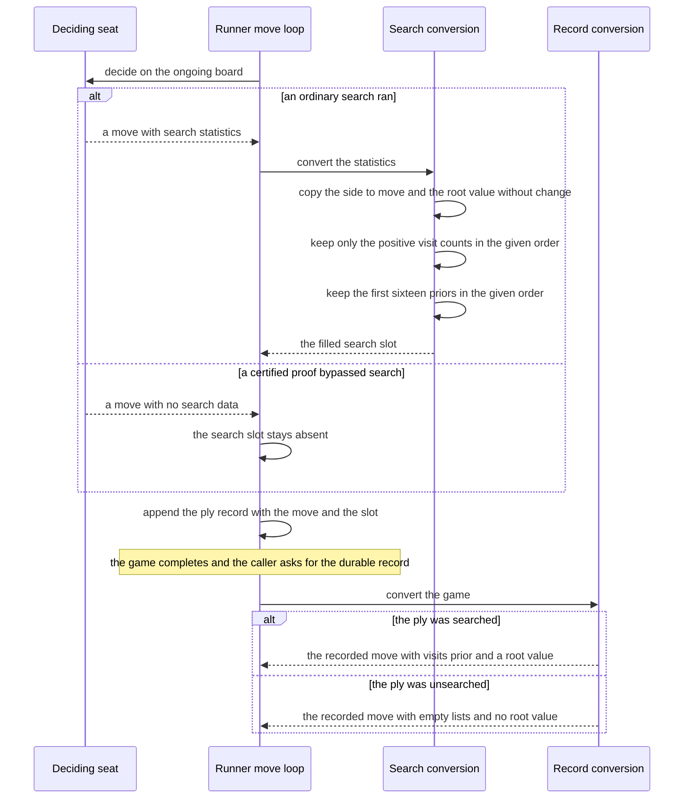
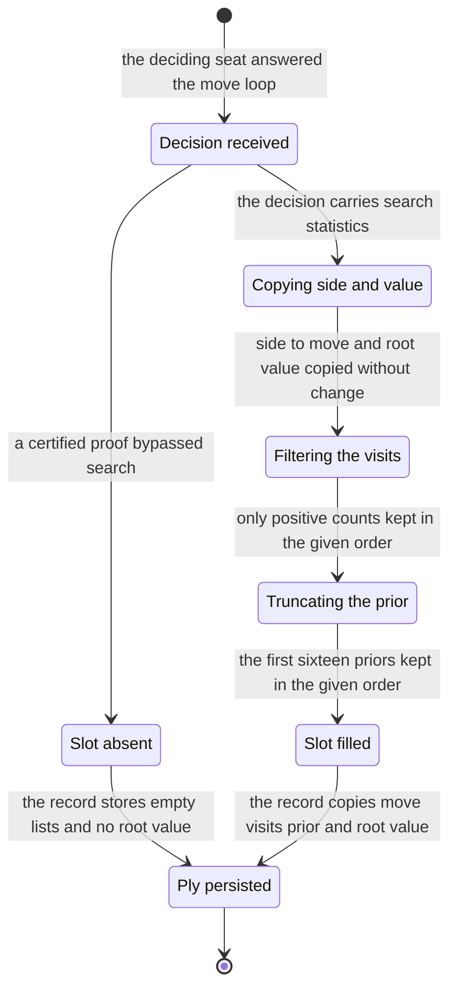

# Chapter 03 — Recording the search: design paper

## Abstract

This paper is the conceptual companion to
[chapter 03 of the selfplay-corpora tutorial](recording-the-search.md).
The chapter teaches the `selfplay` crate what a search record *means*:
chapter 01's inline conversion of the seat's statistics into the
per-ply search slot becomes a named, test-pinned conversion, the
`From<player::SearchStats> for PlySearch` implementation, with three
fixed semantics — the root value keeps the side to move's sign, the
visit list keeps only positive counts, and the prior is truncated to
its first `RECORDED_PRIOR_TOP_K = 16` entries in the search's
extraction order (descending by value). This paper explains why the design has that shape. Its
conclusions: the record stores what the search produced and nothing
more, because the training targets π and z are read-time derivations,
not write-time computations; the sign convention costs nothing because
the recorded value travels with the recorded side to move; sparsity is
honesty — a zero-count entry and a tail prior carry no information the
record needs; and the empty-versus-zero distinction is the load-bearing
boundary, because no reader may ever mistake *no search ran* for *the
search estimated zero*. The intended reader is the learner who has read
the chapter paper and wants the reasoning behind its artifacts before
building them.

## Glossary

| Term | Definition |
|------|------------|
| **Seat** | One of the two players of a generated game: a persistent `player::AiPlayer` running the baseline evaluator at a declared simulation budget (chapter 01). Every game pairs two seats; this paper speaks of the *deciding* seat of a ply. |
| **SearchStats** | `player::SearchStats`, the statistics the seat extracts from one real searched tree: the side to move, every root move with its visit count (descending by count, ties by move index), every root prior (descending by value, ties by move index), and the root value. Absent when a certified proof bypassed search. |
| **PlySearch** | The `selfplay` crate's per-ply search slot: `side_to_move`, `visits`, `prior`, `root_value`. This chapter owns its conversion semantics. |
| **PlyRecord** | The runner's per-ply record (chapter 01): `mv`, the played move, and `search`, an `Option<PlySearch>` — `None` for a certified-proof move. |
| **RecordedPly** | The durable per-ply record (chapter 02): `mv`, sparse raw `visits`, sparse `prior`, and `root_value: Option<f32>`. The disk image of one `PlyRecord`. |
| **Side to move** | The color whose turn the searched position was — `board.to_move()` at decision time. The root value's sign is defined relative to this side. |
| **Root value** | The search's value estimate at the root after the simulation budget is spent, from the side to move's perspective: the sum of the root edges' accumulated values divided by the sum of their visit counts, or exactly 0.0 when no edge was visited. Recorded as metadata, not as a training target. |
| **Prior** | The evaluator's policy probabilities over root moves before search — the P in predictor UCT (PUCT; Rosin 2011) — after the optional root Dirichlet noise (Silver et al. 2017) when noise was applied. The post-noise qualification holds on ordinary play; a resignation's statistics are pre-noise and never recorded, because a resignation produces no ply. Recorded sparsely for audit. |
| **Top-k** | Keeping only the k leading entries of an ordered list. Here k is `RECORDED_PRIOR_TOP_K = 16`. |
| **Sparse** | Storing only the entries that carry information: visited root children for the visit counts, the top-k for the priors. Unvisited children and the prior's tail are omitted. |
| **π (visit-distribution target)** | The normalized root visit-count distribution of the search at a ply; the policy training target (Silver et al. 2017). The record stores raw counts; normalization happens at read time in chapter 06. |
| **z (outcome target)** | The game result in {+1, 0, −1} from the perspective of the side to move at a ply; derived from the stored outcome at read time in chapter 06, never stored per ply. |
| **Certified forced win** | A forced-win line produced by the engine's threat-space search (TSS) prover (Allis 1994) and checked by `engine::verify_line`. A seat that holds one plays its first move immediately; no search runs, and the ply carries no search statistics. |
| **Swap2** | The project's opening protocol: one side places three stones, the other side chooses a color or places two more stones, and the first side then chooses a color. Its ceremony fixes the starting position and the colors, which is what makes the side to move derivable on replay. |
| **Claim labels** | The project's provenance labels (chapter 12 of the wiki): **[paper]** (stated in a cited paper), **[derived]** (computed from cited or measured values), **[experiment]** (a free parameter, to be settled by measurement). |

## Context and connected design narrative

The [chapter paper](recording-the-search.md) states the specification;
this paper tells the story. Three sources supply what the chapter
refines, and each contributes one side of the seam. From the
[baseline tutorial](../../baseline-tutorial/README.md) comes the
producer: a seat's `AiPlayer::decide` returns a `Decision`, and
`Decision.search` — an `Option<SearchStats>` — is the raw material.
The `Option` is the honesty rule of that track: statistics come from a
real searched tree, never from a proof. When the seat's own-side TSS
probe certifies a forced win, the decision plays the proof's first move
and carries `search: None`. From
[chapter 01](../01-the-game-runner/the-game-runner.md) and its
[design paper](../01-the-game-runner/the-game-runner-design.md) comes
the slot: every played move becomes a `PlyRecord` whose `search` field
is an `Option<PlySearch>`, filled by an inline conversion inside the
move loop — copy the side to move, keep only the positive-count visit
entries, carry the prior through untruncated, copy the root value. From
[chapter 02](../02-recording-games/recording-games.md) and its
[design paper](../02-recording-games/recording-games-design.md) comes
the durable side: `GameRecord::from_game` copies each slot into a
`RecordedPly` as-is — empty visits, an empty prior, and
`root_value: None` when the slot is absent.

This chapter changes exactly one thing in that picture: the inline
conversion gains a name and a semantics contract. The name is
`From<player::SearchStats> for PlySearch`; the contract is three field
rules — the sign and visit rules carried from the inline block, and
the prior rule now extended with truncation. Nothing on the
record side changes — chapter 02's mapping already copies the slot
verbatim, and this chapter's work is making the slot worth copying.

### Record what the search produced; derive the targets later

The sentence the design hangs on: **the record stores what the search
produced, and the training targets are derived from it at read time.**
A `SearchStats` is a measurement of one searched tree — the side to
move, the visit counts over the root edges, the priors the selection
actually saw, the root value estimate. The conversion's job is to carry
that measurement into the game without interpretation. What it must
not do is compute training targets. The policy target π is a
*normalization* of the raw visit counts, and normalization is a choice
the reader makes (chapter 06's read path), not a fact the writer
decides; storing raw counts keeps the record honest about how much
search stood behind each entry — thirty simulations and eight hundred
produce different records, as they should. The value target z is the
game's outcome re-read from each ply's perspective, and the outcome is
already stored once per game (chapter 02); duplicating it per ply would
store derivable data and open a consistency hazard. This is the
primer's invariants 5 and 6 — π normalized at read time, z derived at
read time — applied at the exact point where the search data enters
the game.

### The sign convention: the value keeps its side

The first rule of the conversion is a non-action: the side to move and
the root value cross over verbatim. The `SearchStats.side_to_move` is
`board.to_move()` at decision time, and the `SearchStats.value` is
computed in that side's frame — the sum of the root edges' accumulated
values divided by the sum of their visit counts, or exactly 0.0 when no
edge was visited. The `PlySearch.root_value` is the same number under
the same convention. The conversion never negates, never re-anchors a
value to a fixed color, and never clamps.

Why is doing nothing a design decision? Because a future "helpful"
normalization — re-expressing every value from Black's perspective,
say — is the kind of change that compiles fine and corrupts a corpus
silently. The recorded root value is **metadata for audit**: it answers
"how good did the search think this position was, for the player who
faced it?", and that question is only meaningful in the facing player's
frame. It is not the value target z and never becomes one in this
track. The slot keeps `side_to_move` beside the value so the sign is
self-describing while the game is in flight — chapter 01's visit-sum
test already reads the expected budget from it. On disk the side is
omitted, because it is derivable: the recorded opening fixes the
starting position, White moves first after the Swap2 ceremony, colors
alternate ply by ply, and the read path replays every game through the
engine anyway. The replayed side to move *is* the recorded side to
move, because the statistics were extracted from the position the
replay reconstructs — so the sign convention survives persistence with
no field spent and no consistency hazard created.

### The visits: positive counts, kept raw and in order

The second rule is inherited unchanged from chapter 01's inline block:
the conversion keeps only the positive-count entries of the visit list.
`SearchStats.visits` lists *every* root move — the player's extraction
sorts all root edges descending by count with ties by move index, and
children the search never visited appear with count zero. A zero-count
entry carries no information: it contributes nothing to the count sum
and nothing to the future π. Dropping it is what "sparse" means for
the visits.

Two things the conversion deliberately does not do to the survivors.
It does not **normalize**: the counts stay raw, per the
record-versus-derive rule above; the primer's invariant 5 lives
exactly here. And it does not **sort**: the entries keep the player's
extraction order — descending by count, ties by move index. Move
selection itself consumes the root edges in creation order; the record
preserves the order the player's extraction reported. A conversion
that re-sorted would duplicate work and risk diverging from that
reported order.

### The prior: sixteen entries, in the search's order

The third rule is this chapter's one new behavior. Chapter 01 carried
the prior through untruncated; the conversion now keeps only the first
`RECORDED_PRIOR_TOP_K` entries — a constant this chapter adds to the
record vocabulary, equal to 16. The constant lives with the record
vocabulary because it is a *format width*: it bounds what any reader
of the durable format must expect, so it belongs beside `RecordedPly`,
not beside the in-memory slot.

Three properties hold together. The cut is a **prefix**: the player's
extraction already ordered the priors descending by value with ties by
move index, so taking the first sixteen *is* taking the top sixteen —
no selection criterion of the conversion's own. The order is
**preserved**: the conversion applies no sort. And the values are
**not renormalized**: the stored entries are the probabilities as
mixed — after the optional root Dirichlet noise (Silver et al. 2017)
when noise was applied, because the extraction happens after the noise
on ordinary play — and they sum to at most one: strictly less only
when the truncation removed positive prior mass, while a ply with no
more than sixteen legal moves retains the full normalized prior.
That is acceptable because the recorded prior is an audit record, not
a distribution to sample from: the
[design spec](../../../specs/2026-11-11-selfplay-corpora-design.md)
§3.2 states its purpose as comparing the baseline's priors against a
trained network's priors on identical positions.

Why sixteen, and why bound it at all? The width is **[experiment]** in
the sense of the claim labels of
[docs/12-gomoku-architecture.md](../../../12-gomoku-architecture.md):
a free parameter of this track, settled by measurement, not a constant
from the literature — the design spec §3.2 records it as a
selfplay-corpora format invention. The rationale for bounding it at
all is cost against value. A 15×15 board has up to 225 root priors per
ply; storing all of them would multiply the record's size for entries
that are, after the first handful, near-uniform tail mass under the
baseline's concentrated policy. The audit value of the tail is low —
and it is recoverable: the baseline evaluator is deterministic, so the
full prior of any recorded position is recomputable by replaying to
that ply and re-evaluating. The stored prefix makes casual inspection
cheap; recomputation makes the omission safe.

### Plies without search: `None`, not zero

The `Option` around `Decision.search` is the whole mechanism for
unsearched plies, and the conversion preserves it as an `Option`
rather than dissolving it into sentinel values. A decision whose
search slot is absent — the certified-proof bypass — produces a
`PlyRecord` whose `search` is `None`. No `PlySearch` is constructed,
so there is no struct in memory that could hold fabricated zeros.

The durable representation says the same thing in a different
vocabulary, and the two layers must not be confused. In memory the
statement is strong: there is no `PlySearch` at all. On disk,
`GameRecord::from_game` maps the absent slot to a `RecordedPly` with
empty visits, an empty prior, and `root_value: None`. The indirection
is exact: the `Option` around `PlySearch` becomes the `Option` around
`root_value`, and the empty vectors are what a missing slot maps to —
not what a search produced.

The empty-versus-zero distinction is the load-bearing point, and the
format keeps the cases strictly apart. `root_value: None` means *no
search ran*. `root_value: Some(0.0)` is a real recorded value: a
search that ran and visited no edge reports exactly 0.0 by the
`SearchStats` convention — reachable only at a zero simulation budget,
which no corpus configuration uses. Empty visits on a *searched* ply
are likewise reachable only at zero budget, because one or more
simulations always visit at least one child. So on any real corpus
ply: a searched ply carries `Some(value)` and the entries its search
produced; an unsearched ply carries empty lists and `None`; and no
reading of the record can mistake one case for the other. Fabricating
statistics for a move no search produced would be dishonest telemetry
— the primer's invariant 7 — and the design makes fabrication
structurally unnecessary: absence is representable, so it is
represented.

### Persistence: the record copies; it does not convert

From the filled or absent slot onward, chapter 02's machinery runs
unchanged. `GameRecord::from_game` turns each `PlyRecord` into one
`RecordedPly` — the move, the visits, the prior, and the root value
lifted from `f32` to `Option<f32>`. The record side applies no
truncation, no filtering, and no sign handling, because this chapter
has already made the slot data exactly what the record should hold.
That is the seam's division of labor: chapter 03 owns what the slot
*guarantees*; chapter 02 owns how the slot *persists*; and the
guarantee is pinned by tests on the conversion itself, so the
persistence tests of chapter 02 pass without knowing the conversion
exists.

## Primary interaction: from one decision to one durable ply

The sequence walks one ply's search data along the happy path: the
deciding seat answers, the runner's move loop maps the optional
statistics through the named conversion, the ply record is appended,
and — after the game completes — the record conversion copies the
slot into its durable shape. Both branches appear twice: the
certified-proof bypass produces no slot, and the record conversion
represents that absence as empty lists with no root value.

The participants name the artifacts: the deciding seat is the seat
that `board.to_move()` selected, the runner move loop is chapter 01's
loop inside the game-playing entry points, the search conversion is
the `From<player::SearchStats> for PlySearch` implementation, and the
record conversion is `GameRecord::from_game`. The engine's legality
gate between decision and append is chapter 01's subject and is
omitted here; nothing about it changes.

## The conversion as a state machine

This machine is a **data-transformation model**, not a new runtime
typestate. The implementation is one total conversion plus chapter
02's as-is copy; the states below name the conceptual stages one ply's
data passes through so the contracts have a shape, the way the record
itself has a shape. There are no error states: the conversion performs
no validation and no fallible operation, every `SearchStats` converts,
and absence of statistics is a branch, not a failure.

| Current state | Input | Condition | Next state | Emitted outputs |
|---------------|-------|-----------|------------|-----------------|
| (entry) | a `Decision` from the deciding seat | always | Decision received | the played move and the optional `SearchStats` |
| Decision received | the decision's search slot | statistics present — an ordinary search ran | Copying side and value | none yet |
| Decision received | the decision's search slot | statistics absent — a certified proof bypassed search | Slot absent | no `PlySearch` is constructed |
| Copying side and value | the side to move and the value | always — copied verbatim, never negated or re-anchored | Filtering the visits | the slot's `side_to_move` and `root_value` |
| Filtering the visits | the visit list | keep entries whose count is positive; the player's order is kept | Truncating the prior | the slot's sparse raw `visits`; empty only when the budget was zero |
| Truncating the prior | the prior list | keep the first `RECORDED_PRIOR_TOP_K` entries; the player's order and values are kept | Slot filled | the slot's bounded `prior`; not renormalized |
| Slot filled | the played move and the filled slot | the game completes and converts | Ply persisted | a `RecordedPly` with the move, the visits, the prior, and `root_value` as a present value |
| Slot absent | the played move and the absent slot | the game completes and converts | Ply persisted | a `RecordedPly` with the move, empty visits, an empty prior, and `root_value` absent |

Two properties of the table deserve emphasis. The branch happens once,
at the decision: everything downstream of *slot filled* and *slot
absent* is chapter 02's unconditional copy, which is why the two
persistence rows differ only in what they emit. And the conversion
rows carry no failure condition because there is none to carry — a
filter that keeps positive counts and a truncation that keeps a prefix
succeed on every input, including empty ones. An empty visit list in
and an empty visit list out is an honest record of a zero-budget
search; it is not an error, and the design invents no error state for
it.

## Noun catalog

### The `player` layer (the producer; not touched by this chapter)

| Name | Kind | Role |
|------|------|------|
| `AiPlayer` | struct | One persistent seat; `decide` runs a fresh search per move and returns what the decision rested on. |
| `Decision` | struct | What a seat concluded: an action plus `search`, the optional statistics; it also carries `guard` and `resignation` diagnostics, which this conversion does not consume. |
| `Decision.search` | field | An `Option<SearchStats>`; `None` only when a certified own-side proof bypassed search. The honesty rule made structural. |
| `SearchStats` | struct | The measurement of one real searched tree: `side_to_move`, `visits`, `prior`, `value`. The conversion's input. |

### The `selfplay` layer — game vocabulary (this chapter's semantics)

| Name | Kind | Role |
|------|------|------|
| `PlySearch` | struct | The per-ply search slot: `side_to_move`, sparse raw `visits`, top-k `prior`, `root_value`. This chapter owns what its conversion guarantees. |
| `PlyRecord` | struct | One played move: `mv` plus `search`, an `Option<PlySearch>` — `None` for a certified-proof move. Unchanged from chapter 01. |
| `From<player::SearchStats> for PlySearch` | trait impl | The named conversion: verbatim side and value, positive-count visits, ordered prior prefix. Total; cannot fail. |
| `RECORDED_PRIOR_TOP_K` | constant | The format width of the prior prefix, 16. Record vocabulary in `record.rs`, re-exported from the crate root; **[experiment]** per the design spec §3.2. |

### The `selfplay` layer — record vocabulary (chapter 02's; unchanged here)

| Name | Kind | Role |
|------|------|------|
| `RecordedPly` | struct | The durable per-ply record: `mv`, `visits`, `prior`, `root_value: Option<f32>`. Empty lists and absent value mark an unsearched ply. |
| `GameRecord` | struct | The durable game; its conversion copies each slot as-is and lifts the root value into the `Option`. |

### The `mcts` layer (the ordering's origin; not touched by this chapter)

| Name | Kind | Role |
|------|------|------|
| `visit_distribution` | function | Extracts every root edge's visit count, zero counts included — the list the player's extraction sorts into `SearchStats.visits`. |
| `add_dirichlet_noise` | function | Mixes root Dirichlet noise (Silver et al. 2017) into the root priors before selection; the recorded prior reflects it when noise was applied. |
| `select_move_with_priors` | function | The temperature selection over the root edges in creation order; the record instead keeps the player's extraction order from `SearchStats`. |

### Disambiguation

- **Value** names three things that must never meet. `SearchStats.value`
  is the search's root estimate at decision time, from the side to
  move's perspective. `PlySearch.root_value` (and the `RecordedPly`
  field of the same name) is that same number carried into the record —
  metadata for audit. **z**, the value *target*, is the game outcome
  re-read per ply at read time (chapter 06); it is never stored and
  never passes through this chapter. The recorded root value can later
  be *compared* against z in an audit; it is not a stand-in for it.
- **Visits, prior, and π** are one position's three policy-shaped
  lists. The visits are the search's answer — how many simulations
  reached each root child, raw. The prior is the evaluator's guess
  before search — probabilities, recorded only as the audit prefix.
  π is neither: it is the visits *normalized*, a read-time derivation
  the record deliberately does not contain.
- **None and empty** are different statements. In memory, `None`
  (no `PlySearch`) means no search ran. On disk, `root_value: None`
  says the same thing, while empty `visits` and `prior` are what an
  absent slot maps to — not what a search produced. `Some(0.0)` is a
  real value: a search that ran and visited no edge. The two cases are
  never interchangeable, and no corpus configuration reaches the
  zero-budget corner where a searched ply could look empty.
- **Side to move** names the color `board.to_move()` returned at
  decision time (a fact about the position), the
  `SearchStats.side_to_move` field (the fact carried into the
  statistics), and the `PlySearch.side_to_move` field (the fact kept
  in memory so the root value's sign is self-describing). The
  `RecordedPly` has no such field: on disk the side is derived by
  replaying the game, and the replayed side is the recorded side by
  construction.

## Verb catalog

Contracts only — receivers, methods, what they consume, what they
produce. The construction itself is the learner's work, layered in the
[implementation plan](recording-the-search-implementation.md).

### The `player` layer

| Receiver | Method | Consumes | Produces |
|----------|--------|----------|----------|
| `AiPlayer` | `decide` | a borrowed board, borrowed options, a mutable borrow of the game's random stream | `Result<Decision, DecisionError>` — on ordinary play, a move with `Some(SearchStats)` extracted from the real tree; on a certified own-side proof, the proof's first move with `None`; never mutates the board |

### The `selfplay` layer

| Receiver | Method | Consumes | Produces |
|----------|--------|----------|----------|
| — (trait impl) | `From<player::SearchStats> for PlySearch` | the statistics, by value | the slot: `side_to_move` and `root_value` copied verbatim; `visits` filtered to positive counts in the input's order; `prior` truncated to its first `RECORDED_PRIOR_TOP_K` entries in the input's order, values unchanged. Total — every input converts, nothing fails |
| `GameRecord` | `from_game` | a borrowed `Game` | a `GameRecord`; must-use; pure — no replay, no search, no I/O. Each ply copies as-is: the slot's fields across when present, empty visits and prior with `root_value: None` when absent. Unchanged from chapter 02 |

### The `mcts` layer

| Receiver | Method | Consumes | Produces |
|----------|--------|----------|----------|
| — (free function) | `visit_distribution` | a tree and its root | every root edge's move and visit count, zero counts included, in edge-creation order |
| — (free function) | `add_dirichlet_noise` | a mutable tree, its root, the mix fraction and concentration, the random stream | the root priors re-mixed in place, before selection |
| — (free function) | `select_move_with_priors` | the root edges (in creation order), the temperature, the random stream | an `Option<Move>` — `None` for empty edges; the creation order it consumes is not the order `SearchStats` later reports |

## Central design rule and invariants

**Central rule:** the record stores what the search produced — sign,
counts, priors, and ordering carried across verbatim within the
declared sparsity — and nothing the training targets need is computed
at write time. π and z are read-time derivations; the conversion is a
carrier, not a computer.

1. **Sign preservation.** The conversion copies `side_to_move` and the
   root value verbatim: no negation, no re-anchoring to a fixed color,
   no clamping. A recorded value is always the estimate of the side
   that was to move, and the recorded or replayed side to move is what
   makes the sign readable later.
2. **Positive visits, raw and in order.** The visit list keeps only
   positive counts — a zero-count child carries no information — and
   keeps them unnormalized, in the player's order (descending by
   count, ties by move index). The counts of one ply sum to the
   deciding seat's simulation budget on real games.
3. **The prior is an ordered prefix.** The recorded prior is exactly
   the first `RECORDED_PRIOR_TOP_K = 16` entries of the player's
   ordering (descending by value, ties by move index): a truncation,
   not a selection; no re-sorting; no renormalization — the stored
   values sum to at most one, strictly less only when the truncation
   removed positive prior mass; a ply with sixteen or fewer legal
   moves retains the full normalized prior. The width is **[experiment]** under
   the claim labels of
   [docs/12-gomoku-architecture.md](../../../12-gomoku-architecture.md),
   a format invention of this track per the design spec §3.2, and the
   omitted tail is recomputable because the baseline evaluator is
   deterministic.
4. **Empty is not zero.** An unsearched ply — a certified-proof move —
   holds no `PlySearch` in memory and persists as empty visits, an
   empty prior, and `root_value: None`. `Some(0.0)` and empty lists on
   a *searched* ply are reachable only at a zero simulation budget,
   which no corpus configuration uses. No reading of a real corpus
   ply can mistake *no search ran* for *the search estimated zero*.
5. **Targets are derived at read time, never stored.** The record
   keeps raw visit counts (π normalizes them at read time, chapter
   06) and the game outcome once (z is derived per ply from the side
   to move at read time, chapter 06). The root value is audit
   metadata, not a training target.
6. **The durable layout does not change.** This chapter changes what
   the slot guarantees, not what the record holds: `RecordedPly` and
   chapter 02's as-is mapping are untouched, and the corpus target
   stays green unchanged. The format width `RECORDED_PRIOR_TOP_K`
   bounds a field that already exists; it introduces no new field and
   no layout change.
7. **No fabricated statistics.** A move no search produced records no
   search data — the honesty rule inherited from the baseline track
   and restated as the primer's invariant 7. A resignation ends the
   game without a played move and produces no ply at all.

## References

**This chapter:**

- [recording-the-search.md](recording-the-search.md) — the chapter
  paper: intention, specification as tests, execution-order
  walkthrough.
- [recording-the-search-implementation.md](recording-the-search-implementation.md)
  — the hiding layer: low-level construction instructions.
- [recording-the-search-solution.md](recording-the-search-solution.md)
  — the annotated reference snippets.

**This track:**

- [Tutorial README](../README.md) — conventions, gates, and the
  chapter map.
- [Self-play primer](../00-selfplay-primer.md) — §3.2 pins the sparse
  storage decisions; §8 pins invariants 5 (π normalized at read time),
  6 (z derived at read time), and 7 (honest search records).
- [Chapter 01 — the game runner](../01-the-game-runner/the-game-runner.md)
  and its [design paper](../01-the-game-runner/the-game-runner-design.md)
  — the `PlySearch` slot, the inline conversion this chapter replaces,
  and the visit-sum contract the refactor must preserve.
- [Chapter 02 — recording games](../02-recording-games/recording-games.md)
  and its [design paper](../02-recording-games/recording-games-design.md)
  — `RecordedPly`, `GameRecord::from_game`, and the as-is persistence
  of the slot.
- [Design spec](../../../specs/2026-11-11-selfplay-corpora-design.md) —
  §3.2: the record format, the sparse top-k prior with k = 16 as
  **[experiment]**, and the audit purpose of the prior.
- [Tutorial hand-off](../../../specs/2026-11-11-selfplay-corpora-tutorial-handoff.md)
  — this chapter's public surface and the unsearched-ply
  representation.

**Prerequisite tracks:**

- [Baseline tutorial](../../baseline-tutorial/README.md) —
  `AiPlayer::decide`, `SearchStats`, and the honesty rule for
  certified-proof moves.
- [MCTS tutorial](../../mcts-tutorial/README.md) — the search whose
  root visit distribution and edge priors `SearchStats` extracts.
- [Engine tutorial](../../13-engine-tutorial/README.md) — the TSS
  prover and `verify_line` behind the certified-proof bypass.
- [docs/12-gomoku-architecture.md](../../../12-gomoku-architecture.md) —
  defines the **[paper]** / **[derived]** / **[experiment]**
  claim-label convention used for k = 16.

**Source (live on `main`):**

- [`gomoku/crates/player/src/lib.rs`](../../../../gomoku/crates/player/src/lib.rs) —
  `AiPlayer`, `Decision`, `SearchStats` — the conversion's input and
  the honesty rule. Not touched in this chapter.
- [`gomoku/crates/mcts/src/policy.rs`](../../../../gomoku/crates/mcts/src/policy.rs) —
  `visit_distribution`, `add_dirichlet_noise`,
  `select_move_with_priors` — the origin of the orderings the record
  keeps. Not touched in this chapter.

**Source (created by chapters 01 and 02, touched by this chapter; not
yet present on `main`):**

- `gomoku/crates/selfplay/src/game.rs` — `PlySearch` gains
  `From<player::SearchStats>`; the move loop's inline conversion
  becomes one `Option::map` call.
- `gomoku/crates/selfplay/src/record.rs` — gains
  `RECORDED_PRIOR_TOP_K`; the `RecordedPly.prior` documentation names
  the bound.
- `gomoku/crates/selfplay/src/lib.rs` — re-exports
  `RECORDED_PRIOR_TOP_K`.
- `gomoku/crates/selfplay/tests/game.rs` — the chapter's
  specification: the two conversion tests.
- `gomoku/crates/selfplay/tests/corpus.rs` — chapter 02's
  specification, unchanged; regression evidence for the record side
  of the seam.

**External sources:**

- Silver, D. et al. (2017). *Mastering the Game of Go without Human
  Knowledge* (AlphaGo Zero). <https://doi.org/10.1038/nature24270> —
  the visit-distribution policy target π whose raw counts the record
  keeps, and the root Dirichlet noise the recorded prior reflects.
- Rosin, C. D. (2011). *Multi-armed bandits with episode context*
  (PUCT). <https://doi.org/10.1007/s10472-011-9258-6> — the selection
  rule whose P is the recorded prior.
- Allis, L. V. (1994). *Searching for Solutions in Games and
  Artificial Intelligence*. PhD thesis, Maastricht University.
  <https://doi.org/10.26481/dis.19940923la> — threat-space search, the
  source of the certified moves that bypass the record.
