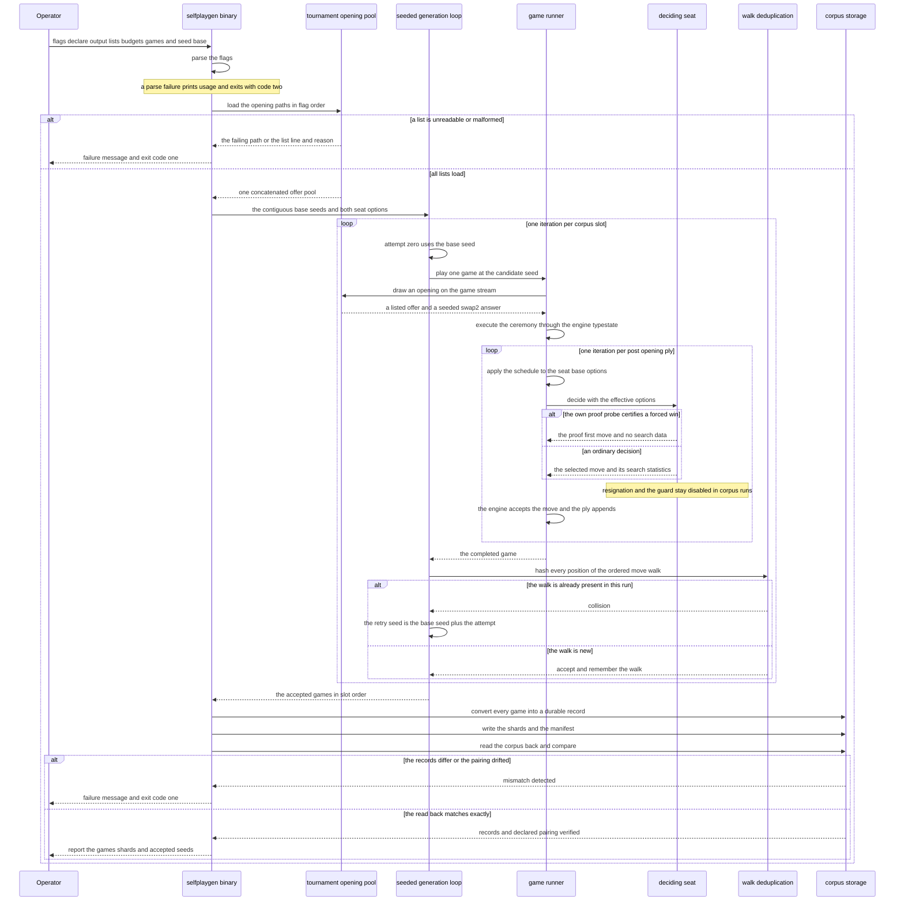
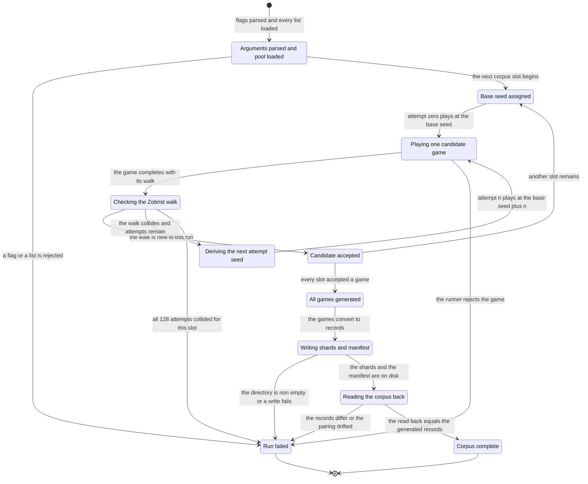

# Chapter 04 — Diversity and grading: design paper

## Abstract

This paper is the conceptual companion to
[chapter 04 of the selfplay-corpora tutorial](diversity-and-grading.md).
The chapter turns the game runner of chapters 01–03 into a corpus
generator; this paper explains why the generator has the shape it has.
Two seats of the same hand-written baseline evaluator, playing greedy,
would produce the same game twice, so the chapter adds five deliberate
mechanics: a parsed pool of tournament opening offers
(`TournamentOpenings` behind the `OpeningSource` seam, recording
`OpeningProvenance` in every header), a windowed exploration schedule
(`ExplorationSchedule::options_for_ply`), one seed per game with a
derived-seed retry rule (`generate_games` / `generate_games_with`),
duplicate detection by the Zobrist walk with a bounded retry budget
(`GenerateError::DuplicateExhausted` after 128 attempts), and the
`selfplaygen` binary that declares the pairing, the seed range, and
the output, writes shards and a `Manifest`, and reads its own output
back. Its conclusions: diversity inside a corpus comes from openings
and exploration alone — the opponent is always the same evaluator, so
there is no opponent diversity — while grading across corpora comes
from declared simulation budgets, a declaration recorded in every
`GameRecord` header and in the manifest, not a measured strength
guarantee; determinism and deduplication are two sides of one seed
discipline, because the seed is the complete identity of a game; and
three observations (a rejected committed opening list, debug-build
slowness, an inverted grading probe) are part of the design's honesty
and stay unresolved here. The intended reader has read the chapter
paper and wants the reasoning behind its artifacts before building
them.

## Glossary

| Term | Definition |
|------|------------|
| **Seat** | One of the two players of a generated game: a persistent `player::AiPlayer` running the baseline evaluator at a declared simulation budget (chapter 01). Every game pairs two seats. |
| **Simulation budget** | The number of search simulations a seat runs per move decision; written baseline-X. Declared per seat on the command line and recorded in every game header. |
| **Pairing** | The declared Black-vs-White seat configuration of a corpus — `SeatPairing` in the record header (chapter 02), `pairing` in the manifest. Matched pairs (X vs X) produce balanced games; graded pairs (X vs Y) produce favorites and upsets. |
| **Corpus** | A set of game records produced at one declared pairing, stored as shards plus a manifest (chapter 02). |
| **Corpus slot** | One position in a run's game sequence. Each slot starts from one base seed and ends with exactly one accepted game. |
| **Shard** | A fixed-capacity file of length-delimited bincode records; the `train` crate's storage unit, reused unchanged (chapter 02). |
| **Manifest** | The JSON file next to the shards — the `Manifest` struct: the exact seed set, the pairing, game counts, shard names. The shards are the data; the manifest is provenance. |
| **Swap2** | The project's opening protocol: one side places three stones, the other side chooses a color or places two more stones, and the first side then chooses a color. Executed through the engine's typestate, so illegal openings are unrepresentable. |
| **Opening offer** | The three-stone opening one side places in the Swap2 ceremony. In this chapter, drawn uniformly from the committed tournament lists. |
| **OpeningSource** | The runner's pluggable opening seam (chapter 01): one method, `opening(&mut self, rng: &mut StdRng) -> Opening`, sharing the game's single random number generator (RNG) stream. `GeneratedOpening` draws near-center stones; `TournamentOpenings` draws from loaded lists. |
| **Opening provenance** | `OpeningProvenance`: `Generated`, or `Listed { list, index }` — the stable identity of the source list and the zero-based offer position within it. Recorded in every game header. |
| **Exploration schedule** | `ExplorationSchedule`: the per-ply move-selection policy shared by both seats. Plies `0..plies` after the Swap2 ceremony sample moves at temperature τ with root Dirichlet noise; every later ply plays the argmax. |
| **Temperature (τ)** | The move-selection temperature: τ = 1 samples moves proportionally to visit counts; τ = 0 plays the argmax (Silver et al. 2017). |
| **Dirichlet noise (ε, α)** | Root noise mixed into the search priors during exploration plies: ε is the mix fraction, α the concentration parameter (Silver et al. 2017). |
| **Base seed / derived seed** | The seed a corpus slot starts from, and the replacement `base_seed + attempt` used when a duplicate is rejected. The accepted seed — base or derived — is the one recorded. |
| **Zobrist key** | A 64-bit hash of a board position, maintained incrementally by the engine; used here for game identity. |
| **Zobrist walk** | The ordered sequence of Zobrist keys of every position a game reaches, opening placements included. Equality of walks is this chapter's duplicate test. |
| **MANUAL test** | A test marked `#[ignore]` with a MANUAL comment because it plays slow games. It never runs by default; it runs on explicit selection, in release mode. |
| **Threat-space search (TSS)** | A proof search over forced-win threat sequences (Allis 1994). Each seat's own-side probe runs before its search; a certified proof short-circuits the search, and that ply carries no search record (chapter 03). |
| **PUCT** | Predictor UCT (Rosin 2011), the selection rule of the Monte Carlo tree search both seats run. |
| **Claim labels** | The project's provenance labels (chapter 12 of the wiki): **[paper]** (stated in a cited paper), **[derived]** (computed from cited or measured values), **[experiment]** (a free parameter, to be settled by measurement). This paper also uses **[invention]**: a choice of this track, not a fact of the architecture chapters. |

## Context and connected design narrative

The [chapter paper](diversity-and-grading.md) states the
specification; this paper tells the story. Four sources supply what
the chapter combines. From
[chapter 01](../01-the-game-runner/the-game-runner.md) and its
[design paper](../01-the-game-runner/the-game-runner-design.md) comes
the runner: `play_game_with_opening(seed, black_options,
white_options, opening_source)` plays a complete game with two
persistent seats, executes the Swap2 ceremony through the engine's
typestate, and runs one `StdRng` stream per game, shared by the
opening source and both seats — so the seed is the game's complete
identity. It also built the `OpeningSource` seam with the stand-in
`GeneratedOpening`. From
[chapter 02](../02-recording-games/recording-games.md) and its
[design paper](../02-recording-games/recording-games-design.md) comes
the durable side: `GameRecord` with its `GameHeader`, and
`write_corpus` / `read_corpus` / `read_manifest` with overwrite
protection. Two of its record fields gain content here, with a
precise ownership split: chapter 02 already defined and tested both
`Manifest.seeds` and `SeatPairing.exploration` as record fields —
the writer assembles `seeds` in corpus order, and the header
serializes the schedule's `Default`. What this chapter supplies is
the accepted seeds of a generated run, derived replacements
included, and the activation of the exploration behavior
(`ExplorationSchedule::options_for_ply` and its per-ply
application); it does not introduce the manifest fields. Of the two,
only `exploration` was behavior-free before this chapter. From
[chapter 03](../03-recording-the-search/recording-the-search.md) and
its [design paper](../03-recording-the-search/recording-the-search-design.md)
comes the honesty rule the schedule must respect: a move played from a
certified TSS proof carries no search record, and the schedule changes
only move selection, so it never fabricates or alters what the search
recorded. From the
[design spec](../../../specs/2026-11-11-selfplay-corpora-design.md)
come the two load-bearing decisions: S5 makes strength grading a
primary axis of the corpus, and S6 fixes the runner's shape —
synchronous, single-threaded, one seed base per process invocation,
parallelism by process.

### The problem: deterministic seats produce one game

The baseline evaluator is deterministic, and greedy move selection is
deterministic. Two games that start from the same opening under those
rules are the same game. A training corpus built that way would be one
game copied many times. The corpus's value therefore depends on
deliberate diversity — and on declared strength, because the design
spec's decision S5 makes the simulation-budget ladder load-bearing:
the later promotion criterion, "the candidate beats the baseline at an
equal simulation budget", only means something if budget demonstrably
grades strength. This chapter builds the mechanics for both; the
measurement of the ladder belongs to chapter 07.

### Two axes: diversity inside a corpus, grading across corpora

The chapter's title names two things, and the design keeps them
strictly separate. **Diversity** is a property of the games inside one
corpus, and it comes from exactly two sources: the opening pool
(different offers, different seeded Swap2 answers, both color
assignments) and the exploration schedule (ten plies of noisy
temperature sampling before greedy play). There is deliberately no
third source: both seats of every game are the same baseline
evaluator, so there is no opponent diversity anywhere in the track.
**Grading** is a property of a corpus as a whole, and it comes from
exactly one source: the declared per-seat simulation budgets of the
pairing — baseline-800 versus baseline-800 for balanced games,
baseline-3000 versus baseline-800 for a graded rung. The pairing is
declared on the command line, recorded in every record header, and
recorded once in the manifest. What the pairing is not is a measured
strength difference: the grading probe's inversion (the open
observations below) is the standing reminder that declaration and
measurement are different things.

### The opening pool: strict parsing, one uniform draw

The first diversity source enters through `TournamentOpenings`, the
chapter's second implementation of the `OpeningSource` seam. The
committed tournament lists hold center-relative `x,y` coordinates, one
offer per line; `TournamentOpenings::parse` validates one list, line by
line, rejecting the first malformed line with the list identity, the
one-based physical line number, and the reason — invalid coordinate,
off-board coordinate, duplicate coordinate, or too few pairs. Longer
lines are validated in full, but only the first three stones enter the
offer, because the Swap2 ceremony consumes exactly three; the rest of
a long line is the source tournament's pre-set continuation, not this
generator's to replay. `TournamentOpenings::load` concatenates any
number of lists into one pool, each offer keeping its own list
identity — the path string — and its own zero-based index. When the
runner asks for an opening, the source draws one offer uniformly from
the whole pool on the game's RNG stream, then draws the Swap2 answer
on the same stream: one third take Black, one third take White, one
third add two unique stones from the central 7×7 region and take a
random final color. The returned `Opening` carries
`OpeningProvenance::Listed { list, index }`, so every record header
says exactly which line of which list the game opened from.

The uniform draw and the three-way seeded answer are an
**[invention]** under the authority of
[chapter 14](../../../14-openings-and-supervised-curriculum.md): its
§3.2 ranks the tournament lists as the tier-1 offer source — they
encode decades of engine-tournament balance selection and need no
value function — and its §3.3 prescribes perturbing the answering
side's argmax in self-play so games explore both colors of the same
offer. This track has no value model, so the perturbed argmax becomes
a seeded uniform protocol choice, including both color assignments.
The reference source comment in `opening.rs` says exactly this, where
a future value-guided answer will replace it.

Why fail fast on the first malformed line instead of skipping it? An
opening list is a curated artifact; a corrupt line means the artifact
is not what the invocation claimed. The piskvork observation below
shows the discipline working: the bad coordinate surfaced as a
line-numbered rejection, not as silently skewed openings.

### The exploration schedule: a narrow contract on selection only

The second diversity source is `ExplorationSchedule::options_for_ply`,
the behavior this chapter adds to the type chapter 02 already
serializes into every record header. The runner's move loop applies
`ExplorationSchedule::default().options_for_ply(base_options,
plies.len())` before every decision; the ply index counts post-opening
moves, because the Swap2 placements are the ceremony, not plies. The
default window is `EXPLORATION_PLIES = 10`: plies 0 through 9 run at
temperature 1.0 with root Dirichlet noise ε = 0.25, α = 0.3 —
**[paper]** for the mechanism (Silver et al. 2017), **[experiment]**
for the window and the values, which mirror the CLI's AI-vs-AI
practice **[invention]**. From ply 10 on, temperature is 0.0 — argmax
selection — and ε is 0.0, which makes α inert, so the schedule leaves
α untouched outside the window.

The contract is narrow on purpose: only move-selection settings
change. The seat's simulation budget, PUCT constant, TSS probe, guard,
and resignation settings pass through exactly. The chapter's
loud-base test pins this from a deliberately extreme configuration
(777 simulations, c_puct 1.75, temperature 4.0), because a schedule
that quietly edited the budget would corrupt the pairing — the
corpus's declared identity. And why explore only early? Diversity is
cheapest at the start of the game, when the game tree is widest;
late-game exploration would mostly add blunders to positions that
strong play would have ended. Chapter 03's visit-distribution records
make the cost visible after the fact: an exploration ply's recorded
visits spread mass over moves the search ranked low — useful breadth
early, noise late.

### One seed per game, with a derivation rule for collisions

`generate_games(base_seeds, black_options, white_options,
opening_source)` receives the base seeds as an iterator — the binary
supplies the contiguous range `seed_base .. seed_base + games`,
overflow-checked before play begins — and forwards to
`generate_games_with`, the injectable seam that takes any
`FnMut(u64) -> Result<Game, GameError>`. The split mirrors chapter
01's `play_game` / `play_game_with_opening`: every stage of the
pipeline has a seam where a test can substitute fabricated behavior,
and the chapter's dedup test uses exactly this seam to force a
collision without playing a game.

Inside, each corpus slot gets up to `MAX_ATTEMPTS_PER_GAME = 128`
candidate games. Attempt zero plays at the base seed itself; attempt
`n` plays at `base_seed.wrapping_add(n)` — the per-game seed
derivation. The accepted candidate's actual seed — base or derived —
stays in the `Game`, flows into the record header, and lands in the
manifest's `seeds` list. Two consequences deserve plain statements. A
base seed that collides is not lost; it is replaced, and the manifest
shows the replacement, so the recorded seed set is always the exact
set that produced the corpus. And base ranges of separate invocations
may stay contiguous without coordination: a derived replacement seed
inside a recorded set is expected behavior, visible in the manifest,
not an anomaly.

### The Zobrist walk: identity by the positions themselves

Determinism cuts both ways. After the ten exploration plies,
selection is greedy, and two seeds whose opening draws and early
samples coincide can converge to the same line — more plausibly at
low budgets, where searches are shallow. A corpus that silently
contained the same game twice would overweight one line in training.
The duplicate test therefore compares the games themselves, not their
seeds: `zobrist_walk` replays the game's full ordered move list
through a fresh `engine::Board` — the Swap2 placements first (three
stones, or five when the answer added two), then every recorded ply —
and collects the board's Zobrist key after every move. The walk, not
the final position, is the identity: two games that reach the same
end position through different move orders are different games. A
`HashSet<Vec<u64>>` holds every walk seen in this run; a failed
insert is the collision signal, and the candidate is discarded for
the next derived seed. If all 128 attempts for one base seed collide,
generation fails with `GenerateError::DuplicateExhausted { base_seed,
attempts }` rather than looping forever; runner errors propagate as
`GenerateError::Game`. Deduplication is scoped to the run: the set is
built fresh per invocation, so two corpora from separate processes
are not deduplicated against each other.

One inference belongs here, labeled with its provenance: the
persisted manifest of the reference's 48-game first corpus records
the contiguous accepted seeds 100000–100047 — one per base seed,
with no derived replacements — from which it follows **[derived]**
that every base seed was accepted at attempt zero and the dedup
check fired zero times. That is an inference from the recorded seed
set, not a directly logged measurement: the run itself counted no
collisions, because nothing counts them. The check is a guard
against a real but rare event, and the bound exists so that a
pathological runner fails loudly instead of spinning.

### The binary: everything declared, then read back

The `selfplaygen` binary ties the pieces together, and its design
principle is that everything about a corpus is declared up front:
the pairing (`--black-sims` / `--white-sims`, defaulting to 800 each),
the opening pool (repeated `--openings` flags, accumulating in
order), the seed range (`--seed-base` plus `--games`), the shard
capacity, and the output directory. Argument parsing is a hand-rolled
loop — no dependency — with rules the unit tests pin: values are
separate arguments only, a repeated numeric flag takes its last
value, an unknown flag is an error, `--help` prints the usage and
exits with code 0, a parse failure prints the message and usage and
exits with code 2, and a run failure exits with code 1. The seat
options are built from `PlayerOptions::default()` with two overrides
— the declared budget and the always-on baseline own-TSS probe at
10 000 nodes / 30 plies — which means the resignation heuristic and
the defensive guard stay disabled in every corpus run: corpus games
end on the board or on a full board, never on a concession heuristic,
and no move substitution occurs. Inside a ply, the decision order is
fixed: the own-side probe first (a certified forced win plays the
proof's first move and records no search), then the PUCT search at
the declared budget, then the scheduled selection at the finished
search's root — noise and temperature sampling inside the window,
argmax outside it. The order matters for the record: chapter 03's
honesty rule means the ply always describes the real search that
ran.

The accepted games convert with chapter 02's
`GameRecord::from_game` — the header takes the game's actual seed,
the `SeatPairing` from both seats' base options plus the default
schedule, the evaluator identity `baseline@<workspace version>`, and
the opening with its provenance — and `write_corpus` streams the
records into fixed-capacity shards and writes the JSON `Manifest`,
refusing a non-empty output directory before any file changes. Then
the binary does something a writer rarely does: it immediately reads
its own output back. `read_corpus` must return records equal to what
was generated, and the manifest's pairing must preserve the declared
per-seat budgets; either mismatch fails the run with exit code 1.
The read-back turns a whole class of serialization defects into a
loud failure at generation time rather than a surprise at training
time. It is a check, not a transaction — the writer promises
pre-flight refusal, not rollback, and a mid-write failure can leave
partial files behind.

### The open observations are part of the design

Three observations from building and measuring the reference are
stated in the chapter paper and belong to this design's honesty. The
committed piskvork list fails the parser at line 41 — an off-board
coordinate — and because `load` rejects the whole call on the first
malformed line, a generation command that included it failed fast and
produced no games; the working pool is the three committed Gomocup
lists, 36 offers. Debug builds play far too slowly for verification —
roughly 25 s for an 8-simulation game — so every game-playing
verification runs in release mode and the slow tests are MANUAL. And
a report-only 20-game probe at baseline-32 versus baseline-1 saw the
budget-1 seat win 15 games — the opposite of the grading expectation.
The caveats are real (small sample, the exploration window handicaps
the stronger seat, fixed colors) and none of them resolves the
observation. The design's response is not a fix but a boundary: the
pairing is a declared label, the pre-registered grading gate is
chapter 07's work, and no sentence in this chapter claims that more
simulations win more often.

## Primary interaction: one invocation, from flags to a verified corpus

The sequence walks one `selfplaygen` invocation along the happy path:
argument parsing, pool loading, the per-slot loop of seed, ceremony,
scheduled play, and deduplication, and finally conversion, writing,
and read-back. The failure branches that end the run early appear
where they occur; the per-ply engine legality gate of chapter 01 is
summarized in one step.

The participants name the artifacts. The selfplaygen binary is the
`main` / `run` / `run_with_opening_source` path of
`src/bin/selfplaygen.rs`. The tournament opening pool is
`TournamentOpenings`. The seeded generation loop is
`generate_games`, which closes over chapter 01's runner; the game
runner is `play_game_with_opening`, and the deciding seat is the
`AiPlayer` that `board.to_move()` selected. The walk deduplication is
the `HashSet<Vec<u64>>` inside `generate_games_with`, fed by the
private `zobrist_walk`. Corpus storage is chapter 02's
`GameRecord::from_game`, `write_corpus`, and `read_corpus`.

## Generation as a state machine

This machine is a **conceptual model of one invocation**, not a
runtime typestate: the implementation is a parse step, a load step,
two nested loops, and the write/read-back sequence. The states name
the stages so the contracts — especially the seed arithmetic, the
collision bound, and the failure exits — have a shape.

| Current state | Input | Condition | Next state | Emitted outputs |
|---------------|-------|-----------|------------|-----------------|
| (entry) | the command line | every flag parses and every list loads | Arguments parsed and pool loaded | the validated `Args` and one concatenated offer pool |
| Arguments parsed and pool loaded | the command line | an unknown flag, a missing value, a zero count, an unreadable file, or a malformed line | Run failed | usage or error message; exit code 2 for parse failures, 1 for load failures |
| Arguments parsed and pool loaded | the next corpus slot | slots remain | Base seed assigned | the slot's base seed from the contiguous, overflow-checked range |
| Base seed assigned | the base seed | always — attempt zero | Playing one candidate game | one `StdRng` stream created from the candidate seed; the base seed itself is the candidate |
| Deriving the next attempt seed | the base seed and the attempt number n | a collision was seen and attempts remain | Playing one candidate game | the candidate seed `base_seed.wrapping_add(n)` |
| Playing one candidate game | the candidate seed | the game completes | Checking the Zobrist walk | the `Game` and its ordered key walk, opening placements included |
| Playing one candidate game | the candidate seed | the runner rejects the opening, a decision, or a move | Run failed | `GenerateError::Game`; exit code 1 |
| Checking the Zobrist walk | the candidate's walk | the per-run walk set does not contain it | Candidate accepted | the walk inserted into the set; the game retained with its actual seed |
| Checking the Zobrist walk | the candidate's walk | the walk is already present and fewer than 128 attempts were tried | Deriving the next attempt seed | the candidate discarded; nothing recorded |
| Checking the Zobrist walk | the candidate's walk | the walk is already present on the 128th attempt | Run failed | `GenerateError::DuplicateExhausted { base_seed, attempts: 128 }`; exit code 1 |
| Candidate accepted | — | more base seeds remain | Base seed assigned | none |
| Candidate accepted | — | every slot accepted a game | All games generated | the games in slot order |
| All games generated | the games | always — the conversion cannot fail | Writing shards and manifest | one `GameRecord` per game, each header carrying its actual seed and the declared pairing |
| Writing shards and manifest | the records and the manifest | the output directory is non-empty or a write fails | Run failed | the writer's error; exit code 1; no rollback — partial files may remain |
| Writing shards and manifest | the records and the manifest | all writes succeed | Reading the corpus back | `shard-*.bin` files and `manifest.json` on disk |
| Reading the corpus back | the written corpus | the read records equal the generated records and the manifest preserves the declared budgets | Corpus complete | the stderr report: game count, shard count, and the exact accepted seed list |
| Reading the corpus back | the written corpus | any record differs or the pairing drifted | Run failed | a mismatch error; exit code 1 |

Three distinctions keep the machine honest. First, the walk set is a
per-run `HashSet<Vec<u64>>`, created empty at the start of
`generate_games_with` and dropped when it returns: nothing persists
it, nothing shares it across processes, and no cross-corpus
deduplication exists. Second, the accepted seed — base or derived —
is the one stored in the `Game`, copied into the `GameRecord` header,
and listed in the manifest's `seeds`, so the recorded seed set is
always the exact set that produced the corpus. Third, there is no
hidden global RNG anywhere in the machine: every candidate game
constructs its own `StdRng` from its candidate seed, and the opening
source and both seats borrow that one stream — which is what makes
the seed the complete identity of the game, and what makes two
invocations with the same seed base and configuration produce
byte-identical shards and manifests. Finally, the machine invents no
transactional behavior: a non-empty output directory is refused
before any file changes, but a mid-write failure is an ordinary error
with partial files possible, and the read-back is an after-the-fact
check, not a rollback.

## Noun catalog

### Opening vocabulary (`opening.rs`; the seam is chapter 01's)

| Name | Kind | Role |
|------|------|------|
| `TournamentOpenings` | struct | The loaded pool of validated tournament offers; implements `OpeningSource` by uniform draws on the game's RNG stream. |
| `ListedOffer` | private struct | One validated offer: its list identity, its zero-based index within that list, and its first three stones. |
| `Opening` | struct | A complete Swap2 description: provenance, the initial three stones in placement order, and the answer. |
| `OpeningAnswer` | enum | The answering side's choice: `Take(Color)`, or `AddTwo { stones, final_choice }` with two new cells and the final color. |
| `OpeningProvenance` | enum | `Generated`, or `Listed { list, index }` — the durable origin record carried into every header. |
| `OpeningSource` | trait | Chapter 01's pluggable seam: one method producing the next `Opening` from the game's shared stream. Unchanged. |
| `GeneratedOpening` | unit struct | Chapter 01's stand-in source: near-center draws from the central 7×7 region. Unchanged. |
| `OpeningParseError` | error struct | One malformed line: the list identity, the one-based physical line number, and the reason. |
| `OpeningLoadError` | error enum | Load failures: an empty path set, an unreadable file (with path and source), or a parse error. |

### Schedule vocabulary (`schedule.rs`; the type is chapter 02's)

| Name | Kind | Role |
|------|------|------|
| `ExplorationSchedule` | struct | The serializable per-ply selection policy shared by both seats: window length, temperature, noise ε, noise α. Serialized into every record header. |
| `EXPLORATION_PLIES` | constant | The default window length, 10 post-opening plies; **[experiment]**, pinned by test. |
| `PlayerOptions` | struct (player crate) | One seat's full decision configuration; the schedule's input and output type. Only its selection fields ever change. Not touched by this chapter. |

### Generation vocabulary (`generate.rs`, with chapter 01's `game.rs`)

| Name | Kind | Role |
|------|------|------|
| `GenerateError` | error enum | Generation failures: `Game` (a transparent runner error) or `DuplicateExhausted { base_seed, attempts }` after 128 collisions. |
| `MAX_ATTEMPTS_PER_GAME` | private constant | The retry bound, 128 candidates per corpus slot. |
| Zobrist walk | value (`Vec<u64>`) | The ordered keys of every position a game reaches; the duplicate test's identity, computed by the private `zobrist_walk` helper. |
| per-run walk set | local `HashSet<Vec<u64>>` | Every walk accepted in this invocation; the collision oracle. Built fresh per run, dropped at return. |
| `Game` | struct | Chapter 01's in-memory game; its `seed` field holds the accepted seed, base or derived. Unchanged. |
| `GameError` | error enum | Chapter 01's runner failures: opening, decision, or rejected move. Propagates through `GenerateError::Game`. Unchanged. |

### CLI vocabulary (`bin/selfplaygen.rs`)

| Name | Kind | Role |
|------|------|------|
| `selfplaygen` | binary | The corpus generator: declares the pairing, the opening pool, the seed range, and the output; writes the corpus; reads it back. |
| `Args` | private struct | The parsed flag values: per-seat budgets, game count, seed base, shard capacity, the probe configuration, the output directory, the ordered opening paths. |
| `USAGE` | constant | The help text; documents all seven flags and the two operational rules (baseline own-TSS probe on both seats; parallelism by disjoint seed ranges in separate processes). |

### Record vocabulary (`record.rs` and `corpus.rs`; chapter 02's, consumed unchanged)

| Name | Kind | Role |
|------|------|------|
| `GameRecord` | struct | The durable game; `from_game` converts without replay or search. |
| `GameHeader` | struct | Configuration and provenance: format version, the actual seed, the pairing, the evaluator identity, the opening. |
| `SeatPairing` | struct | The declared per-seat configurations plus the exploration schedule; its `exploration` field becomes behavioral in this chapter. |
| `SeatConfig` | struct | One seat's exact configuration as recorded: budget, PUCT constant, base selection settings, probe, guard, resignation. |
| `Manifest` | struct | Corpus provenance: the accepted seeds in corpus order, the declared pairing, game count, shard names, workspace version. |

### Disambiguation

- **Opening** names five things. The Swap2 *ceremony* is the protocol
  executed through the engine's typestate. An *opening offer* is the
  three-stone start one side places — here, one line of a tournament
  list. The `Opening` struct is the complete description: offer plus
  answer plus provenance. The `opening` module holds the vocabulary.
  The `OpeningSource` trait is the runner's seam. This chapter touches
  the module and adds a source; the ceremony, the struct's shape, and
  the seam are chapter 01's.
- **Seed** names three numbers and one stream. The *base seed* is the
  slot's starting value from the contiguous range. The *derived seed*
  (or attempt seed) is `base_seed.wrapping_add(n)` for attempt `n`
  after a collision. The *accepted seed* — base or derived — is the
  one recorded in the game, the header, and the manifest. None of
  them is the RNG: the stream is a `StdRng` constructed from the
  candidate seed inside each game, and no other random source exists.
- **Pairing versus strength.** The pairing is a declaration — two
  budgets on the command line, copied into every header and the
  manifest. Strength is an empirical relationship between budget and
  outcomes, and the inverted grading probe shows it is not guaranteed
  by the declaration. baseline-X names a budget, never a measured
  rank.
- **Duplicate** names two unrelated events. A *duplicate coordinate*
  inside one opening line is a parse rejection with a line number.
  A *duplicate game* is a Zobrist-walk collision between two
  candidates, resolved by retry with a derived seed. The first is a
  data defect; the second is an expected, rare consequence of
  deterministic play.
- **Corpus** names the shards-plus-manifest product of one run at one
  declared pairing. It is not the datagen track's sample datasets —
  those shards hold training samples; these hold game records — and a
  *corpus slot* is not a corpus but one position in a run's game
  sequence.
- **Exploration** names two mechanisms that must not meet. The
  schedule's exploration is windowed temperature sampling with root
  Dirichlet noise, applied at move *selection* time. The search's
  exploration is the PUCT constant c_puct, applied *inside* the tree.
  The schedule changes the first and provably never touches the
  second.

## Verb catalog

Contracts only — receivers, methods, what they consume, what they
produce. The construction itself is the learner's work, layered in
the [implementation plan](diversity-and-grading-implementation.md).

### The opening layer

| Receiver | Method | Consumes | Produces |
|----------|--------|----------|----------|
| `TournamentOpenings` | `parse` | a list identity string and the list's text | `Result<Self, OpeningParseError>` — every line validated in full; only the first three stones of each line enter the offer; the first malformed line fails the whole list with its one-based line number |
| `TournamentOpenings` | `load` | a slice of paths | `Result<Self, OpeningLoadError>` — one concatenated pool; each path string becomes a list identity; the first failure fails the whole load |
| `TournamentOpenings` | `len`, `is_empty` | a borrow | the offer count; `is_empty` is never true for a successfully parsed pool |
| `TournamentOpenings` (as `OpeningSource`) | `opening` | a mutable borrow and the game's `StdRng` | an `Opening`: a uniform offer draw, then a seeded three-way answer (take Black, take White, or add two unique central-region stones excluding the offer's, with a random final color); provenance `Listed { list, index }` |
| `Opening` | `board` | a borrow | `Result<Board, PlayError>` — the ceremony executed through the engine's Swap2 typestate; chapter 01's method, unchanged |

### The schedule layer

| Receiver | Method | Consumes | Produces |
|----------|--------|----------|----------|
| `ExplorationSchedule` | `options_for_ply` | the schedule, the seat's base `PlayerOptions` by value, and the zero-based post-opening ply index | the effective `PlayerOptions`: inside the window, temperature, ε, and α replaced by the schedule's; outside it, temperature 0.0 and ε 0.0 with α untouched; every other field preserved exactly. Must-use, pure, cannot fail |
| — (free function) | `play_game_with_opening` | a seed, both seats' base options, and a mutable opening source | `Result<Game, GameError>` — chapter 01's runner; this chapter's one-line-region change applies the default schedule per ply inside the move loop |

### The generation layer

| Receiver | Method | Consumes | Produces |
|----------|--------|----------|----------|
| — (free function) | `generate_games` | a base-seed iterator, both seats' base options, and a mutable opening source | `Result<Vec<Game>, GenerateError>` — the thin wrapper that closes over the real runner call |
| — (free function) | `generate_games_with` | a base-seed iterator and an injected runner `FnMut(u64) -> Result<Game, GameError>` | `Result<Vec<Game>, GenerateError>` — identical seed arithmetic and collision handling through the testable seam |
| — (private free function) | `zobrist_walk` | a borrowed `Game` | `Result<Vec<u64>, GameError>` — the opening placements (three or five) and every ply replayed through a fresh board, the key collected after every move |

### The CLI layer

| Receiver | Method | Consumes | Produces |
|----------|--------|----------|----------|
| — (private function) | `parse_args` | the argument iterator | `Result<Args, String>` — `--flag value` pairs only; last numeric value wins; repeated `--openings` accumulate in order; zero counts and missing required flags are errors |
| — (private function) | `run` | the parsed `Args` | `Result<(), String>` — loads the pool, then delegates |
| — (private function) | `run_with_opening_source` | the `Args` and a mutable opening source | `Result<(), String>` — the overflow-checked seed range, generation, conversion, the protected write, and the read-back comparison; the testable seam of the binary |
| — | `main` | the process arguments | exit code 0 on `--help`, 2 on a parse failure, 1 on a run failure |

### The record layer (chapter 02's, used unchanged)

| Receiver | Method | Consumes | Produces |
|----------|--------|----------|----------|
| `GameRecord` | `from_game` | a borrowed `Game` | a `GameRecord` — the actual seed, the pairing from both base options plus the default schedule, the evaluator identity, the opening with provenance; pure, no replay, no I/O |
| — (free function) | `write_corpus` | the records, the output directory, the shard capacity | `io::Result<Manifest>` — fixed-capacity shards plus the JSON manifest; a non-empty directory refused before any file changes |
| — (free function) | `read_corpus` | the corpus directory | `io::Result<Vec<GameRecord>>` — every shard in lexicographic order |
| — (free function) | `read_manifest` | the corpus directory | `io::Result<Manifest>` |

### The player layer (not touched by this chapter)

| Receiver | Method | Consumes | Produces |
|----------|--------|----------|----------|
| `AiPlayer` | `decide` | a borrowed board, the effective options, a mutable borrow of the game's random stream | `Result<Decision, DecisionError>` — the own-side probe first; a certified proof short-circuits with no search statistics; otherwise the search at the declared budget, then the scheduled selection; resignation and the guard are disabled by the corpus configuration |

## Central design rule and invariants

**Central rule:** a corpus is declared, not discovered — the pairing,
the opening pool, and the seed range are fixed on the command line and
recorded in every header and in the manifest, and every mechanic of
this chapter (the listed openings, the exploration window, the seed
derivation, the walk deduplication) exists only to make the games
inside that declaration diverse, reproducible, and honestly
deduplicated. Diversity comes from openings and exploration; grading
comes from declared budgets; neither is left to chance, and neither
claims more than it is.

1. **The schedule window and settings are exact.**
   `EXPLORATION_PLIES` is 10, pinned by test so a silent change fails
   loudly. Inside the window the settings are temperature 1.0, ε 0.25,
   α 0.3; outside it temperature 0.0 and ε 0.0, with α left untouched
   because ε 0.0 makes it inert. Every other seat setting — simulation
   budget, PUCT constant, TSS probe, guard, resignation — passes
   through unchanged, pinned from a deliberately loud base
   configuration.
2. **Colors and provenance are absolute and recorded.** The opening
   vocabulary carries absolute colors (`Take(Color)`, the final choice
   of `AddTwo`) through the engine's Swap2 typestate, matching the
   project's locked absolute-color decision of chapter 13 — Swap2's
   non-alternating opening breaks relative stores. Every record header
   carries the opening's `OpeningProvenance`: `Generated`, or
   `Listed { list, index }` with the load-time path string as the
   stable list identity.
3. **The seed is the game's complete identity.** Each candidate game
   constructs one `StdRng` from its candidate seed and lends it to the
   opening source and both seats; no other random source exists. Same
   seed, same game; same invocation, same corpus — the reference
   measured byte-identical shards and manifests (matching SHA-256
   digests) across two release processes at seed base 424242.
4. **Deduplication is bounded, exact, and run-scoped.** Attempt zero
   plays at the base seed; attempt `n` plays at
   `base_seed.wrapping_add(n)`; at most `MAX_ATTEMPTS_PER_GAME = 128`
   candidates per slot. The identity test is the full Zobrist walk,
   opening placements included, never the final position. Exhaustion
   fails with `GenerateError::DuplicateExhausted { base_seed,
   attempts }`; runner errors propagate as `GenerateError::Game`. The
   walk set is built fresh per invocation — no cross-corpus
   deduplication — and the accepted seed is always the one recorded.
5. **The pairing is declared and preserved.** The budgets are named
   on the command line, recorded in every header's `SeatPairing` and
   once in the manifest; the writer refuses a record set whose
   headers disagree, and the binary's read-back fails the run if the
   persisted pairing does not preserve the declared per-seat budgets.
6. **Game-playing verification runs in release mode.** A debug build
   plays an 8-simulation game in roughly 25 s, so every game-playing
   check is either release-only or MANUAL-ignored and explicitly
   selected. The chapter adds nothing slow to the default suite: the
   opening tests parse text and load committed lists, the schedule
   property test plays no game, the dedup test fabricates its games,
   and only the binary's budget-1 fixture plays, in seconds.
7. **Declared budgets are not a strength guarantee.** The pairing is
   a label, and the load-bearing assumption that budget grades
   strength remains unverified in this chapter: the report-only
   20-game probe at baseline-32 versus baseline-1 saw the budget-1
   seat win 15. The observation is reported with its caveats (small
   sample, the exploration window handicapping the stronger seat,
   fixed colors) and without resolution; the pre-registered grading
   gate is chapter 07's work.
8. **Opening lists fail fast, and the working pool is 36 offers.** A
   malformed line rejects the whole load with the list identity and
   the one-based line number; the committed
   [piskvork list](../../../../data/openings/piskvork-openings.txt)
   fails at line 41, and a regression test pins that rejection. The
   working pool is the three committed Gomocup lists —
   [2024](../../../../data/openings/gomocup-2024-freestyle15.txt),
   [2025](../../../../data/openings/gomocup-2025-freestyle15.txt),
   [2026](../../../../data/openings/gomocup-2026-freestyle15.txt) —
   36 offers; the measured first corpus saw 28 of them with a maximum
   single-offer share of 8.33 %.
9. **This chapter generates and records; it does not certify,
   export, verify, or promote.** Anchor extraction (`selfplayanchors`)
   is chapter 05, sample export (`selfplayexport`) is chapter 06,
   corpus verification (`selfplayverify`) and the acceptance gates
   are chapter 07, and candidate-versus-baseline promotion belongs to
   the AlphaZero loop, not this tutorial. No anchor, export, verifier,
   or promotion artifact is built, named in a test, or promised here.

## References

**This chapter:**

- [diversity-and-grading.md](diversity-and-grading.md) — the chapter
  paper: intention, specification as tests, execution-order
  walkthrough, open observations.
- [diversity-and-grading-implementation.md](diversity-and-grading-implementation.md)
  — the hiding layer: low-level construction instructions.
- [diversity-and-grading-solution.md](diversity-and-grading-solution.md)
  — the annotated reference snippets.

**This track:**

- [Tutorial README](../README.md) — conventions, gates, the chapter
  map, and the reference provenance.
- [Self-play primer](../00-selfplay-primer.md) — §4.4 fixes the five
  diversity mechanics; §6 holds the measured acceptance evidence this
  paper quotes; §7 states the three open observations; §8 pins the
  track invariants.
- [Chapter 01 — the game runner](../01-the-game-runner/the-game-runner.md)
  and its [design paper](../01-the-game-runner/the-game-runner-design.md)
  — the `OpeningSource` seam, `GeneratedOpening`, the single-RNG
  discipline, and the move loop this chapter schedules.
- [Chapter 02 — recording games](../02-recording-games/recording-games.md)
  and its [design paper](../02-recording-games/recording-games-design.md)
  — `GameRecord`, `SeatPairing.exploration`, `Manifest.seeds`,
  `write_corpus` with overwrite protection, and the read-back
  mechanics.
- [Chapter 03 — recording the search](../03-recording-the-search/recording-the-search.md)
  and its [design paper](../03-recording-the-search/recording-the-search-design.md)
  — the honesty rule for certified-proof moves that the schedule never
  disturbs.
- [Design spec](../../../specs/2026-11-11-selfplay-corpora-design.md) —
  §3.1 the runner shape, §4 the five diversity mechanics, §5 the
  acceptance gates; decisions S5 (grading as primary axis) and S6
  (synchronous, one seed base per process).
- [Tutorial hand-off](../../../specs/2026-11-11-selfplay-corpora-tutorial-handoff.md)
  — this chapter's public surface, the measured headline numbers, and
  the open questions.
- [docs/12-gomoku-architecture.md](../../../12-gomoku-architecture.md) —
  the claim-label convention (**[paper]** / **[derived]** /
  **[experiment]**).
- [docs/13-engine-design.md](../../../13-engine-design.md) — the
  locked absolute-color decision behind invariant 2.
- [docs/14-openings-and-supervised-curriculum.md](../../../14-openings-and-supervised-curriculum.md) —
  §3.2 the tier-1 tournament lists, §3.3 the perturbed answering
  argmax this chapter approximates.

**Prerequisite tracks:**

- [Baseline tutorial](../../baseline-tutorial/README.md) —
  `AiPlayer::decide`, the own-TSS probe (10 000 nodes / 30 plies), the
  guard, and `PlayerOptions`.
- [MCTS tutorial](../../mcts-tutorial/README.md) — the PUCT search
  whose root carries the Dirichlet noise.
- [Engine tutorial](../../13-engine-tutorial/README.md) — the Swap2
  typestate and the Zobrist keys this chapter walks.
- [Datagen tutorial](../../datagen-tutorial/README.md) — the `train`
  crate's shard and manifest storage discipline.
- [gomoku/crates/cli/README.md](../../../../gomoku/crates/cli/README.md) —
  the AI-vs-AI exploration practice the schedule mirrors.
- [data/openings/README.md](../../../../data/openings/README.md) —
  the committed opening lists and their sources.

**Source (live on `main`):**

- [`gomoku/crates/engine/src/opening.rs`](../../../../gomoku/crates/engine/src/opening.rs) —
  the `Swap2<State>` typestate every opening executes through.
- [`gomoku/crates/engine/src/zobrist.rs`](../../../../gomoku/crates/engine/src/zobrist.rs) —
  the incremental keys the walk collects.
- [`gomoku/crates/engine/src/board.rs`](../../../../gomoku/crates/engine/src/board.rs) —
  `Board`, `Color`, `Status`, `PlayError`.
- [`gomoku/crates/player/src/lib.rs`](../../../../gomoku/crates/player/src/lib.rs) —
  `AiPlayer`, `PlayerOptions` (whose `Default` disables resignation
  and the guard), `OwnTssConfig::baseline`.

**Source (created by chapters 01–04; not yet present on `main`):**

- `gomoku/crates/selfplay/src/opening.rs` — gains
  `TournamentOpenings`, `OpeningParseError`, `OpeningLoadError`.
  Touched in this chapter.
- `gomoku/crates/selfplay/src/schedule.rs` — gains
  `ExplorationSchedule::options_for_ply`. The type,
  `EXPLORATION_PLIES`, and the `Default` were created in chapter 02.
  Touched in this chapter.
- `gomoku/crates/selfplay/src/generate.rs` — new: `GenerateError`,
  `generate_games`, `generate_games_with`, the private `zobrist_walk`.
  Created in this chapter.
- `gomoku/crates/selfplay/src/bin/selfplaygen.rs` — new: the corpus
  generator binary and its unit tests. Created in this chapter.
- `gomoku/crates/selfplay/src/game.rs` — the move loop applies the
  schedule per ply. Touched in this chapter.
- `gomoku/crates/selfplay/src/record.rs` — `SeatPairing.exploration`
  becomes behavioral. Not touched in this chapter.
- `gomoku/crates/selfplay/src/corpus.rs` — `Manifest.seeds` is filled
  with the accepted seeds of a run. Not touched in this chapter.
- `gomoku/crates/selfplay/src/lib.rs` — re-exports the new
  vocabulary. Touched in this chapter.
- `gomoku/crates/selfplay/tests/openings.rs`,
  `tests/schedule.rs`, `tests/dedup.rs`, `tests/binary.rs`,
  `tests/grading.rs` — this chapter's specification. Created in this
  chapter.

**External sources:**

- Silver, D. et al. (2017). *Mastering the Game of Go without Human
  Knowledge* (AlphaGo Zero). <https://doi.org/10.1038/nature24270> —
  temperature sampling over visit counts and root Dirichlet noise,
  the exploration mechanisms the schedule applies.
- Rosin, C. D. (2011). *Multi-armed bandits with episode context*
  (PUCT). <https://doi.org/10.1007/s10472-011-9258-6> — the selection
  rule of the search the schedule leaves untouched.
- Allis, L. V. (1994). *Searching for Solutions in Games and
  Artificial Intelligence*. PhD thesis, Maastricht University.
  <https://doi.org/10.26481/dis.19940923la> — threat-space search, the
  seat probe that short-circuits the search on certified wins.
