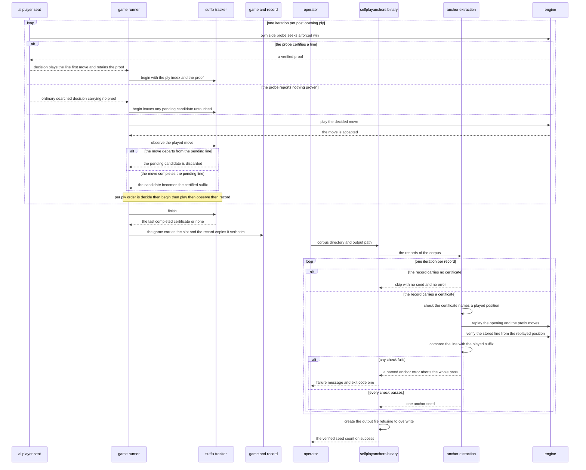
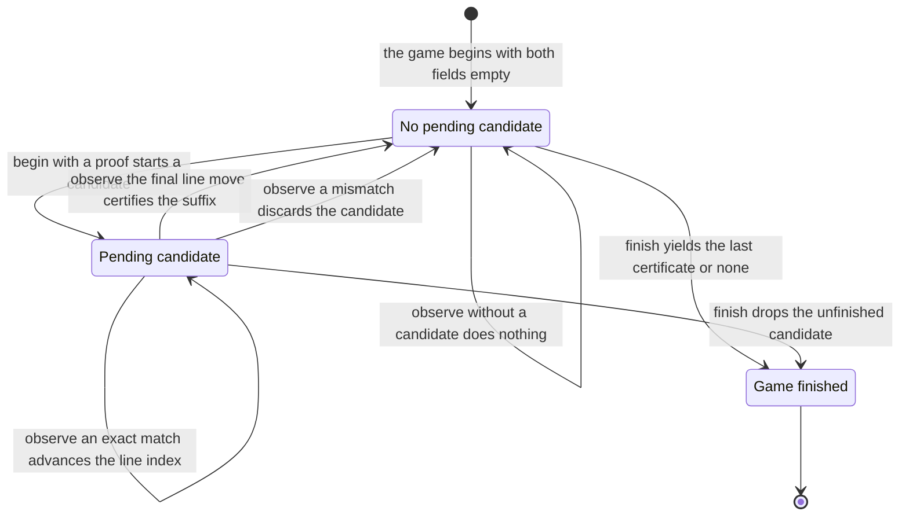

# Chapter 05 — Certified endgames: design paper

## Abstract

This paper is the conceptual companion to
[chapter 05 of the selfplay-corpora tutorial](certified-endgames.md).
The chapter turns the certified endgames that self-play already
produces into a machine-checked anchor set for milestone 4; this paper
explains why the certificate pipeline has the shape it has. The
baseline seat's own-side threat-space search (TSS) probe has certified
forced wins since the baseline tutorial, but the proof vanished with
the decision that used it. The design threads that evidence through
three seams. First, the `player` crate's `Decision` gains
`own_proof: Option<engine::Proof>`: the certified own-proof bypass
retains the exact verified line that selected its move, while every
ordinary search path and every resignation carries `None`, and move
selection does not change. Second, the game runner gains a private
`SuffixTracker` that begins a pending candidate when a decision
carries a proof and observes every played move against the proof's
line; a game that follows a certified line to completion fills the
`Game.certified_suffix` slot chapter 02 created, and
`GameRecord::from_game` copies the slot verbatim. Third,
`extract_anchor_seeds` replays every certified record through the
engine, re-verifies each stored line with `engine::verify_line`,
checks that the certified line is a prefix of the moves actually
played, and emits one `AnchorSeed` per certificate — replay
instructions from which the milestone-4 (position, forcing move, ±1)
triple derives. The `selfplayanchors` binary drives the pass over a
corpus and writes the seeds as JSON, refusing to overwrite an existing
file. The conclusions: the anchor set's trust comes from the boundary,
not from the pipeline — every emitted line passes the soundness gate
twice, once inside the prover at decision time and once at extraction
against a board rebuilt from the record itself; a proof and a played
line are different claims, and the design checks both, because a sound
line that was not played is not an anchor for the game that happened;
a doctored or mismatched certificate aborts the whole extraction as a
named error, never a silent skip; and a game without a certificate
contributes no anchor data and no negative label, because an unproven
position is unknown, not lost. The reference's measured acceptance
run, quoted and attributed below, carried a certified suffix in 47 of
48 games and re-verified 47 of 47 certificates. The intended reader
has read the chapter paper and wants the reasoning behind its
artifacts before building them.

## Glossary

| Term | Definition |
|------|------------|
| **Threat-space search (TSS)** | A proof search over forced-win threat sequences (Allis 1994). The engine ships a bounded prover (`prove_forced_win`, `prove_shortest_forced_win`) and a verifier (`verify_line`); the prover may be incomplete, never unsound. |
| **Proof** | `engine::Proof`: a certified forced win — the winning side (`winner`) and one forcing sequence (`line`). The line alternates attacker and defender moves, starts with the attacker's first threat, and ends when the attacker completes five (overlines count) or creates an unblockable double threat. |
| **Attacker / defender** | The two roles inside a proof line. The attacker is the side with the forced win (`proof.winner`); the defender is its opponent. Attacker moves sit at even offsets of the line, defender replies at odd offsets. |
| **verify_line** | `engine::verify_line(board, proof) -> bool`: the soundness net. It replays the line from the board and, at every defender turn, enumerates every reply that addresses the threat; the attacker's continuation must still win against all of them. `true` only if the proof is airtight. |
| **Own-side TSS probe** | The `AiPlayer::decide` step that runs `prove_shortest_forced_win` for the side to move before any search (baseline preset: 10 000 nodes / 30 plies). A certified proof short-circuits the decision: the line's first move is played and no search runs. |
| **own_proof** | The `Decision` field this chapter adds: `Option<engine::Proof>`, `Some` exactly when the own-side probe certified the played move. |
| **Certified suffix** | `CertifiedSuffix { from_ply: u16, line: Vec<Move> }`: a terminal segment of a game in which every played move belongs to one machine-verified forced-win line. `from_ply` is the zero-based post-opening ply of the attacker's first certified move. |
| **SuffixTracker** | The runner's private detector: it begins a pending candidate when a decision carries an own proof and observes every played move against the candidate's line; a departure discards the candidate, and a completed line becomes the game's certified suffix. |
| **Pending candidate** | The tracker's in-flight certificate: the private `PendingSuffix` value holding a `CertifiedSuffix` under construction plus `next`, the index of the line move expected next. |
| **Certificate** | The claim stored in a record: the `CertifiedSuffix` value in the `certified_suffix` slot. Distinct from the proof (an engine value at decision time) and from the anchor seed (the extraction output). See the disambiguation subsection. |
| **Anchor seed** | `AnchorSeed { game_index, from_ply, line }`: replay instructions for one milestone-4 anchor position. Replay the source game's opening and its first `from_ply` post-opening moves; at that position `line[0]` is the forcing move and the verified value is +1 for the side to move (−1 for its opponent). |
| **Swap2** | The project's opening protocol: one side places three stones, the other side chooses a color or places two more stones, and the first side then chooses a color. The placements are the ceremony, not plies. |
| **Post-opening ply** | One played move after the Swap2 ceremony, counted from zero. `from_ply` and the tracker count in these plies. |
| **Corpus** | A set of game records produced at one declared pairing, stored as shards plus a manifest (chapter 02). |
| **Milestone 4** | The project's puzzle-solving milestone (chapter 12 of the wiki): an anchor set of (position, forcing move, ±1) triples whose positions come from real self-play games. This chapter produces its input. |
| **Soundness gate** | The project's rule (chapter 12 §12): every certificate consumed downstream must pass `verify_line`; 100 % must verify. The prover may be incomplete, never unsound. |
| **Unknown** | The honest reading of an absent proof or an absent certificate: the bounded prover reported nothing within budget, which says nothing about the true value of the position. Unknown is never a negative label. |
| **MANUAL test** | A test marked `#[ignore]` with a MANUAL comment because it plays slow games. This chapter adds none. |
| **Claim labels** | The project's provenance labels (chapter 12 of the wiki): **[paper]** (stated in a cited paper), **[derived]** (computed from cited or measured values), **[experiment]** (a free parameter, to be settled by measurement). |

## Context and connected design narrative

The [chapter paper](certified-endgames.md) states the specification;
this paper tells the story. Five sources supply what the chapter
combines. From
[chapter 01](../01-the-game-runner/the-game-runner.md) and its
[design paper](../01-the-game-runner/the-game-runner-design.md) comes
the move loop this chapter instruments: one `StdRng` stream per game,
two persistent `AiPlayer` seats, and one decision per ply whose
`Decision` yields the played move. From
[chapter 02](../02-recording-games/recording-games.md) and its
[design paper](../02-recording-games/recording-games-design.md) comes
the durable side: the `CertifiedSuffix` type, the
`Game.certified_suffix` slot (set to `None` by the runner until now),
the matching `GameRecord.certified_suffix` slot that
`GameRecord::from_game` copies verbatim, and the corpus mechanics
(`read_corpus`, `write_corpus`) the binary reuses. From
[chapter 03](../03-recording-the-search/recording-the-search.md) and
its [design paper](../03-recording-the-search/recording-the-search-design.md)
comes the honesty rule that makes this chapter necessary: a move
played from a certified own-side proof carries `search: None`, because
no search ran — so the proof itself is the only evidence such a ply
can offer. From
[chapter 04](../04-diversity-and-grading/diversity-and-grading.md) and
its [design paper](../04-diversity-and-grading/diversity-and-grading-design.md)
comes the corpus generator: `selfplaygen` configures both seats with
the baseline own-side TSS probe, so every generated game runs the
prover whose output this chapter collects, and the exploration
schedule this chapter must not disturb. From the
[design spec](../../../specs/2026-11-11-selfplay-corpora-design.md)
§3.4 comes the design authority: certified suffixes feed the
milestone-4 anchor set as on-distribution puzzle roots, and absence of
a certificate is "no anchor data", not a negative label. The
[primer](../00-selfplay-primer.md) §4.5 states the same contract in
tutorial terms. The two prerequisite tracks supply the certificate's
two halves: the
[baseline tutorial](../../baseline-tutorial/README.md) built
`AiPlayer::decide` and its own-side probe, and the
[engine tutorial](../../13-engine-tutorial/README.md) built the TSS
prover and `verify_line`, including the rule that a `None` from the
prover means "not proven within budget" and says nothing about the
true value.

### The problem: the proof vanishes with the decision

Every corpus game already contains certified knowledge. When the
own-side probe fires, `prove_shortest_forced_win` returns an
`engine::Proof` whose line has passed `verify_line` inside the prover
— the initial proof and each shorter retry alike — and the seat plays
the line's first move without searching. That proof is a
machine-checked forced win over real self-play positions: exactly the
raw material milestone 4's anchor set wants. But until this chapter
the proof was a local variable of `AiPlayer::decide`. The decision
played the move, the ply record stored the move and (by chapter 03's
honesty rule) no search data, and the proof was dropped. A corpus of
thousands of games could hold thousands of certified forced wins, and
nothing downstream could tell which games contained them, where they
started, or whether the certified line was actually played out.

The design question is therefore not how to *find* forced wins — the
prover does that — but how to *carry* their evidence from the moment
of certification to a durable, independently checkable record. The
answer has three seams, and each seam exists because the evidence must
cross a boundary: from the player into the runner, from the runner
into the record, and from the record back into the engine at
extraction time.

### Retain the exact proof; never re-prove

The first seam is one field: `Decision` gains
`own_proof: Option<engine::Proof>`. The three construction sites pin
the contract. The certified own-proof bypass stores `Some(proof)` —
the very `Proof` value the probe returned. The ordinary search path
and the resignation path store `None`. Move selection does not change
anywhere; the field is evidence retention, not behavior.

Why retain the proof instead of re-proving in the runner? The source
comment in the reference's `game.rs` states the reasoning: the player
supplies the exact proof that selected the move, and re-proving could
choose a different line — the prover searches anew and its
shortest-line preference is not a promise to repeat — while
duplicating the probe's work. Retention makes the recorded certificate
the same object as the evidence that drove the decision. The ordinary
paths carrying `None` is equally load-bearing: a searched move asserts
no forced win, and a resignation asserts nothing about the board at
all, so neither may fabricate a proof-shaped hint. And because the
bypass already consumed no search, no evaluator call, and no
randomness, adding the retained proof to the decision changes no
selection and no random stream: the determinism story of chapters 01
and 04 is untouched.

### A proof says what wins; the record must say what happened

The second seam exists because a proof and a played line are different
claims. A proof says: from this position, this line wins against every
defense. A certificate in a game record must say something stronger
for the anchor set's purpose: this line wins, *and this game actually
played it*. The distinction is not pedantry. The prover certifies the
main line it returns, but at play time the defender may legally depart
from that line — answering a gapped four with the alternative block, a
reply `verify_line` has proven the line still beats. The win is still
forced, but the game no longer follows the recorded line, move for
move. An anchor seed stores replay instructions and one recorded
continuation; if the continuation did not happen, the seed is a lie
about the game even though the proof is sound.

The runner's `SuffixTracker` is the mechanism that separates the two
claims at play time. It rides alongside the board in chapter 01's move
loop, whose per-ply order becomes: decide, begin, play, observe,
record. `begin` runs on every played decision with the current ply
count and the decision's `own_proof`; it starts a pending candidate
only when the decision carries a proof, recording the ply count as the
candidate's `from_ply` — converted to `u16` under the stated bound
that a game has at most 225 plies — and the proof's line as the
candidate line. After the engine accepts the move, `observe(mv)`
compares the played move against the candidate line's next expected
move: a match advances, completing the whole line promotes the
candidate to the game's certified suffix, and a mismatch discards the
candidate entirely. When the game ends, `finish` yields the last
completed certificate.

Three behaviors of this machine deserve plain statements, because
each is a deliberate honesty choice. A decision without a proof
changes nothing: a pending candidate survives the defender's
proof-less replies, because the defender's forced blocks are part of
the line being tracked — the candidate belongs to the line, not to one
seat. A new proof replaces any pending candidate: the latest own-side
proof wins, which is why the `Game` field documents itself as the
*latest* proof followed to completion. And a departed line is not a
shortened certificate; it is no certificate. The tracker follows the
exact recorded line, attacker threats and defender replies alike, and
a departure simply loses an anchor candidate — unrecorded is not an
error. The full state machine, with every transition, is specified
below.

### One slot, filled once, copied verbatim

The durable side of the second seam is chapter 02's, unchanged.
`finish` yields into the `Game.certified_suffix` slot that chapter 02
created and left `None`; `GameRecord::from_game` copies the slot
verbatim into the record; the shard writer persists it. No record
field changes shape, no format version moves, and the preservation
test chapter 02 wrote against a fabricated suffix now guards a slot
the runner actually fills. The certified suffix is the one field of
the record that no later chapter reinterprets: it is already final
when the game ends.

The semantics are stated exactly once, in the chapter paper, and this
paper only recalls them: `from_ply` counts post-opening plies from
zero and identifies the position *before* the attacker's first
certified move; `line` is the complete verified forced-win line from
that position, both sides' moves included, because the claim is about
the game that happened, not about the attacker's intentions.

### Extraction trusts nothing it has not re-checked

The third seam is the one that makes the anchor set trustworthy
without trusting the generator. `extract_anchor_seeds(records)` is a
pure pass over in-memory records — the binary supplies them — and it
rebuilds every position it reasons about from the record's own primary
evidence. Per record, in order: a record without a certificate is
skipped, contributing no seed, no error, and no negative label;
`from_ply` must name a played position, or the pass fails with
`AnchorError::SuffixOutOfBounds`; the Swap2 opening executes from the
record header (`AnchorError::Opening` on rejection) and the first
`from_ply` recorded moves replay through a fresh engine board
(`AnchorError::Replay` on the first illegal move); the stored line,
paired with the replayed side to move as the proof's winner, must pass
`engine::verify_line` (`AnchorError::VerificationFailed`); and the
first `line.len()` played moves from `from_ply` must equal the
certified line (`AnchorError::SuffixNotPlayed`). One failure aborts
the entire extraction — the first error returns, and no partial seed
set exists.

The order of the last two checks is the design's honesty made
executable. Verification proves the line *wins*; the prefix check
proves the line *happened*. The chapter's fabricated fixture makes the
gap between them concrete: an open four has two winning ends, so the
alternative end is a *verified* line that the game did not play —
`verify_line` passes, the prefix check fails, and extraction rejects
the certificate. The anchor set wants both properties: a puzzle root
whose recorded continuation is the sound one.

The prefix check is a prefix check, not a whole-suffix match, and that
is deliberate. A proof can end in an unblockable double threat with
moves still to play, so a game may legally continue after its
certified line completes; the trailing moves do not invalidate the
certificate. One honesty note belongs here: every chapter fixture ends
exactly when its certified line completes, so the proper-prefix case —
trailing moves after the line — is prose-specified, source-verified
behavior of the reference implementation that no chapter test pins.
The chapter paper states this gap explicitly rather than papering over
it with a ninth test.

Each surviving certificate emits one `AnchorSeed { game_index,
from_ply, line }` — derivation instructions, not planes. Replay the
game's opening and its first `from_ply` plies; at that position
`line[0]` is the forcing move and the verified value is +1 for the
side to move (−1 for its opponent). That is the milestone-4 (position,
forcing move, ±1) triple, computed rather than duplicated: the doc
comment on the reference's `AnchorSeed` states why storing derivation
information keeps the seed independent of plane encoding. This chapter
emits milestone-4 input; reading corpora into training samples is
chapter 06's work, and the corpus-level acceptance gates are chapter
07's.

### The binary is a thin, honest driver

`selfplayanchors` adds no logic of its own; it is a driver with the
same argument discipline as `selfplaygen` — hand-rolled parsing, no
dependency. Two flags, both required, values as separate arguments
only: `--corpus <DIR>` and `--out <JSON>`. `--help` (or `-h`) prints the usage
and exits successfully, and the usage text states the contract out
loud: every certified suffix must pass `verify_line` and match the
played line, games without certificates emit no anchor data and no
negative labels, and the output file must not already exist. A parse
failure prints the message and the usage and exits with code 2. The
run path is three steps: `read_corpus` loads the records;
`extract_anchor_seeds` runs the pass; the output file opens with
create-new semantics — an existing file fails the run, the same
overwrite discipline the corpus writer keeps — and the seeds serialize
as pretty-printed JSON. Any run failure prints
`selfplayanchors failed: …` and exits with code 1; on success the
count goes to stderr. The create-new rule is a small guard with a
clear purpose: an extraction never overwrites a seed set by accident,
because a seed set, once consumed downstream, should be traceable to
one deliberate invocation.

### The measured evidence is quoted, not re-run

The chapter quotes the reference's acceptance run; it does not ask the
learner to reproduce it, and the numbers describe one low-budget
corpus, not a promise about future ones. On the reference's 48-game
corpus (baseline-32 versus baseline-32, seeds 100000–100047),
`selfplayanchors` reported `Wrote 47 verified anchor seeds`: 47 of 48
games carried a certified suffix — the sole exception was the 222-ply
draw, game index 4 — and 47 of 47 certificates re-verified (100 %),
in 0.14 s. Every certified line in that corpus was one ply long: the
baseline probe finds the final forcing move late and short. These
figures are attributed to the reference's measured acceptance evidence
(the hand-off and the reference repository's
`acceptance-evidence.md`); chapter 07 owns the corpus-level gates that
will measure new corpora.

## Primary interaction: from one certified decision to the seed file

The sequence walks the full life of one certificate: the seat's probe
certifies a line, the decision retains the proof, the runner tracks
the played moves against it, the record carries the resulting suffix,
and a later extraction re-verifies it into an anchor seed on disk. The
ordinary decision path and the certificate-free record appear where
they occur; the failure branch shows the abort discipline.

The participants name the artifacts. The ai player seat is
`player::AiPlayer` running `decide` with the baseline own-side probe.
The game runner is `play_game_with_opening` in the selfplay crate's
`game.rs`, and the suffix tracker is its private `SuffixTracker`. The
game and record participant is the `Game` value, its
`certified_suffix` slot, and `GameRecord::from_game`. The
selfplayanchors binary is `src/bin/selfplayanchors.rs`; anchor
extraction is `extract_anchor_seeds` in `anchor.rs`. The engine
participant stands for the `engine` crate's board, the prover, and
`verify_line`. The diagram draws one loop for play and one for
extraction; in a real run the two loops are separated by corpus
generation and storage, and extraction runs over many records, not
one.

## The suffix tracker as a state machine

The tracker is a small machine with two fields and two tracking
states. The fields are `pending: Option<PendingSuffix>` — the
candidate under construction, holding a `CertifiedSuffix` and `next`,
the index of the line move expected next — and
`certified: Option<CertifiedSuffix>`, the last completed certificate.
The states below name whether a candidate is in flight; completion and
discard both return to the empty state and differ only in what they
leave in `certified`. The inputs are the move loop's three calls in
their fixed per-ply order: `begin` on every played decision (before
the engine accepts the move), `observe` on every accepted move, and
`finish` once when the game ends.

| Current state | Input | Condition | Next state | Emitted outputs |
|---------------|-------|-----------|------------|-----------------|
| (entry) | the game starts | always | No pending candidate | `pending` empty, `certified` empty |
| No pending candidate | `begin` at ply p | the decision carries an own proof | Pending candidate | a candidate: `from_ply` is p converted to `u16` (the conversion's `expect` states the bound: a game has at most 225 plies), `line` is the proof's line, `next` is zero; `certified` untouched |
| Pending candidate | `begin` at ply p | the decision carries a newer own proof | Pending candidate | the candidate replaced wholesale — latest proof wins; `certified` untouched |
| No pending candidate | `begin` | the decision carries no proof | No pending candidate | nothing changes |
| Pending candidate | `begin` | the decision carries no proof | Pending candidate | nothing changes — the candidate survives the defender's proof-less replies |
| Pending candidate | `observe` the played move | the move equals the line move at `next` and is not the last | Pending candidate | `next` advances by one |
| Pending candidate | `observe` the played move | the move equals the final line move | No pending candidate | the candidate promotes into `certified`, replacing any earlier completed certificate |
| Pending candidate | `observe` the played move | the move differs from the line move at `next` | No pending candidate | the candidate is discarded entirely; any earlier completed certificate is kept |
| No pending candidate | `observe` the played move | no candidate in flight | No pending candidate | nothing changes — moves after a completed or discarded certificate are not tracked |
| No pending candidate | `finish` | the game ended | Game finished | the last completed certificate, or none |
| Pending candidate | `finish` | the game ended mid-line | Game finished | the unfinished candidate yields nothing; the last completed certificate, or none |

Three properties of the machine follow from the table and are worth
stating directly. First, the machine is deterministic and total: every
combination of state and input has exactly one row, and no input
invents a certificate — a certificate exists only if a probe-certified
line was observed, move for move, to completion. Second, completion is
sticky but replaceable: once a line completes, later moves cannot
remove the certificate (observations without a candidate do nothing),
while a later proof begins a fresh candidate that, on completion,
replaces the earlier one — the `Game` field's documentation as the
*latest* proof followed to completion is exactly this row structure.
Third, the machine certifies the recorded line, not the winning
position: a defender who departs from the line with a reply the proof
still beats causes a discard, and the win goes unrecorded unless a
later probe certifies a fresh line. The machine loses an anchor
candidate; it never emits a wrong one.

## Noun catalog

### Engine vocabulary (the `engine` crate; consumed, not touched)

| Name | Kind | Role |
|------|------|------|
| `Proof` | struct | A certified forced win: the winning side (`winner`) and the forcing sequence (`line`), attacker moves at even offsets. Produced by the prover at decision time; reconstructed at extraction from the replayed side to move and the stored line. |
| `Move` | struct | One legal board cell, serialized as its index (`row * 15 + col`, a `u8`) — the shape the JSON seed file shows. |
| `Board` | struct | The replay target: the opening executes into it, the prefix moves replay through it, and `verify_line` reads the side to move from it. |
| `PlayError` | error enum | The engine's rejection of an illegal opening or move; carried inside `AnchorError::Opening` and `AnchorError::Replay`. |
| `Color` | enum | The absolute color vocabulary; the proof's `winner` is a `Color`. |

### Player vocabulary (the `player` crate; one field touched)

| Name | Kind | Role |
|------|------|------|
| `Decision` | struct | The seat's per-ply output; this chapter's only cross-crate change adds one field to it. |
| `own_proof` | field (`Option<engine::Proof>`) | The retained evidence: `Some` with the exact proof that selected the move when the own-side probe certified it, `None` on the ordinary search path and the resignation path. |
| `DecisionAction` | enum | `Play(Move)` or `Resign(...)`; the runner begins tracking only on played moves. |
| `AiPlayer` | struct | The baseline seat; its `decide` runs the own-side probe before any search. Unchanged except for the retained field. |

### Selfplay vocabulary (`game.rs`, `record.rs`, `anchor.rs`)

| Name | Kind | Role |
|------|------|------|
| `SuffixTracker` | private struct | The runner's detector: two fields (`pending`, `certified`) and the begin/observe/finish protocol above. Created in this chapter. |
| `PendingSuffix` | private struct | The in-flight candidate: a `CertifiedSuffix` under construction plus `next`, the expected line index. Created in this chapter. |
| `CertifiedSuffix` | struct | The certificate: `from_ply: u16` and the verified `line`. Chapter 02's type, filled by the runner for the first time in this chapter. |
| `Game` | struct | Chapter 01's in-memory game; its `certified_suffix` slot receives the tracker's `finish` yield. Touched in this chapter. |
| `GameRecord` | struct | The durable game; `from_game` copies the suffix slot verbatim. Not touched in this chapter. |
| `GameHeader` | struct | The record's configuration and provenance; extraction replays the opening from it. Not touched in this chapter. |
| `AnchorSeed` | struct | The extraction output: `game_index`, `from_ply`, `line` — replay instructions for one milestone-4 anchor position. Created in this chapter. |
| `AnchorError` | error enum | The five extraction failures: `Opening`, `Replay`, `SuffixOutOfBounds`, `SuffixNotPlayed`, `VerificationFailed`. The first one aborts the whole pass. Created in this chapter. |
| `RecordedPly` | struct | One recorded move with its search metadata; the extraction's prefix replay and played-line check read its `mv`. Not touched in this chapter. |

### CLI vocabulary (`bin/selfplayanchors.rs`; created in this chapter)

| Name | Kind | Role |
|------|------|------|
| `selfplayanchors` | binary | The extraction driver: reads a corpus, runs the pass, writes the seeds as pretty JSON with create-new semantics. |
| `Args` | private struct | The parsed flag values: the corpus directory and the output path. |
| `USAGE` | constant | The help text; documents both flags and the contract (the `verify_line` gate, no negative labels, no overwrite). |

### Disambiguation

- **Proof, certificate, certified suffix, anchor seed** name four
  different artifacts on one pipeline, and the design's honesty depends
  on not merging them. A *proof* (`engine::Proof`) is an engine value
  that exists at decision time and again, reconstructed, at extraction:
  it says a line wins from a position. A *certificate* is the claim a
  record carries — the `CertifiedSuffix` value in the
  `certified_suffix` slot — and it says a line won *and was played* in
  this game. A *certified suffix* is the same value read as a game
  segment: the terminal run of plies the line covers. An *anchor seed*
  (`AnchorSeed`) is the extraction's output: replay instructions for a
  milestone-4 puzzle root, one per surviving certificate. The tracker
  turns proofs into certificates; extraction turns certificates into
  seeds; neither direction is skipped.
- **game_index versus from_ply.** Both are indices into the seed, and
  they count different things. `game_index` is the zero-based position
  of the source record in corpus order — which game. `from_ply` is the
  zero-based post-opening ply at which the certified position occurs —
  where in the game. Replay instructions need both.
- **Line versus played suffix.** The *line* is the stored forcing
  sequence: the claim. The *played suffix* is the record's actual
  moves from `from_ply` onward: the history. Extraction's final check
  relates them — the line must be a prefix of the played suffix —
  because a sound line that was not played is a rejected certificate,
  and a played suffix longer than the line (trailing moves after the
  line completes) is accepted.
- **Unknown** names two related absences, and neither is a judgment. A
  `None` from the bounded prover means "not proven within budget". A
  `None` in a record's `certified_suffix` slot means no certified line
  was followed to completion. Both are *unknown*: no anchor data, no
  negative label, no inference about the position's true value.

## Verb catalog

Contracts only — receivers, methods, what they consume, what they
produce. The construction itself is the learner's work, layered in the
[implementation plan](certified-endgames-implementation.md).

### The player layer

| Receiver | Method | Consumes | Produces |
|----------|--------|----------|----------|
| `AiPlayer` | `decide` | a borrowed board, the effective options, a mutable borrow of the game's random stream | `Result<Decision, DecisionError>` — the own-side probe first; a certified proof short-circuits with no search statistics and retains the exact proof in `own_proof`; the ordinary search path and the resignation path carry `None`; selection, evaluator use, and random-stream consumption are unchanged by the retention |

### The runner layer

| Receiver | Method | Consumes | Produces |
|----------|--------|----------|----------|
| `SuffixTracker` | `begin` | the current post-opening ply count and the decision's `own_proof` | nothing returned; with a proof, starts or replaces the pending candidate (ply count converted to `u16` under the 225-ply bound, the proof's line, `next` at zero); without a proof, leaves all state untouched |
| `SuffixTracker` | `observe` | the played move, after the engine accepted it | nothing returned; advances the candidate on an exact line match, promotes a completed candidate into the certified slot, discards the candidate on a mismatch, does nothing when no candidate is in flight |
| `SuffixTracker` | `finish` | the tracker itself, once, when the game ends | `Option<CertifiedSuffix>` — the last completed certificate, or none; an unfinished candidate yields nothing |
| — (free function) | `play_game_with_opening` | a seed, both seats' base options, and a mutable opening source | `Result<Game, GameError>` — chapter 01's runner; this chapter wires begin on every played decision, observe after every accepted move, and finish into the game's suffix slot |

### The record layer (chapter 02's, used unchanged)

| Receiver | Method | Consumes | Produces |
|----------|--------|----------|----------|
| `GameRecord` | `from_game` | a borrowed `Game` | a `GameRecord` — the `certified_suffix` slot copied verbatim; pure, no replay, no I/O |
| — (free function) | `read_corpus` | the corpus directory | `io::Result<Vec<GameRecord>>` — every shard in lexicographic order; the binary's input source |

### The extraction layer

| Receiver | Method | Consumes | Produces |
|----------|--------|----------|----------|
| — (free function) | `extract_anchor_seeds` | a slice of `GameRecord` | `Result<Vec<AnchorSeed>, AnchorError>` — per record, in order: skip when no certificate; bounds-check `from_ply`; replay the opening and the prefix moves; re-verify the stored line against the replayed position; require the line to be a prefix of the played suffix; emit one seed per surviving certificate. The first failure aborts the whole pass |

### The CLI layer

| Receiver | Method | Consumes | Produces |
|----------|--------|----------|----------|
| — (private function) | `parse_args` | the argument iterator | `Result<Args, String>` — `--flag value` pairs only; both flags required; an unknown flag or a missing value is an error |
| — (private function) | `run` | the parsed `Args` | `Result<(), String>` — read the corpus, run the extraction, create the output file with create-new semantics, write the pretty JSON, report the count on stderr |
| — | `main` | the process arguments | exit code 0 on `--help`/`-h` or success, 2 on a parse failure, 1 on a run failure |

### The engine layer (consumed, unchanged)

| Receiver | Method | Consumes | Produces |
|----------|--------|----------|----------|
| — (free function) | `prove_shortest_forced_win` | a borrowed board, the side to move, a search budget | `Option<Proof>` — a line verified inside the prover; `None` means not proven within budget, never "lost" |
| — (free function) | `verify_line` | a borrowed board and a borrowed proof | `bool` — true only if the line wins against every enumerated defender reply; `false` also when the proof's winner is not the side to move |

## Central design rule and invariants

**Central rule:** soundness over completeness — the anchor set may miss
forced wins, but it must never contain an unchecked one, so every
emitted seed is a line that passed `verify_line` twice (inside the
prover at decision time and again at extraction against a board rebuilt
from the record) *and* that the record shows actually played.

1. **Every emitted line passes the soundness gate at read time.** The
   gate of chapter 12 §12 is unchanged: 100 % of consumed certificates
   verify; the prover may be incomplete but never unsound **[paper]**
   (Allis 1994). Extraction re-verifies each stored line with
   `engine::verify_line` against a position reconstructed from the
   record's own opening and moves, so a corrupted header, an illegal
   prefix move, or a doctored line fails loudly instead of slipping
   through on the generator's say-so.
2. **A certificate must describe the line actually played.** The
   stored line must equal the first `line.len()` played moves from
   `from_ply` — a prefix check, not a whole-suffix match. A sound
   alternative line that was not played is rejected
   (`SuffixNotPlayed`), because the seed's continuation must be the
   one the game contains. A game may legally continue after its
   certified line completes — a proof can end in an unblockable double
   threat with moves still to play — so trailing moves are accepted.
   That proper-prefix acceptance is prose-specified, source-verified
   behavior of the reference implementation; no chapter test pins it,
   and the chapter paper says so explicitly.
3. **Missing proof means unknown, never loss.** The prover is bounded;
   `None` is a budget report, not a value judgment. A record without a
   certificate is skipped — no seed, no error, no negative label — and
   the anchor set is a set of positives. This reading is the design
   spec's §3.4 scope note, not a convention invented here.
4. **Evidence retention changes nothing about play.** The
   `own_proof` field is carried, not consulted: the own-proof bypass
   played the same move before the field existed, the ordinary search
   path and the resignation path carry `None`, and no selection,
   search, evaluator call, or random-stream consumption changes.
   Chapters 01 and 04's determinism story — one seed, one stream,
   byte-identical regeneration — is untouched by this chapter.
5. **Tampering aborts; it is never skipped.** The first `AnchorError`
   — opening, replay, bounds, verification, or played-line mismatch —
   aborts the entire extraction, and no partial seed set exists.
   Skipping would turn tampering into silent data loss; aborting turns
   it into an investigation.
6. **The output never overwrites.** The seed file opens with
   create-new semantics: an existing output fails the run with the
   operating system's file-exists error, the same discipline the
   corpus writer keeps. An extraction never replaces a seed set by
   accident.
7. **The measured evidence is quoted with attribution, not re-run.**
   The 47-of-48 certified-suffix rate and the 47-of-47 (100 %)
   re-verification are the reference's measured acceptance evidence,
   quoted from the hand-off and the reference repository's
   `acceptance-evidence.md`; they describe one low-budget 48-game
   corpus — every certificate one ply long, extraction in 0.14 s — and
   promise nothing about future corpora. The corpus-level gates that
   would re-measure them are chapter 07's work.
8. **This chapter certifies, extracts, and writes; it does not read
   back or gate.** Replay-to-sample derivation, holdout splitting, D4
   augmentation, source mixing, and `selfplayexport` are chapter 06;
   corpus verification (`selfplayverify`), the acceptance gates, and
   the quality report are chapter 07. No sample, verifier, or gate
   artifact is built, named in a test, or promised here, and the
   tracker only reads what the decision already carried.

## References

**This chapter:**

- [certified-endgames.md](certified-endgames.md) — the chapter paper:
  intention, specification as tests, execution-order walkthrough, the
  soundness boundary.
- [certified-endgames-implementation.md](certified-endgames-implementation.md)
  — the hiding layer: low-level construction instructions,
  signatures in prose, method bodies never.
- [certified-endgames-solution.md](certified-endgames-solution.md) —
  the annotated reference snippets.

**This track:**

- [Tutorial README](../README.md) — conventions, gates, the chapter
  map, and the reference provenance.
- [Self-play primer](../00-selfplay-primer.md) — §4.5 states this
  chapter's contract; the glossary defines the certified suffix and
  the anchor seed.
- [Chapter 01 — the game runner](../01-the-game-runner/the-game-runner.md)
  and its [design paper](../01-the-game-runner/the-game-runner-design.md)
  — the move loop and the `Decision` seam this chapter instruments,
  and the single-RNG discipline the retention respects.
- [Chapter 02 — recording games](../02-recording-games/recording-games.md)
  and its [design paper](../02-recording-games/recording-games-design.md)
  — the `CertifiedSuffix` type, the `Game` and `GameRecord` slots, the
  preservation test this chapter activates, and the corpus read/write
  mechanics the binary reuses.
- [Chapter 03 — recording the search](../03-recording-the-search/recording-the-search.md)
  and its [design paper](../03-recording-the-search/recording-the-search-design.md)
  — the honesty rule that makes the proof the only evidence a
  certified ply offers.
- [Chapter 04 — diversity and grading](../04-diversity-and-grading/diversity-and-grading.md)
  and its [design paper](../04-diversity-and-grading/diversity-and-grading-design.md)
  — the generator whose baseline-probe seats produce the certificates,
  and the determinism story invariant 4 defers to.
- [Design spec](../../../specs/2026-11-11-selfplay-corpora-design.md) —
  §3.4 the certified-endgame contract and the no-negative-labels rule;
  §5 the acceptance gates chapter 07 runs.
- [Tutorial hand-off](../../../specs/2026-11-11-selfplay-corpora-tutorial-handoff.md)
  — this chapter's public surface and the measured headline numbers
  invariant 7 quotes.
- [docs/12-gomoku-architecture.md](../../../12-gomoku-architecture.md) —
  §12 the soundness gate; the claim-label convention (**[paper]** /
  **[derived]** / **[experiment]**).
- [docs/13-engine-design.md](../../../13-engine-design.md) — the
  soundness-over-completeness decision behind the bounded prover.

**Prerequisite tracks:**

- [Baseline tutorial](../../baseline-tutorial/README.md) —
  `AiPlayer::decide`, the own-side TSS probe, and the certified
  bypass that now retains its proof.
- [Engine tutorial](../../13-engine-tutorial/README.md) — the TSS
  prover and `verify_line`, and the budget-honesty rule.

**Source (live on `main`):**

- [`gomoku/crates/engine/src/tss.rs`](../../../../gomoku/crates/engine/src/tss.rs) —
  `Proof`, `prove_shortest_forced_win`, `verify_line`, and the
  in-prover verification of every returned line.
- [`gomoku/crates/engine/src/moveset.rs`](../../../../gomoku/crates/engine/src/moveset.rs) —
  `Move` and its index serialization, the shape the JSON seed file
  shows.
- [`gomoku/crates/player/src/lib.rs`](../../../../gomoku/crates/player/src/lib.rs) —
  `Decision` gains `own_proof`; the own-proof bypass stores
  `Some(proof)`, the search and resignation paths store `None`.
  Touched in this chapter.
- [`gomoku/crates/player/tests/decisions.rs`](../../../../gomoku/crates/player/tests/decisions.rs) —
  `own_proof_plays_the_shortest_certified_line` gains the retention
  assertion. Touched in this chapter.

**Source (created by chapters 01–05; not yet present on `main`):**

- `gomoku/crates/selfplay/src/game.rs` — gains the `SuffixTracker`,
  its three call sites in the move loop, and the two unit tests.
  Touched in this chapter.
- `gomoku/crates/selfplay/src/anchor.rs` — new: `AnchorSeed`, the
  five-variant `AnchorError`, and `extract_anchor_seeds`. Created in
  this chapter.
- `gomoku/crates/selfplay/src/bin/selfplayanchors.rs` — new: the
  extraction binary. Created in this chapter.
- `gomoku/crates/selfplay/src/lib.rs` — re-exports the new
  vocabulary. Touched in this chapter.
- `gomoku/crates/selfplay/src/record.rs` — the `CertifiedSuffix`
  slot, unchanged since chapter 02. Not touched in this chapter.
- `gomoku/crates/selfplay/tests/anchors.rs` — the extraction
  specification, four tests. Created in this chapter.
- `gomoku/crates/selfplay/tests/binary.rs` — gains this chapter's
  two binary tests. Touched in this chapter.

**External sources:**

- Allis, L. V. (1994). *Searching for Solutions in Games and
  Artificial Intelligence*. PhD thesis, Maastricht University.
  <https://doi.org/10.26481/dis.19940923la> — threat-space search, the
  prover and verifier behind every certificate this chapter handles.
- Rosin, C. D. (2011). *Multi-armed bandits with episode context*
  (PUCT). <https://doi.org/10.1007/s10472-011-9258-6> — the selection
  rule of the search the probe short-circuits and the retention leaves
  untouched.
