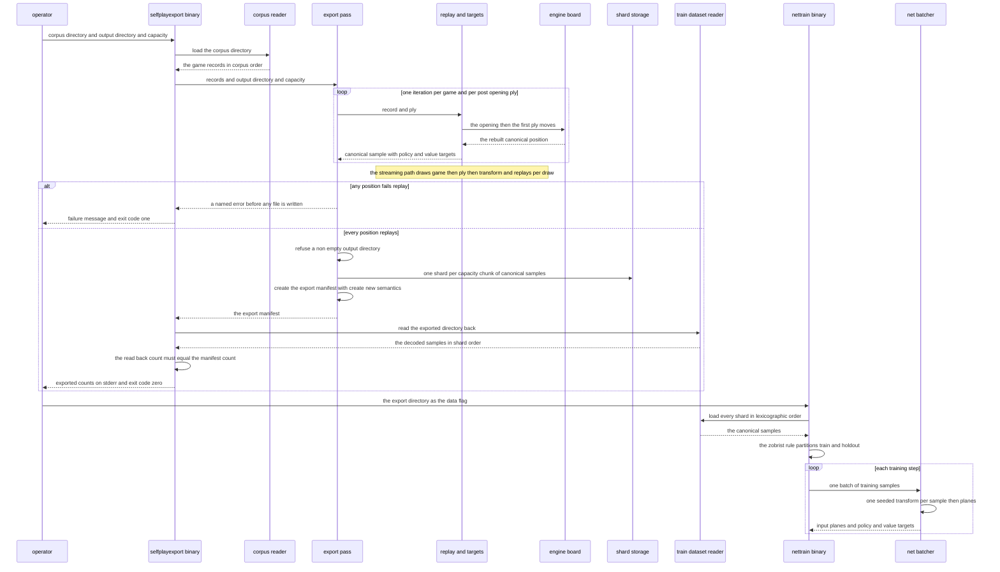
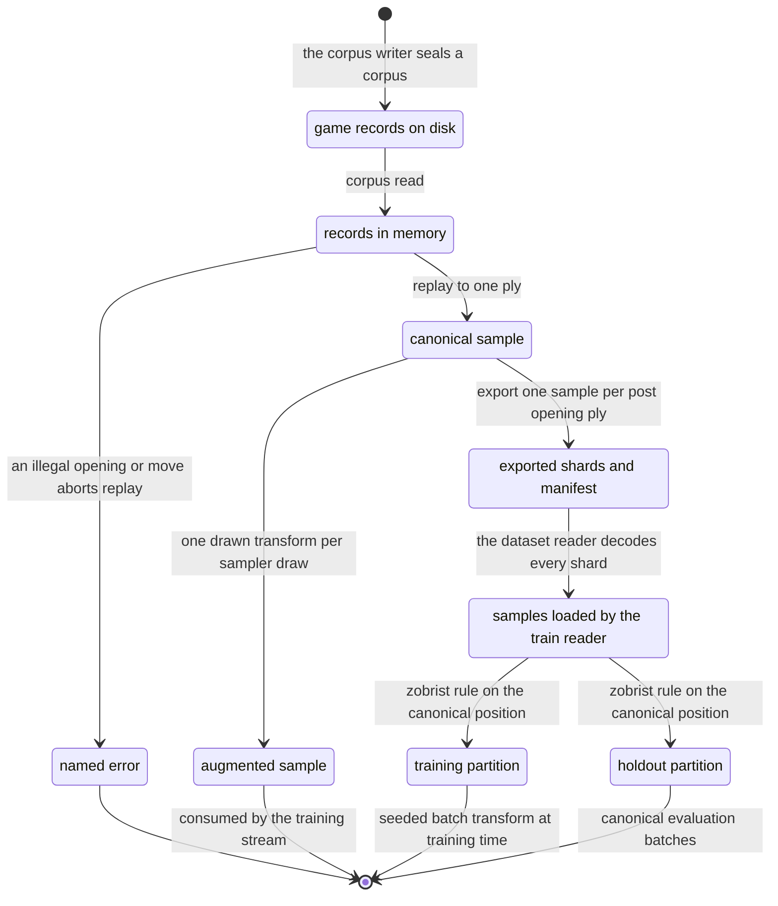

# Chapter 06 — Reading back: design paper

## Abstract

This paper is the conceptual companion to
[chapter 06 of the selfplay-corpora tutorial](reading-back.md). The
chapter turns durable game records into deterministic training and
validation data; this paper explains why the read path has the shape
it has. Chapters 01–05 wrote corpora of `GameRecord`s: one complete
game per record, opened by Swap2 (the opening ceremony that fixes the
initial stones and assigns the colors), with per-ply raw visit counts,
sparse priors, root-value estimates, the outcome, and optional
certified suffixes. The read path derives everything a trainer
consumes at read time and stores none of it. Four decisions carry the
design. First, replay is the only position reconstruction the path
trusts: a sample's position is rebuilt from the record's primary
evidence — the header's Swap2 opening plus the played moves — through
a fresh engine board, so reading re-checks legality instead of
believing the file. Second, the derived `train::Sample` stores stones,
never planes, and augmentation is a read-time draw, never a write-time
commitment: records and exports stay canonical (as played, no
transform), and the engine's proven encode–transform commutation makes
stone-list augmentation exactly equivalent to plane-space
augmentation. Third, the targets follow the AlphaGo Zero discipline
(Silver et al. 2017): the policy target π is the normalized recorded
visit histogram, the value target z is the game outcome from the
sampled side to move, and the recorded priors and root values travel
along as audit data that is never trained on. A ply that was never
searched contributes a deliberate one-hot on the played move — honest
behavior cloning of a machine-certified decision — while a corrupt
nonempty-but-zero visit histogram is a named error, never a NaN.
Fourth, every read-time mechanism is deterministic: the holdout
partition is a content rule on the canonical position's Zobrist key,
evaluated before any transform; the sampler and the mixer are seeded
streams whose schedules are exact, not approximate; and the export is
a seedless function of the corpus that validates every position before
it writes and refuses to overwrite; the `selfplayexport` binary then
reads the export back through the real `train` dataset reader and
checks the count against the manifest before reporting success. The
conclusions: the read path is deterministic end to end, so the same
corpus always yields the same shards and the same seed always yields
the same stream; the export is canonical, so holdout metrics stay
comparable across the synthetic and the self-play sources; and the
seam holds in practice — the reference's measured acceptance run,
quoted and attributed below, exported 1 860 samples from 48 games into
4 shards and trained the tiny `nettrain` configuration on them for 50
steps with no change to `net` or `nettrain`. That run is a smoke
result, not a model-quality or playing-strength claim. The intended
reader has read the chapter paper and wants the reasoning behind its
artifacts before building them.

## Glossary

| Term | Definition |
|------|------------|
| **Game record** | `GameRecord`: the durable serialization of one complete game — a header (seed, seat pairing, evaluator identity, the Swap2 opening), the ordered post-opening `plies`, the `outcome`, and an optional certified suffix. Chapter 02 fixed the format. |
| **Recorded ply** | `RecordedPly { mv, visits, prior, root_value }`: one played post-opening move and its durable search data. `visits` holds sparse raw root visit counts, descending; `prior` holds up to 16 root priors for audit; both are empty when no search ran, and `root_value` is then `None`. |
| **Sample** | `train::Sample`: the labelled training record — `black` and `white` stone lists in absolute color, `to_move`, a sparse `policy` of `(move, probability)` pairs, and a `value` target from the side-to-move perspective. It stores stones, never planes. |
| **π (policy target)** | The normalized root visit-count distribution of the search at a ply; the policy training target (Silver et al. 2017). The read path computes it from the recorded raw counts. |
| **z (value target)** | The game outcome in {+1, 0, −1} from the perspective of the side to move at the sampled ply; the value training target. |
| **Prior** | The evaluator's policy probabilities over root moves before search, recorded sparsely (top 16, after any root noise) for audit. Never a training target. |
| **Root value** | The search's value estimate at the root after the simulation budget is spent, from the recording side to move's perspective. Metadata, not a target. |
| **Canonical orientation** | The position exactly as played, with no D4 transform applied. Records and exported shards are canonical; augmentation happens per sample, never per batch — one transform per drawn sample in the sampler, one seeded transform per sample in `nettrain`'s batcher. |
| **D4** | The dihedral group of the square: the 8 rotations and reflections of the board, `engine::Transform::ALL`. |
| **Zobrist key** | A 64-bit hash of a board position, maintained incrementally by the engine (`Board::zobrist`). Orientation-specific: a transformed position hashes differently. |
| **Holdout split** | The train/holdout partition of the `train` crate: a sample is held out iff `zobrist(board) % 100 < HOLDOUT_PERCENTAGE` (= 10). Content-based, so collection order cannot leak correlated positions into both sides. |
| **Replay** | The reconstruction of a position from a record's opening and played moves through a fresh engine `Board`. The only position source the read path trusts. |
| **Behavior cloning** | Training on the move actually played as a one-hot policy target. For a searched ply this would discard the search's information; for a ply no search produced, it is the honest target. |
| **TSS bypass** | The certified own-side threat-space search (TSS; Allis 1994) proof that short-circuits a decision: the line's first move is played and no search runs. Such a ply records empty `visits` and `prior` and `root_value: None` (chapter 03's honesty rule). |
| **CorpusSampler** | The seeded, infinite iterator of augmented samples over a corpus: each draw picks a random game, a random ply, and a random D4 transform, then replays and augments on demand. |
| **SourceMixer / WeightedSource** | The seeded weighted round-robin over sample iterators: each `WeightedSource` contributes `weight` consecutive items per turn, and the seed picks the initial source. |
| **Shard** | A fixed-capacity file of length-delimited records in the `bincode` crate's binary encoding, named `shard-NNN.bin`; the `train` crate's storage unit, shared by synthetic datasets, game corpora, and sample exports. |
| **Corpus manifest** | The corpus writer's JSON provenance (`Manifest` in `corpus.rs`): format version, the exact seed set, the pairing, game count, shard names in record order, and the workspace version. |
| **ExportManifest** | The export's JSON provenance: format version, game count, sample count, shard names in sample order, and the workspace version. A different schema from the corpus manifest, under the same file name `manifest.json`. |
| **Fold** | A design decision whose shape exists to foreclose one specific failure mode. This paper's closing table lists the read path's folds and the evidence that each holds. |
| **Claim labels** | The project's provenance labels (chapter 12 of the wiki): **[paper]** (stated in a cited paper), **[derived]** (computed from cited or measured values), **[experiment]** (a free parameter, to be settled by measurement). |
| **The reference** | The reference implementation of this tutorial track: built test-first, gate-verified, and acceptance-measured before the tutorial was written. It lives only in a read-only worktree beside this repository; the learner's own implementation on `main` is the reference in the didactic sense. |

## Context and connected design narrative

The [chapter paper](reading-back.md) states the specification; this
paper tells the story. Seven sources supply what the chapter combines,
and each summary states what the source delivered and why this chapter
needs it.

- [Chapter 01 — the game runner](../01-the-game-runner/the-game-runner.md)
  and its
  [design paper](../01-the-game-runner/the-game-runner-design.md) —
  built the in-memory `Game` and the single-seeded-stream discipline:
  one `StdRng` per game, every randomness consumed in a fixed order.
  The read path's sampler and mixer inherit that discipline at the
  stream level: one seed per stream, draws in a fixed order.
- [Chapter 02 — recording games](../02-recording-games/recording-games.md)
  and its
  [design paper](../02-recording-games/recording-games-design.md) —
  built the durable format this chapter reads (`GameRecord`,
  `GameHeader` with the Swap2 `Opening`, `RecordedPly`), the corpus
  mechanics `read_corpus` / `write_corpus` on the shared
  `train::storage` shard layer, and the overwrite-refusal discipline
  the export mirrors. The read path consumes exactly what the write
  path stored; no format changes here.
- [Chapter 03 — recording the search](../03-recording-the-search/recording-the-search.md)
  and its
  [design paper](../03-recording-the-search/recording-the-search-design.md) —
  fixed what the recorded search data means: raw visit counts
  (normalization into π was deferred to read time; this chapter is
  that read time), sparse top-16 priors for audit, root-value
  estimates as metadata, and the honesty rule that a TSS-bypassed ply
  carries empty visits and priors and `root_value: None`.
- [Chapter 04 — diversity and grading](../04-diversity-and-grading/diversity-and-grading.md)
  and its
  [design paper](../04-diversity-and-grading/diversity-and-grading-design.md) —
  produced the corpora this chapter reads and established that a
  corpus directory is a deterministic, regenerable artifact. The
  export inherits that property: it adds no randomness of its own.
- [Chapter 05 — certified endgames](../05-certified-endgames/certified-endgames.md)
  and its
  [design paper](../05-certified-endgames/certified-endgames-design.md) —
  explains why unsearched plies exist at all: a certified own-side
  proof bypasses search, and its move is played without a visit
  histogram. The read path must give such plies an honest policy
  target, and chapter 05's replay discipline — rebuild every position
  from the record's own primary evidence, trust nothing — is the
  template for this chapter's replay.
- [Datagen tutorial](../../datagen-tutorial/README.md) — built the
  `train` crate this chapter targets: the `Sample` record
  ([`train/src/sample.rs`](../../../../gomoku/crates/train/src/sample.rs)),
  the shard mechanics, the dataset reader
  ([`train/src/dataset.rs`](../../../../gomoku/crates/train/src/dataset.rs)),
  and the content-based holdout rule
  ([`train/src/split.rs`](../../../../gomoku/crates/train/src/split.rs)).
  Exported corpora are ordinary datasets in every sense the reader
  cares about.
- [Net tutorial](../../net-tutorial/README.md) — built `net` and
  `nettrain`, the consumer: `nettrain --data <DIR>` reads sample
  shards, computes the holdout split on load, and applies its own
  seeded D4 transform per sample within each batch
  ([`net/src/batcher.rs`](../../../../gomoku/crates/net/src/batcher.rs)).
  The export path exists so this binary needs no modification.

The [primer](../00-selfplay-primer.md) §4.6 states this chapter's
contract: draw a random game, replay it through the engine to a random
ply, and emit position s, the normalized visit distribution π of that
ply, and the outcome z from the side to move's perspective — plus one
random D4 transform — with the train/holdout split derived from the
position's Zobrist key, the same discipline as the synthetic sets. The
[design spec](../../../specs/2026-11-11-selfplay-corpora-design.md) is
the design authority: decision S2 (store games, not positions;
replay, encode, and apply one random D4 transform at sample time),
decision S3 (what is stored per ply and what is derived at read
time), §3.3 (the read path), and decision S4 (the network trains on a
mixture of sources, so the sampler must mix streams — hence
`SourceMixer`; the mixture itself is chapter 14's decision D6). The
[wiki's system design](../../../12-gomoku-architecture.md) locks the
two load-bearing facts this chapter relies on: §7 (transforms operate
in the 15×15 space, the 17×17 border ring is D4-invariant, and
encoding commutes with every transform exactly) and §9 (store games;
planes are derivable data).

### Reference provenance

The chapters of this track quote a reference implementation that was
built test-first and verified end-to-end before the tutorial was
written (decision S1). It lives only in a separate, read-only
worktree beside this repository (`rust-ml-selfplay-ref`, branch
`selfplay-ref-v2`, all changes uncommitted); its measured runs are
preserved in the
[hand-off](../../../specs/2026-11-11-selfplay-corpora-tutorial-handoff.md)
and quoted here with attribution. The `engine`, `train`, and `net`
sources this paper cites are live on `main`. The `selfplay` crate's
read-path files — `sample.rs`, `sampler.rs`, `mix.rs`, `export.rs`,
`bin/selfplayexport.rs`, and `tests/read_path.rs` — are created on
`main` by the learner in this chapter; until then they exist only in
the reference worktree, and this paper cites them as paths, not
links. The solution papers quote the reference; they are inspiration,
not authority — the learner's own implementation on `main` is the
reference.

### The problem: a corpus on disk is not yet training data

Chapter 04's generator leaves behind a directory of game records:
complete games, durable, regenerable, canonical. The trainer consumes
something else entirely: labelled positions, one at a time, in a
shuffled and augmented stream or in sharded files. Between the two
sits every decision that determines whether the training data can be
trusted — which position a ply refers to, what the policy target is
when no search ran, which orientation a stored position has, which
positions are held out, how sources mix, and whether a training run
can be reproduced. The design question of this chapter is where each
of those decisions lives. The answer, in one sentence, is the design's
central rule: the stored game is the only durable truth, and
everything the trainer consumes is a deterministic read-time
derivation of it. The rest of this paper unfolds that sentence in
execution order.

## Intention

You can explain, for every artifact between a corpus directory and a
training batch, why it has the shape it has — and predict its behavior
without reading its body. Given a corpus, you can say which bytes are
canonical and why nothing D4-shaped is ever written; why π comes from
visit counts, z from the outcome, and the recorded priors and root
values from neither; why a ply that was never searched yields a
one-hot policy instead of a fabricated distribution or a skipped
sample; why the holdout partition is computed on the canonical
position and can therefore never move a position between splits; why
the mixer's weights are met exactly rather than approximately; and why
the export refuses to overwrite and then reads its own output back.
You can also state the two format boundaries precisely — the game
corpus format and the sample export format — and which component owns
each side of the seam.

## Prerequisites

This paper assumes the chapter paper
([reading-back.md](reading-back.md)) has been read; it explains the
reasoning, not the test list. It further assumes the working knowledge
the earlier chapters and tracks build, summarized here so the paper
stands alone:

- Chapters 01–05 of this track: what a `GameRecord` contains and how a
  corpus is written and read back. Needed because every read-path
  decision starts from the record's fields.
- The [datagen tutorial](../../datagen-tutorial/README.md): the
  `train` crate's `Sample` (stones, sparse policy, value), the
  length-delimited shard framing, and the Zobrist-keyed holdout rule.
  Needed because the export reuses all three unchanged.
- The [net tutorial](../../net-tutorial/README.md): `nettrain`'s data
  path — shards in, split on load, one seeded D4 transform per sample
  within each batch, planes assembled at batch time. Needed because the export is shaped
  to this consumer.
- The [engine tutorial](../../13-engine-tutorial/README.md): the
  bitboard `Board`, `Board::zobrist`, the D4 `Transform`s, and the
  encode–transform commutation. Needed because replay, the holdout
  rule, and the augmentation discipline all stand on engine
  guarantees.

## The read path in execution order

The subsections follow one position from a stored record to a training
batch, in the order execution touches each mechanism. The reasoning
folds into the step where it matters.

### 1. The durable record is the only input

Everything starts from chapter 02's mechanics: `read_corpus` reads the
corpus manifest and decodes every shard into `Vec<GameRecord>`, in
record order. From that point the derivation logic never touches the
disk: the in-memory constructors (`CorpusSampler::new`,
`export_corpus`) take records directly, so tests exercise the
derivation without files, and the directory-backed constructor
(`CorpusSampler::from_corpus`) is a thin composition of `read_corpus`
and `new`, with an empty corpus surfaced as
`io::ErrorKind::InvalidData`. The fold here is small but deliberate:
I/O lives at the boundary, so the deterministic core has exactly one
input — the records — and exactly one source of truth to be a pure
function of.

### 2. Replay rebuilds the position from primary evidence

`replay_sample(record, ply)` yields the sample for the position
*immediately before* `ply` is played. Replay starts from the header's
Swap2 description — `record.header.opening.board()` executes the
ceremony through the engine's Swap2 typestate — and plays the first
`ply` recorded moves through the resulting board. Three consequences
matter. First, the read path re-checks legality: an opening the
engine rejects is `SampleError::Opening`, the first illegal recorded
move is `SampleError::Replay { ply, mv, .. }`, and a `ply` beyond the
record's plies is `SampleError::PlyOutOfBounds { ply, ply_count }`. A
corrupt record fails loudly at the position that exposes it — the same
trust-nothing discipline chapter 05's extraction applied to
certificates. Second, the side to move comes from the board, not from
ply parity: Swap2 answers decide which color moved first, and the
board already knows. Third, the sample's stone lists are enumerated
from the rebuilt board by color in row-major board order — the engine
board is the only position representation the read path trusts, and
the sample never carries a position the engine did not accept.

### 3. Stones, not planes

The returned `train::Sample` stores stone lists, never neural-network
planes. The plane encoding is applied later, at batch time, inside
`net`'s batcher (`planes::assemble` in
[`net/src/planes.rs`](../../../../gomoku/crates/net/src/planes.rs)):
`engine::encode` emits two 17×17 planes — the side to move's stones
and the opponent's stones, with the D4-invariant border ring set in
the opponent plane — and `planes::assemble` builds the four
model-input planes by adding the one-hot `my_last` and `opp_last`
history planes, which carry no border ring. This deferral is safe
because the engine proved the
commutation in its symmetry slice: the proptest
`encode_commutes_with_every_transform` in
[`engine/src/encode.rs`](../../../../gomoku/crates/engine/src/encode.rs)
asserts, for all eight transforms, that transforming the board and
then encoding yields the same planes as encoding and then permuting
the planes. The wiki's §7 states why the commutation is exact:
transforms operate in the 15×15 space, and the border ring is itself
D4-invariant. Three dividends follow. Augmentation can live on stone
lists, so the read path never touches plane arithmetic. The storage
format stays in engine vocabulary, so a future plane encoding —
chapter 12 §10's history-plane experiments — leaves every stored game
and every exported shard valid (decision S2). And the border is added
exactly once, by the consumer that needs it.

### 4. The recorded search becomes π, the outcome becomes z

With the position in hand, the two targets derive from the record at
the same ply. The policy target: the recorded visit histogram —
sparse raw counts, descending, exactly as chapter 03 stored them — is
normalized to a probability mass per move, in the recorded order. Two
edge cases are folds, not afterthoughts. A nonempty histogram whose
counts sum to zero is rejected with `SampleError::ZeroVisitTotal`,
because a corrupt record deserves a named error, not a NaN that would
surface three crates away as a training divergence. An *empty*
histogram is the honest case: no search ran (the TSS bypass of
chapters 03 and 05), so the policy is the one-hot
`[(played_move, 1.0)]`. The source comment in `sample.rs` states the
reading: the bypassed move was certified by a machine-verified proof,
so its deterministic one-hot is deliberate behavior cloning for that
ply — and the value target is unchanged. Contrast decision S3's
warning: for a *searched* ply, behavior cloning would discard the
search's information; for a ply no search produced, the one-hot is the
truthful statement of what was chosen with certainty.

The value target: +1.0 when the outcome's winner is the side to move,
−1.0 when the winner is the opponent, 0.0 for a draw — always from the
sampled position's side to move, which the replayed board supplies.
This is the AlphaGo Zero discipline **[paper]** (Silver et al. 2017):
the value target is the game outcome, never an estimate.

Two recorded fields deliberately do **not** become targets. The sparse
`prior` (top 16 root priors, after any root noise) is audit data — a
selfplay-corpora format invention for comparing the baseline's priors
against a trained network's priors on identical positions (design spec
§3.2). It is truncated and noise-perturbed by design, and training on
it would teach the network to imitate the evaluator's pre-search
beliefs rather than the search-improved policy. The `root_value`
estimate is likewise audit data: it is the recording seat's interim
guess, and TSS-bypassed plies have none, so a root-value target would
both bake the evaluator's bias into the data and silently drop exactly
the plies that carry machine-certified moves. π comes from visits; z
comes from the outcome; the priors and root values travel along for
inspection.

### 5. One D4 transform augments the sample

`augment_sample(sample, transform)` maps both stone lists and every
policy move through `transform.transform_move`, and leaves `to_move`
and `value` untouched. The semantics are the group structure: D4
rotations and reflections preserve wins, losses, draws, and turn
order, so the game facts of a sample are invariant and only its
geometry changes. One sample becomes eight possible training views of
the same position — board symmetries as augmentation, AlphaZero's
exact usage **[paper]** (Silver et al. 2017; locked for this project
in chapter 12 §7) — and because the stored record stays canonical, the
eight-fold multiplicity costs nothing on disk. One transform per drawn
sample, never all eight: averaging or storing all eight costs
eight-fold evaluation or storage for a marginal gain this project's
scale cannot afford (chapter 12 §7).

### 6. The canonical position decides the holdout

`position_is_holdout(record, ply)` replays and applies the synthetic
datasets' rule unchanged: rebuild the board, take its Zobrist key,
held out iff `zobrist % 100 < HOLDOUT_PERCENTAGE` (= 10). Two
properties are load-bearing. First, the rule is content-based, so
holdout membership is a function of the position itself: shard layout,
export order, and corpus size cannot move a position between splits,
and holdout metrics stay comparable across the synthetic and
self-play sources. Second, the key is computed on the **canonical**
position, before any augmentation: Zobrist keys are
orientation-specific, so hashing after a random transform would hash a
different orientation and could flip the partition per draw. This is
why `CorpusSampler` — which augments every draw — is a
training-stream artifact, not a split-dataset artifact; its doc
comment says so directly and points split-constructing consumers at
direct replay plus `position_is_holdout`, or at the canonical export
path. (`train::split::is_holdout` also treats a sample whose stones
cannot rebuild a legal board as held out — the conservative default
keeps corrupt data out of training.)

### 7. The sampler: one seed, three draws per sample

`CorpusSampler::new(records, seed)` builds an infinite iterator over
the corpus. Construction filters the corpus to the games that have at
least one post-opening ply and rejects a corpus with none
(`SamplerError::EmptyCorpus`) — a fail-fast fold: the error surfaces
at construction, not as a panic on the first draw. Each `next` draws
three uniform randoms from one `StdRng` seeded with `seed`, in a fixed
order: a game slot among the sampleable games, a ply within that game,
and a transform from `Transform::ALL`. The draw then replays on demand
— `replay_sample` plus `augment_sample` — so positions are never
materialized in advance and the stream's memory is the corpus itself.
Items are `Result<Sample, SampleError>`: replay errors surface at draw
time rather than being hidden by the iterator. Determinism is the
contract: same records, same seed, same stream — the specification's
64-draw equality test pins it, augmentation included.

### 8. The mixer: exact weights under one seed

`SourceMixer` combines any number of sample streams into one, and it
is decision S4's artifact: the phase-1 mixture — self-play corpora,
the synthetic tactical set, the external supplements — is one
`SourceMixer` away. Each `WeightedSource::new(weight, iterator)` boxes
a stream with a positive relative weight; `SourceMixer::new(sources,
seed)` rejects an empty source list (`MixError::Empty`) and any zero
weight (`MixError::ZeroWeight`), and uses the seed exactly once, to
pick the *initial* source. From there the discipline is weighted
round-robin: the current source contributes `weight` consecutive
items, then the cursor advances cyclically. The mixer's doc comment
states the reasoning: the seed makes the stream deterministic without
introducing a second random scheduling policy. Because the schedule is
deterministic, the mix matches the weights exactly over a full cycle —
the specification's 1 000 / 3 000 split over 4 000 draws is an
equality, not a confidence interval. An exhausted finite source is
skipped, and the mixer ends when every source is exhausted; infinite
sources such as `CorpusSampler` make the mixed stream infinite. The
mixer is generic over the item type, so it combines plain `Sample`
iterators and fallible corpus draws (`Result<Sample, SampleError>`)
alike — replay errors flow through as items instead of being swallowed
at the mixing boundary.

### 9. Export: the batch path through the unchanged consumer

`export_corpus(records, out_dir, shard_capacity)` is the batch
alternative to streaming: it materializes **one canonical sample per
post-opening ply**, in corpus order — game by game, ply by ply. The
ordering of its steps is the robustness story. Validation comes first:
an empty record list is `ExportError::EmptyCorpus`, a zero capacity is
`ExportError::ZeroShardCapacity`, and every position in the corpus is
replayed before the output directory is touched — a replay failure is
`ExportError::Sample { game_index, ply, .. }`, and no partial dataset
exists. Then the overwrite discipline: a non-empty output directory is
refused outright (`AlreadyExists`: "refusing to export samples into a
non-empty directory"), mirroring the corpus writer's rule that
datasets are never overwritten by accident — and going one step
further, because the export offers no opt-in overwrite at all: it is
cheap to redo, so refusal has no escape hatch. The samples are chunked
by `shard_capacity` into `shard-000.bin`, `shard-001.bin`, … through
`train::storage::write_shard` — the same length-delimited bincode
framing the synthetic datasets use, each shard opened create-new — and
a pretty-printed `manifest.json` is created with create-new semantics.
The manifest is an `ExportManifest`, and its
`workspace_version` (the workspace package version) is shared with the
`train` reader so format drift is visible.

Note what is *not* exported: no D4 variants, no holdout labels. The
shards stay canonical, and `nettrain` computes the Zobrist split on
load and applies its own seeded D4 transform per sample within each
batch — the module comment in
`export.rs` states the seam in one sentence: `nettrain --data` reads
the shards and ignores manifest details, so no network or training
changes. Export order is fully determined by the corpus, and the
framing is fixed, so the same corpus exports the same bytes — the
determinism the chapter-07 byte-identity gates rely on.

### 10. The binary verifies its own output

`selfplayexport` is a thin driver with hand-rolled argument parsing —
no dependency — in the style of `selfplaygen` and `selfplayanchors`.
Two required flags and one option, values as separate arguments only:
`--corpus <DIR>`, `--out <DIR>`, and `--shard-capacity <usize>`
(default 4096, the `train` crate's shard size). `--help` (or `-h`)
prints the usage and exits successfully; a parse failure prints the
message and the usage and exits with code 2. The run path is four
steps: `read_corpus` loads the records (a read failure reports
`failed to read corpus: …`); `export_corpus` writes the dataset
(`failed to export samples: …`); the binary then reads the export back
through `train::dataset::read_dataset` — the very reader `nettrain`
uses — and fails if the read-back count differs from the manifest's
`sample_count`; on success one line goes to stderr:
`Exported 1860 samples from 48 games into 4 shards at <DIR>`. Any run
failure prints `selfplayexport failed: …` and exits with code 1. The
read-back is the seam's self-check: the exporter verifies its own
output through the consumer's reader before it reports success, so a
framing or ordering defect fails the export command itself rather than
some later training run.

## Primary interaction: from one corpus directory to training steps

The sequence walks the full export path once: the operator invokes the
binary, the corpus becomes records, every position replays through the
engine before anything is written, the canonical shards and manifest
land on disk under create-new semantics, the binary reads its own
output back through the real dataset reader, and `nettrain` then
consumes the directory unchanged — split on load, one seeded transform
per sample within each batch, planes at batch time. The streaming alternative appears as
a note where it branches off.



The participants name the artifacts. The selfplayexport binary is
`src/bin/selfplayexport.rs`; the corpus reader is `read_corpus`; the
export pass is `export_corpus`; replay and targets are `replay_sample`
in `sample.rs`; the engine board is `engine::Board`; the shard storage
is `train::storage::write_shard`; the train dataset reader is
`train::dataset::read_dataset`; the nettrain binary and the net
batcher are the consumer side, untouched by this chapter. The diagram
draws the export path; the streaming path (`CorpusSampler` into
`SourceMixer`) shares the replay-and-targets participant and differs
only in what happens after a canonical sample exists — one drawn
transform per draw, no disk.

## Artifact lifecycle and ownership

Two dataset formats share one directory shape — shard files named
`shard-NNN.bin` plus a `manifest.json` — and the design keeps them
distinct by schema, by version constant, and by owner. The lifecycle
diagram shows the states one position passes through; the table below
it fixes the two manifest schemas side by side.



Three properties of the lifecycle follow from the diagram. First,
every arrow out of the durable states (records on disk, exported
shards) is a pure derivation: no transition mutates what is stored,
and the only failure state is entered before any write happens.
Second, augmentation is terminal: an augmented sample feeds a training
stream and is never written back, so nothing D4-shaped ever reaches
disk. Third, the split is a reading, not an artifact: the training and
holdout partitions exist only as evaluations of the Zobrist rule over
canonical samples, computed by each consumer, never stored.

The two formats, side by side:

| Aspect | Game corpus (chapter 02) | Sample export (this chapter) |
|--------|--------------------------|------------------------------|
| Record type | `GameRecord` | `train::Sample` |
| Version constant | `GAME_RECORD_FORMAT_VERSION` (= 1) | `SAMPLE_EXPORT_FORMAT_VERSION` (= 1) |
| Manifest type | `Manifest` (`corpus.rs`) | `ExportManifest` (`export.rs`) |
| Manifest fields | format version, the exact seed set, the pairing, game count, shard names in record order, workspace version | format version, game count, sample count, shard names in sample order, workspace version |
| Orientation | canonical games | canonical samples |
| Writer and owner | `write_corpus`; overwrite refused by default, explicit opt-in (`OverwritePolicy::Allow`) to replace | `export_corpus`; every non-empty output directory refused, no opt-in |
| Reader | `read_corpus` (decodes `GameRecord`s) | `train::dataset::read_dataset` (decodes `Sample`s; ignores the manifest) |
| Randomness to record | the per-game seed set, because games are stochastic | none — the export is a deterministic function of the corpus |

An export manifest for one six-ply game at shard capacity 2 looks like
this — the example uses compact arrays for readability and is not
byte-exact in whitespace; it pins the semantic schema, not
`serde_json`'s pretty output:

```json
{
  "format_version": 1,
  "game_count": 1,
  "sample_count": 6,
  "shards": ["shard-000.bin", "shard-001.bin", "shard-002.bin"],
  "workspace_version": "0.1.0"
}
```

The ownership rules are the point of the table. A directory means what
its reader says it means: `read_corpus` decodes `GameRecord`s,
`read_dataset` decodes `Sample`s, and the two version constants —
coincidentally both 1, evolving independently — let format drift
surface as a version mismatch rather than as a decode failure or,
worse, a silent misread. The corpus manifest records the seed set
because a corpus is stochastic provenance; the export manifest records
counts because an export has no randomness to confess.

## Determinism and seeding

Every read-time mechanism is reproducible, and each one gets its
determinism from a different, stated source:

| Mechanism | Randomness | Determinism rule |
|-----------|------------|------------------|
| Replay (`replay_sample`, `position_is_holdout`) | none | a pure function of the record; the engine board and its compile-time Zobrist table are fixed |
| Augmentation in the stream | the sampler's one `StdRng` | same records and same seed give the same stream, transforms included |
| Holdout split | none | a content rule on the canonical position's Zobrist key, before any transform |
| `CorpusSampler` | one `StdRng` seeded with `seed` | three uniform draws per sample in a fixed order: game slot, then ply, then transform |
| `SourceMixer` | one seeded draw at construction | the seed picks the initial source; the schedule is weighted round-robin with no further randomness |
| Export (`export_corpus`) | none | export order is corpus order; framing is fixed; the same corpus yields the same bytes |
| `nettrain` batching (consumer) | the batcher's seed plus a per-sample counter | one seeded transform per sample; the holdout batcher never transforms |

Two statements in that table deserve precision, because both are easy
to get wrong in an independent implementation.

**Weighted round-robin is not random weighted choice.** A per-draw
random choice with probability proportional to weight would match the
weights only in expectation; the mixer's deterministic schedule —
`weight` consecutive items from the current source, then advance the
cursor cyclically — matches them exactly over every full cycle. The
specification's mixer test asserts exact counts (1 000 and 3 000 over
4 000 seeded draws at weights 1 and 3), which a random policy could
only pass approximately. The seed's single role — picking the initial
source — exists so that two mixtures with the same sources and seed
agree, without a second random policy to reason about. Exhaustion
semantics are part of the contract: a finite source that is exhausted
is marked once and skipped from then on, and the mixer ends when every
source is exhausted; an infinite source such as `CorpusSampler`
therefore makes the mixed stream infinite.

**There is no split artifact.** Nothing materializes the train/holdout
partition: no field in `Sample`, no label in the shards, no separate
holdout file set. The split exists only as the predicate
`train::split::is_holdout`, evaluated by consumers —
`position_is_holdout` for direct replay, `nettrain`'s load path for
exports. And `CorpusSampler` cannot serve as a split source at all: it
augments every draw, and an augmented position hashes to a different
Zobrist key than its canonical original, so split membership computed
on sampler output could flip per draw. Split-constructing consumers
use canonical data only.

The export's create-new and refusal behavior completes the
determinism story. `export_corpus` refuses any non-empty output
directory before writing anything, opens each shard create-new through
`train::storage::write_shard`, and creates `manifest.json` with
create-new semantics. An existing *empty* directory is accepted; an
existing *non-empty* one fails with "refusing to export samples into a
non-empty directory". Because nothing in the path rolls dice,
exporting the same corpus twice into two fresh directories yields
identical shards — the byte-level determinism the chapter-07 gates
will check.

## Alternatives the design rejected

Each rejected alternative names the source of the decision. These are
recorded so the choices are not relitigated silently.

| Rejected alternative | Why it was rejected | Source of the decision |
|----------------------|---------------------|------------------------|
| Store planes, or store augmented rows | Planes are derivable data: storing them freezes one encoding into the corpus, forbids re-encoding under a future plane format, multiplies storage roughly eightfold for augmentation, and buys nothing the batcher cannot compute. `train::Sample` stores stones precisely so the reader can apply augmentation and derive planes on load. | Decision S2; chapter 12 §9 (store games); the `train::Sample` module documentation |
| Apply the random transform before the holdout decision | Zobrist keys are orientation-specific: hashing a randomly rotated position could flip its partition per draw, and the same position would sit in training in one run and in holdout in another. The rule therefore runs on the canonical position, matching `nettrain`, which splits on load before its batch-time transforms. | `position_is_holdout` and `CorpusSampler` doc comments; chapter 12 §7 (orientation-specific keys) |
| Train the value target on the recorded root value, or the policy target on the recorded prior | The root value is the recording seat's interim estimate — absent entirely on TSS-bypassed plies — and the prior is a truncated, noise-perturbed audit record. Training on either would bake the evaluator's bias into the targets; z is the game outcome and π is the visit distribution, the AlphaGo Zero discipline. | Decision S3 (root value is metadata); design spec §3.2 (the prior is for audit); Silver et al. 2017 **[paper]** |
| Draw the next source by per-draw random weighted choice | A random policy matches the weights only in expectation and adds a second scheduling randomness to reason about. The deterministic round-robin with a seeded initial source matches weights exactly per cycle and keeps one seed per stream. | `SourceMixer` doc comment; the specification's exact-count mixer test |
| Export transformed samples, or export holdout labels | An exported transform bakes one orientation into the dataset and forfeits the canonical Zobrist split; a stored label would couple the data to one partition rule. The export stays canonical: `nettrain` computes the split on load and applies its own seeded D4 transform per sample within each batch. | `export.rs` module documentation; the unchanged-consumer seam |
| Silently overwrite the output directory | An exported dataset, once consumed by a training run, should be traceable to one deliberate invocation. The export refuses every non-empty output directory and creates the manifest with create-new semantics — stricter than the corpus writer, which offers an explicit opt-in, because an export is cheap to redo. | `export_corpus`'s `AlreadyExists` refusal; chapter 02's overwrite discipline |
| Treat `CorpusSampler` as the split dataset | The sampler augments every draw, and an augmented position hashes differently from its canonical original, so sampler output cannot carry a stable partition. The sampler is a training-stream artifact; splits come from direct replay plus `position_is_holdout`, or from the canonical export. | `CorpusSampler` doc comment |

## Design folds and the evidence that they hold

The folds below are the decisions an independent implementation is
most likely to get subtly wrong; each is pinned by a named test in
`tests/read_path.rs` or by the reference's measured acceptance run.
The eleven read-path tests all run by default and none plays a game —
the reference runs the whole target in about 0.2 s in debug — and the
chapter's suite state after this chapter is 46 passed, 4 ignored, with
the four ignored tests unchanged from chapter 04.

| Design choice | The pitfall it forecloses | The evidence that it holds |
|---------------|---------------------------|----------------------------|
| Replay from the record's opening and played moves through a fresh engine board; side to move from the board | Trusting the file's implicit position, or deriving the side to move from ply parity (wrong whenever the Swap2 answer changes who moved first) | `replay_at_ply_has_opening_and_played_stones_with_the_right_side_to_move` |
| π is the normalized recorded visit histogram, sparse, in recorded order | Off-normalization, mass loss, or reordering of the sparse target | `raw_visits_become_a_sparse_normalized_policy` (masses sum to 1 within 1e-6) |
| An unsearched ply yields the one-hot `[(played_move, 1.0)]` | A fabricated distribution for a move no search produced — dishonest telemetry | `a_ply_without_search_uses_the_played_move_as_its_policy`; the stating comment in `sample.rs` |
| A nonempty all-zero visit histogram is `SampleError::ZeroVisitTotal` | A NaN policy surfacing as a training divergence far from the corrupt record | `nonempty_zero_visit_histogram_is_rejected_instead_of_producing_nan` |
| z is the outcome from the sampled side to move | A sign flip whenever the sampled ply's side to move differs from the recording seat's | `outcome_value_uses_each_position_side_to_move_perspective` (win, loss, and draw cases) |
| One transform moves stones and policy masses together; side to move and value stay | Geometry and labels drifting apart under augmentation | `d4_augmentation_transforms_stones_and_policy_together` (`Rot90(0, 0) == (14, 0)`, masses carried) |
| The holdout rule runs on the canonical position with the synthetic rule unchanged | A position flipping partitions per draw, or a self-play split incomparable with the synthetic one | `holdout_uses_the_canonical_position_zobrist_and_train_partition` (both paths agree with a hand-computed expectation) |
| One seed per stream; three draws per sample in fixed order | Irreproducible training streams | `corpus_sampler_is_deterministic_under_one_seed` (identical 64-sample streams, policy mass intact after augmentation) |
| The directory-backed sampler is the same stream over shard-read records | A disk path that diverges from the in-memory path | `corpus_sampler_loads_a_corpus_directory` |
| Weighted round-robin with a seeded initial source | Mixture proportions that only approximately match the declared weights | `source_mixer_respects_weights_over_a_large_seeded_draw` (exactly 1 000 / 3 000 over 4 000 draws) |
| Export validates every position before writing, refuses a non-empty output directory, and the binary reads its own output back through the real reader | Partial datasets, accidental overwrite, and framing defects discovered by the trainer instead of the exporter | `export_command_writes_samples_that_the_real_train_reader_loads` (the compiled binary, the real `train::dataset::read_dataset`, per-ply split agreement, manifest fields) |

The end-to-end seam is measured, not just tested. The reference's
acceptance run (quoted from the
[hand-off](../../../specs/2026-11-11-selfplay-corpora-tutorial-handoff.md)
and the reference worktree's `acceptance-evidence.md` §5; the learner
does not re-run it) exported the 48-game baseline-32 corpus — chapter
04's strongest grading level, the baseline evaluator at 32 simulations
per move — with
`--shard-capacity 512` in 0.18 s: **1 860 samples from 48 games into
4 shards**, with the exporter's own read-back count matching the
manifest. Training on the export with the unmodified binary —
`nettrain --data <DIR> --config tiny --seed 7 --steps 50` (8 channels,
1 residual block, batch size 16) — split the dataset into **1 665
train and 195 holdout** samples (the Zobrist rule over the canonical
export, 10.5 % held out), ran 50/50 steps in 0.47 s, and moved train
loss from **6.5483584 at step 1 to 6.252371 at step 50** (step-50
holdout loss 6.1449027). This is a smoke result: it proves the net
consumed game-derived sample shards end to end. It is not a
model-quality assessment and not a playing-strength claim of any kind.

## Noun catalog

### The `engine` layer (consumed, unchanged)

| Name | Kind | Role |
|------|------|------|
| `Board` | struct | The replay target: the opening executes into it, the prefix moves replay through it, and it supplies the stone lists, the side to move, and the Zobrist key. The only position representation the read path trusts. |
| `Move` | struct | One legal board cell; the unit of the stone lists and the sparse policy. |
| `Color` | enum | The absolute color vocabulary; the sample's `to_move`. |
| `Transform` | enum | One D4 element; `Transform::ALL` holds all eight, and `transform_move` maps a move through one. |
| `PlayError` | error enum | The engine's rejection of an illegal opening or move; carried inside `SampleError::Opening` and `SampleError::Replay`. |

### The `train` layer (consumed; the storage module is chapter 02's extraction)

| Name | Kind | Role |
|------|------|------|
| `Sample` | struct | The labelled training record: stone lists in absolute color, side to move, sparse policy, value. Stores stones, never planes; `Sample::board` rebuilds the engine position. |
| `storage::write_shard` / `storage::read_shard` | free functions | The shared length-delimited bincode framing; shard files open create-new. Chapter 02 extracted them for corpora and datasets alike. |
| `dataset::read_dataset` | free function | The consumer-side reader: discovers `shard-*.bin`, sorts lexicographically, decodes in order. The manifest is not required — the shards are the data; the manifest is provenance. |
| `split::is_holdout` / `split::HOLDOUT_PERCENTAGE` | function / constant | The content-based partition: `zobrist % 100 < 10`, with unbuildable samples conservatively held out. |
| `shard::SHARD_SIZE` | constant | The synthetic datasets' shard capacity (4096); the export binary's default `--shard-capacity` matches it. |

### The `selfplay` record layer (chapters 01–05, consumed unchanged)

| Name | Kind | Role |
|------|------|------|
| `GameRecord` | struct | The durable game: header, ordered plies, outcome, optional certified suffix. |
| `GameHeader` | struct | Configuration and provenance; replay executes its `opening`. |
| `RecordedPly` | struct | One played move and its durable search data: raw sparse visits, sparse top-16 prior, optional root value. |
| `Opening::board` | method | Executes the Swap2 ceremony through the engine's typestate into a fresh `Board`. |
| `Outcome` | enum | The terminal winner or draw from which z derives. |
| `Manifest` | struct | The corpus manifest: seeds, pairing, counts, shards, versions. Distinct from `ExportManifest`. |
| `read_corpus` | free function | The corpus reader: manifest plus every shard into `Vec<GameRecord>`, in record order. |

### The `selfplay` read-path layer (this chapter)

| Name | Kind | Role |
|------|------|------|
| `SampleError` | error enum | The four replay/derivation failures: `PlyOutOfBounds`, `ZeroVisitTotal`, `Opening`, `Replay`. |
| `replay_sample` | free function | Record plus ply to canonical `Sample`: replay the position, normalize the visits into π (one-hot when no search ran), derive z from the outcome. |
| `augment_sample` | free function | One D4 transform applied to stones and policy together; side to move and value invariant. |
| `position_is_holdout` | free function | Replay plus the canonical-position Zobrist rule. |
| `SamplerError` | error enum | `EmptyCorpus`: no game has a post-opening ply. |
| `CorpusSampler` | struct | The seeded infinite stream of augmented samples; a training-stream artifact, never a split artifact. |
| `MixError` | error enum | `Empty` and `ZeroWeight`: the rejected mixer configurations. |
| `WeightedSource` | struct | One boxed iterator and its positive relative round-robin weight. |
| `SourceMixer` | struct | The seeded weighted round-robin over sample iterators; generic over the item type. |
| `ExportManifest` | struct | The export's provenance: format version, counts, shard names in sample order, workspace version. |
| `SAMPLE_EXPORT_FORMAT_VERSION` | constant | The sample-export manifest layout version (1); independent of the game-record format version. |
| `ExportError` | error enum | The four export failures: `EmptyCorpus`, `ZeroShardCapacity`, `Sample { game_index, ply, .. }`, `Io`. |
| `export_corpus` | free function | Records to canonical shards plus manifest; validates before writing, refuses a non-empty output directory. |

### The CLI layer (`bin/selfplayexport.rs`; this chapter)

| Name | Kind | Role |
|------|------|------|
| `selfplayexport` | binary | The export driver: read a corpus, export, read back through the real dataset reader, check the count, report. |
| `Args` | private struct | The parsed flags: corpus directory, output directory, shard capacity (default 4096). |
| `USAGE` | constant | The help text; states the canonical-sample contract and the `--flag value` discipline. |

### The `net` layer (the consumer; untouched)

| Name | Kind | Role |
|------|------|------|
| `nettrain` | binary | The training binary; `--data` reads exported shards unchanged. |
| `NetBatcher` | struct | The batch-time boundary: one seeded D4 transform per sample (none for holdout), then plane assembly. |
| `planes::assemble` | free function | Builds the four 17×17 model-input planes from a board: the two border-padded `engine::encode` planes (side-to-move stones, opponent stones with the ring) plus the two one-hot last-move history planes, which carry no border ring. |

### Disambiguation

- **Manifest versus ExportManifest.** Both serialize as
  `manifest.json` next to `shard-NNN.bin` files, and they are
  different schemas with different owners. The corpus `Manifest`
  records stochastic provenance (the exact seed set, the pairing); the
  `ExportManifest` records deterministic provenance (counts). The two
  `format_version` fields are backed by two independent constants —
  `GAME_RECORD_FORMAT_VERSION` and `SAMPLE_EXPORT_FORMAT_VERSION` —
  that are both 1 today by coincidence, not by coupling.
- **Shard** names the same framing in both formats — length-delimited
  bincode, fixed capacity, `shard-NNN.bin` — but the payload type
  differs: `GameRecord` in a corpus, `train::Sample` in an export.
  The reader chosen (`read_corpus` versus `read_dataset`) decides what
  a directory means.
- **Sample versus sampling.** A *sample* is the `train::Sample`
  record. *Sampling* is the act of drawing from a stream. The
  `CorpusSampler` performs sampling and yields samples; the export
  writes samples without any sampling.
- **The split versus shard chunking.** The *split* is the
  content-based train/holdout partition — a predicate, never a stored
  artifact. *Shard chunking* is the capacity-based grouping of samples
  into files. Neither decides the other: the split ignores file
  layout, and chunking ignores the split.
- **Canonical versus augmented.** *Canonical* is the position exactly
  as played. *Augmented* is one D4 transform of it, produced per
  sampler draw or per sample within each `nettrain` training batch.
  Only canonical data reaches
  disk; the holdout rule reads canonical data only.
- **Reading back, two senses.** The chapter title's sense is the whole
  read path: records back into training data. The binary's read-back
  is narrower and literal: after writing, it decodes its own export
  through `train::dataset::read_dataset` and checks the count. Both
  appear in this paper; the second is always qualified as the
  read-back self-check.
- **Visits versus π.** The record holds raw visit counts (sparse,
  descending, unnormalized). π is the normalized distribution derived
  from them at read time. The record never stores π; the sample never
  stores raw counts.

## Verb catalog

Contracts only — receivers, methods, what they consume, what they
produce. The construction itself is the learner's work, layered in the
implementation plan.

### The replay layer (`sample.rs`)

| Receiver | Method | Consumes | Produces |
|----------|--------|----------|----------|
| — (free function) | `replay_sample` | a borrowed `GameRecord` and a zero-based post-opening ply | `Result<Sample, SampleError>` — the canonical sample for the position immediately before the ply: stones enumerated from the replayed board by color in board order, side to move from the board, π from the normalized visits (one-hot on the played move when empty), z from the outcome; `PlyOutOfBounds`, `ZeroVisitTotal`, `Opening`, or `Replay` on the first failure |
| — (free function) | `augment_sample` | a borrowed canonical `Sample` and one `Transform` | a new `Sample` with both stone lists and every policy move transformed, side to move and value unchanged |
| — (free function) | `position_is_holdout` | a borrowed `GameRecord` and a ply | `Result<bool, SampleError>` — the synthetic datasets' rule on the canonical position |

### The stream layer (`sampler.rs`, `mix.rs`)

| Receiver | Method | Consumes | Produces |
|----------|--------|----------|----------|
| — (associated function) | `CorpusSampler::new` | a vector of records and a seed | `Result<CorpusSampler, SamplerError>` — `EmptyCorpus` when no game has a post-opening ply |
| — (associated function) | `CorpusSampler::from_corpus` | a corpus directory path and a seed | `io::Result<CorpusSampler>` — `read_corpus` errors propagate; an empty corpus is `InvalidData` |
| `CorpusSampler` | `next` (iterator) | the stream state | `Option<Result<Sample, SampleError>>` — always `Some`; each item draws game slot, ply, and transform from the one seeded stream, then replays and augments on demand |
| — (associated function) | `WeightedSource::new` | a positive weight and an iterator | a boxed source; zero weights are rejected downstream by `SourceMixer::new` |
| — (associated function) | `SourceMixer::new` | a vector of weighted sources and a seed | `Result<SourceMixer, MixError>` — `Empty` or `ZeroWeight`; the seed picks the initial source |
| `SourceMixer` | `next` (iterator) | the mixer state | `Option<T>` — `weight` consecutive items per source per turn; exhausted finite sources are skipped; `None` when every source is exhausted |

### The export layer (`export.rs`, `bin/selfplayexport.rs`)

| Receiver | Method | Consumes | Produces |
|----------|--------|----------|----------|
| — (free function) | `export_corpus` | a slice of records, an output directory, a shard capacity | `Result<ExportManifest, ExportError>` — every position replayed before the directory is touched; a non-empty directory refused; shards chunked in corpus order; the manifest created create-new |
| — (private function) | `parse_args` | the argument iterator | `Result<Args, String>` — `--flag value` pairs only; both required flags; a zero capacity rejected |
| — (private function) | `run` | the parsed `Args` | `Result<(), String>` — read the corpus, export, read back through `train::dataset::read_dataset`, require the read-back count to equal the manifest's `sample_count`, report the counts on stderr |
| — | `main` | the process arguments | exit code 0 on `--help`/`-h` or success, 2 on a parse failure, 1 on a run failure |

### The consumed layers (unchanged)

| Receiver | Method | Consumes | Produces |
|----------|--------|----------|----------|
| `Opening` | `board` | the stored ceremony description | `Result<Board, PlayError>` — the post-ceremony position through the engine's Swap2 typestate |
| `Board` | `play`, `to_move`, `stone_at`, `zobrist` | moves and queries | legality-checked play; the side to move; per-cell occupancy; the incremental position key |
| — (free function) | `train::dataset::read_dataset` | a dataset directory | `io::Result<Vec<Sample>>` — every `shard-*.bin` in lexicographic order; the manifest is not consulted |
| — (free function) | `train::split::is_holdout` | a borrowed `Sample` | `bool` — the canonical Zobrist rule; unbuildable samples are held out |
| — (free function) | `train::storage::write_shard` | a slice of records and a path | `io::Result<()>` — create-new, length-delimited bincode in slice order |

## Central design rule and invariants

**Central rule:** the stored game is the only durable truth — every
artifact the trainer consumes (position, π, z, augmentation, split
membership, mixture, shards) is a deterministic read-time derivation
of it, so the record never changes and every derivation is
reproducible from a seed or from the corpus alone.

1. **Records and exports are always canonical.** Nothing D4-shaped is
   ever written to disk. Augmentation happens per sampler draw or per
   sample within each `nettrain` training batch, and the engine's
   proven encode–transform
   commutation (`encode_commutes_with_every_transform`) guarantees the
   two augmentation sites see equivalent planes **[paper]** (Silver et
   al. 2017 for the augmentation itself; chapter 12 §7 for the
   project lock).
2. **Replay is the only position source.** Every position is rebuilt
   from the record's primary evidence through a fresh engine board,
   with named errors for an out-of-bounds ply, a rejected opening, and
   the first illegal move. The read path re-checks legality; it never
   believes the file.
3. **π is visits, z is the outcome, the prior and the root value are
   audit.** The policy target is the normalized recorded visit
   histogram; the value target is the game outcome from the sampled
   side to move. The recorded sparse priors and root-value estimates
   travel along for inspection and are never trained on.
4. **Unsearched plies are honest.** A TSS-bypassed certified move has
   no visit histogram; its one-hot policy on the played move is
   deliberate behavior cloning, and its value target still comes from
   the outcome. A corrupt nonempty-but-zero histogram is a named
   error, never a NaN.
5. **The holdout partition is stable and canonical.** It is computed
   from the canonical position's Zobrist key with the synthetic
   datasets' own rule — `zobrist % 100 < 10` — never after
   augmentation, never from a sample's position in a file. There is no
   split artifact, and `CorpusSampler` is a training-stream artifact,
   never a split source.
6. **Sampling and mixing are seeded and exact.** One `StdRng` per
   stream; game, ply, and transform draws in a fixed order; weighted
   round-robin with a seeded initial source. Same seed, same stream;
   weights are met exactly per cycle, not approximately.
7. **Export validates before it writes, and never overwrites.** All
   positions replay before the output directory is modified; a
   non-empty output directory is refused with no opt-in; shards and
   manifest are create-new; the binary reads its own export back
   through the consumer's reader and checks the count before it
   reports success.
8. **The consumer is unchanged.** Exported corpora are ordinary
   `train` datasets: `nettrain --data` reads the shards, computes the
   split on load, and applies its own seeded D4 transform per sample
   within each batch. This
   chapter touches no training or network code.
9. **The measured evidence is quoted with attribution, and it is a
   smoke result.** The 1 860 samples / 4 shards export, the 1 665 /
   195 split, and the 6.548 → 6.252 train-loss movement are the
   reference's measured acceptance evidence (the hand-off and the
   reference worktree's `acceptance-evidence.md` §5). They prove the
   seam end to end; they are not a model-quality assessment and not a
   playing-strength claim. Chapter 07 owns the corpus-level gates.
10. **This chapter reads back; it does not verify.** Corpus
    verification (`selfplayverify`), the determinism and legality
    gates, and the quality report are chapter 07. The read path's own
    error surface (named replay errors, validated-before-write export)
    is what this chapter contributes to that verification.

## References

**This chapter:**

- [reading-back.md](reading-back.md) — the chapter paper: intention,
  specification as tests, execution-order walkthrough, the read-path
  contract, and the integration smoke evidence.
- [reading-back-implementation.md](reading-back-implementation.md)
  — the hiding layer:
  low-level construction instructions, signatures in prose, method
  bodies never.
- [reading-back-solution.md](reading-back-solution.md) — the
  annotated reference
  snippets.

**This track:**

- [Tutorial README](../README.md) — conventions, gates, the chapter
  map, and the reference provenance.
- [Self-play primer](../00-selfplay-primer.md) — §4.6 states this
  chapter's contract; the invariants list fixes what the read path
  must not drift from.
- [Chapter 01 — the game runner](../01-the-game-runner/the-game-runner.md)
  and its [design paper](../01-the-game-runner/the-game-runner-design.md)
  — the single-seeded-stream discipline the sampler and mixer inherit.
- [Chapter 02 — recording games](../02-recording-games/recording-games.md)
  and its [design paper](../02-recording-games/recording-games-design.md)
  — the `GameRecord` format, the corpus mechanics, the shared
  `train::storage` extraction, and the overwrite discipline.
- [Chapter 03 — recording the search](../03-recording-the-search/recording-the-search.md)
  and its [design paper](../03-recording-the-search/recording-the-search-design.md)
  — what the recorded visits, priors, and root values mean, and the
  honesty rule for unsearched plies.
- [Chapter 04 — diversity and grading](../04-diversity-and-grading/diversity-and-grading.md)
  and its [design paper](../04-diversity-and-grading/diversity-and-grading-design.md)
  — the corpora this chapter reads and the determinism story the
  export inherits.
- [Chapter 05 — certified endgames](../05-certified-endgames/certified-endgames.md)
  and its [design paper](../05-certified-endgames/certified-endgames-design.md)
  — why unsearched plies exist, and the replay-from-primary-evidence
  discipline.
- [Design spec](../../../specs/2026-11-11-selfplay-corpora-design.md) —
  decision S2 (store games, not positions), decision S3 (the per-ply
  payload and its audit fields), §3.3 (the read path), decision S4
  (source mixing).
- [Tutorial hand-off](../../../specs/2026-11-11-selfplay-corpora-tutorial-handoff.md) —
  this chapter's public surface and the measured integration smoke
  numbers.
- [docs/12-gomoku-architecture.md](../../../12-gomoku-architecture.md) —
  §7 the D4 group, the orientation-specific Zobrist keys, and the
  exact encode–transform commutation; §9 the store-games replay
  discipline with its dated amendment; the claim-label convention.
- [docs/14-openings-and-supervised-curriculum.md](../../../14-openings-and-supervised-curriculum.md) —
  decision D6, the mixture the `SourceMixer` serves.

**Prerequisite tracks:**

- [Datagen tutorial](../../datagen-tutorial/README.md) — the `train`
  crate: `Sample`, the shard mechanics, the dataset reader, and the
  Zobrist-keyed holdout split.
- [Net tutorial](../../net-tutorial/README.md) — `nettrain`, the
  consumer: canonical shards in, split on load, seeded batch-time D4.
- [Engine tutorial](../../13-engine-tutorial/README.md) — the
  bitboard `Board`, `Board::zobrist`, the D4 `Transform`s, and the
  encode–transform commutation.
- [Baseline tutorial](../../baseline-tutorial/README.md) — the seats
  whose searches produced the recorded visits, and the TSS bypass
  behind the unsearched plies.

**Source (live on `main`, consumed unchanged):**

- [`gomoku/crates/train/src/sample.rs`](../../../../gomoku/crates/train/src/sample.rs) —
  `Sample`: stones, never planes; `Sample::board` rebuilds the engine
  position.
- [`gomoku/crates/train/src/split.rs`](../../../../gomoku/crates/train/src/split.rs) —
  `is_holdout` and `HOLDOUT_PERCENTAGE`: the content-based partition.
- [`gomoku/crates/train/src/dataset.rs`](../../../../gomoku/crates/train/src/dataset.rs) —
  `read_dataset`: the reader the exporter reads back through and
  `nettrain` trains from.
- [`gomoku/crates/train/src/shard.rs`](../../../../gomoku/crates/train/src/shard.rs) —
  `SHARD_SIZE` (4096), the export binary's default shard capacity.
- [`gomoku/crates/engine/src/symmetry.rs`](../../../../gomoku/crates/engine/src/symmetry.rs) —
  `Transform`, `Transform::ALL`, and `transform_move`.
- [`gomoku/crates/engine/src/encode.rs`](../../../../gomoku/crates/engine/src/encode.rs) —
  the 17×17 border-padded encoding and the proptest
  `encode_commutes_with_every_transform` the augmentation discipline
  relies on.
- [`gomoku/crates/engine/src/board.rs`](../../../../gomoku/crates/engine/src/board.rs) —
  `Board::play`, `to_move`, `stone_at`, and `zobrist`: the replay
  target's surface.
- [`gomoku/crates/net/src/batcher.rs`](../../../../gomoku/crates/net/src/batcher.rs)
  and
  [`gomoku/crates/net/src/planes.rs`](../../../../gomoku/crates/net/src/planes.rs) —
  the consumer's batch-time boundary: one seeded transform per sample
  (none for holdout), then plane assembly via `engine::encode`.
- [`gomoku/crates/net/src/bin/nettrain.rs`](../../../../gomoku/crates/net/src/bin/nettrain.rs) —
  `--data` reads shards through `read_dataset` and partitions with
  `is_holdout` on load.

**Source (in the read-only reference worktree; lands on `main` as the
track is worked):**

- `gomoku/crates/selfplay/src/sample.rs` — new: `SampleError`,
  `replay_sample`, `augment_sample`, `position_is_holdout`, including
  the behavior-cloning comment for unsearched plies. Created in this
  chapter.
- `gomoku/crates/selfplay/src/sampler.rs` — new: `SamplerError` and
  `CorpusSampler`, including the doc comment that bars the sampler
  from split duty. Created in this chapter.
- `gomoku/crates/selfplay/src/mix.rs` — new: `MixError`,
  `WeightedSource`, `SourceMixer`, including the
  deterministic-schedule doc comment. Created in this chapter.
- `gomoku/crates/selfplay/src/export.rs` — new:
  `SAMPLE_EXPORT_FORMAT_VERSION`, `ExportManifest`, `ExportError`,
  `export_corpus`, including the module comment that states the
  `nettrain` seam. Created in this chapter.
- `gomoku/crates/selfplay/src/bin/selfplayexport.rs` — new: the export
  binary with the read-back self-check. Created in this chapter.
- `gomoku/crates/selfplay/tests/read_path.rs` — the read-path
  specification: all eleven tests. Created in this chapter.
- `gomoku/crates/selfplay/src/lib.rs` — re-exports the new vocabulary.
  Touched in this chapter.
- `gomoku/crates/selfplay/src/record.rs`,
  `gomoku/crates/selfplay/src/corpus.rs`,
  `gomoku/crates/selfplay/src/opening.rs` — the record, corpus, and
  opening vocabulary this chapter consumes. Chapters 01–05's, not
  touched in this chapter.
- `gomoku/crates/train/src/storage.rs` — the shared shard mechanics
  (`write_shard`, `read_shard`) the export writes through. Extracted
  by chapter 02; not touched in this chapter.

**External sources:**

- Silver, D. et al. (2017). *Mastering the Game of Go without Human
  Knowledge* (AlphaGo Zero). <https://doi.org/10.1038/nature24270> —
  the (s, π, z) training record: policy from search visit counts,
  value from the game outcome, board symmetries as augmentation.
- Allis, L. V. (1994). *Searching for Solutions in Games and
  Artificial Intelligence*. PhD thesis, Maastricht University.
  <https://doi.org/10.26481/dis.19940923la> — threat-space search, the
  prover behind the TSS bypasses whose plies carry no visits.
