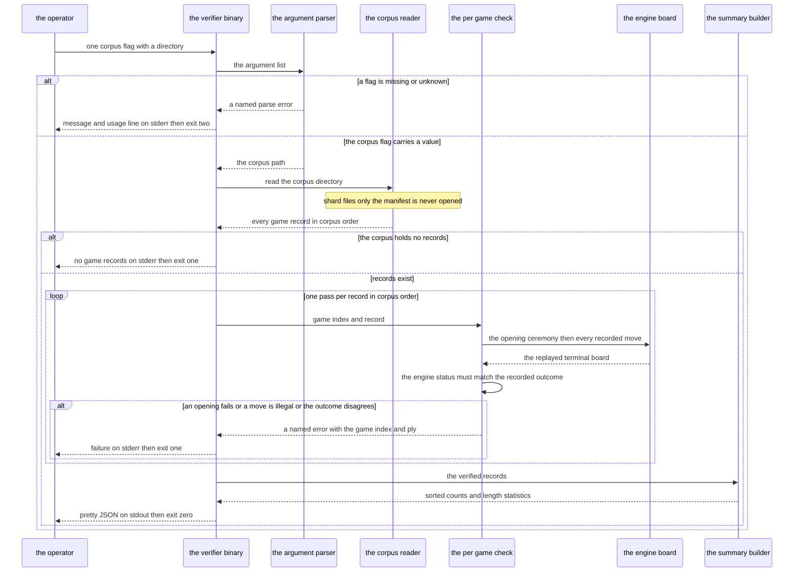
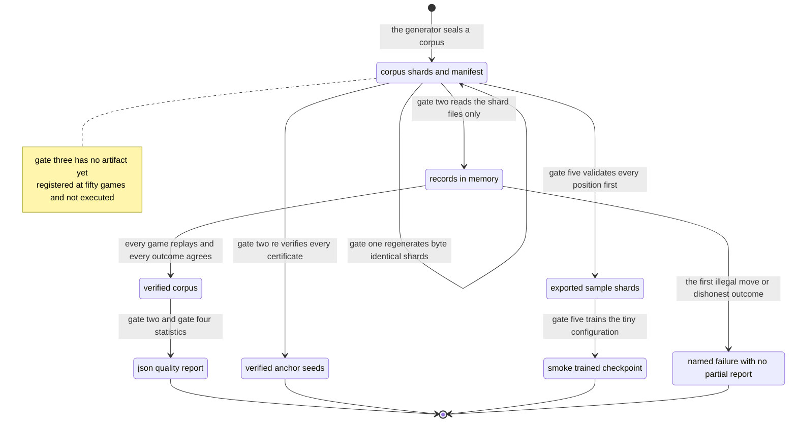

# Chapter 07 — Acceptance: design paper

## Abstract

This paper is the conceptual companion to
[chapter 07 of the selfplay-corpora tutorial](acceptance.md). The
chapter builds the `selfplayverify` binary and takes the tutorial's
five acceptance gates to their recorded status; this paper explains
why the acceptance architecture has the shape it has, and where its
evidence boundaries run. Chapters 01–06 built the pipeline being
accepted: two baseline seats play complete Swap2 games (the opening
ceremony that fixes the initial stones and assigns the colors), every
game is recorded as a durable `GameRecord`, corpora are generated at
declared pairings, certified endgame suffixes are re-verified and
extracted as anchor seeds, and the read path replays records into
training samples. Four decisions carry this chapter's design. First,
the records are the evidence and the engine is the adjudicator: the
verifier replays every opening and every recorded move through a
fresh engine board and compares the recorded outcome against the
board's own terminal status, so a corpus is accepted from primary
evidence, never from its metadata. Second, the verifier is
deliberately single-purpose: it verifies legality and outcome
agreement and it *counts* certified suffixes, while certificate
re-verification stays with the `selfplayanchors` binary and the
policy and value target contracts stay with the read path — the
acceptance legality gate runs the binaries side by side rather than
merging their passes. Third, the verifier never opens the manifest:
`read_corpus` lists and decodes shard files only, `read_manifest` is
a separate API it does not call, and the manifest-versus-shard
cross-check is implemented nowhere in the tutorial — an open
hardening gap this paper and chapters 02 and 07 record plainly rather
than a gate the design secretly satisfies. Fourth, the quality report
is a deterministic function of the corpus: every map is sorted, the
opening keys are the literal recorded path strings, and a fixed
corpus yields byte-identical JSON. The conclusions, stated up front.
The acceptance architecture proves the *stored data contract* end to
end and proves nothing about playing strength. Four of the five gates
carry measured evidence from the reference's acceptance run:
determinism (byte-identical shards across process restarts), legality
(48 of 48 games and 1 860 of 1 860 moves, 47 of 47 certificates
re-verified), the first corpus's quality report, and the integration
smoke. The fifth gate — whether simulation budget grades strength —
is pre-registered but not executed at the registered scale, because
the only graded measurement on record inverted the expectation and
that observation stands unresolved. The intended reader has read the
chapter paper and wants the reasoning behind its artifacts before
building them.

## Glossary

| Term | Definition |
|------|------------|
| **Acceptance gate** | One of the five repeatable checks of the design spec §5 — determinism, legality, grading, corpus, integration — that together decide whether the tutorial's corpus pipeline is accepted. |
| **Anchor seed** | `AnchorSeed { game_index, from_ply, line }`: a (position, forcing move, ±1) triple extracted from a certified suffix; the input format of the milestone-4 puzzle anchor set. |
| **Baseline-X** | The hand-written baseline evaluator behind the `mcts::Evaluator` seam, orchestrated by `player::AiPlayer`, running X search simulations per move decision. The simulation budget is the strength parameter. |
| **Certified suffix** | `CertifiedSuffix { from_ply, line }`: a terminal segment of a game in which every attacker move belongs to a machine-verified forced-win line produced by the engine's threat-space search prover. |
| **Claim labels** | The project's provenance labels ([docs/12-gomoku-architecture.md](../../../12-gomoku-architecture.md)): **[measured]** marks numbers recorded in the reference's acceptance logs; **[derived]** marks a value computed from cited or measured values; **[experiment]** marks a free parameter or bar to be settled by measurement; **[invention]** marks a design choice of this track; **[paper]** marks a statement from a cited paper. Statements about code behavior carry no label: they are *source-grounded*, meaning they describe the cited source file's actual text and can be checked against it. |
| **Corpus** | A set of game records produced at one declared pairing, stored as shard files plus a manifest in one directory. |
| **Deduplicated count** | A test count taken per target: each suite contributes its own tests once. Contrasts with the raw result-line count; the two differ because one test re-runs its own binary in child processes. |
| **Elo-style rating** | A relative-strength rating computed from match results. The tutorial produces none, deliberately. |
| **Fold** | A design decision whose shape exists to foreclose one specific failure mode. The closing fold table lists this chapter's folds and the evidence that each holds. |
| **Game record** | `GameRecord`: the durable serialization of one complete game — a header (seed, seat pairing, evaluator identity, the Swap2 opening), the ordered post-opening `plies`, the `outcome`, and an optional certified suffix. Chapter 02 fixed the format. |
| **Holdout split** | The train/holdout partition of the `train` crate: a sample is held out iff its canonical position's Zobrist key modulo 100 is below 10. Content-based, so holdout metrics stay comparable across sources. |
| **MANUAL test** | A slow game-playing test marked `#[ignore]` with a MANUAL comment, run by explicit selection in release mode, never by the default gate. |
| **Manifest** | The corpus writer's JSON provenance (`Manifest` in `corpus.rs`), serialized as `manifest.json`: format version, seed set, pairing, game count, shard list, and workspace version. The shards are the data; the manifest is the provenance. |
| **Opening offer / opening answer** | The three-stone opening one side places in the Swap2 ceremony, and the other side's reply (`OpeningAnswer::Take` a color, or `OpeningAnswer::AddTwo` with a final color choice). |
| **Outcome / Status** | `Outcome` is the record's terminal claim (`Won { winner, reason }` with `WinReason::FiveOrMore` or `WinReason::Resignation(..)`, or `Draw`); `engine::Status` is the board's own terminal state (`Ongoing`, `Won(Color)`, `Draw`). The verifier compares the two. |
| **Pairing** | The declared simulation budgets of the two seats of a corpus: matched (X vs X) or graded (X vs Y). Recorded in every game header. |
| **π (policy target)** | The normalized root visit-count distribution of the search at a ply; the policy training target (Silver et al. 2017). Computed from the recorded raw visit counts at read time. |
| **Pre-registration** | Fixing a measurement's protocol and its bar before running it, so the result cannot be tuned after the fact. |
| **Raw result-line count** | A test count taken by summing every `test result:` line in a log, including the lines printed by child processes. Contrasts with the deduplicated count. |
| **Replay** | Rebuilding a position by playing a record's opening and its moves through a fresh `engine::Board`. The engine is the only position representation the verification path trusts. |
| **Shard** | A fixed-capacity file of length-delimited records in the `bincode` crate's binary encoding, named `shard-NNN.bin`; the `train` crate's storage unit. |
| **Swap2** | The opening protocol of this project: one side places three stones, the other chooses a color or adds two stones, and the first side then chooses a color. |
| **The reference** | The reference implementation of this tutorial track: built test-first, gate-verified, and acceptance-measured before the tutorial was written. It lives only in a read-only worktree beside this repository; the learner's own implementation on `main` is the reference in the didactic sense. |
| **Threat-space search (TSS)** | A proof search over forced-win threat sequences (Allis 1994). The engine ships a bounded prover and a verifier; the prover may be incomplete, never unsound. |
| **Verified plies** | The report's `verified_plies` field: the total number of post-opening plies across all records, counted only after every record verified. |
| **verify_line** | `engine::verify_line(board, proof) -> bool`: the soundness net. It replays a certified line and, at every defender turn, enumerates every reply that addresses the threat; the attacker's continuation must win against all of them. Chapter 05 owns this gate. |
| **z (value target)** | The game outcome in {+1, 0, −1} from the perspective of the side to move at a ply; the value training target. Derived at read time. |
| **Zobrist key** | A 64-bit hash of a board position, maintained incrementally by the engine; used for identity, deduplication, and the holdout split. |

## Context and connected design narrative

The [chapter paper](acceptance.md) states the specification; this
paper tells the story. Seven sources supply what the chapter
combines, and each summary states what the source delivered and why
this chapter needs it.

- [Chapter 01 — the game runner](../01-the-game-runner/the-game-runner.md)
  and its
  [design paper](../01-the-game-runner/the-game-runner-design.md) —
  built the in-memory `Game` and the outcome vocabulary (`Outcome`,
  `WinReason`, including resignation). The verifier's outcome
  comparison is meaningless without the runner's semantics: a
  resignation truncates the game with the loser to move, and the
  verifier's third outcome rule exists because of it.
- [Chapter 02 — recording games](../02-recording-games/recording-games.md)
  and its
  [design paper](../02-recording-games/recording-games-design.md) —
  built the durable format the verifier reads (`GameRecord`,
  `GameHeader` with the Swap2 `Opening` and its `OpeningProvenance`,
  `RecordedPly`) and the corpus mechanics: `read_corpus` lists a
  corpus directory's `shard-*.bin` files, sorts them, and decodes
  every record; `read_manifest` is a separate API. Chapter 02's
  honesty boundary stated that a cleanly read corpus is *well-formed*,
  not *true*; this chapter supplies the missing truth check for moves
  and outcomes — and corrects the boundary on one item, the manifest
  cross-check, which chapter 02 had deferred here and which this
  chapter in fact does not implement.
- [Chapter 03 — recording the search](../03-recording-the-search/recording-the-search.md)
  and its
  [design paper](../03-recording-the-search/recording-the-search-design.md) —
  fixed the meaning of the recorded search data: sparse raw visit
  counts, sparse top-16 priors for audit, root-value estimates, and
  the honesty rule that a certified bypass move carries no search
  record. The verifier never inspects any of it; this chapter's
  context is why that restraint is correct.
- [Chapter 04 — diversity and grading](../04-diversity-and-grading/diversity-and-grading.md)
  and its
  [design paper](../04-diversity-and-grading/diversity-and-grading-design.md) —
  built the `selfplaygen` generator whose corpora this chapter
  verifies, and established the release-mode discipline for
  everything that plays games and the MANUAL-test discipline for slow
  measurements. Its three open observations — the grading probe that
  inverted the expectation, the per-seed divergence on the pinned
  grading seeds, the rejected piskvork opening list — are this
  chapter's inheritance.
- [Chapter 05 — certified endgames](../05-certified-endgames/certified-endgames.md)
  and its
  [design paper](../05-certified-endgames/certified-endgames-design.md) —
  owns the certificate gate: `extract_anchor_seeds` re-verifies every
  certified suffix with `engine::verify_line` (100 % must verify; the
  prover may be incomplete, never unsound), and the `selfplayanchors`
  binary runs the pass. This chapter's verifier *counts* certified
  suffixes; the re-verification stays chapter 05's artifact, and the
  acceptance legality gate runs both binaries.
- [Chapter 06 — reading back](../06-reading-back/reading-back.md) and
  its [design paper](../06-reading-back/reading-back-design.md) —
  built the read path whose contracts the verifier does not re-check:
  π is the normalized recorded visit histogram with a named error for
  a corrupt histogram, z is the outcome from the side to move's
  perspective, and the `selfplayexport` binary validates every
  position before writing and reads its own export back through the
  real `train` dataset reader. Its binary and the `nettrain` smoke
  are this chapter's integration gate.
- [Net tutorial](../../net-tutorial/README.md) — built `net` and
  `nettrain`, the integration gate's consumer: `nettrain --data`
  reads exported sample shards unmodified.

The [design spec](../../../specs/2026-11-11-selfplay-corpora-design.md)
§5 fixes the five acceptance gates; the
[primer](../00-selfplay-primer.md) §6 carries the measured headline
numbers and §7 the open questions. The
[hand-off](../../../specs/2026-11-11-selfplay-corpora-tutorial-handoff.md)
lists the measured numbers the chapters quote. The
[wiki's system design](../../../12-gomoku-architecture.md) §12 locks
the determinism policy and the claim-label convention this paper's
glossary defines.

### Reference provenance

The chapters of this track quote a reference implementation that was
built test-first and verified end-to-end before the tutorial was
written (design spec decision S1). It lives only in a separate,
read-only worktree beside this repository (`rust-ml-selfplay-ref`,
branch `selfplay-ref-v2`, all changes uncommitted); its measured runs
are preserved in the reference worktree's `acceptance-evidence.md`
and `acceptance-logs/` directory — raw measurement records, temporary
provenance, deleted with the worktree once the tutorial is complete
on `main`, with the load-bearing numbers preserved in the hand-off
and quoted in the chapters. This paper distinguishes three
provenance classes throughout: what lives on `main` (the `engine`,
`train`, and `net` sources, cited as links), what exists only in the
read-only reference worktree until the learner builds it (the whole
`selfplay` crate, including this chapter's binary, cited as paths,
not links), and what is scratch measurement provenance (the
acceptance logs, quoted with attribution and never re-run by the
learner). The solution papers quote the reference; they are
inspiration, not authority — the learner's own implementation on
`main` is the reference in the didactic sense.

### The problem: a written claim is not a checked claim

Chapter 04's generator leaves behind a directory of shards plus a
manifest. Everything in that directory is a *claim*: the records
claim their moves were legal and their outcomes correct; the
manifest claims a seed set, a pairing, and a game count; the
certified suffixes claim machine-verified forced wins. Chapters 02
through 06 built writers and readers for these claims, and the
readers check framing and decodability — but until this chapter,
nothing in the pipeline replays a stored game against the engine and
asks whether the record is *true*. The design question of this
chapter is which claims acceptance checks, with which adjudicator,
in which artifact, and what the checking itself may conclude. The
answer, in one sentence, is the design's central rule: the records
are the evidence, the engine is the adjudicator, the report describes
only what verified — and no acceptance artifact measures playing
strength. The rest of this paper unfolds that sentence in execution
order.

## Intention

You can explain, for every part of the acceptance architecture, why
it has the shape it has — and predict its behavior without reading
its body. Given a corpus directory, you can say why one command —
`selfplayverify --corpus <DIR>` — needs no other flag; why the
verifier reads shard files and never the manifest, and what honesty
gap that leaves; why an empty corpus is an error rather than an empty
report; why replay through a fresh engine board is the only legality
check the design trusts; why the outcome comparison has exactly three
rules and what the resignation rule checks; why the summary can call
its plies *verified*; why the report is byte-identical across runs;
and why certificates, search data, and playing strength are checked
elsewhere or nowhere. You can also state the five acceptance gates
with their artifact ownership and their status — which four carry
measured evidence, which one is pre-registered but not executed, and
why the grading inversion and the per-seed divergence are
observations, not strength conclusions.

## Prerequisites

This paper assumes the chapter paper
([acceptance.md](acceptance.md)) has been read; it explains the
reasoning, not the test list. It further assumes the working
knowledge the earlier chapters and tracks build, summarized here so
the paper stands alone:

- Chapters 01–06 of this track: what a `GameRecord` contains, how a
  corpus is written and read back, what a certified suffix claims,
  and what the read path derives. Needed because every acceptance
  decision starts from the record's fields and the sibling passes.
- The [engine tutorial](../../13-engine-tutorial/README.md): the
  bitboard `Board`, `Board::play` and its `PlayError`,
  `Board::status`, `Board::to_move`, and `verify_line`. Needed
  because the engine is the adjudicator every check in this chapter
  trusts.
- The [datagen tutorial](../../datagen-tutorial/README.md): the
  length-delimited shard framing and the manifest-as-provenance
  discipline. Needed because the corpus inherits both.
- The [net tutorial](../../net-tutorial/README.md): `nettrain`'s data
  path. Needed because the integration gate's consumer is unchanged.

## The acceptance architecture in execution order

The subsections follow one `selfplayverify` invocation from argument
to exit status, in the order execution touches each mechanism. The
reasoning folds into the step where it matters. Exactly one source
file is new — `gomoku/crates/selfplay/src/bin/selfplayverify.rs` in
the reference worktree — and the binary's private pieces, named here
at first use, are `parse_corpus` (the argument parser),
`verify_record` (the per-game check), and `Summary` with
`OutcomeCounts` and `Summary::from_records` (the report). No library
module is added; the binary consumes only existing vocabulary.

### 1. One flag, and the flags that do not exist

The vocabulary is exactly one required flag: `--corpus <DIR>`.
`parse_corpus` walks the argument list; an unrecognized argument
fails with `unknown flag: <FLAG>`, a `--corpus` without a value
fails with `--corpus requires a value`, and an empty argument list
fails with `--corpus is required`. Every parse failure prints the
message followed by the one-line usage `Usage: selfplayverify
--corpus <DIR>` to stderr and exits with code 2. Hand-rolled parsing,
no dependency, in the style of the earlier binaries — but thinner.
The sibling binaries (`selfplaygen`, `selfplayanchors`,
`selfplayexport`) carry `--help` text and several flags;
`selfplayverify` carries none of them, and each absence is a
decision, not an omission:

- **No `--help`.** The whole interface is the one flag; the usage
  line that accompanies every parse error already states it.
- **No `--json`.** The report is always JSON. An opt-in flag for the
  only output format would create a second, prose output mode that
  later tooling could parse by accident.
- **No `--anchors`.** Certificate re-verification is
  `selfplayanchors`' pass (chapter 05). Folding it in here would give
  two artifacts the same job and one artifact two jobs.
- **No `--limit`.** The verifier always reads the whole corpus.
  Limiting work is a generation-time decision (`selfplaygen
  --games`), not a verification-time one: a verified prefix is not a
  verified corpus, and a flag that produces one invites quoting the
  partial as the whole.

The fold is the same in all four absences: the binary that judges a
corpus should have exactly one way to run, so a green exit status
always means the same thing.

### 2. The shards are the corpus; the manifest is not read

`read_corpus(&corpus)` lists the directory's `shard-*.bin` files,
sorts them, and decodes every record into a `Vec<GameRecord>` —
chapter 02's mechanics, unchanged. A read failure prints
`selfplayverify failed: could not read corpus: …` and exits with
code 1. Note what the verifier reads its evidence from: the
**records**, never the manifest. `read_corpus` does not open
`manifest.json` — its source lists and decodes shard files only —
and `read_manifest`, the separate API that would, is not called by
this binary. The consequence is a deliberate direction of trust:
every number in the report is derived from the decoded games
themselves, so the report describes the data that is there, not the
provenance the writer claimed.

The honesty boundary belongs here, stated plainly, because it is the
one place the completed tutorial's checking is *weaker* than a naive
reading of "acceptance" would assume. The completed reference
performs **no manifest-versus-shard cross-check**: a manifest that
disagrees with its shards — a wrong game count, a wrong shard list, a
forged pairing — passes verification unnoticed. Chapter 02's honesty
boundary had deferred this cross-check to the acceptance chapter
alongside the replay checks; that deferral was wrong about this one
item, and the two chapters now record the gap consistently: the
cross-check is implemented nowhere in the tutorial, it is not a gate
the design secretly satisfies, and it stands as open hardening work.
What the completed reference *does* check is the replay of steps 4
and 5 below; what stays where earlier chapters put it is certificate
re-verification (chapter 05) and the policy- and value-target
contracts (π and z, chapter 06). The
pairing is worth naming explicitly: `SeatPairing` lives in every game
header, so the declared budgets are stored per game — but the
verifier reads moves and outcomes, not configurations, so it does
not confirm that the games were actually played at the manifest's
declared pairing either. Acceptance of a corpus at a declared
pairing currently rests on the generator's determinism (gate 1), not
on a configuration audit.

### 3. The empty corpus is an error, not an empty report

An empty record vector prints `selfplayverify failed: corpus
contains no game records` and exits with code 1. The fold: an empty
report would be indistinguishable from a typo'd path that happened
to be a directory — `read_corpus` on a directory without matching
shards returns an empty vector, not an error — so the binary turns
"no evidence" into a loud failure instead of a silent zero-filled
success. Acceptance never reports on nothing.

### 4. Replay: the engine adjudicates every move

`verify_record(game_index, record)` rebuilds each game from primary
evidence. `record.header.opening.board()` replays the Swap2 ceremony
into a fresh `engine::Board` (a rejection is `game <N>: opening
replay failed: …`), and then every recorded move is played in order:
`board.play(recorded.mv)`. The first rejection stops the run with
`game <N>: move <MOVE> at ply <PLY> was rejected: …`, where the
engine's own `PlayError` text supplies the reason — the chapter's
specification pins the occupied-cell case, whose engine message is
`Cell is already occupied.` Two indexing decisions carry meaning.
`game_index` is the record's position in corpus order — the same
indexing the `AnchorSeed`s of chapter 05 use — so an error message
and an anchor seed can be cross-referenced without a translation
table. `ply` counts post-opening plies, matching the record's own
`plies` vector, so the index in the error is the index in the data.
Failure handling is all-or-nothing: the run stops at the first
failing game, and no partial report exists. A corpus of ten thousand
legal games and one illegal move is a rejected corpus, not a 99.99 %
report.

### 5. The recorded outcome is a claim; the engine adjudicates it

After the last ply, the board's own `status()` adjudicates the
recorded `outcome`. Three rules, one per outcome shape:

- `Won { winner, reason: FiveOrMore }` requires
  `status == Status::Won(winner)` — the engine must see the same
  five-or-more on the board.
- `Won { winner, reason: Resignation(..) }` requires
  `status == Status::Ongoing` and `board.to_move() ==
  winner.other()` — a resignation truncates the game with the *loser*
  to move, so the replayed board must still be open with the losing
  side's turn pending. The resignation reason itself is not replayed;
  it is a decision record, not a board state.
- `Draw` requires `status == Status::Draw` — the board full, no
  winner.

Any disagreement fails with `game <N>: final status <STATUS> does not
match recorded outcome <OUTCOME>`. This is the honesty check the
whole format depends on: z, the value target, is *derived* from the
recorded outcome at read time (chapter 06), so a recorded outcome
the engine contradicts would poison every value target derived from
it — and the resignation rule is the subtle one, because it pins a
*non-terminal* board state and a side to move rather than a terminal
one.

### 6. The summary counts what verified

When every record verifies, `Summary::from_records` derives the
report. The derivation order is the honesty story: the summary is
computed only after the all-or-nothing loop has accepted every
record, so the report's counts and its adjective agree — the
`verified_plies` field (the total number of post-opening plies across
all records) counts only plies that passed replay, and on the
measured 48-game corpus it is where the "1 860 of 1 860 moves legal"
figure comes from. The opening placements themselves are replayed
(step 4) but not counted: lengths are post-opening lengths. The
fields, in the report's order:

- `game_count` — the number of records.
- `verified_plies` — as above.
- `certified_suffixes` — the number of records that *carry* a
  certified suffix. Presence is counted, not re-verified: the
  `verify_line` re-verification is `selfplayanchors`' pass, and the
  legality gate runs both binaries.
- `games_ending_within_16_plies` — the count of games with at most 16
  post-opening plies; the tactical short tail the corpus gate reports
  on.
- `min_plies`, `max_plies`, `mean_plies`, `median_plies` — the length
  summary. The median of an even count is the mean of the two middle
  values, so it can end in `.5` (the measured corpus: 48 games,
  median 27.0).
- `length_histogram_plies` — the exact length frequencies as a map
  from ply count to game count. Exact frequencies, not bins: a bin
  boundary would be an opinion, and the corpus gate's job is to
  report, not to interpret.
- `opening_offers` — one counter per opening offer, keyed by
  provenance: `Generated` for a generated opening, or
  `<list>#<index>` for a listed one, where `<list>` is the opening
  list's path *as recorded in the header* — the literal string the
  generation command was given, never normalized.
- `opening_answers` — one counter per Swap2 answer shape:
  `take_black`, `take_white`, `add_two_take_black`,
  `add_two_take_white`.
- `outcomes` — `{black, white, draw}`: the recorded outcome balance.
  Every counted outcome passed step 5's engine comparison first.

Note what the report does not contain: no seed set, no pairing, no
wall times, no strength numbers. The report is a description of the
games, derived from the games; configuration provenance stays in the
manifests the verifier deliberately does not read.

### 7. One report, always JSON, and the exit-code contract

On success the summary is serialized with `serde_json`'s pretty
printer and printed to **stdout**; the process exits with code 0. A
serialization failure would print `selfplayverify failed: could not
serialize summary: …` and exit 1. The exit-code discipline is the
binary's contract in one table: 0 means verified with a report on
stdout; 1 means a read, empty-corpus, replay, outcome, or
serialization failure with a named error on stderr; 2 means
command-line misuse with the usage line on stderr. The report is
machine-readable because corpus quality is something later tooling
and documents quote — the chapter's own gate sections parse the same
JSON the tests parse. And because the corpus is fixed input and every
map in the report is a `BTreeMap`, the report itself is
deterministic: two runs over the same corpus print byte-identical
JSON [measured — the chapter's capstone demonstrates it with a
byte comparison].

## What the verifier deliberately does not check

Three absences are design, not oversight, and each assigns the check
to its owner.

**Certificates: counted here, re-verified by `selfplayanchors`.** The
verifier's `certified_suffixes` field counts records that carry a
suffix; it never calls `verify_line`. Re-verification is chapter 05's
pass: `extract_anchor_seeds` replays each certified game to
`from_ply`, calls `engine::verify_line` on the stored line (100 %
must verify; one failure aborts the whole extraction), confirms the
played moves match the certified line, and emits the anchor seeds. A
count is not a proof: a corpus could report 47 suffixes of which zero
are sound, and only the anchor pass would notice. Splitting the two
keeps each binary single-purpose, and the acceptance legality gate
runs both — the verifier for legality and outcomes, the extractor
for certificate soundness.

**Search data and the π/z contracts: the read path's.** The recorded
visit histograms, sparse priors, and root values are never inspected
by the verifier: they are audit and training material, not legality
material. The π contract — a nonempty histogram must have positive
total mass, an empty one means no search ran — lives in the read
path, where chapter 06's tests pin the named
`SampleError::ZeroVisitTotal` failure for a corrupt histogram. The
export exercises the contract at scale: `export_corpus` replays every
position of every record before writing anything, so a π-contract
violation anywhere in the corpus fails the export; and the
`selfplayexport` binary then reads its own output back through
`train::dataset::read_dataset` — the very reader `nettrain` uses —
and requires the read-back count to match the export manifest before
it reports success. Train readability is thereby validated by the
producer through the consumer's own reader, which is exactly the
seam the integration gate measures.

**Playing strength: nothing in this chapter's artifacts.** The
verifier proves that the stored data is what it claims to be, and
the quality report describes the corpus. Whether the *player* is
strong is the grading gate's question, and that gate's status —
pre-registered, not executed, with an unresolved inverted
observation — is recorded in the gates section below.

## Primary interaction: one verification run end to end

The sequence walks one full invocation: the operator supplies the one
flag, the parser either rejects the command line with exit code 2 or
yields the corpus path, the reader loads shard files only, the
per-game check replays each record through the engine and
adjudicates its outcome, and the summary becomes pretty JSON on
stdout with exit code 0. Every failure branch stops the run; no
partial report exists.

The participants name the artifacts. The verifier binary is
`src/bin/selfplayverify.rs`; the argument parser is `parse_corpus`;
the corpus reader is `read_corpus` from chapter 02; the per-game
check is `verify_record`; the engine board is `engine::Board`; the
summary builder is `Summary::from_records`. The diagram draws the
verifier's own pass; the sibling passes the gates compose it with —
`selfplayanchors` for certificates, `selfplayexport` plus `nettrain`
for integration — run as separate invocations and appear in the
lifecycle diagram below.

## Artifact and gate lifecycle

One directory shape — shard files plus a manifest — sits at the
center of acceptance, and each gate owns a different pass over it.
The lifecycle diagram shows the states a corpus passes through and
the gate that owns each transition; the table below it fixes the
five gates, their artifacts, and their recorded status.

Three properties of the lifecycle follow from the diagram. First,
every arrow out of the corpus is a read-only pass: no gate mutates
the artifact it checks, and the only failure state is entered before
any report exists. Second, the gates are composable because the
passes are separate binaries: legality and certificates are two
arrows owned by one gate, run as two invocations. Third, gate three
has no transition and no artifact: a registered-but-not-executed
gate is a hole in the lifecycle, and the diagram draws the hole
rather than papering over it.

## The five acceptance gates: ownership, status, and evidence

The design spec §5 fixes five gates. The table fixes ownership and
status; the subsections state the evidence and its boundaries. The
measured numbers are the reference's acceptance run of 2026-11-11,
recorded in the reference worktree's `acceptance-evidence.md` and
`acceptance-logs/` — raw measurement records, temporary provenance.
The learner's fresh commands are the chapter's capstone; the two are
never mixed.

| Gate | Question | Artifact that answers | Status |
|------|----------|-----------------------|--------|
| 1 — determinism | Same seeds, same bytes, across process restarts? | `selfplaygen` run twice; the default-suite test `identical_seeds_produce_byte_identical_corpora_across_process_restarts` in `tests/corpus.rs` | Met [measured] |
| 2 — legality and certificates | Every move legal, every outcome honest, every certificate sound? | `selfplayverify` (legality, outcomes) and `selfplayanchors` (certificate re-verification) | Met [measured] |
| 3 — grading | Does simulation budget grade strength? | The pre-registered 50-game protocol in the chapter | Registered, not executed |
| 4 — corpus | What does the first corpus look like? | `selfplayverify`'s JSON report over the generated corpus | Met [measured] |
| 5 — integration | Does `nettrain` train on game-derived samples? | `selfplayexport` plus the unmodified `nettrain` | Met, as a smoke [measured] |

### Gate 1 — determinism [measured]

Same seed, byte-identical game record, across process restarts. Two
separate release invocations of `selfplaygen` (3 games, baseline-8 vs
baseline-8, seed base 424242, the three committed Gomocup freestyle
lists) produced byte-identical shards — SHA-256
`4388d84e4ce5f3c2a03017adc49df11d5aabba841c60413b1e9120a70812ae52`
for both `shard-000.bin` files — and byte-identical manifests; both
`cmp` comparisons exited 0. Both runs accepted seeds 424242–424244
and wrote one shard each; wall times 2.79 s and 2.80 s. The gate
also has a permanent default-suite anchor: chapter 02's
cross-process determinism test re-runs the test binary in two child
processes and compares bytes, so the property is re-checked by every
default gate run, not just by the acceptance measurement. **Status:
met.**

### Gate 2 — legality and certificates [measured]

Every recorded game replays through the engine without error; every
certified suffix verifies, 100 %. The gate is deliberately two
invocations of two binaries, because the two checks have two owners.
On the 48-game first corpus (`data/selfplay/v0-b32/` in the
reference worktree), the release verifier ran in 0.19 s and reported
`game_count: 48`, `verified_plies: 1860` — 48 of 48 games and 1 860
of 1 860 post-opening moves legal — and every recorded outcome
matched the replayed engine status. The certificate pass ran
separately: `selfplayanchors --corpus data/selfplay/v0-b32 --out
data/selfplay/v0-b32-anchors.json` re-verified every certified line
with `engine::verify_line` and reported `Wrote 47 verified anchor
seeds` in 0.14 s — 47 certificates from 47 distinct games, 47 of 47
verified (100 %). Every certified line in this corpus was one ply
long. The sole uncertified game was the 222-ply draw; its absence of
a certificate emitted no anchor data and no negative label —
chapter 05's honesty rule. The graded probe corpus (below) replayed
cleanly too: 20 of 20 games, 729 post-opening plies, 20 certified
suffixes present. **Status: met.**

### Gate 3 — grading [pre-registered, not executed]

The gate validates the ladder's load-bearing assumption — that the
simulation budget grades strength — which the later promotion
criterion ("the candidate beats the baseline at an equal simulation
budget") depends on. The design spec leaves the bar to the chapter
[experiment]; the pre-registration is:

- **Pairing:** baseline-800 vs baseline-200.
- **Games:** 50, in two `selfplaygen` runs of 25. The second run
  swaps the budgets across the colors (`--black-sims 200
  --white-sims 800` after `--black-sims 800 --white-sims 200`),
  because the binary declares budgets per color and no color-swapping
  exists — the swap removes the fixed-color confound of the probe
  below.
- **Seeds:** one declared seed base per run; the manifests record the
  accepted seeds.
- **Mode:** release; the exploration schedule is unchanged, because
  it is part of the matched conditions.
- **Bar** [experiment]: the higher-budget seat wins at least 30 of
  the 50 games; draws count as won by neither side. The number is a
  starting bar, not a research result — a 50-game sample cannot
  separate small strength differences, and the bar exists to detect a
  large effect or its absence.
- **Cost** [derived]: at the measured 2.56 s per baseline-32 game and
  roughly linear scaling in the budget, a 800-vs-200 game costs on
  the order of half a minute single-threaded; 50 games are tens of
  minutes on one process, minutes across a dozen parallel processes
  (one seed base per invocation, per chapter 04's process-parallel
  discipline).

**Status: registered, not executed.**

#### Why the inversion is an observation, not a strength conclusion

Two measurements on record touch strength, and both are reported
without resolution. The report-only probe: 20 games at baseline-32
(Black) vs baseline-1 (White), seeds 200000–200019, generated in
40.82 s — the budget-1 seat won 15 of 20 (75 %), no draws, the
opposite of the grading expectation. The per-seed divergence:
chapter 04's slice ran the four pinned grading seeds of
`tests/grading.rs` fresh in release, twice, and both runs agreed
seed for seed — two stronger-seat wins, one weaker-seat win, one
draw — while the reference's pinned comment records "four short
games, all won by baseline-16"; the direction assertion passed, but
the per-seed detail did not reproduce the comment.

Neither observation licenses a conclusion, and the reasons are
structural, not rhetorical. The probe's sample is small — 20 games
cannot separate budget effects from color, openings, or tactical
quirks. Its conditions confound the comparison: the exploration
schedule (temperature 1 with root Dirichlet noise for the first 10
plies; root noise is AlphaGo Zero's exploration mechanism **[paper]**
(Silver et al. 2017)) perturbs exactly the seat whose search would
otherwise exploit the weak opponent, and the probe used fixed colors
with the stronger seat always Black. And neither run was
pre-registered: an unregistered measurement can raise a suspicion,
never settle one. The divergence is weaker still: fixed seeds are
fixed inputs, not a promise that per-seed outcomes reproduce across
measurement contexts, and a passing direction assertion is the only
claim the test makes. The design's answer to an inverted expectation
is therefore procedural: register the 50-game protocol, record the
suspicion honestly, and run the gate deliberately later — whatever it
then measures is a finding about the ladder premise, not a defect of
this tutorial.

### Gate 4 — the first corpus [measured]

Build the first corpus at a declared pairing and report the numbers.
The measured corpus: 48 games, baseline-32 vs baseline-32, seeds
100000–100047, the three committed Gomocup freestyle lists, shard
capacity 16, one release process. Wall time 122.68 s — **1 408.54
games/hour**, mean 2.56 s per game — writing three shards, 200 KiB
on disk. All 48 base seeds were accepted with no derived replacement
seeds, from which one fact is *inferred*, accurately labeled: the
Zobrist-walk deduplication of chapter 04 never fired on this corpus,
because a rejected duplicate would have been re-rolled under a
derived seed and the manifest records the accepted seed set. The
quality report is the verifier's JSON (the reference worktree's
`acceptance-logs/v0-b32-verified.json`): outcomes Black 23
(47.92 %), White 24 (50.00 %), draw 1 (2.08 %) — no outcome-balance
bar was pre-registered, so the first corpus establishes the baseline;
game length min 7, median 27.0, mean 38.75, max 222 post-opening
plies, with the longest game the only draw; 10 of 48 games
(20.83 % [derived]) ended within 16 plies — a clear short tactical
tail, but 38 of 48 (79.17 %) lasted longer, so this small corpus
does not support saying that *most* games end inside the ~16-ply
prediction; opening diversity 28 of the 36 offers in the pool, the
most frequent single offer 4 of 48 times (8.33 %), list totals
2024: 23, 2025: 15, 2026: 10; Swap2 answers take Black 20, take
White 17, add two with final choice Black 6, add two with final
choice White 5; certified suffixes 47 of 48 games (97.92 %
[derived]), all re-verified under gate 2. **Status: met** — the gate
is a report; no bars beyond generation and verification were
pre-registered.

### Gate 5 — integration [measured]

`nettrain` reads a game-record shard set and trains on it. Measured
as a smoke test: `selfplayexport --corpus data/selfplay/v0-b32
--out data/selfplay/v0-b32-export --shard-capacity 512` materialized
**1 860 samples from the 48 games into 4 shards** in 0.18 s, and the
exporter's own read-back through `train::dataset` matched the
manifest's count. Then the unmodified `nettrain` trained the tiny
configuration (8 channels, 1 residual block, batch size 16) on the
export for 50 of 50 steps in 0.47 s and wrote a checkpoint. The
dataset split into 1 665 train and 195 holdout samples — the
Zobrist rule over the canonical export, 10.5 % held out. Train loss
moved from **6.5483584 at step 1 to 6.252371 at step 50**
(`metrics.jsonl`; step-50 holdout loss 6.1449027). The boundary
statement belongs to the gate: this proves the net consumed
game-derived sample shards end to end. The loss values are smoke-run
evidence only, not a model-quality assessment, and not a
playing-strength claim of any kind. **Status: met, as a smoke.**

## Determinism and the report design

The report's determinism is not a property to test for; it is a
consequence of three decisions, each made for its own reason.

**Fixed input.** The verifier reads exactly one input — the shard
files of one directory — and adds no randomness, no wall-clock time,
and no process state of its own. The report is therefore a pure
function of the corpus bytes.

**Sorted maps.** Every map in `Summary` is a `BTreeMap`:
`length_histogram_plies`, `opening_offers`, `opening_answers`.
Iteration order is key order, so serialization order is fixed. In
JSON the map keys become object keys — strings — which is why the
report shows `"6": 1` rather than `6: 1`, and why lexicographic
string order, not numeric order, sorts the opening-offer keys (the
measured report lists `…freestyle15.txt#10` before
`…freestyle15.txt#2`).

**Literal provenance keys.** The `opening_offers` keys are the
recorded path strings, exactly as the generation command's
`--openings` flag carried them: the acceptance run, launched from
the worktree root, reports
`data/openings/gomocup-2024-freestyle15.txt#4`; the chapter's
capstone, launched from `gomoku/`, reports
`../data/openings/gomocup-2024-freestyle15.txt#0` — the same list,
two spellings, because the provenance preserves the literal
argument. Normalizing the paths would make the two runs comparable
at the cost of inventing a canonicalization rule; the design keeps
the bytes and accepts the spellings.

The measured consequence: the chapter's capstone runs the verifier
twice over one freshly generated corpus and compares the two
reports — byte-identical [measured 2026-11-14, the reference's
writing-session run].

Determinism also disciplines the *test* side of acceptance.
Everything that plays games runs in release mode (chapter 04's
discipline: an 8-simulation game takes roughly 25 s in a debug
build), and the slow game-playing measurements are MANUAL tests —
`#[ignore]`d with a MANUAL comment, executed only by explicit
selection (`-- --ignored`) in release, never by the default gate.
This chapter adds exactly four tests, all default, none ignored, and
none of them plays a game: each fabricates its records by hand and
drives the compiled binary through
`env!("CARGO_BIN_EXE_selfplayverify")`, so the whole target runs in
about 0.2 s in debug [measured]. The four ignored tests at the end
of the track are exactly chapter 04's set — the two game-playing
probes in `tests/game.rs`, the scheduled-game reproducibility test
in `tests/schedule.rs`, and the grading probe in `tests/grading.rs`
— and no chapter-07 test joins them. No ignored test is silently
included in any count this paper or the chapter quotes: the
deduplicated totals state passed and ignored separately, and the
ignored set runs only when someone selects it by name.

## Counting what the gate ran: the two counting methods

The closing project gates are measured evidence too, and their
numbers carry a methodology warning. The reference's final run
(2026-11-11, from `gomoku/`) [measured]:

| Gate | Result | Wall time |
|---|---|---:|
| `cargo test -p selfplay` | 50 passed, 0 failed, 4 ignored, across 15 unique test/doc suites | 19.73 s (debug) |
| `cargo test --workspace` | 852 passed, 0 failed, 11 ignored, across 63 unique suites | 56.36 s |
| `cargo clippy --workspace --all-targets -- -D warnings` | exit 0, no warnings | 0.38 s |
| `cargo fmt --all` | exit 0 | — |

The raw logs tell a second, equally true story: the crate log shows
**52 passes across 17 result lines**, and the workspace log **854
passes across 65 lines**. Both stories come from one mechanism.
Chapter 02's cross-process determinism test
(`identical_seeds_produce_byte_identical_corpora_across_process_restarts`
in `tests/corpus.rs`) re-runs the compiled test binary twice as
child processes — `std::env::current_exe()` with one filtered test
name and an output-directory environment variable — and each child
prints its own `test result:` line (`1 passed; 9 filtered out`). The
deduplicated count takes each suite's tests once (corpus: 10 tests,
one suite); the raw count sums every result line, so the two child
executions add two lines and two passes. The arithmetic, stated once
and never mixed: **per-target (deduplicated)** counts are 50/4 for
the crate and 852/11 across 63 suites for the workspace; **raw
result-line** counts are 52 across 17 lines for the crate and 854
across 65 lines for the workspace. The chapter and this paper quote
deduplicated counts everywhere except the sentences that explain
the difference. Mixing the methods — comparing one run's raw count
against another run's deduplicated count — manufactures a
discrepancy out of a counting convention.

## The fixture flake: an observation, not a diagnosis

One fresh observation belongs to this chapter's own verification
[measured 2026-11-14, the chapter's writing session]. In one of
several repeated runs of `cargo test -p selfplay --test binary`
against the reference, two tests failed together: one with `File
exists` while writing its corpus, another with `No such file or
directory` while reading its corpus back; every re-run was green.

What is established is exactly the observed pair of errors and their
non-reproduction. What is *plausible* — an explanation, not a
finding — lives in the test fixture, not the verifier:
`tests/binary.rs`'s `TestDir` helper names its directory
`selfplayanchors-test-<pid>-<nanos>` (the prefix is historical —
chapter 05's anchor tests introduced the helper), parallel tests
share the process id, and two tests that draw the same clock
nanoseconds would share one directory; one test's `Drop` would then
delete the other's directory mid-run, which matches the observed
pair — one writer failing to create, one reader failing to find. The
failures were not instrumented, so the nanosecond-collision
mechanism is not established fact. Three boundary statements keep
the observation honest. The verifier is not implicated: the errors
surfaced in test-fixture directory handling, and the binary holds no
temporary-directory state at all. No fix has landed: the chapter
quotes counts from green runs, and if the flake ever bites during
the learner's gate, the hardening is a per-test label in the
directory name — a fixture change, never a verifier change. And the
sibling fixture shows the shape of that hardening without this paper
prescribing it: `tests/corpus.rs`'s `TestDir` takes a per-test label
and is not affected.

## Alternatives the design rejected

Each rejected alternative names the source of the decision. These
are recorded so the choices are not relitigated silently.

| Rejected alternative | Why it was rejected | Source of the decision |
|----------------------|---------------------|------------------------|
| Fold certificate re-verification into `selfplayverify` (an `--anchors` mode) | Two artifacts would share one job and one artifact would carry two. Certificates have an owner — chapter 05's `extract_anchor_seeds` with its `verify_line` gate, its bounds checks, and its played-line confirmation — and the legality gate composes the two binaries instead of merging them. | Chapter 05's ownership boundary; the acceptance legality gate running both binaries |
| Fold the π/z checks into `selfplayverify` | The π contract (positive total mass, one-hot for unsearched plies) and the z derivation are read-path semantics with their own named errors (`SampleError::ZeroVisitTotal`), pinned by chapter 06's tests and exercised at scale by the export's validate-every-position pass. Re-checking them in the verifier would duplicate the contract in a second place, free to drift. | Chapter 06's read-path ownership; the export seam |
| Treat the summary's `certified_suffixes` count as proof of certificate validity | A count of records that *carry* a suffix says nothing about soundness: a forged or corrupt suffix counts too. Only `verify_line` re-verification establishes validity, which is why the legality gate quotes the anchor pass's 47/47, not the verifier's 47, for the certificate claim. | The count-versus-re-verify split in `Summary::from_records` and `extract_anchor_seeds` |
| Trust the manifest, or cross-check it against the shards | The verifier reads the shards only; every report number derives from the decoded records, so the report cannot agree with a manifest the data contradicts. The stronger alternative — an actual manifest-versus-shard cross-check — is implemented nowhere in the tutorial and stands as an open hardening gap, recorded in chapters 02 and 07, not a gate this design satisfies. | Chapter 02's corrected honesty boundary; the chapter's walkthrough §2 |
| Silently overwrite capstone or acceptance outputs | Every writer in the pipeline refuses rather than replaces: the corpus writer refuses a non-empty output directory by default, the export refuses with no opt-in, and the anchor extractor fails with `File exists (os error 17)` when its `--out` exists. An acceptance artifact, once quoted, must be traceable to one deliberate invocation. | Chapter 02's overwrite discipline; chapter 06's stricter refusal; the chapter's capstone boundary experiment |
| Convert the grading probe or the grading smoke into an Elo-style rating or any strength claim | A 20-game unregistered probe and a four-seed direction sanity check cannot carry a rating; one inverted and the other diverged per seed. The design pre-registers a 50-game protocol with a fixed bar precisely so the eventual measurement has a stated meaning — and even that bar detects a large effect or its absence, not a rating. | The design spec §5 grading gate; chapter 04's pinned MANUAL comment ("a cheap sanity check does not become a flaky Elo estimate") |
| A `--limit` flag for partial verification | A verified prefix is not a verified corpus; the flag invites quoting the partial as the whole. Limiting work is a generation-time decision (`selfplaygen --games`). | The one-flag parse design |
| Binned length histogram | A bin boundary is an opinion; the corpus gate reports, it does not interpret. The exact frequency map costs nothing at corpus scale. | The `length_histogram_plies` field semantics |

## Design folds and the evidence that they hold

The folds below are the decisions an independent implementation is
most likely to get subtly wrong; each is pinned by a named test in
`tests/binary.rs` or by the reference's measured acceptance logs. All
four `selfplayverify_*` tests run by default, none plays a game, and
the binary target itself contributes zero unit tests — the four
integration tests are its whole specification.

| Design choice | The pitfall it forecloses | The evidence that it holds |
|---------------|---------------------------|----------------------------|
| One flag; parse failures exit 2 with the usage line | Ambiguous invocation contracts; a prose report mode growing beside the JSON one | Source-grounded: every unknown flag fails with `unknown flag: <FLAG>` plus the usage line; the chapter's capstone demonstrates it with `--json` |
| Shard-only reading; the report derives from the records | The report agreeing with a manifest the data contradicts | Source-grounded: `read_corpus` lists `shard-*.bin` only; `read_manifest` is never called by the binary |
| An empty corpus is an error, exit 1 | A typo'd directory producing a plausible empty report | `selfplayverify_rejects_a_corpus_without_game_records` (stderr contains `no game records`) |
| Replay through a fresh `engine::Board`; the engine's `PlayError` carries the reason | Trusting the file's implicit legality; inventing a second rulebook | `selfplayverify_rejects_an_illegal_recorded_move` (stderr contains `ply 1` and the engine's `occupied`) |
| The three-rule outcome comparison, resignation included | A poisoned z in every sample derived from a dishonest outcome | `selfplayverify_rejects_a_recorded_outcome_that_disagrees_with_the_engine` (stderr contains `final status` and `game 0`) |
| All-or-nothing failure; no partial report | A 99.99 % corpus quoted as accepted | Source-grounded: the run stops at the first failing game, before the summary exists |
| `game_index` in corpus order, matching `AnchorSeed` indexing | Error messages that cannot be cross-referenced with the anchor set | Source-grounded: the same `enumerate` order feeds both binaries |
| `BTreeMap` everywhere in the report | Non-deterministic key order breaking byte comparison | The measured 48-game report's sorted keys; the capstone's byte-identical double run [measured] |
| `certified_suffixes` counts presence; `selfplayanchors` owns re-verification | A count silently upgraded to a validity claim | The measured gate-2 pair: 47 counted by the verifier, 47 of 47 re-verified by the extractor [measured] |
| Unconditional pretty JSON to stdout | Later tooling parsing prose by accident | `selfplayverify_reports_replay_and_corpus_statistics_as_json` (stdout parses as JSON; the schema pinned field by field) |

The end-to-end evidence is measured, not just tested: the four
fabricated-record tests pin the failure contract and the report
schema, and the measured run applied the same binary to 48 real
games and 1 860 real moves with zero failures [measured]. What the
fabricated tests cannot pin — real visit histograms riding through
storage untouched, real tournament-opening provenance keys, outcomes
of every shape including the 222-ply draw — is exactly what the
measured corpus supplied.

## Noun catalog

### The verifier binary (this chapter; `src/bin/selfplayverify.rs`)

| Name | Kind | Role |
|------|------|------|
| `selfplayverify` | binary | The acceptance verifier: read a corpus shard-only, replay every game through the engine, adjudicate every outcome, print the JSON quality report. |
| `Summary` | private struct | The report aggregate: counts, length statistics, and the three sorted maps; serialized pretty to stdout. |
| `OutcomeCounts` | private struct | The `{black, white, draw}` outcome balance inside `Summary`. |

### The `selfplay` record layer (chapters 01–05, consumed unchanged)

| Name | Kind | Role |
|------|------|------|
| `GameRecord` | struct | The durable game: header, ordered plies, outcome, optional certified suffix. The unit the verifier replays. |
| `GameHeader` | struct | Configuration and provenance; replay executes its `opening`. |
| `RecordedPly` | struct | One played post-opening move and its durable search data. The verifier reads `mv` and nothing else. |
| `CertifiedSuffix` | struct | The terminal certified segment; counted by the verifier, re-verified by the extractor. |
| `Opening` / `OpeningProvenance` / `OpeningAnswer` | struct / enums | The Swap2 ceremony description; `Opening::board` replays it, the provenance keys the `opening_offers` map, the answer shape keys the `opening_answers` map. |
| `Outcome` / `WinReason` | enums | The record's terminal claim: five-or-more, resignation, or draw. |
| `Manifest` | struct | The corpus manifest: seeds, pairing, counts, shards, versions. Provenance the verifier never opens. |
| `read_corpus` / `read_manifest` | free functions | The shard-only corpus reader the verifier uses, and the separate manifest reader it does not call. |

### The `engine` layer (consumed, unchanged)

| Name | Kind | Role |
|------|------|------|
| `Board` | struct | The adjudicator: the opening executes into it, every recorded move replays through it, and it supplies the terminal `status()` and the side to move. |
| `Status` | enum | The board's own terminal state: `Ongoing`, `Won(Color)`, `Draw`. Compared against the recorded outcome. |
| `PlayError` | error enum | The engine's rejection of an illegal opening or move; its text carries the reason into the verifier's error message. |
| `Color` / `Move` | enum / struct | The absolute color vocabulary and one legal board cell. |

### The sibling passes (ownership boundaries; not called by the verifier)

| Name | Kind | Role |
|------|------|------|
| `selfplaygen` | binary | The corpus generator (chapter 04); the determinism gate runs it twice. |
| `selfplayanchors` | binary | The certificate pass (chapter 05); the legality gate runs it beside the verifier. |
| `extract_anchor_seeds` | free function | Re-verifies every certified suffix with `engine::verify_line` and emits the anchor seeds; one failure aborts the extraction. |
| `AnchorSeed` | struct | The extracted (position, forcing move, ±1) triple; its `game_index` shares the verifier's corpus-order indexing. |
| `selfplayexport` | binary | The export driver (chapter 06); validates every position, refuses to overwrite, reads its own output back through the consumer's reader. |
| `export_corpus` | free function | The export pass; its replay-everything validation exercises the π contract at corpus scale. |
| `train::dataset::read_dataset` | free function | The consumer-side reader the exporter reads back through and `nettrain` trains from. |
| `nettrain` | binary | The training binary (net tutorial); the integration gate's unchanged consumer. |

### The test layer (`tests/binary.rs`; this chapter adds four tests)

| Name | Kind | Role |
|------|------|------|
| `TestDir` | helper struct | The temporary directory with `Drop` cleanup; named `selfplayanchors-test-<pid>-<nanos>` — the fixture named in the flake observation. |
| `certified_record` | helper function | The fabricated six-ply record with a one-move certified suffix that all four chapter-07 tests share; no game is played. |
| `mv` | helper function | The coordinate shorthand for building moves. |
| `selfplayverify_*` | four tests | The binary's whole specification: empty corpus, illegal move, outcome disagreement, JSON report. |

### Disambiguation

- **Outcome versus Status.** `Outcome` is the record's terminal
  *claim*, written by the runner. `engine::Status` is the replayed
  board's own terminal *state*. Acceptance is the comparison of the
  two; the verbs "claims" and "adjudicates" are not interchangeable.
- **Counted versus re-verified.** The verifier *counts* certified
  suffixes (`certified_suffixes` is a presence count).
  `selfplayanchors` *re-verifies* them (`verify_line`, 100 % must
  pass). Gate 2 quotes the first number for presence and the second
  for soundness, and never substitutes one for the other.
- **Three JSON artifacts, three owners.** The corpus `Manifest`
  (chapter 02: seeds, pairing, counts) and the `ExportManifest`
  (chapter 06: counts) both serialize as `manifest.json` next to
  shard files; the verifier's quality report is a third JSON artifact
  with no file name — it exists on stdout. None of the three readers
  consults another's schema.
- **Verified plies versus recorded plies.** The record's `plies`
  vector holds every post-opening ply; the report's `verified_plies`
  is their total count, legitimate as an adjective only because the
  summary is computed after every record passed replay. The Swap2
  opening placements are replayed but counted in neither — lengths
  are post-opening lengths.
- **Deduplicated versus raw counts.** The deduplicated count takes
  each suite's tests once (50 passed, 4 ignored, 15 suites for the
  crate). The raw result-line count sums every `test result:` line
  in the log (52 across 17), including the two lines printed by the
  corpus target's child processes. Never mix the two.
- **Gate, two senses.** The *acceptance gates* are the design spec
  §5's five checks. The *project gates* are `cargo test`,
  `cargo clippy`, and `cargo fmt` — the commands that must be green
  before any commit. This paper always qualifies which one it means.
- **Verify, two scopes.** The binary's name promises legality and
  outcome agreement over a corpus. `verify_line` promises soundness
  of one certified line at one position. The second is a subroutine
  of chapter 05's pass, not of this chapter's.

## Verb catalog

Contracts only — receivers, methods, what they consume, what they
produce. The construction itself is the learner's work, layered in
the implementation plan.

### The CLI layer (`src/bin/selfplayverify.rs`; this chapter)

| Receiver | Method | Consumes | Produces |
|----------|--------|----------|----------|
| — (private function) | `parse_corpus` | the argument iterator | `Result<PathBuf, String>` — the corpus path; `unknown flag: <FLAG>`, `--corpus requires a value`, or `--corpus is required` |
| — (private function) | `verify_record` | a corpus-order game index and a borrowed `GameRecord` | `Result<(), String>` — `Ok` when the opening replays, every move is legal, and the engine's status matches the recorded outcome; a named error with the game index (and ply, for a move failure) otherwise |
| `Summary` | `from_records` | the verified records | a `Summary` — counts, length statistics, sorted maps; only ever called after every record verified |
| — | `main` | the process arguments | exit 0 with pretty JSON on stdout; exit 1 with a named failure on stderr; exit 2 with the usage line on stderr |

### The consumed layers (unchanged)

| Receiver | Method | Consumes | Produces |
|----------|--------|----------|----------|
| — (free function) | `read_corpus` | a corpus directory path | `io::Result<Vec<GameRecord>>` — every `shard-*.bin` in lexicographic order, decoded in record order; the manifest is not consulted |
| `Opening` | `board` | the stored ceremony description | `Result<Board, PlayError>` — the post-ceremony position through the engine's Swap2 typestate |
| `Board` | `play` | one move | legality-checked play; `PlayError` on rejection |
| `Board` | `status` / `to_move` | the replayed board | the terminal state; the side to move — the two inputs of the outcome comparison |
| — (free function) | `serde_json::to_string_pretty` | the `Summary` | the report text for stdout |

### The sibling passes (not called by the verifier)

| Receiver | Method | Consumes | Produces |
|----------|--------|----------|----------|
| — (free function) | `extract_anchor_seeds` | the corpus records | `Result<Vec<AnchorSeed>, AnchorError>` — every certified suffix re-verified with `verify_line`; one failure aborts |
| — (free function) | `engine::verify_line` | a board and a proof line | `bool` — the certificate soundness net |
| — (free function) | `export_corpus` | records, an output directory, a shard capacity | `Result<ExportManifest, ExportError>` — every position replayed before the directory is touched |
| — (free function) | `train::dataset::read_dataset` | a dataset directory | `io::Result<Vec<Sample>>` — the consumer's reader the exporter reads back through |

## Central design rule and invariants

**Central rule:** the records are the evidence, the engine is the
adjudicator, and the report describes only what verified — acceptance
proves the stored data contract, and no acceptance artifact measures
playing strength.

1. **The shards are the corpus.** The verifier reads shard files
   only; `read_manifest` is a separate API it never calls. Every
   report number derives from the decoded records, and the
   manifest-versus-shard cross-check is an open hardening gap,
   recorded in chapters 02 and 07 — not a gate this design secretly
   satisfies.
2. **The engine is the only adjudicator.** Every opening and every
   move replays through a fresh `engine::Board`, and the recorded
   outcome must match the board's own status — three rules, the
   resignation rule pinning an open board with the loser to move. No
   second rulebook exists anywhere in the verification path.
3. **Failure is all-or-nothing.** The first failing game stops the
   run with a named error carrying the corpus-order game index and
   the post-opening ply; no partial report exists.
4. **The report is a deterministic function of the corpus.** Fixed
   input, `BTreeMap` key order, literal provenance path strings:
   two runs over the same corpus print byte-identical JSON
   [measured].
5. **Ownership is single-purpose.** Certificates are counted by the
   verifier and re-verified only by `selfplayanchors`; the π/z
   contracts live only in the read path and are exercised at scale by
   the export; train readability is validated by the exporter through
   the consumer's own reader. The legality gate composes binaries; it
   does not merge them.
6. **The exit codes are the contract.** 0 verified with a report; 1
   named failure; 2 command-line misuse with the usage line. There is
   exactly one way to run the binary, so a green exit always means
   the same thing.
7. **The default gate stays fast and honest.** Four fabricated-record
   integration tests, none ignored, no game played, zero unit tests
   on the binary; the MANUAL set stays at chapter 04's four and runs
   only by explicit selection in release.
8. **Counts are quoted deduplicated, never mixed with raw.** 50/4
   across 15 suites and 852/11 across 63 are the contract; the raw
   52/17 and 854/65 lines exist because one test re-runs its own
   binary in two child processes, and the two methods are never
   combined in one comparison.
9. **Observations are reported, not resolved.** The grading
   inversion, the per-seed divergence, the fixture flake, and the
   rejected piskvork list stand as recorded observations; none is a
   strength conclusion, a diagnosis, or a silently fixed defect.
10. **Measured numbers carry their provenance.** Every [measured]
    figure quotes the reference's acceptance logs of 2026-11-11 (or
    the dated writing-session runs of 2026-11-14); the learner's
    fresh capstone runs are separate evidence, never mixed with the
    reference's.

## References

**This chapter:**

- [acceptance.md](acceptance.md) — the chapter paper: intention,
  specification as tests, the execution-order walkthrough, the five
  gates with their measured evidence, the open observations, and the
  capstone.
- [acceptance-implementation.md](acceptance-implementation.md)
  *(planned)* — the hiding layer: low-level construction
  instructions, signatures in prose, method bodies never.
- [acceptance-solution.md](acceptance-solution.md) *(planned)* — the
  annotated reference snippets.

**This track:**

- [Tutorial README](../README.md) — conventions, gates, the chapter
  map, and the reference provenance.
- [Self-play primer](../00-selfplay-primer.md) — §6 the five
  acceptance gates with the measured headline numbers; §7 the open
  questions.
- [Chapter 01 — the game runner](../01-the-game-runner/the-game-runner.md)
  and its [design paper](../01-the-game-runner/the-game-runner-design.md)
  — the outcome semantics, including the resignation the verifier's
  third rule adjudicates.
- [Chapter 02 — recording games](../02-recording-games/recording-games.md)
  and its [design paper](../02-recording-games/recording-games-design.md)
  — the `GameRecord` format, the shard-only `read_corpus`, the
  separate `read_manifest`, the corrected honesty boundary, and the
  cross-process determinism test whose child processes explain the
  two counting methods.
- [Chapter 03 — recording the search](../03-recording-the-search/recording-the-search.md)
  and its [design paper](../03-recording-the-search/recording-the-search-design.md)
  — what the recorded search data means, and why the verifier leaves
  it untouched.
- [Chapter 04 — diversity and grading](../04-diversity-and-grading/diversity-and-grading.md)
  and its [design paper](../04-diversity-and-grading/diversity-and-grading-design.md)
  — `selfplaygen`, the release-mode and MANUAL-test disciplines, the
  grading probe and its pinned seeds, and the open observations this
  chapter inherits.
- [Chapter 05 — certified endgames](../05-certified-endgames/certified-endgames.md)
  and its [design paper](../05-certified-endgames/certified-endgames-design.md)
  — the certified suffix, `verify_line`, `extract_anchor_seeds`, and
  the `selfplayanchors` pass the legality gate runs beside the
  verifier.
- [Chapter 06 — reading back](../06-reading-back/reading-back.md) and
  its [design paper](../06-reading-back/reading-back-design.md) — the
  π/z contracts the verifier does not re-check, the export's
  validate-then-write and read-back self-check, and the integration
  smoke this chapter records as gate 5.
- [Design spec](../../../specs/2026-11-11-selfplay-corpora-design.md) —
  §5 the five acceptance gates; S7 the retired mock-strength probe.
- [Tutorial hand-off](../../../specs/2026-11-11-selfplay-corpora-tutorial-handoff.md) —
  the measured acceptance evidence the gates quote and the open
  questions carried honestly.
- [docs/12-gomoku-architecture.md](../../../12-gomoku-architecture.md) —
  §12 the determinism policy and the claim-label convention this
  paper's glossary defines.
- [docs/14-openings-and-supervised-curriculum.md](../../../14-openings-and-supervised-curriculum.md) —
  §3 the Swap2 procedure and the tournament opening lists whose paths
  key the report's `opening_offers` map.

**Prerequisite tracks:**

- [Engine tutorial](../../13-engine-tutorial/README.md) — the
  bitboard `Board`, `Status`, `PlayError`, and `verify_line`: the
  adjudicator every check in this chapter trusts.
- [Datagen tutorial](../../datagen-tutorial/README.md) — the shard
  and manifest storage discipline the corpora inherit.
- [Net tutorial](../../net-tutorial/README.md) — `nettrain`, the
  integration gate's consumer.

**Source (live on `main`, consumed unchanged):**

- [`gomoku/crates/engine/src/board.rs`](../../../../gomoku/crates/engine/src/board.rs) —
  `Board::play`, `Board::status`, `Board::to_move`, `Status`,
  `PlayError`: the adjudicator's surface.
- [`gomoku/crates/train/src/dataset.rs`](../../../../gomoku/crates/train/src/dataset.rs) —
  `read_dataset`: the consumer's reader the exporter reads back
  through.
- [`gomoku/crates/net/src/bin/nettrain.rs`](../../../../gomoku/crates/net/src/bin/nettrain.rs) —
  the integration gate's unchanged consumer.

**Source (in the read-only reference worktree; lands on `main` as the
track is worked):**

- `gomoku/crates/selfplay/src/bin/selfplayverify.rs` — new: the
  verifier binary (`parse_corpus`, `verify_record`, `Summary`,
  `OutcomeCounts`, `main`). Created in this chapter.
- `gomoku/crates/selfplay/tests/binary.rs` — the four
  `selfplayverify_*` specification tests beside the three existing
  binary tests; the `TestDir` helper the flake observation names.
  Touched in this chapter.
- `gomoku/crates/selfplay/src/record.rs`,
  `gomoku/crates/selfplay/src/opening.rs`,
  `gomoku/crates/selfplay/src/game.rs`,
  `gomoku/crates/selfplay/src/corpus.rs` — the consumed vocabulary:
  `GameRecord` / `GameHeader` / `RecordedPly` / `CertifiedSuffix`,
  `Opening` / `OpeningProvenance` / `OpeningAnswer`, `Outcome` /
  `WinReason`, `read_corpus` / `read_manifest` / `Manifest`. Not
  touched in this chapter.
- `gomoku/crates/selfplay/src/anchor.rs` and
  `gomoku/crates/selfplay/src/bin/selfplayanchors.rs` — the
  certificate pass the legality gate runs beside the verifier. Not
  touched in this chapter.
- `gomoku/crates/selfplay/src/export.rs` and
  `gomoku/crates/selfplay/src/bin/selfplayexport.rs` — the export
  pass whose validation exercises the π contract at scale. Not
  touched in this chapter.
- `gomoku/crates/selfplay/tests/corpus.rs` — the cross-process
  determinism test with its two child-process result lines, and the
  labeled `TestDir` the flake observation contrasts with. Not touched
  in this chapter.
- `gomoku/crates/selfplay/tests/grading.rs` — the pinned grading
  probe whose comment the per-seed divergence is measured against.
  Not touched in this chapter.
- `gomoku/crates/train/src/storage.rs` — the shared shard mechanics
  `read_corpus` decodes through. Extracted by chapter 02; not touched
  in this chapter.

**Scratch measurement provenance (temporary, deleted with the
worktree):**

- `acceptance-evidence.md` and `acceptance-logs/` in the reference
  worktree (`rust-ml-selfplay-ref`, branch `selfplay-ref-v2`) — the
  raw measurement record behind every [measured] label in this
  paper; the load-bearing numbers are preserved in the hand-off and
  quoted in the chapters.

**External sources:**

- Silver, D. et al. (2017). *Mastering the Game of Go without Human
  Knowledge* (AlphaGo Zero). <https://doi.org/10.1038/nature24270> —
  the (s, π, z) record format whose stored-data contract this
  chapter verifies, and the root Dirichlet noise of the exploration
  schedule the grading caveats discuss.
- Allis, L. V. (1994). *Searching for Solutions in Games and
  Artificial Intelligence*. PhD thesis, Maastricht University.
  <https://doi.org/10.26481/dis.19940923la> — threat-space search,
  the prover whose certificates the legality gate re-verifies.
